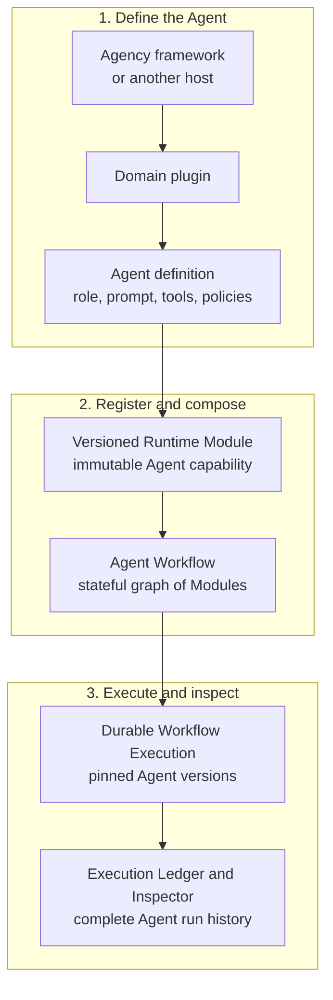
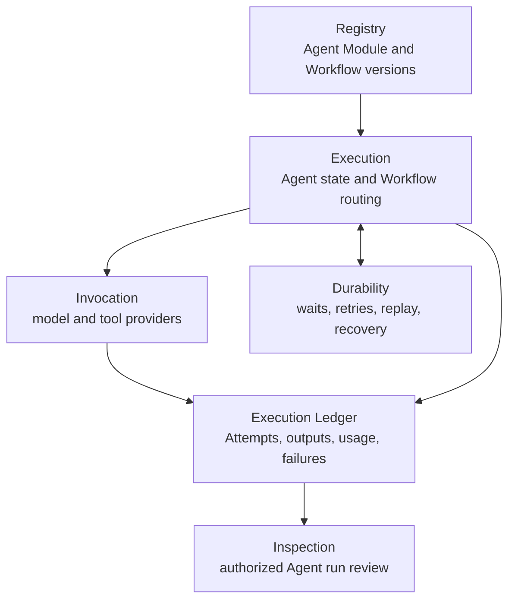
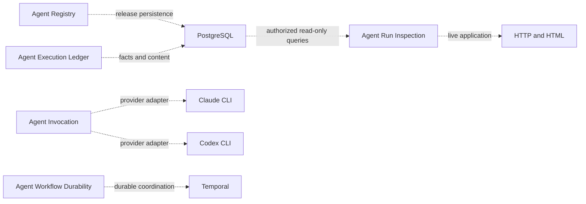
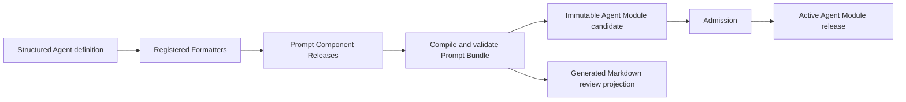
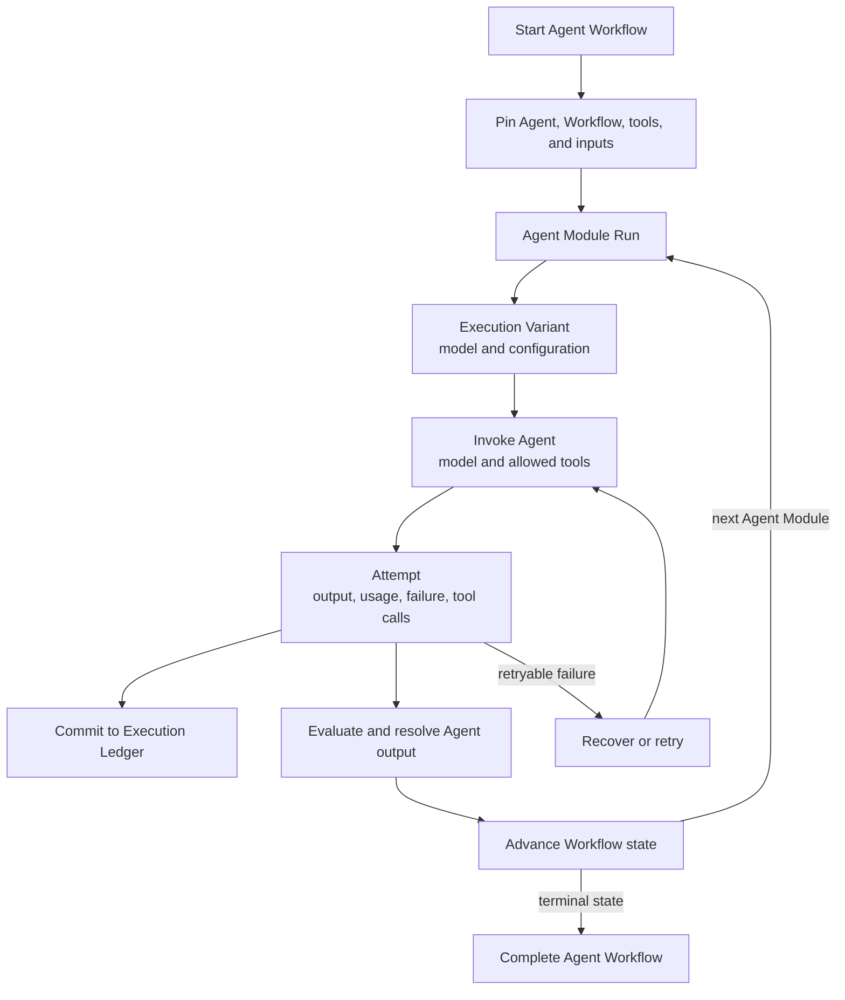

# Agent Runtime for Windows

**Agent Runtime 在 Windows 上运行有版本的 Agent 任务，也能接入带项目指令、业务 skills、MCP 和 Python 依赖的 Claude Code／Codex 原生项目。每次执行通过统一入口启动，并交回结构化结果和运行记录。**

业务项目负责定义 Agent 要完成什么工作、需要什么输入、怎样的结果才有业务意义。Runtime 负责把这份
定义放进统一的运行环境，准备执行配置和资源，管理执行过程，并向调用方交回结果及可追查的运行记录。
各个业务项目可以共用这套底座，同时保留自己的任务内容和业务流程。

在评测场景中，题库、参考答案、业务评分、批量实验和成绩比较由调用方或平台组织。Runtime 提供单次任务的
执行与证据：技术执行状态、实际配置、工具调用、产物位置和用量；业务判定使用这些记录及所属项目的评分规则。

这里的封装环境包含四个部分：

| Runtime 稳定下来的部分 | 对业务项目意味着什么 |
| --- | --- |
| **任务定义与版本** | 任务指令、输入输出格式和运行能力作为有版本的定义保存。调用时能确定执行的是哪一份定义；这类独立任务单元在 Runtime 中叫 `Module`。 |
| **运行配置与资源准备** | 按已声明的运行要求和本次参数，组装模型、运行时限、输入材料、工作目录、文件读写能力以及已有 MCP 连接，再交给所选执行器。 |
| **执行生命周期** | 通过统一入口启动任务，处理完成、失败、超时和取消，保留每次尝试的状态；重试与持久恢复遵循对应的运行配置和后端合同。 |
| **结果与记录交接** | 按约定格式接收结果，记录实际使用的定义与配置、输入、输出、日志和用量，供上层程序或 Agent 继续处理、测试和查询。 |

这样，一个“审核 Agent”可以先被单独注册和测试，再被不同的业务流程调用；业务方也可以把多个 Module
按自己的流程组合成 Workflow。更换受支持的模型时，任务定义可以保持不变，本次执行配置单独记录。
标识符、hash、执行引用等机器字段由代码生成和传递。

Windows 版本目前通过 **Claude Code CLI（`claude -p`）和 Codex CLI（`codex exec`）** 执行模型任务；
**Antigravity CLI（`agy`）** 的首个绑定只支持 `structured_output` 与 `file_review` 两种环境。
它们是这个封装环境中的执行器。CLI 内部怎样思考、读写文件、运行工具和调用 MCP，由 CLI 自己处理；
Runtime 维护任务外层的定义、配置、生命周期和交接。业务结论的正确性仍由任务所属项目判断。

<a id="agent-entry-paths"></a>

## 先选接入方式：Module 任务或原生项目

两种方式都使用已注册的 Module 保存任务合同和能力要求，也都返回结构化结果与运行记录。

| 你的任务从哪里来 | 接入方式 | 本次调用的关键选择 |
| --- | --- | --- |
| 已有一份任务 prompt、输入输出格式，按它完成审核、分析、写作或文件处理 | **默认 Module 调用**：按定义和本次输入执行；Claude／Codex 的原生项目指令与业务 skills 保持关闭 | 从下方四种预设选择工具与工作区，提供输入及相应资源 |
| 已有 Claude Code／Codex 项目，希望保留项目指令及多个业务 skills，由 Agent 在一次任务中自主选择方法 | **原生项目调用**：保留 Module 合同，由 CLI 按原生规则发现项目指令与 skills | 注册为 `code_change` 或 `mcp_data`，传 `--project-directory` 与 `--native-project`；Codex 另加 `--codex-execution-mode host` |

`--native-project` 是每次调用的选项，与工具／工作区预设分别选择。Claude 使用 `CLAUDE.md` 和
`.claude/skills/`；Codex 使用 `AGENTS.md` 和 `.agents/skills/`。每次是独立的 `claude -p` 或 `codex exec`，
已有 MCP 连接由 Module 选择，业务 Python 的解释器和依赖由项目准备。

已有原生项目可直接从[原生项目接入说明与调用示例](#native-project)开始；首次确认宿主能否运行该模式，使用
[随包 `native_project` 样例](#runnable-examples)。该样例使用随包的本地 MCP fixture，不连接宿主的业务 MCP 或数据库，
需要安装 `[cli_tools]` 可选依赖。

<a id="four-common-patterns"></a>

## 四种常用运行环境 / Environment presets

**按任务需要哪些工具、文件写到哪里、是否连接 MCP 来选择环境。** 同一个环境可以执行审核、写作、分析、
文件转换或其他任务；做什么、检查什么、采用什么业务标准，都由 prompt 定义。

下面用运行环境描述名称。第二行列出当前 API／CLI 接受的 preset ID，注册时使用该值。
“开启”表示 Module 明确声明了这项工具能力，实际由所选 CLI 提供。

| 能力或配置 | 无工具环境 | 独立任务工作区 | 项目工作区 | 项目工作区＋MCP |
| --- | --- | --- | --- | --- |
| **当前 preset ID** | `structured_output` | `file_review` | `code_change` | `mcp_data` |
| **读取文件 `read`** | 关闭 | 开启 | 开启 | 开启 |
| **写入／编辑文件 `edit`** | 关闭 | 开启 | 开启 | 开启 |
| **搜索工具 `search`** | 关闭 | 开启 | 开启 | 未单独声明 |
| **执行命令 `shell`** | 关闭 | 开启 | 开启 | 开启 |
| **调用 MCP 工具** | 关闭 | 关闭 | 关闭 | 开启选定连接；至少选一个 |
| **原生项目指令与业务 skills** | 不适用 | 不适用 | 可显式加 `--native-project` | 可显式加 `--native-project` |
| **CLI 的工作目录（cwd）** | 不提供可写任务目录 | Claude：本次 Attempt 的 `work/`（内含只读 `materials/` 与 `scratch/`）；Codex、Antigravity：本次的 `scratch/` | 调用者指定的项目目录（Antigravity 不支持） | 调用者指定的项目目录（Antigravity 不支持） |
| **文件写到哪里** | 模型不写文件，直接返回结果 | 只写入本次的 `scratch/` 草稿目录，材料副本保持只读 | 在指定项目目录中创建或修改文件 | 在指定项目目录中创建或修改文件 |
| **工具联网配置** | 无任务工具，额外工具网络关闭 | 沿用 CLI／宿主配置 | 沿用 CLI／宿主配置 | 沿用 CLI／宿主及所选连接配置 |

工作目录与可写目录不一定相同：独立任务工作区里，Claude 在 `work/` 运行而只写 `scratch/`。每次 agent 调用的
stdin 开头都有一段由代码生成的 `## Runtime Invocation Locations`，给出本次实际的工作目录、可写目录、
只读材料目录、选定的只读依赖与 Runtime Python；调用方和 Agent 以它为准，不按目录名推测位置。
`TMPDIR`、`TEMP`、`TMP` 都指向本次调用的临时文件夹。

这张表区分工具声明和实际执行方式：Codex 的文件读取、编辑与搜索均通过原生 Shell 完成；
Claude 使用原生文件工具和 Bash。MCP 预设虽然没有单独声明 `search`，仍可通过已允许的 Shell 命令搜索。
“Shell 开启”表示可以使用命令工具。默认 Module 调用中，Claude 需要额外允许的命令由宿主用
`--command-permit` 提供，Codex 使用自己的权限配置与 execpolicy。原生项目调用中，Shell 使用执行账号的
宿主权限，`--command-permit` 不适用；具体工具和配置见[原生项目模式](#native-project)。
Antigravity 用原生 `view_file`、`write_to_file`、`replace_file_content` 读写文件，搜索经原生 Shell；它只运行
`--command-permit` 明确允许的命令（渲染为本次会话设置中的 `command(<permit>)`，已实测写法见
[Antigravity 执行](docs/agent_runtime_claude_native_tools.md#5-antigravity-执行首个绑定)），没有许可即不运行命令。

### 怎样选择和提供资源

| 你需要的运行条件 | 选择 | 本次要提供的资源 |
| --- | --- | --- |
| 所有信息都在输入中，模型只需返回结果 | **无工具环境** | `--input` 中的完整任务输入；不提供文件工具或项目工作区 |
| 让模型读材料、运行命令、生成文件，并把产物放在本次独立目录 | **独立任务工作区** | 输入；需要文件材料时，用 `--material-root` 配合 `--material` 选择文件，或明确 `--all-materials` |
| 让模型直接在你指定的目录中工作，留下新文件或修改已有文件 | **项目工作区** | 输入和 `--project-directory`；目录中可以是文档、数据、代码或其他任务文件 |
| 上述项目目录能力之外，还需要调用已有外部工具或数据服务 | **项目工作区＋MCP** | 输入、`--project-directory`；注册时用 `--mcp-connection` 选择连接名，宿主在 `.runtime/config.json` 配置同名连接 |

例如，生成一份新报告可以使用独立任务工作区，也可以使用项目工作区，取决于产物应放在哪个目录。
MCP 环境可以使用所选服务提供的工具；具体工具操作由 prompt 和服务端已有授权决定。Runtime 只传递
选定连接配置，服务登录、凭据与授权仍由宿主和服务维护。

`--project-directory` 选择本次工作位置；加载该目录的原生项目指令和业务 skills，还需显式选择
`--native-project`。业务 Python 与 Runtime Python 可以是不同环境，项目指令或 skill 应写明所需解释器。

### 所有预设共用的能力与配置

- **结构化结果与运行记录：** 四个预设都按任务声明的输出 schema 返回结果，并保留状态、日志与可取得的用量。
  `structured_output` 这个当前接口名所对应的区别是“没有任务工具”；结构化结果是四种环境的共同输出方式。
- **任务输入与上下文：** 都使用本次独立执行上下文，语义输入以内联方式交给模型。文件模式另外提供材料或项目目录，
  模型使用已开放工具读取。输入内容和业务指令由任务方提供。
- **模型、effort 和时限：** 与预设分开选择。执行时通过 `--transport`、`--model`、`--effort`、
  `--run-timeout-seconds` 或执行参数文件提供；不会因为任务叫“审核”或“分析”就另选一套系统配置。
- **任务定义与尝试次数：** 工具和工作区要求随 Module 版本保存；四个预设默认 `max_attempts=1`，注册时可显式设置。
  已注册任务保持自己的配置，后续调用读取该定义。

当前这些快捷预设中，MCP 连接由 `mcp_data` 提供，其他三个 ID 不接收 MCP 连接名。
可用组合和执行器差异以当前代码为准。每种环境都有[可运行样例](#runnable-examples)，完整字段见
[预设参数与 CLI 差异](#preset-reference)。

## 以一个审核 Agent 为例

一个项目希望用 AI 审核设计文档，可以这样接入：

1. **项目提供审核定义。** 在 prompt 中写明检查内容、审核标准和步骤；另行声明输入材料与输出格式，例如“结论、问题列表、每个问题的依据”。
2. **Runtime 封装这项能力。** 将定义注册为有版本的 Module，选择独立任务工作区（当前 ID 为 `file_review`），并提供独立运行与查看记录的入口。
3. **每次调用选择材料和执行配置。** 项目指定这次审核的文档、所选 Claude／Codex 模型及运行参数；Runtime 据此准备工作目录和实际调用。
4. **上层按统一方式取回结果。** Runtime 交回执行状态、审核结果和记录。项目判断业务结论、决定下一步；后续也能查询这次实际运行了什么。

同一个审核定义可以独立测试、重复调用，也可以成为更大业务流程中的一个步骤。Runtime 提供共同的执行环境，
项目维护自己的审核标准和流程。产品总纲与 Runtime 总章的位置见[随包设计文档入口](#source-and-design-contract-map)。

## 第一次使用，从这里开始

1. **安装 Runtime 和操作 Skills：** 按[Clone 后安装 Runtime 和 Skills](#clone-and-install-skills)准备你的业务项目。
2. **按接入方式跑样例：** 已有原生项目时选 `native_project`，检查项目指令、skill、MCP 和 Python 的实际使用；默认 Module 调用按任务需要选择四种预设对应的[样例](#runnable-examples)，只需确认模型调用时可选 `structured_output`。
3. **换成自己的任务或项目：** 使用随包的 `agent-runtime-usage` Skill 选择要求，再按[注册与运行 Runbook](docs/agent_runtime_registration_runbook.md)注册任务、准备输入，并按所选接入方式调用。

查看、留档、升级或查接口等其他操作，见[按任务开始](#start-by-task)。

Runtime 对外提供 Python API 和命令行工具。随包三份 Runtime 操作 Skills 指导 Claude／Codex 选择模式、
注册和运行任务；项目已有的业务 skills 则在原生项目模式中由 CLI 发现和使用。安装后可以直接让项目里的 Agent：

> 使用 agent-runtime-usage，帮这个项目接入一个文件审核任务。先说明推荐模式、需要我提供的材料，以及从哪个样例开始。

<a id="current-status"></a>

## 当前版本与运行条件

当前发布为 **`agent-runtime-core 0.2.0.dev22`，Windows 开发版（Pre-Alpha）**。

- [GitLab 源码](https://dacazscegit001.dymonasia.com/ai-fellowship-equities/els-ai-pack/agent-runtime-windows)
- [下载安装包（Releases）](https://dacazscegit001.dymonasia.com/ai-fellowship-equities/els-ai-pack/agent-runtime-windows/-/releases)
- [Package Registry](https://dacazscegit001.dymonasia.com/ai-fellowship-equities/els-ai-pack/agent-runtime-windows/-/packages)

普通本地运行需要 Windows 11、Python 3.11+，以及已安装并登录的 Claude Code CLI、Codex CLI，或（仅
`structured_output` 与 `file_review`）Antigravity CLI。
使用文件、代码或 MCP 模式时，还需要提供相应目录、材料或连接。普通 Test Run 的记录保存在本地；
PostgreSQL 和 Temporal 是需要宿主另行配置的可选集成。跨进程持久恢复需要接入对应存储和执行后端。

运行成功表示任务完成了技术执行，业务结果是否正确仍由调用方判断。
本发布的验证范围、平台限制与真实运行开关见[平台与显式扩展限制](#platform-and-extension-limits)和
[真实 CLI 用例开关](#live-run-gates)。

<a id="install-and-first-run"></a>

### 安装与第一次运行 / Install and first run

安装包和随包 Skills 需要 Python 3.11+；实际运行模型时还需要所选 CLI 的已安装程序与宿主自己的 CLI 登录。
已 clone 仓库的使用者，直接按下方 [Clone 后安装 Runtime 和 Skills](#clone-and-install-skills) 完成项目接入。
有本项目访问权限的使用者，可通过已配置 GitLab 登录的 Git 安装源码：

```sh
python -m pip install "agent-runtime-core @ git+https://dacazscegit001.dymonasia.com/ai-fellowship-equities/els-ai-pack/agent-runtime-windows.git@main"
# 或使用源码 checkout
git clone https://dacazscegit001.dymonasia.com/ai-fellowship-equities/els-ai-pack/agent-runtime-windows.git
python -m pip install ./agent-runtime-windows
```

`main` 是本 GitLab 项目的 Windows 发布分支；需要固定版本时，把 `@main` 换成发布 tag
（例如 `@v0.2.0.dev22-windows`）或该版本的完整 commit。

也可以从上方 Releases 或 Package Registry 下载 wheel，再在 PowerShell 安装本地文件：

```powershell
python -m pip install .\agent_runtime_core-0.2.0.dev22-py3-none-any.whl
```

安装后，用一条命令准备要使用 Runtime 的业务项目（`--provider` 取 `claude`、`codex` 或 `both`）：

```powershell
agent-runtime-setup --root "C:\work\my_project" --provider both
```

它在项目中安装三份 Runtime Skills，并找到所选 CLI 的原生程序：依次查看已有配置、PATH 上的原生程序，
最后查看 npm 安装包里的固定位置，然后把程序位置写入 `.runtime\config.json`。它还会读取 CLI 自己的版本与
登录状态，最后打印一份 JSON 报告，列出已准备的内容、还缺什么和下一步命令。它不会登录、不调用模型，也不批准任何
工具权限。报告中缺少的 Provider 登录或 MCP 登录／授权由本人在原生 CLI 中完成，之后再运行报告给出的
验证命令（详见[项目 setup](docs/agent_runtime_registration_runbook.md#local-runtime-setup)）。
程序化宿主仍可直接调用 `from agent_runtime import setup_runtime` 只安装 Skills。仅安装 wheel 不会自动修改项目目录。
可选依赖写在包名之后，例如 `"agent-runtime-core[cli_tools] @ git+https://dacazscegit001.dymonasia.com/ai-fellowship-equities/els-ai-pack/agent-runtime-windows.git@main"`：
`[cli_tools]`（`mcp` 包：记录型命令、任务 callback 进程桥，以及 `mcp_data`／`native_project` 样例的 MCP fixture）、
`[postgres]`（PostgreSQL 定义与执行存储，以及 `agent-runtime-archive` 的中央留档）、`[temporal]`（Temporal 协调）。
普通 Test Run 不需要它们。安装后核对实际版本（本说明对应 `0.2.0.dev22`）和命令：

```sh
python -c "from importlib.metadata import version; print(version('agent-runtime-core'))"
agent-runtime-test-run --help
agent-runtime-archive --help
```

Windows 上只启动原生 `claude.exe`、`codex.exe`（PATH 查找也只找原生程序）；`.cmd`、`.bat`、`.ps1` 启动器
不会被启动；`agent-runtime-setup` 会找到 npm 安装包中的原生程序并写入 `provider_cli_paths`，也可用 `--cli-path` 指定。Claude 的 Bash 工具需要
Git for Windows，必要时由宿主设置 `CLAUDE_CODE_GIT_BASH_PATH`。
从一个已审 Reviewer source 到查看结果的最小路径（只需选择 source 文件夹、版本、输入和输出文件位置）：

```sh
agent-runtime-registry register-reviewer --root /path/to/host \
  --source "/path/to/project/.claude/skills/my-skill/runtime_modules/my_reviewer" \
  --version v1 --selection-out my_reviewer.selection.json
agent-runtime-test-run --root /path/to/host --selection my_reviewer.selection.json \
  --input input.json --record-out record.json
agent-runtime-inspect --test-run-record record.json --view output
```

Test Run 把本次执行事实以 JSON 打印到 stdout（`--record-out` 同时存成新文件）；退出码 `0` 表示技术执行完成，
不表示业务审核通过。
完整步骤见[注册新的 Reviewer 并测试](docs/agent_runtime_registration_runbook.md#new-reviewer)；
第一次在新宿主上验证环境，可以先运行[四种常用模式样例](#runnable-examples)。

<a id="clone-and-install-skills"></a>

### Clone 后安装 Runtime 和 Skills / Set up a cloned checkout

刚 clone 的使用者可以按下面的 PowerShell 步骤完成安装。**源码目录**是 clone 下来的 Runtime 仓库；
**项目目录**是要使用 Runtime 的业务项目，Skills 安装到这个项目中。只想在 Runtime 仓库里试用时，
把 `$ProjectRoot` 设成 `$RuntimeRepo`。每个要使用 Skills 的项目各执行一次 setup。

**1. 指定目录和 Python 环境。** 将下面的路径换成实际绝对路径，优先使用项目已有的 Python 3.11+ 环境：

```powershell
$RuntimeRepo = "C:\work\agent-runtime-windows"
$ProjectRoot = "C:\work\my_project"
$Python = "C:\work\my_project\.venv\Scripts\python.exe"
```

如果项目还没有 Python 环境，先用已安装的 Python 3.11+ 创建虚拟环境；已有环境则跳过这一步：

```powershell
py -3 -m venv "$ProjectRoot\.venv"
$Python = "$ProjectRoot\.venv\Scripts\python.exe"
```

后续命令直接使用这个解释器，无需激活虚拟环境。

**2. 安装 Runtime 包，再准备项目。** 在同一个 PowerShell 会话中执行，每条命令成功后再继续；`--provider`
按实际使用的 CLI 取 `claude`、`codex` 或 `both`：

```powershell
& $Python -m pip install "$RuntimeRepo"
$RuntimeSetup = Join-Path (Split-Path -Parent $Python) "agent-runtime-setup.exe"
& $RuntimeSetup --root "$ProjectRoot" --provider both
```

Runtime 对外提供 Python API 和 CLI，三份随包 Skills 指导 Agent 使用这些入口；当前不对外提供
Runtime MCP 服务。单独 `git clone` 或 `pip install` 不会把 Skills 安装到业务项目；
上面的 `agent-runtime-setup` 才会完成项目准备。
它在 `$ProjectRoot` 下创建 `.runtime/setup.json`，并向两个原生 Skill 目录安装相同的三份随包内容：

| Skill | 作用 | 安装位置（相对于项目目录） |
| --- | --- | --- |
| `agent-runtime-usage` | 按任务选择四种常用模式、推荐 preset、查找配置与可运行样例 | `.agents/skills/agent-runtime-usage/SKILL.md` 与 `.claude/skills/agent-runtime-usage/SKILL.md` |
| `agent-runtime-registration` | 注册已批准的 Module／Workflow 定义并准确回读 | `.agents/skills/agent-runtime-registration/SKILL.md` 与 `.claude/skills/agent-runtime-registration/SKILL.md` |
| `agent-runtime-test-run` | 运行已注册任务，查看结果、执行日志与留档 | `.agents/skills/agent-runtime-test-run/SKILL.md` 与 `.claude/skills/agent-runtime-test-run/SKILL.md` |

同一命令还把找到的原生 `claude.exe`／`codex.exe` 写入 `.runtime\config.json` 的 `provider_cli_paths`，并报告
CLI 版本与登录状态；配置中的其他内容保持不变。找不到程序时用 `--claude-path`／`--codex-path` 指定原生程序；
已配置但无法启动的程序只被报告，不被静默替换。准备 Skills 不需要先登录 Claude／Codex，setup 也不调用模型。
`--provider both` 仍只表示 Claude 与 Codex；Antigravity 用 `--provider antigravity`（可加 `--antigravity-path`）单独准备：
依次使用配置的程序、PATH 上的原生 `agy.exe`、安装器的固定位置 `%LOCALAPPDATA%\agy\bin\agy.exe`，只运行
`agy --version`。agy 没有公开的登录状态命令，setup 不读取认证文件，也不以模型列表代替登录证据，因此报告
`login: not_verified`；登录由本人在原生 CLI 中完成，首个真实调用（报告给出的样例命令）才确认可用。
退出码 `0` 表示没有缺项，`1` 表示报告的 `missing` 中还有需要处理的项（例如尚未登录）。其他共享服务的 Skills（如
`credential-access`、`dagster-access`）由各自的服务安装流程维护，不属于这三份 Runtime Skills。

如需运行随包的 `mcp_data` 或 `native_project` 样例，再执行 `& $Python -m pip install "${RuntimeRepo}[cli_tools]"`，
安装样例本地 MCP fixture 所需的 MCP Python 库；使用中央留档 `agent-runtime-archive` 时再安装 `"${RuntimeRepo}[postgres]"`。
任务使用宿主已有 MCP 的连接能力见[四种常用模式](#four-common-patterns)；
这与把 Runtime 自身作为 MCP 服务提供给外部 Agent 是两回事。

**3. 验证安装。** 核对实际版本，再运行一次同样的 setup：

```powershell
& $Python -c "from importlib.metadata import version; print(version('agent-runtime-core'))"
& $RuntimeSetup --root "$ProjectRoot" --provider both
```

第二次报告中 `changed_paths` 为空，表示六份 Skill 与当前包一致、配置无需再改；`status` 为 `prepared` 表示没有缺项。
有缺项时按 `missing` 与 `next_steps` 处理：登录由本人在 CLI 中完成，然后运行报告给出的样例命令做一次真实调用验证。
随后在这个项目中使用 `agent-runtime-usage`，
例如让 Agent「按 Runtime 的四种常用模式，推荐适合我的文件审核任务的 preset，并指出对应样例」。

更新 Runtime 后，在同一 Python 环境重新安装包，并对各项目重新运行 `agent-runtime-setup` 即可更新受管理的
Skills；内容已一致时不会重复写入。如果同名 Skill 已被本地修改，setup 会报告具体路径，先处理该处差异，
不要直接覆盖。更多行为见[轻量运行前 setup](docs/agent_runtime_registration_runbook.md#local-runtime-setup)。

<a id="outer-cli-boundary"></a>

### 外层 CLI 边界 / Thin outer-CLI boundary

| 阶段 | Runtime 做什么 | CLI、宿主与服务负责什么 |
| --- | --- | --- |
| 启动前 | 按已注册定义和本次参数组装 instruction、输入、输出 schema、模型、effort、工作目录、工具／MCP 与原生允许规则，启动所选 CLI | 宿主提供程序、登录、材料、目录和已配置的连接 |
| 运行中 | 接收 stdout、stderr 与公开事件，维护本次外层调用的时限、取消和进程状态 | CLI 自行规划、读写文件、运行命令、调用 MCP 和内部重试 |
| 结束时 | 接收退出状态和最终结果，校验输出 schema，保存执行记录与 Attempt 留档 | 任务 owner 判断业务结论；MCP、网关和数据库按各自授权批准或拒绝 |

Runtime 不逐次审批、拦截或重执行 CLI 内部的工具调用，也不提供第二套文件服务、工具路由、权限引擎或沙箱；
单个工具报错由 CLI 自己处理。宿主的 Claude 用户／项目设置、Codex `config.toml` 与 execpolicy 规则正常加载并生效。
`ModuleReviewer` 预设与下面三种 agent 模式使用 network `provider_managed`：Runtime 不另加工具联网限制，
也不要求操作系统沙箱。普通 `Module` 没有默认工具，运行要求由作者明确声明，或明确传入下面的预设。

<a id="code-owned-machine-fields"></a>

### identifier、hash 与 address 由代码负责

Runtime 的设计要求同时约束使用它的操作 Agent 和它启动的任务 Agent：Agent 提供业务意图、任务内容和
明确的对象／资源选择；identifier、release ref、hash、执行 key、存储地址与 lineage 由 Runtime 或所属
宿主／服务代码生成、计算、解析和传递。代码从已批准 source、实际配置、注册结果和运行记录取得这些值，
不要求 Agent 手填、猜测、拼接或修补，也不依赖模型从先前回答中重新抄录。

已有业务名称与业务数据中的标识符仍保留其业务意义。真实目录、连接与地址由资源 owner 提供或由配置解析；
代码不会为了补齐字段自行选择其他服务。底层 API 中的 exact ID/ref/hash 参数是代码之间的绑定合同，
调用代码应直接消费返回对象。普通路径的每一步只要求操作者做选择，机器字段由代码形成并交给下一步：

| 步骤 | 操作者选择 | 代码负责 |
| --- | --- | --- |
| 注册 | 已审 source 文件夹（或其 `module_registration.json`）、owner 批准的版本、普通 Module 的 preset | 从 source 读取 Skill／Module 身份，编译、注册、准确回读；`--selection-out` 写出定义选择文件，输出 JSON 的 `selection` 是同一内容 |
| 选择已有定义 | 已注册 Workflow ID 与准确版本；PG 定义另选 `root/.runtime/config.json` 中已配置的 `release_stores` 名称 | `agent-runtime-registry select` 读取准确 ref 与 hash 并写出选择文件；不选 latest。`load --selection FILE` 返回所选定义及其 `input_schema`、`output_schema`，供准备输入 |
| 运行 | 选择文件、输入、`--material-root` 下用 `--material` 选定的文件（或明确 `--all-materials`）、项目目录、已配置的 MCP 连接 | 每次运行重新从该 root 或已配置的 PG store 准确读取所选 ref/hash，较新的注册版本不会替换它；按实际 bytes 计算材料 hash 并由原有捕获检查后续变化；记录 `definition_selection` 及执行身份是否与之相同 |
| 查看结果 | `--record-out` 保存的记录文件 | `agent-runtime-inspect --test-run-record FILE`（`--view` 取 `summary`、`output`、`log` 或 `files`）读取记录与 Attempt 文件夹；不注册、不重跑、不连 PG |

选择文件只是指向已注册定义的引用，不是定义副本，也不是持久执行回执；PG 选择只记录已配置的 store 名称，
DSN 留在该名称配置的环境变量里，每次运行按当前配置打开并读取准确 ref/hash。具体交接与同版本设计依据见
[注册 Runbook：机器字段的来源与交接](docs/agent_runtime_registration_runbook.md#code-owned-machine-fields)。

<a id="preset-reference"></a>

### 预设参数与 CLI 差异 / Preset reference

| 模式（preset ID） | Module 运行要求（注册时固定） | 本次调用提供 | 随包样例的检查依据 |
| --- | --- | --- | --- |
| `structured_output` 纯文本／结构化输出 | `tool_free`、`inline`、工具 `()`、workspace `none`、network `denied` | `--input` | 输出字段与本次生成的输入一致；没有任务工具调用 |
| `file_review` 文件审核 | `agent`、工具 `edit, read, search, shell`、`own_draft_read_write`、`provider_managed`（与 `ModuleReviewer` 的固定能力相同） | `--material-root` 加 `--material`（或明确 `--all-materials`），hash 由代码计算；也可用 `write_local_resources` 写出的 `--resources` 文件；需要运行检查时 Claude 加 `--command-permit` | scratch 中的审核文件含只出现在材料里的事实；日志中有对该文件的读回 |
| `code_change` 代码开发并运行命令 | `agent`、工具 `edit, read, search, shell`、`explicit_project_read_write`、`provider_managed` | `--project-directory`（调用者的 checkout／worktree）；默认 Claude 调用用 `--command-permit` 允许检查命令；原生项目调用见下节 | 只改了目标文件、没有新增文件；宿主独立复跑检查通过；日志中模型对最终代码运行了检查（证据由代码从日志的命令结果中附上，不要求模型复述 hash 或 nonce）；返回的改动文件、命令与通过状态和实际一致 |
| `mcp_data` 已有 MCP／网关取数、落盘、读回 | `agent`、工具 `edit, read, shell` 与每个声明连接的 `mcp__<name>`、`explicit_project_read_write`、`provider_managed` | 宿主在 `root/.runtime/config.json` 的 `mcp_servers.<transport>.<name>` 配好连接；输出目录用 `--project-directory` | fixture 自己审计到参数与任务一致的真实 `tools/call`；保存的 JSON 与它返回的完整结果一致；日志中有读回；派生文件正确；返回的文件名指向项目目录中的这两个文件 |

运行要求来自代码中的预设，不另抄一份配置。`module_requirements_preset(preset_id, *, mcp_connections=(), max_attempts=1)`
返回普通 `ModuleExecutionRequirements`，作为 `execution_requirements` 明确传给 `register_module`（或
`Module`）；默认 `max_attempts=1`，可传其他合法值，`ModuleReviewer` 仍固定为 3。CLI 用
`agent-runtime-registry register-module --source DIR --preset mcp_data --mcp-connection team_data --version v1`；
Python 中把注册结果直接交给下一步：

```python
from agent_runtime import (module_requirements_preset, register_module, run_local_workflow_test,
                           selection_from_registration)

result = register_module(host_root, source=module_folder, module_version="v1",
                         execution_requirements=module_requirements_preset("mcp_data", mcp_connections=("team_data",)))
selection = selection_from_registration(result, root=host_root)
record = run_local_workflow_test(host_root, selection=selection, input_payload=payload,
                                 project_directory=output_folder)
```

预设只决定注册时固定的能力。transport、模型、effort 与时限逐次取本次参数或执行参数文件；材料、项目目录、
Claude 命令许可和 MCP 连接也在每次调用或宿主 root 中提供。已保存的定义保持其保存的工具与网络要求，
不按版本标签或当前预设重新推断。选择模式、查看预设和运行样例的完整方法在随包 Skill `agent-runtime-usage`：
包内位置 `agent_runtime/skills/agent-runtime-usage/SKILL.md`，Runtime setup 会把它与另两份操作 Skill 一起放进
root 的 `.agents/skills` 和 `.claude/skills`。

Codex 没有独立的 Read、Grep、Edit 工具，read、search、edit 都经由 shell，因此需要 `shell`；只声明 MCP 时
shell 关闭，模型不能存取本地文件。Codex 不支持 `--command-permit`（`ADAPTER_CAPABILITY_UNSUPPORTED`），
默认 configured 模式的 Shell 范围由 Codex 自己的 sandbox 与宿主 execpolicy 决定；原生项目使用后述的 host 方式。第四种模式的“网关”指经已声明 MCP 连接访问的
既有服务；Runtime 自己的 `gateway_read`／`hybrid` 输入仍未接通。

下表说明默认调用的 CLI 差异；原生项目调用的指令、skills 和命令条件见下一节。

| 差异 | Claude CLI | Codex CLI | Antigravity CLI（首个绑定） |
| --- | --- | --- | --- |
| 支持的预设 | 四种 | 四种 | 仅 `structured_output`、`file_review` |
| 模型与 effort | 可省略，使用 Runtime 默认 | 必须显式给出 | 必须显式给出 |
| 文件读写 | Read、Grep／Glob、Edit／Write | 经 shell | `view_file`、`write_to_file`、`replace_file_content`；搜索经 Shell |
| 命令 | 自带只读命令加 `--command-permit` 允许的命令 | 不接受逐条许可 | 只运行 `--command-permit` 允许的命令（`command(<permit>)`） |
| Windows 上的 Shell | Git Bash | PowerShell | PowerShell |
| MCP | 私有 `mcp.json` 加 `--strict-mcp-config` | `-c mcp_servers.<name>`，未声明的宿主服务器本次关闭 | 不支持 |
| 结构化结果 | `--json-schema` | `--output-schema` | `--json-schema`，结果取 `result.structured_output`（`finish` 机制） |

<a id="native-project"></a>

### 原生项目模式 / Native project execution

**让 Agent 在你自己的项目里按项目指令和项目 Skills 工作时，给这次调用加 `--native-project`。** 仍是一次独立的
`claude -p` 或 `codex exec`，每次是新会话、不续接；Runtime 照常准备输入、输出 schema、模型、时限与选定的 MCP
连接，校验结构化结果并保存执行记录。它是每次调用的选择，不改 Module 定义：Module 仍用 `code_change`（无 MCP）
或 `mcp_data`（带 MCP）预设注册。

| | Claude | Codex |
| --- | --- | --- |
| 项目指令 | CLAUDE.md | AGENTS.md |
| Skills | `.claude/skills`（及用户 Skills），经原生 `Skill` 工具使用；任务里不用点名 | `.agents/skills`（及用户 Skills），模型读取 SKILL.md 后执行 |
| 命令 | `Bash` 与 `PowerShell` 在 `dontAsk` 下整项允许，不需要 `--command-permit` | 原生 Shell，须另加 `--codex-execution-mode host` |
| MCP | 只传 Module 声明、root 配置中同名的连接；登录留在 CLI 自己的机制里 | 同左；未声明的宿主服务器本次关闭 |
| Python | 项目指令或 Skill 写明项目解释器的绝对路径；Runtime Python 仍在 PATH 首位 | 同左 |
| 本次关闭 | 自动记忆、hooks | agents、Web 搜索、memories、hooks、plugins 等既有关闭项 |

Shell 以本人宿主权限运行：项目目录是任务范围，不是操作系统边界；用户、项目与托管的 deny／ask 规则和 Codex
execpolicy 照常生效，不使用 bypassPermissions 或跳过权限的参数。材料包、`--resources` 中的 commands 与额外依赖、
`--command-permit` 和 Antigravity 不适用，在启动模型前被拒绝。记录中的 `effective_configuration` 写明
`native_project`、`context_enabled`、`context_suppressed` 与实际工具、允许规则；实际发现和调用了哪些 Skills、命令与
MCP 工具，以原始日志为准（`agent-runtime-inspect --view log`）。

```powershell
# Claude
agent-runtime-test-run --root $Root --selection $Selection --input $Input --transport claude_cli `
  --model claude-sonnet-5-5 --effort high --project-directory $Project --native-project --record-out $Record
# Codex
agent-runtime-test-run --root $Root --selection $Selection --input $Input --transport codex_cli `
  --model gpt-6-astra --effort xhigh --project-directory $Project --native-project `
  --codex-execution-mode host --record-out $Record
```

Python API 对应 `run_local_workflow_test(..., project_directory=project, native_project=True)`，Codex 另加
`codex_execution_mode="host"`。完整说明、两种 CLI 的原生表面、连接名与登录的关系见
[原生项目执行](docs/agent_runtime_claude_native_tools.md#6-native-project-execution)；随包可运行样例为
`--pattern native_project`（见下节）。

<a id="runnable-examples"></a>

### 可运行样例 / Runnable examples

四种模式各有一个随包样例，由已安装的包直接运行，只使用上面的公开注册与 Test Run 接口和所选 CLI 的普通路径：

```powershell
$Root = "$HOME\Documents\Agent Runtime Examples"
python -m agent_runtime.testing.conformance_pattern_examples run --pattern structured_output --transport claude_cli --root $Root
python -m agent_runtime.testing.conformance_pattern_examples run --pattern file_review --transport claude_cli --root $Root
python -m agent_runtime.testing.conformance_pattern_examples run --pattern code_change --transport claude_cli --root $Root
python -m agent_runtime.testing.conformance_pattern_examples run --pattern mcp_data --transport claude_cli --root $Root
# Codex：同样四条，改为 --transport codex_cli 并显式给出 --model <model> --effort <effort>
# Antigravity：仅前两条，改为 --transport antigravity_cli 并显式给出 --model <model> --effort <effort>
# 原生项目模式（Claude 或 Codex；Codex 自动以 host 运行，需显式 --model 与 --effort）：
python -m agent_runtime.testing.conformance_pattern_examples run --pattern native_project --transport claude_cli --root $Root
```

每次运行在 `$Root` 下新建 `<pattern>-<claude|codex|antigravity>-<UTC 时间>-<hex>` 文件夹，不复用、不覆盖已有内容，
走与自己任务相同的普通路径：`source\` 中写出普通 v4 任务 source，`register_module` 从该文件夹读取身份、注册并回读，
代码写出 `selection.json`，`file_review` 的 `resources.json` 由 `prepare_material_files` 按选定材料计算；运行使用该选择，
并核对执行的 Workflow 与 Module 身份等于它。文件夹内还有 `host\`（本次 Runtime root：注册的 `example_<pattern>@v1`
定义与 `.runtime\config.json`）、`attempts\`（Attempt 留档）、`input.json`，以及按模式的 `materials\`、`project\`
（`code_change` 的小项目，或 `mcp_data` 的输出目录）、`mcp_fixture_audit.jsonl`；结束后写入 `record.json`
（Test Run 记录，可用 `agent-runtime-inspect --test-run-record` 查看）和 `check.json`（检查结论）。
stdout 的 JSON 中 `passed` 汇总 `checks`，退出码 `0` 表示全部检查通过。检查只看实际效果：磁盘上的文件、
记录中 Inspection 返回的工具调用、`code_change` 的宿主独立复跑，以及 `mcp_data` fixture 自己的调用审计；
模型的自我陈述不算证据。按模式产生的文件：

| 模式 | 运行后核对的文件 |
| --- | --- |
| `structured_output` | `record.json` 的 `output` |
| `file_review` | `attempts\<attempt>\work\scratch\review.md`（Antigravity 另带一条已实测写法的命令许可，只允许 `Get-Content review.md` 读回） |
| `code_change` | `project\pricing.py`（Claude 另有 `run_check.sh`，用于固定的 `--command-permit "sh run_check.sh"`） |
| `mcp_data` | `project\stock_snapshot.json`、`project\stock_summary.json` 与 `mcp_fixture_audit.jsonl` |
| `native_project` | `project\reports\stock_report.md`（首行须是项目指令要求的标记）、`project\reports\stock_summary.json`（项目脚本以项目解释器生成）、`project\data\snapshot.json` 与 `mcp_fixture_audit.jsonl`；另查日志中的 Skill 调用或 SKILL.md 读取，以及 Claude init 列出的项目 Skills |

`prepare` 只准备文件夹并在 `run.json` 记录等价的 `agent-runtime-test-run --selection ... --record-out ...` 命令，便于逐步观察；
`check --run-dir DIR [--record FILE]` 对保存的记录重新检查（`--record-out` 写 UTF-8；若改用 PowerShell 5.1 重定向 stdout，
check 也能读取 UTF-16 或带 BOM 的 UTF-8）。
`mcp_data` 和 `native_project` 随包样例需要 `[cli_tools]`（`mcp` 包）；它们的 MCP 连接是样例自带的本地 fixture，
不是宿主的业务 MCP 或数据库。默认 configured 模式的 Codex 在 Windows 上用自己的 sandbox 身份运行命令，根目录不能放在受保护的
Temp 或被应用包重定向的 AppData 下；Windows 路径默认限 260 字符，根目录宜短。样例不需要生产凭据或数据。

运行结束后，可以把任一样例或自己任务的完整记录与 Attempt 文件存入中央留档、读回还原，并只清理本次 Attempt。
这是对已有运行的后续处理，不是新的运行环境预设；完整流程见
[运行留档与本次清理样例](docs/agent_runtime_registration_runbook.md#archive-test-run-example)。

要换成宿主已有的 MCP 服务（例如团队已在用的数据 MCP），用 `agent-runtime-setup --mcp <name>` 选择这个连接：
Codex 读取 `codex mcp get <name> --json`；Claude 或已有的 Runtime 配置用 `--mcp-config FILE` 作为来源。连接写入自己 root 的
`mcp_servers.<transport>.<name>`，凭据只用环境变量名引用（Claude 的 `env`／`headers` 中写 `${VAR}` 并列入
`environment_keys`；Codex 用 `env_vars`、`bearer_token_env_var` 或 `env_http_headers`），Module 使用
`module_requirements_preset("mcp_data", mcp_connections=("<name>",))`。Runtime 只把声明的连接交给 CLI，不读取凭据值、
不检查或接管服务端授权；在 CLI 账号层面托管、不能写成连接配置的连接器不经此路径传递。

<a id="native-file-io"></a>

### 原生基础文件读写 / Native basic file I/O

本节说明默认 Module 调用的配置；原生项目模式的文件与 Shell 条件见[原生项目接入](#native-project)。

默认 Claude 调用按记录的工具精确映射：read 为 Read，search 为 Grep、Glob，edit 为 Edit、Write，shell 为 Bash。
Runtime 为宿主的 `--command-permit` 渲染 `Bash(<permit>)` 允许规则；Claude 自带的只读命令
始终可运行，未被允许规则覆盖的命令被拒绝。

| workspace | 工作目录与可写范围 |
| --- | --- |
| `none` | Attempt 的 `work/`；没有模型可写区域 |
| `own_draft_read_write` | Attempt 的 `work/`；`materials/` 只读，`scratch/` 是唯一可写位置 |
| `explicit_project_read_write` | 调用者的 `project_directory`，可在其中读写 |

文件工具由 Claude 自身的工作目录规则限定在工作目录与额外只读目录内，这不是任意 Shell／脚本的操作系统
隔离。Codex 以私有草稿的 scratch 或调用者的 `project_directory` 为主文件夹（即 cwd），按次生成的权限 profile
只对该可写目录及本次临时文件夹授予写入，并把材料目录声明为只读输入。两种 CLI 收到的实际位置见 stdin 开头的
`## Runtime Invocation Locations`（[说明](docs/agent_runtime_claude_native_tools.md)）。`edit` 需要可写 workspace；没有 `edit` 的已保存定义
不获得 Write／Edit。

`--command-permit` 是默认 Claude 调用中普通 Shell 的逐次预批准。`--resources` 中的 `commands`
是另一项显式扩展：按 ID 执行并记录命令，只在 macOS（sandbox-exec，需要 `cli_tools`）上可用，不限制普通 Bash，
也不是四种常用模式的前提。

<a id="retention-and-cleanup"></a>

### 任务材料、留档与宿主清理 / Task material, retention and host cleanup

- `--resources` 中的材料以只读副本放进 Attempt 的 `work/materials/`，运行后再次校验。Windows 使用只读属性，
  不表示可执行位，并拒绝链接与 reparse point。只读依赖目录按引用提供，不复制。
- 每个 Attempt 文件夹保留在 `attempt_workspace_root`（默认 `root/.runtime/attempt_workspaces`）下，含材料、
  scratch 和 `archive/execution_record.json`。执行结束、所启动的 CLI 进程确认停止且留档已保存时才封存；
  否则保持原样并给出 `seal_skipped_reason`。Test Run 结果的 `attempt_workspaces` 列出每个文件夹。
- Runtime 不自动启动清理日程。宿主用 [maintain_attempt_workspaces](docs/agent_runtime_reviewer_api.md#maintain_attempt_workspaces)
  以 `intent="query"` 或 `"cleanup"` 查询或删除自己留档集合中已封存且过期的文件夹；`retention_seconds=None`
  不删除，`0` 表示封存后不再额外等待。调用者的 `project_directory`、Provider 登录状态与服务数据从不进入清理集合。
- 宿主受限的 `--example` 多 Agent callback 样例不同：它的工作目录是临时目录，结束并取得记录后删除，不留 Attempt 文件夹。
- 本地留档不是 PostgreSQL 持久化，也不承诺跨进程恢复。需要中央留档时，用下一节的 `agent-runtime-archive`。

<a id="central-run-archive"></a>

### 中央留档与本次清理 / Central run archive and owned cleanup

一次 Test Run 结束后，宿主可以显式把这次的记录和它自己的 Attempt 文件夹存进中央数据库，读回核对后再删除本次现场。
默认的 Test Run 不变，不会自动存入中央留档或清理。命令需要 `[postgres]` 可选依赖；保存对象是 `--record-out`
写出的完整记录文件。

- root 的 `.runtime/config.json` 里配置一个 `run_archive`（与定义仓库 `release_stores` 分开）：
  `{"host": "localhost", "port": 5432, "database": "the_workspace", "user": "comms_app", "schema": "runtime_archive",
  "password_credential": "project001.postgresql.comms_app"}`。配置里只写凭据名，密码由代码在每次连接时通过本机
  已安装的中央凭据客户端 `wscred.exe` 私下取得，不进参数、环境变量、记录或输出。表结构由数据库 owner 用
  `run_archive_ddl(grant_role=...)` 建一次（只授予 SELECT 与 INSERT）；保存时不建表。
- `agent-runtime-archive save --root ROOT --record RECORD --receipt-out RECEIPT [--cleanup]`：保存 `--record-out`
  记录和本次 Attempt 文件夹中的普通文件（保留结构与字节；Runtime 的 marker、seal 不存，链接与特殊文件不跟随并记为
  未留档），一次事务提交后用新连接读回，逐项核对路径、大小与 SHA-256，再由代码写出收据。`run_status` 是运行自身的结果，
  `archive_status`（`verified`、`write_failed`、`readback_failed`）是留档结果，两者分开；留档失败时现场不动。
- `agent-runtime-archive read --root ROOT --receipt RECEIPT [--view summary|output|log] [--extract-to NEW_DIR]`：
  从数据库重新读回并核对，返回存档的记录（输出、失败、完整执行日志）与文件索引，`--extract-to` 还原全部文件。
  现场删除后同样可读。
- `agent-runtime-archive cleanup --root ROOT --receipt RECEIPT [--query] [--hold]`：再次从数据库读回核对（收据里的
  状态不作为依据），确认现场文件仍与留档一致，然后只把本次列出的 Attempt 交给 `maintain_attempt_workspaces`
  （`retention_seconds=0`，即封存后不再等待；仍要求执行结束、进程停止已确认、已封存、无活跃租约）。`--hold` 表示下游
  仍在使用而保留；现场有链接、留档后有新文件或读回失败时都保留并说明原因。项目目录、业务数据与留档行从不删除。
- 项目目录中的业务产出不在 Attempt 内，不被复制进留档，也不被清理；需要保存时由项目自己处理。
- 完整步骤见[运行留档与本次清理](docs/agent_runtime_registration_runbook.md#archive-test-run)，可运行样例见
  [同节样例](docs/agent_runtime_registration_runbook.md#archive-test-run-example)。

<a id="token-usage"></a>

### 用量与 token 含义 / Token usage

| 字段 | 含义 | Claude CLI 来源 | Codex CLI 来源 | Antigravity CLI 来源 |
| --- | --- | --- | --- | --- |
| `input_tokens` | 输入总量，**包含缓存**；与 dev10 含义相同 | 普通输入、缓存读取、缓存创建三项都已报告时的和，否则未知 | Codex 报告的 `input_tokens` | 未知：agy 的 `input_tokens` 是否含缓存读取尚未确立 |
| `ordinary_input_tokens` | 非缓存的普通输入（dev11 新增） | Claude 原始 `input_tokens` | 未知（`null`） | 未知 |
| `cache_read_tokens` | 缓存读取，属于输入总量 | `cache_read_input_tokens` | `cached_input_tokens` | 未知（原始值保留在 trace） |
| `cache_creation_tokens` | 缓存创建，属于输入总量 | `cache_creation_input_tokens` | 已报告时记录，否则未知 | 未知 |
| `output_tokens` | 输出，单独计算 | `output_tokens` | `output_tokens` | `output_tokens`（已含 `thinking_tokens`，不再相加） |

未知值是 `null`，不是零；普通输入不由总量减缓存推算，总量与缓存子集也不再相加。四项输入都已知时，
`input_tokens` 等于普通输入、缓存读取与缓存创建之和。Test Run 结果的 `usage`、执行记录与
`aggregate_model_usage` 使用这些字段；汇总还给出 `<field>_unknown_module_count`。Inspector 显示
“Input total (incl. cache)”“Ordinary input”“Cache read”“Cache creation”，输出单列。已保存记录及其 hash 不变。
保存用量事件时，未知的普通输入不写入（省略该键，而不是写 `null`），因此只有带已知普通输入的新事件多一个键，
也只有这类事件不能由 0.2.0.dev10 或更早版本按字节校验；共享执行存储的读取方应先升级。本版本不需要数据库迁移。

<a id="platform-and-extension-limits"></a>

### 平台与显式扩展限制 / Platform and extension limits

| 能力 | Windows | macOS | Linux |
| --- | --- | --- | --- |
| 原生项目指令、业务 skills 与宿主 Shell | Claude 与 Codex 的 `code_change`／`mcp_data` 要求；CLI 原生发现项目指令和 skills，传递选定 MCP，Shell 使用宿主权限 | `project_directory`、`native_project=True`；Codex 另选 `codex_execution_mode="host"`。项目指令指定业务 Python。完整条件见[原生项目模式](#native-project) |
| 冻结材料与只读依赖 | 支持 | 支持 | 支持 |
| 原生 Read／Grep／Glob／Edit／Write、按许可的 Bash | 支持（Bash 需要 Git Bash） | 支持 | 支持 |
| 声明的 MCP 连接 | 支持 | 支持 | 支持 |
| 四种常用模式样例 | 支持 | 支持 | 支持 |
| 记录型 `commands`（`--resources`） | 不支持 | 支持（sandbox-exec，需要 `cli_tools`） | 不支持 |
| 任务 callback（Python `tool_session_factory`）及 `--example` 多 Agent 样例 | 不支持（无 Unix-domain socket） | 支持（需要 `cli_tools`） | 支持（需要 `cli_tools`） |

Reviewer 是任务角色，不是平台能力：普通 Reviewer（`ModuleReviewer` 预设，或运行要求在上表支持范围内的审核
Module）在 Windows 上通过同一 CLI 注册和运行。审核调用方若在 `--resources` 中明确提供非空 `commands`，并要求以
其记录型执行结果作为证据，则仍受该扩展的 macOS 限制，Windows 上在调用前报告不支持；这不是 Reviewer 本身不可用，
也不能靠删掉 `commands` 或其要求的证据绕过。需要在 Windows 运行时，由该审核的负责人决定不使用这一扩展的审核方式。

本开发线只在 Windows 上重新验证；macOS／Linux 两列描述包内实现，不表示本版本已在这些平台测试。
所有平台的随包 CLI 都未接通生产领域 Gateway（`gateway_read`／`hybrid` 输入）、`managed_attachment`、
`direct_sandboxed` 工具联网、Codex 逐次命令许可，以及 Codex 无 shell 的 read／search／edit 组合；
Antigravity 首个绑定只接受 `structured_output` 与 `file_review` 两种形状，显式项目、MCP、callback、
记录型 `commands` 与 prompt-only JSON 均不在其内。这些请求会在调用前报告不支持。已注册且记录 network `denied` 并含 Shell 的旧 Reviewer 在没有 Claude sandbox 的
宿主（例如 Windows）上会得到 Claude 自己的 sandbox 拒绝；需要新预设时按
[升级已有 Reviewer](docs/agent_runtime_registration_runbook.md#upgrade-existing-reviewer) 注册新的定义版本。
平台细节见 [Claude CLI 工具与宿主环境](docs/agent_runtime_claude_native_tools.md#21-明确的本地工程资源与命令记录)。

<a id="live-run-gates"></a>

### 真实 CLI 用例开关 / Live-run gates

源码 checkout 的 pytest 默认不启动任何 Provider；真实调用由两个互不包含的环境变量分别开启，未开启的用例显示为
skipped，不算通过：

| 开关 | 开启的用例 | 另需 |
| --- | --- | --- |
| `AGENT_RUNTIME_REAL_RUN=1` | 四种常用模式样例与 `native_project` 样例（`tests/test_agent_runtime_pattern_examples.py`）、外层 CLI 边界验收（`tests/test_agent_runtime_cli_boundary_acceptance.py`）、Codex workspace、时限与进度等真实运行用例 | 样例与边界验收用 `AGENT_RUNTIME_CLAUDE_BIN`／`AGENT_RUNTIME_CODEX_BIN` 指向原生程序；可选 `AGENT_RUNTIME_CLAUDE_MODEL`、`AGENT_RUNTIME_CODEX_MODEL`、`AGENT_RUNTIME_ACCEPTANCE_EFFORT`、`AGENT_RUNTIME_EXAMPLE_ROOT` |
| `RUN_PROVIDER_INTEGRATION=1` | 较早的 Provider smoke 用例：原生结构化输出（`-k live`）、Claude 原生工具真实用例、`--example` 多 Agent 样例（仅 macOS/Linux）等 | 已登录的 CLI；部分用例另需各自说明的变量 |

```powershell
$env:AGENT_RUNTIME_REAL_RUN = "1"
$env:AGENT_RUNTIME_CLAUDE_BIN = "C:\path\to\claude.exe"
python -B -m pytest -q -rs -p no:cacheprovider tests/test_agent_runtime_pattern_examples.py -k "real_cli and claude_cli"
```

Provider 调用可能计费。同一宿主上不要并行启动多批真实用例。

<a id="start-by-task"></a>

## 按任务开始 / Start by task

使用 Runtime 时先按任务找操作步骤，不必先知道类名或搜索生产源码。

| 我想做什么 | 从哪里开始 |
| --- | --- |
| 刚 clone 仓库，安装 Runtime 与配套 Skills | [Clone 后安装 Runtime 和 Skills](#clone-and-install-skills)：选定项目与 Python 环境，安装包、setup、验证三份 Skills |
| 准备新项目或补齐 CLI／MCP 配置 | `agent-runtime-setup --root DIR --provider claude\|codex\|both`，见[项目 setup](docs/agent_runtime_registration_runbook.md#local-runtime-setup) |
| 在指定 root 使用 Runtime 工具 | [轻量运行前 setup](docs/agent_runtime_registration_runbook.md#local-runtime-setup)；现有命令自动完成，无需另装 Skill |
| 注册新的 Reviewer / register a new reviewer | [准备资料与注册](docs/agent_runtime_registration_runbook.md#new-reviewer) |
| 升级已有环境，继续使用旧 Reviewer | [升级与一次性采用](docs/agent_runtime_registration_runbook.md#upgrade-existing-reviewer)：安装包、登记新定义、回读并验证 |
| 用宿主环境首次测试 Reviewer / test a reviewer | [从已注册定义执行测试](docs/agent_runtime_registration_runbook.md#test-reviewer) |
| 查看 Claude 运行中状态 / watch a running Claude review | [运行中安全摘要](docs/agent_runtime_registration_runbook.md#watch-claude-run)：进程存活、耗时、输出字节与当前事件，不含正文 |
| 查询审核结果、执行日志或失败 / inspect a review | [按执行 ID 查询](docs/agent_runtime_registration_runbook.md#inspect-reviewer) |
| 让 Agent 带着项目指令、项目 Skills、已有 MCP 与项目 Python 在自己的项目里工作 | [原生项目模式](#native-project)：`--native-project`（Codex 另加 `--codex-execution-mode host`） |
| 选择纯输出、文件审核、代码开发或 MCP 取数的配置 | [四种常用模式](#four-common-patterns)、`module_requirements_preset` 与随包 Skill `agent-runtime-usage` |
| 在新宿主上先跑通四种模式 | [可运行样例](#runnable-examples)：`python -m agent_runtime.testing.conformance_pattern_examples run ...` |
| 清理已留档的 Attempt 文件夹 | [任务材料、留档与宿主清理](#retention-and-cleanup) |
| 运行后存入中央留档、读回还原，并只清理本次 Attempt | [中央留档与本次清理](#central-run-archive)：`agent-runtime-archive save\|read\|cleanup`；[可运行样例](docs/agent_runtime_registration_runbook.md#archive-test-run-example) |
| 查一次运行的组成与职责、默认值、接口参数、返回值和错误 | [由代码导出的 Runtime run profile](docs/agent_runtime_reviewer_api.md#runtime-run-profile)，再按该页链接查 Module 与执行 API；`agent-runtime-test-run --help` 显示职责摘要与当前 Python 路径 |
| 开发 Runtime，运行回归测试 | [开发者能力与测试样例](docs/agent_runtime_capabilities.md) |
| 运行多 Agent callback 示例或独立评价（仅 macOS/Linux，需要 `cli_tools`；Windows 不支持） | [宿主受限的高级 callback 样例](docs/agent_runtime_capability_runbook.md#宿主受限的高级callback样例)；同一个 `agent-runtime-test-run` 命令提供 `--example` |

注册保存 Module/Workflow 定义；执行时由 Runtime 固定准确版本并准备本次配置，不要求先给宿主
root 绑定模型或 Profile。宿主提供资源、授权和薄操作入口，不能把测试 fixture 当作正式配置。
本目录提供任务发现与操作导航，不证明某个宿主或 Profile 已完成集成。

使用本包时，README 负责导航；随包 Design 说明职责与意图；docstring、CLI help 和由代码生成的
API reference 给出准确参数、默认值、返回值与错误；runbook 和操作 Skill 连接这些接口；同版本
源码中的测试说明如何验证相应能力。工作记录和历史交付报告不承担必需的接口说明。调用者仍需
提供自己的任务定义、输入、程序与资源，不能把缺少这些输入理解成需要寻找作者的历史聊天。

Agent Runtime is a reusable management and execution layer for stateful AI
agents. It is the part of an agent framework that answers operational
questions: Which version of the agent ran? Which prompt, tools, model profile,
and inputs were pinned? What happened on each retry? Can the run recover after
a crash? What may the current reviewer inspect?

Agent Runtime is the Agent execution and management runtime at the core of the
broader Agency framework. It occupies a role similar to LangGraph's stateful
Agent orchestration layer: applications register versioned Agent capabilities,
connect them into durable Workflows, execute them through model and tool
providers, and inspect every run from an authoritative Execution Ledger.

In Runtime terminology, an Agent capability is registered as a Module, a graph
of Modules is a Workflow, and each provider invocation or retry is an Attempt.
Runtime pins the exact registered versions used by an execution, coordinates
state transitions and recovery, records complete lineage, and exposes
authorized inspection of what happened.

Agent Runtime is also an independently installable, domain-neutral Python
package. The Agency framework—or another host application—extends it with
domain plugins that supply roles, prompts, tools, policies, and business
meaning. Writer, Router, Verifier, Reviewer, or Expert are therefore possible
Agent roles built on Runtime, not hard-coded concepts in Runtime itself. A
Module may also wrap a deterministic function, human task, or external service.

## Agent model

The Agency framework defines what an Agent means for a domain. Agent Runtime
turns that definition into an immutable, executable Module and manages it as
part of a stateful Workflow.



The same Agent Module can be reused in multiple Workflows, and a Workflow can
combine model-backed Agents with deterministic functions, human tasks, and
external services. Runtime manages their execution contracts and lineage
without owning their domain-specific meaning.

## Relationship to other Agent frameworks

Agent Runtime is closest to the orchestration-runtime layer of
[LangGraph](https://docs.langchain.com/oss/python/langgraph/overview), not to a
high-level prompt or role library. LangGraph emphasizes stateful graphs,
durable execution, streaming, persistence, and human-in-the-loop control.
Agent Runtime focuses more narrowly on independently operated infrastructure:
immutable Agent Module and Workflow releases, exact version pinning, atomic
recovery records, a PostgreSQL Execution Ledger, and query-time-authorized
inspection.

Other frameworks optimize for different entry points:

| Framework | Primary strength | Agent Runtime's different focus |
| --- | --- | --- |
| LangGraph | Low-level graphs for long-running stateful agents | Registered immutable releases and an authoritative operational ledger are first-class Runtime contracts |
| [OpenAI Agents SDK](https://openai.github.io/openai-agents-python/) | Lightweight agent loops, tools, handoffs, guardrails, sessions, and tracing | Provider-neutral execution facts, durable backend coordination, and host-supplied authorization boundaries |
| [AutoGen](https://microsoft.github.io/autogen/stable/user-guide/core-user-guide/index.html) | Message-driven single-process and distributed multi-agent runtimes | Version-pinned Workflow execution, transactional recovery, and formal inspection records |
| [CrewAI](https://docs.crewai.com/) | High-level role-based crews plus structured Flows | Domain-neutral infrastructure that does not prescribe roles, goals, or collaboration metaphors |

These are not mutually exclusive ideas. A host can adapt another framework's
agent implementation behind a Runtime Module while using Agent Runtime for
release authority, durable execution, ledgering, and review. The tradeoff is
intentional: Runtime requires more explicit contracts and host integration, and
it does not provide another framework's ecosystem of ready-made roles, tools,
memory strategies, or managed deployment.

## Agent execution responsibility flow

Each Runtime responsibility owns one part of the Agent lifecycle. Arrows mean
Runtime calls or committed execution facts.



Concrete technologies are registered separately as implementation bindings:



This diagram shows the currently registered bindings. The generated
architecture projection is the exhaustive current set.

The Runtime distribution uses Claude CLI and Codex CLI. It does not import or
depend on Claude Agent SDK and no longer provides its SDK executor classes.
Previously recorded SDK Profile identities remain readable as historical data;
they do not select a CLI implementation or recreate a removed executor.

PostgreSQL, Temporal, provider SDKs, CLIs, and renderers are replaceable
implementations. None is a peer logical responsibility or execution authority.

## Logical responsibilities

| Logical responsibility | Owns | Does not own |
| --- | --- | --- |
| Registry | Compile, validate, register, and load immutable Module and Workflow releases | Workflow execution or business meaning |
| Execution | Start and advance Workflow executions; stage admitted content; coordinate authorization, Evaluation, and Resolution | Product Entitlements, provider implementation, or canonical execution facts |
| Invocation | Assemble admitted model context and invoke one registered model or tool profile | Workflow routing, release selection, or canonical records |
| Durability | Coordinate acknowledged commands, waits, retries, replay, and recovery | Prompt, output, usage, or product data storage |
| Ledger | Commit authoritative execution lineage, Attempts, usage, outcomes, and Resolution facts | Workflow decisions, provider sessions, or inspection presentation |
| Inspection | Project and render authorized, read-only Runtime release and execution views | Execution mutation, approval, retry, or publication |

Product Authorization and governed Data Access remain external authorities.
Runtime carries the admitted authorization context and calls those authorities
when an execution requires a current decision or authorized product data.

## Capability documentation

从能力索引按使用任务找到样例，再用 runbook 的单例、分组或全仓命令执行测试。
样例指向真实 pytest 函数，说明输入、预期结果与所需环境；测试代码位于同版本源码 checkout 的
`tests/`，wheel 随附文档。批量测试直接使用 pytest 自动收集，结果中的跳过项不算通过。

- [Agent Runtime capabilities](docs/agent_runtime_capabilities.md)
- [Agent Runtime capability runbook](docs/agent_runtime_capability_runbook.md)
- [Registration runbook](docs/agent_runtime_registration_runbook.md)
- [Claude CLI 工具、宿主环境与 PG sample](docs/agent_runtime_claude_native_tools.md)

公开仓库不携带宿主的私有 Governance/Reviewer source。相关集成用例通过
`AGENT_RUNTIME_REVIEWER_SOURCE_ROOT` 指向已经安装该包的宿主；未配置时明确跳过，不算审核已完成。

### Reviewer interface documentation

The [Reviewer API reference](docs/agent_runtime_reviewer_api.md) is generated
from class/method docstrings, signatures, fields and error constants. Edit
those source definitions, then run these commands in the matching source
checkout; `--check` verifies both repository and wheel-bound documentation
without writing:

```sh
python -B tools/build_agent_runtime_api_reference.py
python -B tools/build_agent_runtime_api_reference.py --check
```

The wheel contains the generated reference under `agent_runtime/docs`.
Its scope is Reviewer authoring and the registered single-node evaluation
entry, not the complete Runtime API.

### Durable parallel groups

A Workflow Release may declare an `all_required` parallel group at one control
node. Every branch remains an ordinary registered Module with its own Module
Run, Variant, Attempt, output, usage, failure, and retry lineage. Runtime keeps
the durable backend cursor at the control node, dispatches missing branches
concurrently, reuses already committed sibling outcomes after recovery, and
advances once to the declared join only after all branches succeed. Parallel
branches cannot wait for external events; waits belong after the join or in a
separate graph position. A committed branch result that cannot enter the join
returns auditable `blocked` progress instead of wedging replay behind a repeated
exception. Runtime also enforces an explicit per-group dispatch-concurrency
limit, and the Cell Activity Bridge contract requires concurrency-safe shared
state.

## Naming

Runtime-owned code uses one three-part semantic name:

```text
module_subject_nominalized_action
```

Examples:

```text
registry_release_registration.py
execution_module_invocation.py
ledger_record_persistence.py
invocation_prompt_assembly.py
durability_temporal_coordination.py
registry_postgres_persistence.py
ledger_postgres_persistence.py
inspection_release_rendering.py
inspection_http_serving.py
inspection_postgres_querying.py
```

The first term identifies the responsible module, the second identifies the
subject, and the third states the action as a noun. Generic filenames such as
`service.py`, `store.py`, `utils.py`, `manager.py`, `api.py`, or `adapter.py`
are not valid Runtime source names.

Python classes may use the `PascalCase` projection of the same semantic name.
Serialized identifiers, functions, variables, schemas, tables, and fields stay
in `snake_case`.

## Source and Design Contract map

The target source distribution is organized by product responsibility, not by
generic Clean Architecture vocabulary.

```text
agent_runtime/
  README.md
  design_contract/
  foundation/
  conformance/
  contracts/
  registry/
  execution/
  invocation/
  durability/
  ledger/
  inspection/
  testing/
```

| Default code family | Primary Design Contract |
| --- | --- |
| `registry_*_*` | `agent_runtime_01_module_contract_and_assembly.md` |
| `execution_*_*` | `agent_runtime_00_execution_charter.md` and `agent_runtime_06_standalone_package_and_lifecycle_contract.md` |
| `execution_authorization_*` and `execution_data_*` | `agent_runtime_09_authorization_integration_contract.md` |
| `invocation_*_*` | `agent_runtime_08_agent_execution_adapter_contract.md` |
| `durability_*_*` | `agent_runtime_07_temporal_durable_adapter_contract.md` |
| `ledger_*_*` | `agent_runtime_06_standalone_package_and_lifecycle_contract.md` |
| `inspection_*_*` | `agent_runtime_06_standalone_package_and_lifecycle_contract.md` |
| `foundation_*_*` | approved Runtime source-architecture and Code Design Basis |
| `conformance_*_*` | approved Runtime source-architecture and Code Design Basis |

The code-owned architecture registration keeps logical responsibilities,
supporting planes, physical source directories, and concrete technology
bindings as separate dimensions. Every target source file maps to one logical
responsibility or one supporting plane and one physical directory. Only a
concrete adapter maps to an implementation binding.

`agent_runtime.conformance` validates the registered source closure, the
one-way responsibility import graph, exact public exports, and shrinking
migration-debt baselines. Existing forbidden imports are frozen by exact source
and target module. A removed debt edge is accepted; a new debt edge fails CI.
Runtime execution code never imports Conformance.
Conformance ships with the standalone wheel so the published package carries
its own assurance tools; shipping it does not place it on the execution call
path. `agent_runtime.testing` is a stable public facade for shipped evaluation
and Adapter-conformance entry points, not a temporary compatibility slice.
Each file below that directory retains its registered logical responsibility or
supporting-plane owner; explicit test composition does not enter ordinary execution.

`agent_runtime.foundation` contains responsibility-neutral validation and JSON
Schema traversal primitives. It imports no Runtime responsibility. Schema
traversal distinguishes schema-bearing positions from container maps such as
`properties` and `$defs`, so a user field named `items` or `properties` is not
misread as a schema keyword.

The current wheel still contains five explicitly enumerated predecessor
semantic surfaces while migration is in progress. They are listed in
`RUNTIME_MIGRATION_DEBT_PATHS`; the generated architecture report, not this
illustrative tree, is the exhaustive current source map.

Before retiring a compatibility facade, use Conformance's
`build_downstream_consumer_manifest` to capture the affected host's import sites,
then `validate_downstream_consumer_retirement_readiness` to check the owner's
decisions. The generated `keep`, `replace` or `retire` defaults identify work;
they do not authorize a cutover. Each site requires an explicit `owner_decision`.
These functions live in `conformance/conformance_consumer_manifesting.py`; a
historical work document is not a package dependency or a current consumer inventory.

Package initializers temporarily re-export some predecessor types for existing
downstream callers. Those re-exports are compatibility-only, must not be used
by a new integration, and retire with the corresponding debt path; a
structural `__init__.py` does not turn the imported predecessor into target
implementation.

The unreleased `0.x.dev` series is the first standalone extraction and has
no tagged public wheel
predecessor. It intentionally does not recreate the former host repository's
physical `postgres`, `provider`, or `review` packages. A host must migrate
those vendored imports to the registered `registry`, `invocation`,
`inspection`, and `ledger` surfaces before pinning the first standalone
release; this wheel is not an in-place upgrade until that migration gate passes.

## Release registration

A domain plugin submits one structured instruction, its input and output
schemas, execution profiles, and registration metadata.
Registered Formatters create immutable Prompt Component Releases;
Runtime orders them into one Prompt Bundle Release and persists both in
PostgreSQL. Admission and activation are explicit later decisions. A generated
Markdown file may project the complete bundle for review and recovery, but it
is never the production read authority.

Execution-selected domain context remains owned by the domain database. The
authorized Runtime caller resolves and freezes it as a hashed Module input
after routing. Runtime does not compile a specialized Module release for it.



Production execution reads the admitted PostgreSQL release. It never rebuilds
a Prompt, Schema, Skill, Module, or Workflow by reopening Git.

## Workflow execution

The Product host requests an already authorized Workflow start. Runtime freezes
the exact Workflow release, Module releases, authorized input closure, and
execution profiles before the first invocation. Later release activation cannot
change an execution already in progress.

For each Agent Module occurrence, Runtime:

1. creates one Module Run;
2. creates one Variant for each selected model or configuration;
3. records every invocation or retry as a separate Attempt;
4. commits output, usage, failure, and evaluation records; and
5. resolves the accepted output before advancing the Workflow.



### 已注册 Module 的一节点执行

宿主已有一节点 Workflow 和选择其 Profile 的 Variant Policy 时，使用
`run_registered_workflow_module`。Stores、Adapter、授权接口和注册绑定配置一次，日常只传
目标 Module、JSON 输入和本次 key。Key 在使用的 record store 命名空间内唯一。

```python
from functools import partial
from agent_runtime import run_registered_workflow_module
from agent_runtime.ledger import PostgresRuntimeExecutionQueryStore

review = partial(
    run_registered_workflow_module,
    release_registry=registry,
    workflow=registry.get_workflow(workflow_ref, workflow_sha256),
    variant_policy=registry.get_execution_variant_policy(variant_ref, variant_sha256),
    authorize=host.authorize,
    context_client=host.context_client,
    operation_client=host.operation_client,
    enforcing_gateway_id=enforcing_gateway_id,
    environment_id=environment_id,
    adapters=adapters,
    artifact_host=cell,
    record_store=execution_store,
    content_store=execution_store,
    claim_token_secret=host_claim_secret,
)

result = review(
    module_id=target_module_id,
    input_payload=payload,
    idempotency_key=review_key,
)
execution_id = result.module_run.workflow_execution_id

query = PostgresRuntimeExecutionQueryStore.from_dsn(database_url, schema=execution_schema)
trace = query.load_trace(execution_id)
for output in result.outputs:
    content = query.load_content(execution_id, output.output_ref)
    assert content.content_sha256 == output.output_sha256
```

宿主提供已初始化的 Registry、Cell staging 接口、明确的 PostgreSQL 记录及内容存储，以及
已配置的执行 Adapter。Staging 可以使用 `InMemoryCellArtifactStore`，需提供 `put_bytes`、
`read_bytes`、`artifact` 和 `resolve_artifact_ref`。Provider 登录和独立 CLI 环境继续由现有
Adapter 配置处理；这个入口不读取环境文件，不执行注册或 activation。

`authorize(request)` 接收已冻结的 `WorkflowModuleExecutionRequest`，返回一个 tuple：
`ExecutionAuthorizationContextEnvelope`，以及依次代表 decision、delegation、entitlement snapshot
的三个 `ResolvedArtifactRef`。它们对应现有记录槽位，不是新增 grant。宿主拥有这些引用的含义，
并将精确内容放入 artifact host。Runtime 校验身份，通过原有 controller 绑定 context，再调用
宿主提供的接口取得操作决定。授权内容和 claim secret 不进入模型 Prompt；同一 execution 使用
相同的 claim secret。

入口从已注册 Workflow 和 Variant Policy 派生 Module、节点与 Profile，并核对它们确实指向
`target_module_id`。当前支持 tool-free inline `evaluation`，不执行多节点图，也不代表
无 Workflow 的持久 standalone 已实现。入口冻结任务与 Prompt，记录执行起点和输入，再通过
`run_workflow_module` 完成实际 Attempt 与原子提交。

返回值是原始 `ModuleRunResult`，业务审核结论由所属 Reviewer 解释。`evaluated_single` 在
尚未独立选择结果时保持 `resolution=None`，重放也一样；只有 `direct_single` 可以从已提交输出
补全缺少的直接 Resolution。同 key、同输入和绑定会复用已提交结果，不再次调用 Provider；
内容冲突会被拒绝。未完成执行返回现有 Runtime 恢复路径，Store 失败不能当作落库成功。
使用示例中的新查询连接核对实际记录和内容。

并发首次调用使用 PG 原生 `CommitReceipt.replayed` 判定进入权，只有首次提交者进入模型执行。
竞争调用取得已提交结果，或在结果尚未完成时返回既有恢复路径。
`WorkflowExecutionLedgerRecorder.record_execution_start` 现在返回这份已有 receipt；
它的输入和写入行为不变，原有忽略返回值的调用可以继续使用。

## Workflow Inspector

The installed Runtime exposes a read-only web interface backed by its formal
PostgreSQL records. The page itself contains no embedded execution snapshot.

An authorized user can:

- list every Workflow Execution allowed by the current Product grant;
- open the frozen Workflow graph;
- select every occurrence of a Module in a loop;
- inspect every Variant, Attempt, retry, failure, Prompt, output, usage,
  Evaluation, and Resolution; and
- refresh a running execution without creating or mutating Runtime records.

Prompt, input, output, and failure bodies are returned only after an exact
content-read authorization decision. The Product host may embed or proxy the
Inspector, but it does not define another execution schema.

The package also retains an explicit offline snapshot exporter for portable
review artifacts. It is a secondary export path, not the primary interface or
a second persisted source of truth, and it is never created automatically.

## PostgreSQL and Live Inspector quick start

Install Runtime with the optional PostgreSQL client from this GitLab project (see
[Install and first run](#install-and-first-run)) and initialize both
Runtime-owned schemas:

```bash
python -m pip install "agent-runtime-core[postgres] @ git+https://dacazscegit001.dymonasia.com/ai-fellowship-equities/els-ai-pack/agent-runtime-windows.git@main"
```

```python
from agent_runtime.ledger import PostgresRuntimeExecutionRecordStore
from agent_runtime.registry import PostgresRuntimeReleaseStore

database_url = "postgresql://runtime@localhost/runtime"
PostgresRuntimeReleaseStore.from_dsn(database_url).create_schema(
    installed_at_utc="2026-08-17T20:00:00Z",
)
PostgresRuntimeExecutionRecordStore.from_dsn(database_url).initialize_schema()
```

The live application deliberately has no allow-all mode and does not trust a
request header by default. A host supplies its authenticated request context
and current Product authorization checks, then assembles the read-only query
stores:

```python
from agent_runtime.inspection import (
    LiveInspectionAssembly,
    PostgresWorkflowInspectionRepository,
)
from agent_runtime.ledger import PostgresRuntimeExecutionQueryStore
from agent_runtime.registry import PostgresRuntimeReleaseQueryStore

def build_inspector():
    repository = PostgresWorkflowInspectionRepository(
        PostgresRuntimeExecutionQueryStore.from_dsn(DATABASE_URL),
        release_queries=PostgresRuntimeReleaseQueryStore.from_dsn(DATABASE_URL),
    )
    return LiveInspectionAssembly(
        repository=repository,
        authorizer=product_inspection_authorizer,
        request_context_resolver=resolve_authenticated_request,
        frame_ancestors=("https://product.example.com",),
    )
```

```bash
agent-runtime-live-inspect \
  --application-factory host.inspector:build_inspector \
  --host 127.0.0.1 \
  --port 8080
```

The console command uses Python's reference WSGI server for a direct package
entry point. A production deployment should load the same assembled WSGI
application in its hardened process manager or application server.

The query adapters execute PostgreSQL transactions in explicit read-only mode.
Production deployments should additionally give the Inspector connection a
database role with `SELECT` privileges only.

## Published release

Every published Runtime release contains:

- this README;
- a generated, hash-bound bundle of Runtime-owned Design Contracts;
- the public Python API and JSON schemas;
- deterministic PostgreSQL schema installers for releases, executions,
  records, content, and query indexes;
- the live Workflow Inspector assets; and
- architecture, clean-wheel, execution, recovery, invocation, and inspection tests.

The README is the human entry point. Design Contracts define intent and stable
invariants. Code, PostgreSQL records, and generated architecture reports define
current executable truth.

## Current maturity

Runtime 提供版本化注册、Module 执行、Workflow 协调、执行记录与只读查询。某个类型或字段能表达
一种能力，不代表每个 Adapter、CLI 或宿主都已接通它。判断可用性时，先选调用入口，再核对该入口
与所选 Adapter 的真实参数；[同版本 API reference](docs/agent_runtime_reviewer_api.md)给出准确合同。

### 选择执行入口

普通调用者通常从前面的 runbook 或 `agent-runtime-test-run` 开始，无需手拼执行内核资源：

| 要完成的工作 | 入口与当前边界 |
| --- | --- |
| 自测已注册单节点 Workflow | CLI `--selection`（注册或 `select` 写出的选择文件，本地或已配置 PG store 中的准确定义），底层仍可用 `--workflow`（root 下的本地定义）或 `--workflow-ref` 加 `--workflow-sha256`（只读取 PostgreSQL 中的准确定义），或 [run_local_workflow_test](docs/agent_runtime_reviewer_api.md#run_local_workflow_test)；使用临时内存记录与明确测试资源，不要求生产授权，不写 PG；`--record-out` 保存的记录用 [inspect_test_run_record](docs/agent_runtime_reviewer_api.md#inspect_test_run_record) 或 `agent-runtime-inspect --test-run-record` 查看 |
| 运行四种常用模式样例 | `python -m agent_runtime.testing.conformance_pattern_examples` 或 [run_pattern_example](docs/agent_runtime_reviewer_api.md#run_pattern_example)；每次在新文件夹注册并运行一个普通 Module，再检查实际效果 |
| 运行随包多 Agent 样例 | 同一 CLI 的 `--example` 或 [run_agent_example](docs/agent_runtime_reviewer_api.md#run_agent_example)；仅运行已列出的固定图，包含受控 callback 和子审核样例；宿主受限（macOS/Linux，需要 `cli_tools`） |
| 在自己的程序里组装本地多节点自测 | [prepare_local_workflow](docs/agent_runtime_reviewer_api.md#prepare_local_workflow)、[WorkflowSelfTestResources](docs/agent_runtime_reviewer_api.md#workflowselftestresources) 与 [LocalWorkflowModuleBridge](docs/agent_runtime_reviewer_api.md#localworkflowmodulebridge)；宿主提供节点输入、结果到图分支的映射及实际资源，不由单节点 CLI 自动接管任意业务图 |
| 将已注册单节点审核接入授权持久执行 | [run_registered_workflow_module](docs/agent_runtime_reviewer_api.md#run_registered_workflow_module)；宿主提供真实授权与记录/内容存储，使用同一准确准备结果，不复制 Adapter 或日志实现 |

更低层的内核有两个入口。[run_module](docs/agent_runtime_reviewer_api.md#run_module)只接纳隔离的 `test` / `evaluation` 请求；其中声明模型
操作时需要明确的 execution authority。[run_workflow_module](docs/agent_runtime_reviewer_api.md#run_workflow_module)消费 Workflow-bound 请求：
持久路径使用 `WorkflowModuleLedgerRecorder` 与所需授权；非持久路径使用准确的
`ModuleSelfTestResources`，不能混入持久 recorder 或外部 authority。上表的自测入口会完成后一种
资源组装。因此，低层接口的授权参数不能被误写成普通自测必须准备的生产授权。

Workflow 宿主使用 `WorkflowExecutionLedgerRecorder` 记录完整输入、派生输出、Domain Outcome
和恢复 checkpoint，业务插件不另建影子账本。一个 Workflow dispatch 当前承载一个 Variant；
A/B 使用同一 Module Release、冻结输入下的独立 dispatch。已有提交按原记录重放。

`production` 表示部署场景，不是 purpose 枚举值。`run_module()` 的用途限制不能套用到整个
Workflow API；反过来，接口支持 Workflow-bound 请求也不证明宿主生产接入已完成。
`standalone` purpose 当前不由这两个内核入口接纳；定义的 `standalone_allowed` entry policy
与执行 purpose 是不同字段。具体请求仍须通过定义、资源和 Adapter 的实际校验。

The development version remains appropriate because a Product host must still
supply and validate its authentication, authorization, governed-data, and
deployment assembly. The shadow `ModuleExecutor` compatibility seam is retired:
the canonical `AuthorizedAgentExecutionAdapter` DTOs and the bounded failure
taxonomy are the only execution contract, with no compatibility aliases.
End-to-end consumer migration remains a release gate, not an implied
capability.

Two boundaries are intentionally still explicit integration gates. Runtime
defines `AgentRuntimeProductHostApi`, but a concrete product-host controller
belongs to the composing host rather than this domain-neutral package.
`ExecutionVariantPolicyRelease` is the admitted pre-execution selection
contract. PostgreSQL execution authorities pin the resolved profile in Variant
and Attempt facts rather than creating a second control-plane selection
authority. A production host must close and test that registered selection
handoff for its own start path.

<a id="current-module-execution-admission-matrix"></a>

### 随包执行路径的工具与资源支持

能力以 Module 注册时固定的要求为准，适用于普通 Module 与继承默认要求的 ModuleReviewer。提供资源或更换模型
不隐含扩展能力；所选入口或 Adapter 不支持的要求在调用前报告，不会被静默删掉。本地自测不编造产品授权决定。
各项说明的位置：

| 需要了解 | 说明所在 |
| --- | --- |
| 四种预设的固定要求、本次调用提供的资源与各 CLI 差异 | [预设参数与 CLI 差异](#preset-reference)、[原生基础文件读写](#native-file-io) |
| 原生项目指令、业务 skills 与宿主 Shell | [原生项目模式](#native-project)、[原生项目执行](docs/agent_runtime_claude_native_tools.md#6-native-project-execution) |
| 材料、只读依赖、Attempt 留档与清理 | [任务材料、留档与宿主清理](#retention-and-cleanup)、[中央留档与本次清理](#central-run-archive) |
| 平台差异、记录型 `commands`、callback，以及尚未接通的生产 Gateway、`gateway_read`／`hybrid` 输入、`direct_sandboxed` 与 Codex 无 shell 的文件工具组合 | [平台与显式扩展限制](#platform-and-extension-limits)、[本地命令与 callback](docs/agent_runtime_claude_native_tools.md#21-明确的本地工程资源与命令记录) |
| Claude 的工具映射、`dontAsk` 与允许规则、日志及失败结果 | [Claude 参数与材料](docs/agent_runtime_claude_native_tools.md#2-参数与材料) |
| Codex configured／host 模式、权限 profile、MCP 选择与 Windows sandbox 条件 | [Codex workspace 执行](docs/agent_runtime_claude_native_tools.md#4-codex-workspace-执行reviewer-默认环境) |
| Antigravity 首个绑定 | [Antigravity 执行](docs/agent_runtime_claude_native_tools.md#5-antigravity-执行首个绑定) |
| 当前绑定；旧 Profile 与已提交结果仍可读取、已提交请求按原记录重放，新调用只用明确准备的当前 Profile | Claude 见[使用 Runtime 准备结果](docs/agent_runtime_claude_native_tools.md#12-使用-runtime-准备结果)，Codex 见 [Codex workspace 执行](docs/agent_runtime_claude_native_tools.md#4-codex-workspace-执行reviewer-默认环境)；规则见随包 Design 08 §3.11.3 与 §5.3 |
| `root/.runtime/config.json` 的字段、相对路径与显式参数优先 | [load_runtime_config](docs/agent_runtime_reviewer_api.md#load_runtime_config) |
| transport、模型、effort 与运行时限的四层来源，参数文件格式与示例 | [run_local_workflow_test](docs/agent_runtime_reviewer_api.md#run_local_workflow_test)、[首次测试与再次调用](docs/agent_runtime_registration_runbook.md#test-reviewer) |
| 工作期限、进程停止与清理 | [run_local_workflow_test](docs/agent_runtime_reviewer_api.md#run_local_workflow_test)；随包 Design 08 §3.4.3 |
| 已有定义采用 `module_execution_requirements_v2` | [升级已有 Reviewer](docs/agent_runtime_registration_runbook.md#upgrade-existing-reviewer) |
| 真实 CLI 用例 | [真实 CLI 用例开关](#live-run-gates) |
