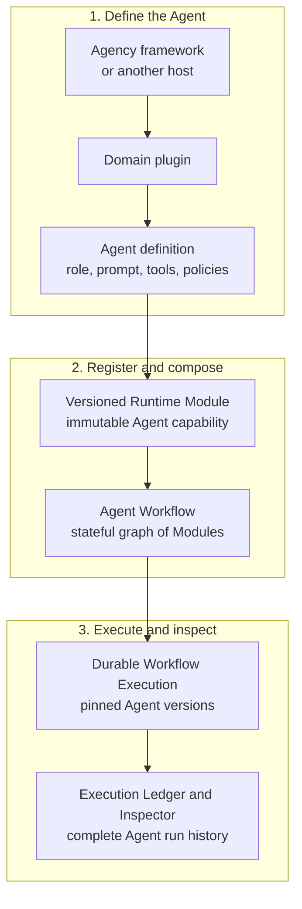
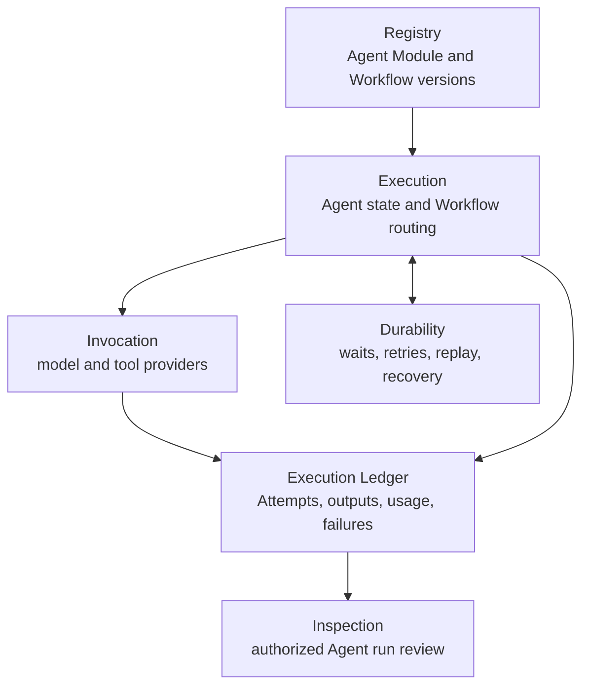
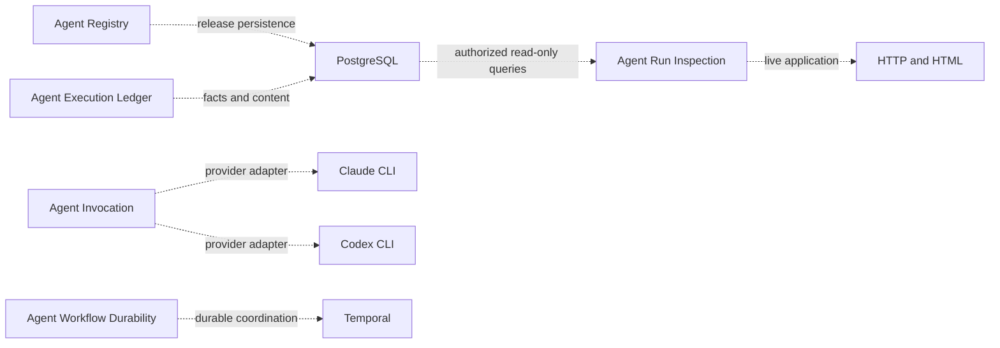
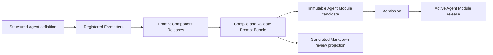
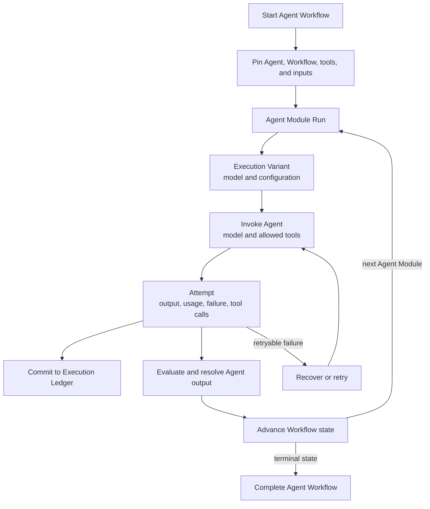

# Agent Runtime

<a id="current-status"></a>

## 当前状态 / Current status: 0.2.0.dev11

`agent-runtime-core` 0.2.0.dev11 属于 standalone 开发线（Pre-Alpha），源码位于
[github.com/bobaoai/agent_runtime](https://github.com/bobaoai/agent_runtime)。

- **执行方式**：Runtime 只通过两个外部 CLI 运行模型：Claude Code CLI（`claude -p`，绑定
  `claude_cli_adapter@v4`）与 Codex CLI（`codex exec`；无工具为 `codex_cli_agent_executor@v5`，带工具为
  `codex_cli_agent_workspace_executor@v4`）。不使用 Claude Agent SDK，也没有其他 Provider 的执行器。
- **验证范围**：当前 Windows 开发线在 Windows 11 宿主上验收：同版本源码的本地测试套件，以及显式开启的
  真实 Claude CLI、Codex CLI 用例。需要 macOS/Linux、PostgreSQL、Temporal 或其他真实服务的用例在该宿主上
  被跳过，跳过不算通过。macOS/Linux 实现仍在包内，本轮没有在这些平台重新验证。
- **存储**：普通 Test Run 不写 PostgreSQL，Attempt 文件夹在本地留档。PG 注册／执行存储、Live Inspector 与
  Temporal 需要宿主明确提供。
- **用量**：dev11 增加 `ordinary_input_tokens`，`input_tokens` 仍是含缓存的输入总量，见
  [用量与 token 含义](#token-usage)。

<a id="install-and-first-run"></a>

### 安装与第一次运行 / Install and first run

需要 Python 3.11+、所选 CLI 的已安装程序以及宿主自己的 CLI 登录。从 GitHub 公开源码安装：

```sh
python -m pip install "agent-runtime-core @ git+https://github.com/bobaoai/agent_runtime@main"
# 或使用源码 checkout
git clone https://github.com/bobaoai/agent_runtime.git
python -m pip install ./agent_runtime
```

`main` 是 GitHub 上最新发布的源码；需要可重复安装时，把 `@main` 换成 GitHub 上该版本的完整 commit。
可选依赖写在包名之后，例如 `"agent-runtime-core[postgres] @ git+https://github.com/bobaoai/agent_runtime@main"`：
`[postgres]`（PostgreSQL 定义与执行存储）、`[cli_tools]`（记录型命令和任务 callback 进程桥）、
`[temporal]`（Temporal 协调）。普通 Test Run 不需要它们。安装后核对实际版本（本说明对应
`0.2.0.dev11`）和命令：

```sh
python -c "from importlib.metadata import version; print(version('agent-runtime-core'))"
agent-runtime-test-run --help
```

Windows 上只启动原生 `claude.exe`、`codex.exe`（PATH 查找也只找原生程序）；`.cmd`、`.bat`、`.ps1` 启动器
不会被启动，必要时用 `--cli-path` 或 `provider_cli_paths` 指向原生程序。Claude 的 Bash 工具需要
Git for Windows，必要时由宿主设置 `CLAUDE_CODE_GIT_BASH_PATH`。
注册一个 Reviewer 后，最小运行为：

```sh
agent-runtime-test-run --root /path/to/host --workflow my_reviewer --input input.json
```

Test Run 把本次执行事实以 JSON 打印到 stdout；退出码 `0` 表示技术执行完成，不表示业务审核通过。
完整步骤见[注册新的 Reviewer 并测试](docs/agent_runtime_registration_runbook.md#new-reviewer)。

<a id="outer-cli-boundary"></a>

### 外层 CLI 边界 / Thin outer-CLI boundary

| 阶段 | Runtime 做什么 | CLI、宿主与服务负责什么 |
| --- | --- | --- |
| 启动前 | 按已注册定义和本次参数组装 instruction、输入、输出 schema、模型、effort、工作目录、工具／MCP 与原生允许规则，启动所选 CLI | 宿主提供程序、登录、材料、目录和已配置的连接 |
| 运行中 | 接收 stdout、stderr 与公开事件，维护本次外层调用的时限、取消和进程状态 | CLI 自行规划、读写文件、运行命令、调用 MCP 和内部重试 |
| 结束时 | 接收退出状态和最终结果，校验输出 schema，保存执行记录与 Attempt 留档 | 任务 owner 判断业务结论；MCP、网关和数据库按各自授权批准或拒绝 |

Runtime 不逐次审批、拦截或重执行 CLI 内部的工具调用，也不提供第二套文件服务、工具路由、权限引擎或沙箱；
单个工具报错由 CLI 自己处理。宿主的 Claude 用户／项目设置、Codex `config.toml` 与 execpolicy 规则正常加载并生效。
`ModuleReviewer` 预设与下面三种 agent 模式使用 network `provider_managed`：Runtime 不另加工具联网限制，
也不要求操作系统沙箱。普通 `Module` 没有默认工具，运行要求由作者明确声明。

<a id="four-common-patterns"></a>

### 四种常用模式 / Four common patterns

| 模式 | Module 运行要求（注册时固定） | 本次调用提供 | 说明 |
| --- | --- | --- | --- |
| 纯文本／结构化输出 | `tool_free`、`inline`、工具 `()`、workspace `none`、network `denied` | `--input` | 不开放任务工具；Runtime 校验输出 schema 并记录用量 |
| 文件审核 | `ModuleReviewer` 预设：`agent`、工具 `edit, read, search, shell`、`own_draft_read_write`、`provider_managed` | `--resources`（`material_root` 加带 sha256 的 `material_files`）；需要运行检查时加 `--command-permit` | 材料是只读副本，模型只写 scratch；没有许可时 Bash 只能运行 Claude 自带的只读命令 |
| 代码开发并运行命令 | `agent`、工具 `edit, read, search, shell`、`explicit_project_read_write`、`provider_managed` | `--project-directory`（调用者的 checkout／worktree）与 `--command-permit "python -m pytest:*"` | 改动留在调用者目录，Runtime 从不删除它；提交、合并和发布不由 Runtime 追加 |
| 已有 MCP／网关查询数据 | `agent`、工具含 `mcp__<name>` 以及 `read`、`edit`（Codex 另需 `shell`），可写目录为私有草稿或 `explicit_project_read_write`，`provider_managed` | 宿主在 `root/.runtime/config.json` 的 `mcp_servers.<transport>.<name>` 配好连接；输出目录用 `--project-directory` | 只传入 Module 声明的连接；服务自己鉴权；模型在目录中保存、读回并继续处理数据 |

Codex 没有独立的 Read、Grep、Edit 工具，read、search、edit 都经由 shell，因此需要 `shell`；只声明 MCP 时
shell 关闭，模型不能存取本地文件。Codex 不支持 `--command-permit`（`ADAPTER_CAPABILITY_UNSUPPORTED`），
其 Shell 范围由 Codex 自己的 sandbox 与宿主 execpolicy 决定。第四种模式的“网关”指经已声明 MCP 连接访问的
既有服务；Runtime 自己的 `gateway_read`／`hybrid` 输入仍未接通。

<a id="native-file-io"></a>

### 原生基础文件读写 / Native basic file I/O

Claude 按记录的工具精确映射：read 为 Read，search 为 Grep、Glob，edit 为 Edit、Write，shell 为 Bash。
Runtime 只为宿主的 `--command-permit` 渲染 `Bash(<permit>)` 允许规则，从不开放裸 Bash；Claude 自带的只读命令
始终可运行，未被允许规则覆盖的命令被拒绝。

| workspace | 工作目录与可写范围 |
| --- | --- |
| `none` | Attempt 的 `work/`；没有模型可写区域 |
| `own_draft_read_write` | Attempt 的 `work/`；`materials/` 只读，`scratch/` 是唯一可写位置 |
| `explicit_project_read_write` | 调用者的 `project_directory`，可在其中读写 |

文件工具由 Claude 自身的工作目录规则限定在工作目录与额外只读目录内，这不是任意 Shell／脚本的操作系统
隔离。Codex 以私有草稿的 scratch 或调用者的 `project_directory` 为主文件夹，按次生成的权限 profile 只对
该可写目录授予写入，并把材料目录声明为只读输入。`edit` 需要可写 workspace；没有 `edit` 的已保存定义
不获得 Write／Edit。

<a id="retention-and-cleanup"></a>

### 任务材料、留档与宿主清理 / Task material, retention and host cleanup

- `--resources` 中的材料以只读副本放进 Attempt 的 `work/materials/`，运行后再次校验。Windows 使用只读属性，
  不表示可执行位，并拒绝链接与 reparse point。只读依赖目录按引用提供，不复制。
- 每个 Attempt 文件夹保留在 `attempt_workspace_root`（默认 `root/.runtime/attempt_workspaces`）下，含材料、
  scratch 和 `archive/execution_record.json`。执行结束、所启动的 CLI 进程确认停止且留档已保存时才封存；
  否则保持原样并给出 `seal_skipped_reason`。Test Run 结果的 `attempt_workspaces` 列出每个文件夹。
- Runtime 不自动启动清理日程。宿主用 [maintain_attempt_workspaces](docs/agent_runtime_reviewer_api.md#maintain_attempt_workspaces)
  以 `intent="query"` 或 `"cleanup"` 查询或删除自己留档集合中已封存且过期的文件夹；`retention_seconds=None`
  不删除。调用者的 `project_directory`、Provider 登录状态与服务数据从不进入清理集合。
- 本地留档不是 PostgreSQL 持久化，也不承诺跨进程恢复。

<a id="token-usage"></a>

### 用量与 token 含义 / Token usage

| 字段 | 含义 | Claude CLI 来源 | Codex CLI 来源 |
| --- | --- | --- | --- |
| `input_tokens` | 输入总量，**包含缓存**；与 dev10 含义相同 | 普通输入、缓存读取、缓存创建三项都已报告时的和，否则未知 | Codex 报告的 `input_tokens` |
| `ordinary_input_tokens` | 非缓存的普通输入（dev11 新增） | Claude 原始 `input_tokens` | 未知（`null`） |
| `cache_read_tokens` | 缓存读取，属于输入总量 | `cache_read_input_tokens` | `cached_input_tokens` |
| `cache_creation_tokens` | 缓存创建，属于输入总量 | `cache_creation_input_tokens` | 已报告时记录，否则未知 |
| `output_tokens` | 输出，单独计算 | `output_tokens` | `output_tokens` |

未知值是 `null`，不是零；普通输入不由总量减缓存推算，总量与缓存子集也不再相加。四项输入都已知时，
`input_tokens` 等于普通输入、缓存读取与缓存创建之和。Test Run 结果的 `usage`、执行记录与
`aggregate_model_usage` 使用这些字段；汇总还给出 `<field>_unknown_module_count`。Inspector 显示
“Input total (incl. cache)”“Ordinary input”“Cache read”“Cache creation”，输出单列。已保存记录及其 hash 不变；
带已知普通输入的新用量事件不能由 0.2.0.dev10 或更早版本按字节校验，共享执行存储的读取方应先升级。
本版本不需要数据库迁移。

<a id="platform-and-extension-limits"></a>

### 平台与显式扩展限制 / Platform and extension limits

| 能力 | Windows | macOS | Linux |
| --- | --- | --- | --- |
| 冻结材料与只读依赖 | 支持 | 支持 | 支持 |
| 原生 Read／Grep／Glob／Edit／Write、按许可的 Bash | 支持（Bash 需要 Git Bash） | 支持 | 支持 |
| 声明的 MCP 连接 | 支持 | 支持 | 支持 |
| 记录型 `commands`（`--resources`） | 不支持 | 支持（sandbox-exec，需要 `cli_tools`） | 不支持 |
| 任务 callback（Python `tool_session_factory`） | 不支持（无 Unix-domain socket） | 支持（需要 `cli_tools`） | 支持（需要 `cli_tools`） |

本轮只在 Windows 上重新验证；macOS／Linux 两列描述包内实现，不表示本版本已在这些平台测试。
所有平台的随包 CLI 都未接通生产领域 Gateway（`gateway_read`／`hybrid` 输入）、`managed_attachment`、
`direct_sandboxed` 工具联网、Codex 逐次命令许可，以及 Codex 无 shell 的 read／search／edit 组合；这些
请求会在调用前报告不支持。已注册且记录 network `denied` 并含 Shell 的旧 Reviewer 在没有 Claude sandbox 的
宿主（例如 Windows）上会得到 Claude 自己的 sandbox 拒绝；需要新预设时按
[升级已有 Reviewer](docs/agent_runtime_registration_runbook.md#upgrade-existing-reviewer) 注册新的定义版本。
平台细节见 [Claude CLI 工具与宿主环境](docs/agent_runtime_claude_native_tools.md#21-明确的本地工程资源与命令记录)。

## 第一次使用：先看运行配置与职责

Runtime 把任务定义、运行环境、执行配置和执行记录分开管理。外部调用者不需要从生产代码里
拼装这些部分，也不需要为每个 Reviewer 另配一套底座。

| 组成 | 负责方 | 外部调用者需要知道什么 |
| --- | --- | --- |
| Module / ModuleReviewer / Workflow | Registry；任务 owner 提供 prompt、schema 与业务含义 | Module 是通用任务定义；ModuleReviewer 继承固定默认能力；单节点 Workflow 默认与 Module 同名 |
| root、Python、程序、材料及依赖 | Foundation 做 setup；Invocation 使用运行资源；宿主提供资源与授权 | Python 默认固定为启动 Runtime 的当前环境；root 不自动授权读取整个项目，也不绑定模型 |
| Execution Profile / Variant | Execution.prepare 生成，Registry 承载准确定义 | Module 决定能力要求；transport、模型、effort 与同步运行时限逐项取本次调用、该 Workflow 的参数文件、workspace 参数文件，最后是 Runtime 默认；无需调用者手拼 Profile |
| CLI 与工具、Attempt 和结果 | Invocation 负责实际调用及原始记录；Execution 负责执行生命周期 | 工具错误与整次执行失败分开；业务是否通过由任务 owner 校验 |
| 记录、恢复与查询 | Ledger / Durability / Inspection | 普通自测不依赖 PG；未请求持久化时返回本次记录并在本地留档 Attempt 文件夹，不承诺跨进程恢复 |

**完整运行配置、默认值、接口字段与责任边界**见[由代码导出的 Runtime run profile](docs/agent_runtime_reviewer_api.md#runtime-run-profile)。
该页先给整体组成，再列真实的 Module、ModuleReviewer 默认、ExecutionProfileRelease、Variant、
执行入口和 CLI 参数。完整值来自代码与 docstring，不是另一份手工 Profile 配置。

`agent-runtime-test-run --help` 同时显示职责摘要和当前 Python 路径。Runtime CLI 管注册、执行和查询；
Portable CLI 管审核对象的准备与结果校验，两套 CLI 保持分开。宿主不复制模型启动或日志解析逻辑。

## 按任务开始 / Start by task

使用 Runtime 时先按任务找操作步骤，不必先知道类名或搜索生产源码。

| 我想做什么 | 从哪里开始 |
| --- | --- |
| 在指定 root 使用 Runtime 工具 | [轻量运行前 setup](docs/agent_runtime_registration_runbook.md#local-runtime-setup)；现有命令自动完成，无需另装 Skill |
| 注册新的 Reviewer / register a new reviewer | [准备资料与注册](docs/agent_runtime_registration_runbook.md#new-reviewer) |
| 升级已有环境，继续使用旧 Reviewer | [升级与一次性采用](docs/agent_runtime_registration_runbook.md#upgrade-existing-reviewer)：安装包、登记新定义、回读并验证 |
| 用宿主环境首次测试 Reviewer / test a reviewer | [从已注册定义执行测试](docs/agent_runtime_registration_runbook.md#test-reviewer) |
| 查看 Claude 运行中状态 / watch a running Claude review | [运行中安全摘要](docs/agent_runtime_registration_runbook.md#watch-claude-run)：进程存活、耗时、输出字节与当前事件，不含正文 |
| 查询审核结果、执行日志或失败 / inspect a review | [按执行 ID 查询](docs/agent_runtime_registration_runbook.md#inspect-reviewer) |
| 选择纯输出、文件审核、代码开发或 MCP 取数的配置 | [四种常用模式](#four-common-patterns)与[原生基础文件读写](#native-file-io) |
| 清理已留档的 Attempt 文件夹 | [任务材料、留档与宿主清理](#retention-and-cleanup) |
| 查完整运行配置、接口参数、返回值和错误 | [自动生成的 Module 与执行 API reference](docs/agent_runtime_reviewer_api.md) |
| 开发 Runtime，运行回归测试 | [开发者能力与测试样例](docs/agent_runtime_capabilities.md) |
| 运行多 Agent 示例或独立评价 | [随包多 Agent 样例](docs/agent_runtime_capability_runbook.md#随包多agent样例)；同一个 `agent-runtime-test-run` 命令提供 `--example` |

注册保存 Module/Workflow 定义；执行时由 Runtime 固定准确版本并准备本次配置，不要求先给宿主
root 绑定模型或 Profile。宿主提供资源、授权和薄操作入口，不能把测试 fixture 当作正式配置。
本目录提供任务发现与操作导航，不证明某个宿主或 Profile 已完成集成。

使用本包时，README 负责导航；随包 Design 说明职责与意图；docstring、CLI help 和由代码生成的
API reference 给出准确参数、默认值、返回值与错误；runbook 和操作 Skill 连接这些接口；同版本
源码中的测试说明如何验证相应能力。工作记录和历史交付报告不承担必需的接口说明。调用者仍需
提供自己的任务定义、输入、程序与资源，不能把缺少这些输入理解成需要寻找作者的历史聊天。

随包样例使用普通 Module、同一 Workflow 执行和真实受控工具接口。`agent_capability_example` 包含
查询、写作、并行审核、修订及同进程等待事件；`agent_evaluation_example` 让被测 Agent 自行请求
任务内审核，再由独立 Agent 依据 Runtime 记录评价。工具读取的 fixture 与生产 Gateway 分开，
样例不取得生产数据权限。源代码中的替身测试和显式开启的真实 Provider 测试分别报告。

Agent Runtime is a reusable management and execution layer for stateful AI
agents. It is the part of an agent framework that answers operational
questions: Which version of the agent ran? Which prompt, tools, model profile,
and inputs were pinned? What happened on each retry? Can the run recover after
a crash? What may the current reviewer inspect?

Agent Runtime is the Agent execution and management runtime at the core of the
broader Agency framework. It occupies a role similar to LangGraph's stateful
Agent orchestration layer: applications register versioned Agent capabilities,
connect them into durable Workflows, execute them through model and tool
providers, and inspect every run from an authoritative Execution Ledger.

In Runtime terminology, an Agent capability is registered as a Module, a graph
of Modules is a Workflow, and each provider invocation or retry is an Attempt.
Runtime pins the exact registered versions used by an execution, coordinates
state transitions and recovery, records complete lineage, and exposes
authorized inspection of what happened.

Agent Runtime is also an independently installable, domain-neutral Python
package. The Agency framework—or another host application—extends it with
domain plugins that supply roles, prompts, tools, policies, and business
meaning. Writer, Router, Verifier, Reviewer, or Expert are therefore possible
Agent roles built on Runtime, not hard-coded concepts in Runtime itself. A
Module may also wrap a deterministic function, human task, or external service.

## Agent model

The Agency framework defines what an Agent means for a domain. Agent Runtime
turns that definition into an immutable, executable Module and manages it as
part of a stateful Workflow.



The same Agent Module can be reused in multiple Workflows, and a Workflow can
combine model-backed Agents with deterministic functions, human tasks, and
external services. Runtime manages their execution contracts and lineage
without owning their domain-specific meaning.

## Relationship to other Agent frameworks

Agent Runtime is closest to the orchestration-runtime layer of
[LangGraph](https://docs.langchain.com/oss/python/langgraph/overview), not to a
high-level prompt or role library. LangGraph emphasizes stateful graphs,
durable execution, streaming, persistence, and human-in-the-loop control.
Agent Runtime focuses more narrowly on independently operated infrastructure:
immutable Agent Module and Workflow releases, exact version pinning, atomic
recovery records, a PostgreSQL Execution Ledger, and query-time-authorized
inspection.

Other frameworks optimize for different entry points:

| Framework | Primary strength | Agent Runtime's different focus |
| --- | --- | --- |
| LangGraph | Low-level graphs for long-running stateful agents | Registered immutable releases and an authoritative operational ledger are first-class Runtime contracts |
| [OpenAI Agents SDK](https://openai.github.io/openai-agents-python/) | Lightweight agent loops, tools, handoffs, guardrails, sessions, and tracing | Provider-neutral execution facts, durable backend coordination, and host-supplied authorization boundaries |
| [AutoGen](https://microsoft.github.io/autogen/stable/user-guide/core-user-guide/index.html) | Message-driven single-process and distributed multi-agent runtimes | Version-pinned Workflow execution, transactional recovery, and formal inspection records |
| [CrewAI](https://docs.crewai.com/) | High-level role-based crews plus structured Flows | Domain-neutral infrastructure that does not prescribe roles, goals, or collaboration metaphors |

These are not mutually exclusive ideas. A host can adapt another framework's
agent implementation behind a Runtime Module while using Agent Runtime for
release authority, durable execution, ledgering, and review. The tradeoff is
intentional: Runtime requires more explicit contracts and host integration, and
it does not provide another framework's ecosystem of ready-made roles, tools,
memory strategies, or managed deployment.

## Agent execution responsibility flow

Each Runtime responsibility owns one part of the Agent lifecycle. Arrows mean
Runtime calls or committed execution facts.



Concrete technologies are registered separately as implementation bindings:



This diagram shows the currently registered bindings. The generated
architecture projection is the exhaustive current set.

The Runtime distribution uses Claude CLI and Codex CLI. It does not import or
depend on Claude Agent SDK and no longer provides its SDK executor classes.
Previously recorded SDK Profile identities remain readable as historical data;
they do not select a CLI implementation or recreate a removed executor.

PostgreSQL, Temporal, provider SDKs, CLIs, and renderers are replaceable
implementations. None is a peer logical responsibility or execution authority.

## Logical responsibilities

| Logical responsibility | Owns | Does not own |
| --- | --- | --- |
| Registry | Compile, validate, register, and load immutable Module and Workflow releases | Workflow execution or business meaning |
| Execution | Start and advance Workflow executions; stage admitted content; coordinate authorization, Evaluation, and Resolution | Product Entitlements, provider implementation, or canonical execution facts |
| Invocation | Assemble admitted model context and invoke one registered model or tool profile | Workflow routing, release selection, or canonical records |
| Durability | Coordinate acknowledged commands, waits, retries, replay, and recovery | Prompt, output, usage, or product data storage |
| Ledger | Commit authoritative execution lineage, Attempts, usage, outcomes, and Resolution facts | Workflow decisions, provider sessions, or inspection presentation |
| Inspection | Project and render authorized, read-only Runtime release and execution views | Execution mutation, approval, retry, or publication |

Product Authorization and governed Data Access remain external authorities.
Runtime carries the admitted authorization context and calls those authorities
when an execution requires a current decision or authorized product data.

## Capability documentation

从能力索引按使用任务找到样例，再用 runbook 的单例、分组或全仓命令执行测试。
样例指向真实 pytest 函数，说明输入、预期结果与所需环境；测试代码位于同版本源码 checkout 的
`tests/`，wheel 随附文档。批量测试直接使用 pytest 自动收集，结果中的跳过项不算通过。

- [Agent Runtime capabilities](docs/agent_runtime_capabilities.md)
- [Agent Runtime capability runbook](docs/agent_runtime_capability_runbook.md)
- [Registration runbook](docs/agent_runtime_registration_runbook.md)
- [Claude CLI 工具、宿主环境与 PG sample](docs/agent_runtime_claude_native_tools.md)

公开仓库不携带宿主的私有 Governance/Reviewer source。相关集成用例通过
`AGENT_RUNTIME_REVIEWER_SOURCE_ROOT` 指向已经安装该包的宿主；未配置时明确跳过，不算审核已完成。

### Reviewer interface documentation

The [Reviewer API reference](docs/agent_runtime_reviewer_api.md) is generated
from class/method docstrings, signatures, fields and error constants. Edit
those source definitions, then run these commands in the matching source
checkout; `--check` verifies both repository and wheel-bound documentation
without writing:

```sh
python -B tools/build_agent_runtime_api_reference.py
python -B tools/build_agent_runtime_api_reference.py --check
```

The wheel contains the generated reference under `agent_runtime/docs`.
Its scope is Reviewer authoring and the registered single-node evaluation
entry, not the complete Runtime API.

### Durable parallel groups

A Workflow Release may declare an `all_required` parallel group at one control
node. Every branch remains an ordinary registered Module with its own Module
Run, Variant, Attempt, output, usage, failure, and retry lineage. Runtime keeps
the durable backend cursor at the control node, dispatches missing branches
concurrently, reuses already committed sibling outcomes after recovery, and
advances once to the declared join only after all branches succeed. Parallel
branches cannot wait for external events; waits belong after the join or in a
separate graph position. A committed branch result that cannot enter the join
returns auditable `blocked` progress instead of wedging replay behind a repeated
exception. Runtime also enforces an explicit per-group dispatch-concurrency
limit, and the Cell Activity Bridge contract requires concurrency-safe shared
state.

## Naming

Runtime-owned code uses one three-part semantic name:

```text
module_subject_nominalized_action
```

Examples:

```text
registry_release_registration.py
execution_module_invocation.py
ledger_record_persistence.py
invocation_prompt_assembly.py
durability_temporal_coordination.py
registry_postgres_persistence.py
ledger_postgres_persistence.py
inspection_release_rendering.py
inspection_http_serving.py
inspection_postgres_querying.py
```

The first term identifies the responsible module, the second identifies the
subject, and the third states the action as a noun. Generic filenames such as
`service.py`, `store.py`, `utils.py`, `manager.py`, `api.py`, or `adapter.py`
are not valid Runtime source names.

Python classes may use the `PascalCase` projection of the same semantic name.
Serialized identifiers, functions, variables, schemas, tables, and fields stay
in `snake_case`.

## Source and Design Contract map

The target source distribution is organized by product responsibility, not by
generic Clean Architecture vocabulary.

```text
agent_runtime/
  README.md
  design_contract/
  foundation/
  conformance/
  contracts/
  registry/
  execution/
  invocation/
  durability/
  ledger/
  inspection/
  testing/
```

| Default code family | Primary Design Contract |
| --- | --- |
| `registry_*_*` | `agent_runtime_01_module_contract_and_assembly.md` |
| `execution_*_*` | `agent_runtime_00_execution_charter.md` and `agent_runtime_06_standalone_package_and_lifecycle_contract.md` |
| `execution_authorization_*` and `execution_data_*` | `agent_runtime_09_authorization_integration_contract.md` |
| `invocation_*_*` | `agent_runtime_08_agent_execution_adapter_contract.md` |
| `durability_*_*` | `agent_runtime_07_temporal_durable_adapter_contract.md` |
| `ledger_*_*` | `agent_runtime_06_standalone_package_and_lifecycle_contract.md` |
| `inspection_*_*` | `agent_runtime_06_standalone_package_and_lifecycle_contract.md` |
| `foundation_*_*` | approved Runtime source-architecture and Code Design Basis |
| `conformance_*_*` | approved Runtime source-architecture and Code Design Basis |

The code-owned architecture registration keeps logical responsibilities,
supporting planes, physical source directories, and concrete technology
bindings as separate dimensions. Every target source file maps to one logical
responsibility or one supporting plane and one physical directory. Only a
concrete adapter maps to an implementation binding.

`agent_runtime.conformance` validates the registered source closure, the
one-way responsibility import graph, exact public exports, and shrinking
migration-debt baselines. Existing forbidden imports are frozen by exact source
and target module. A removed debt edge is accepted; a new debt edge fails CI.
Runtime execution code never imports Conformance.
Conformance ships with the standalone wheel so the published package carries
its own assurance tools; shipping it does not place it on the execution call
path. `agent_runtime.testing` is a stable public facade for shipped evaluation
and Adapter-conformance entry points, not a temporary compatibility slice.
Each file below that directory retains its registered logical responsibility or
supporting-plane owner; explicit test composition does not enter ordinary execution.

`agent_runtime.foundation` contains responsibility-neutral validation and JSON
Schema traversal primitives. It imports no Runtime responsibility. Schema
traversal distinguishes schema-bearing positions from container maps such as
`properties` and `$defs`, so a user field named `items` or `properties` is not
misread as a schema keyword.

The current wheel still contains five explicitly enumerated predecessor
semantic surfaces while migration is in progress. They are listed in
`RUNTIME_MIGRATION_DEBT_PATHS`; the generated architecture report, not this
illustrative tree, is the exhaustive current source map.

Before retiring a compatibility facade, use Conformance's
`build_downstream_consumer_manifest` to capture the affected host's import sites,
then `validate_downstream_consumer_retirement_readiness` to check the owner's
decisions. The generated `keep`, `replace` or `retire` defaults identify work;
they do not authorize a cutover. Each site requires an explicit `owner_decision`.
These functions live in `conformance/conformance_consumer_manifesting.py`; a
historical work document is not a package dependency or a current consumer inventory.

Package initializers temporarily re-export some predecessor types for existing
downstream callers. Those re-exports are compatibility-only, must not be used
by a new integration, and retire with the corresponding debt path; a
structural `__init__.py` does not turn the imported predecessor into target
implementation.

The unreleased `0.x.dev` series is the first standalone extraction and has
no tagged public wheel
predecessor. It intentionally does not recreate the former host repository's
physical `postgres`, `provider`, or `review` packages. A host must migrate
those vendored imports to the registered `registry`, `invocation`,
`inspection`, and `ledger` surfaces before pinning the first standalone
release; this wheel is not an in-place upgrade until that migration gate passes.

## Release registration

A domain plugin submits one structured instruction, its input and output
schemas, execution profiles, and registration metadata.
Registered Formatters create immutable Prompt Component Releases;
Runtime orders them into one Prompt Bundle Release and persists both in
PostgreSQL. Admission and activation are explicit later decisions. A generated
Markdown file may project the complete bundle for review and recovery, but it
is never the production read authority.

Execution-selected domain context remains owned by the domain database. The
authorized Runtime caller resolves and freezes it as a hashed Module input
after routing. Runtime does not compile a specialized Module release for it.



Production execution reads the admitted PostgreSQL release. It never rebuilds
a Prompt, Schema, Skill, Module, or Workflow by reopening Git.

## Workflow execution

The Product host requests an already authorized Workflow start. Runtime freezes
the exact Workflow release, Module releases, authorized input closure, and
execution profiles before the first invocation. Later release activation cannot
change an execution already in progress.

For each Agent Module occurrence, Runtime:

1. creates one Module Run;
2. creates one Variant for each selected model or configuration;
3. records every invocation or retry as a separate Attempt;
4. commits output, usage, failure, and evaluation records; and
5. resolves the accepted output before advancing the Workflow.



### 已注册 Module 的一节点执行

宿主已有一节点 Workflow 和选择其 Profile 的 Variant Policy 时，使用
`run_registered_workflow_module`。Stores、Adapter、授权接口和注册绑定配置一次，日常只传
目标 Module、JSON 输入和本次 key。Key 在使用的 record store 命名空间内唯一。

```python
from functools import partial
from agent_runtime import run_registered_workflow_module
from agent_runtime.ledger import PostgresRuntimeExecutionQueryStore

review = partial(
    run_registered_workflow_module,
    release_registry=registry,
    workflow=registry.get_workflow(workflow_ref, workflow_sha256),
    variant_policy=registry.get_execution_variant_policy(variant_ref, variant_sha256),
    authorize=host.authorize,
    context_client=host.context_client,
    operation_client=host.operation_client,
    enforcing_gateway_id=enforcing_gateway_id,
    environment_id=environment_id,
    adapters=adapters,
    artifact_host=cell,
    record_store=execution_store,
    content_store=execution_store,
    claim_token_secret=host_claim_secret,
)

result = review(
    module_id=target_module_id,
    input_payload=payload,
    idempotency_key=review_key,
)
execution_id = result.module_run.workflow_execution_id

query = PostgresRuntimeExecutionQueryStore.from_dsn(database_url, schema=execution_schema)
trace = query.load_trace(execution_id)
for output in result.outputs:
    content = query.load_content(execution_id, output.output_ref)
    assert content.content_sha256 == output.output_sha256
```

宿主提供已初始化的 Registry、Cell staging 接口、明确的 PostgreSQL 记录及内容存储，以及
已配置的执行 Adapter。Staging 可以使用 `InMemoryCellArtifactStore`，需提供 `put_bytes`、
`read_bytes`、`artifact` 和 `resolve_artifact_ref`。Provider 登录和独立 CLI 环境继续由现有
Adapter 配置处理；这个入口不读取环境文件，不执行注册或 activation。

`authorize(request)` 接收已冻结的 `WorkflowModuleExecutionRequest`，返回一个 tuple：
`ExecutionAuthorizationContextEnvelope`，以及依次代表 decision、delegation、entitlement snapshot
的三个 `ResolvedArtifactRef`。它们对应现有记录槽位，不是新增 grant。宿主拥有这些引用的含义，
并将精确内容放入 artifact host。Runtime 校验身份，通过原有 controller 绑定 context，再调用
宿主提供的接口取得操作决定。授权内容和 claim secret 不进入模型 Prompt；同一 execution 使用
相同的 claim secret。

入口从已注册 Workflow 和 Variant Policy 派生 Module、节点与 Profile，并核对它们确实指向
`target_module_id`。当前支持 tool-free inline `evaluation`，不执行多节点图，也不代表
无 Workflow 的持久 standalone 已实现。入口冻结任务与 Prompt，记录执行起点和输入，再通过
`run_workflow_module` 完成实际 Attempt 与原子提交。

返回值是原始 `ModuleRunResult`，业务审核结论由所属 Reviewer 解释。`evaluated_single` 在
尚未独立选择结果时保持 `resolution=None`，重放也一样；只有 `direct_single` 可以从已提交输出
补全缺少的直接 Resolution。同 key、同输入和绑定会复用已提交结果，不再次调用 Provider；
内容冲突会被拒绝。未完成执行返回现有 Runtime 恢复路径，Store 失败不能当作落库成功。
使用示例中的新查询连接核对实际记录和内容。

并发首次调用使用 PG 原生 `CommitReceipt.replayed` 判定进入权，只有首次提交者进入模型执行。
竞争调用取得已提交结果，或在结果尚未完成时返回既有恢复路径。
`WorkflowExecutionLedgerRecorder.record_execution_start` 现在返回这份已有 receipt；
它的输入和写入行为不变，原有忽略返回值的调用可以继续使用。

## Workflow Inspector

The installed Runtime exposes a read-only web interface backed by its formal
PostgreSQL records. The page itself contains no embedded execution snapshot.

An authorized user can:

- list every Workflow Execution allowed by the current Product grant;
- open the frozen Workflow graph;
- select every occurrence of a Module in a loop;
- inspect every Variant, Attempt, retry, failure, Prompt, output, usage,
  Evaluation, and Resolution; and
- refresh a running execution without creating or mutating Runtime records.

Prompt, input, output, and failure bodies are returned only after an exact
content-read authorization decision. The Product host may embed or proxy the
Inspector, but it does not define another execution schema.

The package also retains an explicit offline snapshot exporter for portable
review artifacts. It is a secondary export path, not the primary interface or
a second persisted source of truth, and it is never created automatically.

## PostgreSQL and Live Inspector quick start

Install Runtime with the optional PostgreSQL client from the public source (see
[Install and first run](#install-and-first-run)) and initialize both
Runtime-owned schemas:

```bash
python -m pip install "agent-runtime-core[postgres] @ git+https://github.com/bobaoai/agent_runtime@main"
```

```python
from agent_runtime.ledger import PostgresRuntimeExecutionRecordStore
from agent_runtime.registry import PostgresRuntimeReleaseStore

database_url = "postgresql://runtime@localhost/runtime"
PostgresRuntimeReleaseStore.from_dsn(database_url).create_schema(
    installed_at_utc="2026-08-17T20:00:00Z",
)
PostgresRuntimeExecutionRecordStore.from_dsn(database_url).initialize_schema()
```

The live application deliberately has no allow-all mode and does not trust a
request header by default. A host supplies its authenticated request context
and current Product authorization checks, then assembles the read-only query
stores:

```python
from agent_runtime.inspection import (
    LiveInspectionAssembly,
    PostgresWorkflowInspectionRepository,
)
from agent_runtime.ledger import PostgresRuntimeExecutionQueryStore
from agent_runtime.registry import PostgresRuntimeReleaseQueryStore

def build_inspector():
    repository = PostgresWorkflowInspectionRepository(
        PostgresRuntimeExecutionQueryStore.from_dsn(DATABASE_URL),
        release_queries=PostgresRuntimeReleaseQueryStore.from_dsn(DATABASE_URL),
    )
    return LiveInspectionAssembly(
        repository=repository,
        authorizer=product_inspection_authorizer,
        request_context_resolver=resolve_authenticated_request,
        frame_ancestors=("https://product.example.com",),
    )
```

```bash
agent-runtime-live-inspect \
  --application-factory host.inspector:build_inspector \
  --host 127.0.0.1 \
  --port 8080
```

The console command uses Python's reference WSGI server for a direct package
entry point. A production deployment should load the same assembled WSGI
application in its hardened process manager or application server.

The query adapters execute PostgreSQL transactions in explicit read-only mode.
Production deployments should additionally give the Inspector connection a
database role with `SELECT` privileges only.

## Published release

Every published Runtime release contains:

- this README;
- a generated, hash-bound bundle of Runtime-owned Design Contracts;
- the public Python API and JSON schemas;
- deterministic PostgreSQL schema installers for releases, executions,
  records, content, and query indexes;
- the live Workflow Inspector assets; and
- architecture, clean-wheel, execution, recovery, invocation, and inspection tests.

The README is the human entry point. Design Contracts define intent and stable
invariants. Code, PostgreSQL records, and generated architecture reports define
current executable truth.

## Current maturity

Runtime 提供版本化注册、Module 执行、Workflow 协调、执行记录与只读查询。某个类型或字段能表达
一种能力，不代表每个 Adapter、CLI 或宿主都已接通它。判断可用性时，先选调用入口，再核对该入口
与所选 Adapter 的真实参数；[同版本 API reference](docs/agent_runtime_reviewer_api.md)给出准确合同。

### 选择执行入口

普通调用者通常从前面的 runbook 或 `agent-runtime-test-run` 开始，无需手拼执行内核资源：

| 要完成的工作 | 入口与当前边界 |
| --- | --- |
| 自测已注册单节点 Workflow | CLI `--workflow`（root 下的本地定义）或 `--workflow-ref` 加 `--workflow-sha256`（只读取 PostgreSQL 中的准确定义），或 [run_local_workflow_test](docs/agent_runtime_reviewer_api.md#run_local_workflow_test)；使用临时内存记录与明确测试资源，不要求生产授权，不写 PG |
| 运行随包多 Agent 样例 | 同一 CLI 的 `--example` 或 [run_agent_example](docs/agent_runtime_reviewer_api.md#run_agent_example)；仅运行已列出的固定图，包含受控 callback 和子审核样例 |
| 在自己的程序里组装本地多节点自测 | [prepare_local_workflow](docs/agent_runtime_reviewer_api.md#prepare_local_workflow)、[WorkflowSelfTestResources](docs/agent_runtime_reviewer_api.md#workflowselftestresources) 与 [LocalWorkflowModuleBridge](docs/agent_runtime_reviewer_api.md#localworkflowmodulebridge)；宿主提供节点输入、结果到图分支的映射及实际资源，不由单节点 CLI 自动接管任意业务图 |
| 将已注册单节点审核接入授权持久执行 | [run_registered_workflow_module](docs/agent_runtime_reviewer_api.md#run_registered_workflow_module)；宿主提供真实授权与记录/内容存储，使用同一准确准备结果，不复制 Adapter 或日志实现 |

更低层的内核有两个入口。[run_module](docs/agent_runtime_reviewer_api.md#run_module)只接纳隔离的 `test` / `evaluation` 请求；其中声明模型
操作时需要明确的 execution authority。[run_workflow_module](docs/agent_runtime_reviewer_api.md#run_workflow_module)消费 Workflow-bound 请求：
持久路径使用 `WorkflowModuleLedgerRecorder` 与所需授权；非持久路径使用准确的
`ModuleSelfTestResources`，不能混入持久 recorder 或外部 authority。上表的自测入口会完成后一种
资源组装。因此，低层接口的授权参数不能被误写成普通自测必须准备的生产授权。

Workflow 宿主使用 `WorkflowExecutionLedgerRecorder` 记录完整输入、派生输出、Domain Outcome
和恢复 checkpoint，业务插件不另建影子账本。一个 Workflow dispatch 当前承载一个 Variant；
A/B 使用同一 Module Release、冻结输入下的独立 dispatch。已有提交按原记录重放。

`production` 表示部署场景，不是 purpose 枚举值。`run_module()` 的用途限制不能套用到整个
Workflow API；反过来，接口支持 Workflow-bound 请求也不证明宿主生产接入已完成。
`standalone` purpose 当前不由这两个内核入口接纳；定义的 `standalone_allowed` entry policy
与执行 purpose 是不同字段。具体请求仍须通过定义、资源和 Adapter 的实际校验。

<a id="current-module-execution-admission-matrix"></a>

### 随包执行路径的工具与资源支持

以下按外部调用者实际提供的资源区分能力，适用于普通 Module，也适用于继承默认要求的
ModuleReviewer。实际适用项以 Module 的固定要求为准；提供资源或更换模型不隐含扩展能力，
不支持的要求不会被静默删掉。

| 需要的能力 | 当前路径 | 调用者从哪里提供 |
| --- | --- | --- |
| 无任务工具的内联模型调用 | Claude CLI；或显式选择 Codex 的 `tool_free`、`inline`、空工具、workspace `none`、network `denied` 组合 | 已注册 Module 的要求；模型、effort 和程序路径使用 [执行参数](docs/agent_runtime_reviewer_api.md#run_local_workflow_test) |
| 原生读取、搜索、编辑和 Shell | Claude 的 `agent`、`inline`、network `denied` 或 `provider_managed` 路径按记录的工具精确映射（read：Read；search：Grep、Glob；edit：Edit、Write；shell：Bash），不另加工具；workspace 为 `none`、私有草稿或调用者显式提供的 `project_directory`（`explicit_project_read_write`）。Shell 命令只由宿主 `command_permits` 预批准（`Bash(<permit>)`），Claude 自身的只读命令按其文档始终可运行，不默认开放完整 Shell。Codex workspace v4：read、search、edit 由 shell 承担，故须含 `shell`；只声明 MCP 时 shell 关闭；Codex 不支持逐次命令许可（`ADAPTER_CAPABILITY_UNSUPPORTED`） | 固定 Module 要求；本次材料与依赖通过 `--resources` / Python 参数提供，项目目录与命令许可通过 `--project-directory` / `--command-permit` 提供，见 [ClaudeAdapter](docs/agent_runtime_reviewer_api.md#claudeadapter) 与 [Codex workspace 执行](docs/agent_runtime_claude_native_tools.md#4-codex-workspace-执行reviewer-默认环境) |
| 冻结材料与只读依赖 | 所有宿主：材料以只读副本放入 Attempt 文件夹并在运行后校验；Windows 不表示可执行位 | `--resources` 中的 `material_root`、`material_files`、`read_only_dependencies` |
| 按 ID 执行并记录本地工程命令 | 仅 macOS（sandbox-exec）上的 Claude 路径与 Codex workspace v4；需要 `shell`、私有草稿和 `cli_tools` 依赖；普通 Shell 不被限制成该命令列表 | `--resources` 中的 `commands` 或 Python `commands` 参数；[原生命令说明](docs/agent_runtime_claude_native_tools.md#21-明确的本地工程资源与命令记录) |
| 使用宿主已配置的 MCP 连接 | Module 声明 `mcp__<name>`；只传递声明的连接（Claude 经私有 `mcp.json`，Codex 经 `-c mcp_servers.<name>` 并按次关闭未声明的宿主服务器）；凭据只以环境变量名引用，trace 只记录名称与配置哈希 | `root/.runtime/config.json` 的 `mcp_servers.<transport>` |
| 调用宿主明确提供的本地函数（callback） | macOS／Linux 上的 Claude 自测路径，通过受控进程桥（Windows 没有 Unix-domain socket，打开会话前报告不支持）；工具名匹配 Module/Profile 的非原生工具，工具 schema 随 factory 定义固定；使用 `cli_tools` | Python `tool_session_factory`（或图入口的 `tool_session_factory_for_node`）；[函数及参数合同](docs/agent_runtime_reviewer_api.md#run_local_workflow_test)与[图调用合同](docs/agent_runtime_reviewer_api.md#localworkflowmodulebridge) |
| 生产领域 Gateway、`gateway_read` / `hybrid` 输入、`direct_sandboxed` 工具联网，或 Codex 只有 read/search/edit 而无 shell 的工具组合 | 随包 CLI 尚未接通这些路径；通用协议或候选实现的存在不代表可直接调用 | 返回所选入口/Adapter 的具体不支持结果，交对应集成维护者，不改 Module 要求或换 transport 来掩盖缺口 |

Callback 是可信宿主程序提供的实际函数会话，不是从任务 JSON 加载代码或服务。普通 CLI 的
资源 JSON 不接收 factory，`--example` 只使用样例自己的固定 factory；自定义 callback 使用上表的
Python 接口。生产领域 Gateway 另有外部授权和数据访问合同，本地 callback 不提供这种授权。

workspace `none` 只表示没有模型可写任务草稿，Runtime 仍可创建隔离的进程目录。network `denied`
限制任务工具联网，不禁止 Provider 完成模型调用所需的连接；`provider_managed` 表示 Runtime 不另加
工具联网限制，由 CLI 自身与宿主配置决定。已保存的 `denied`、`gateway_only`、`direct_sandboxed`
保持原意。宿主的 Claude 用户/项目设置与 Codex `config.toml`、execpolicy 规则正常加载，其限制照常生效。
原生工具、本地命令和 callback 都不能
自动获得领域操作许可；真实授权拒绝保留其来源。资源失效、关闭的 fence 或必要记录失败仍按各自
合同处理，不能靠捕获一个工具异常取得继续执行的权限。

Claude permission events and ordinary tool failures are recorded independently
of the invocation outcome. Codex completion requires a successful process, an
unambiguous successful Provider terminal and valid output. Both CLI paths retain
captured stdout/stderr and public tool events in the existing private trace,
including failure and cancellation prefixes. `read_execution_log` returns these
facts with explicit capture or content limitations. A valid business `non_pass`
or `blocked` response remains a completed technical execution, not a reason to
retry the model. Tool, Provider, Attempt and business outcomes stay distinct.

Ordinary execution extracts basic metadata and the final result, and archives
raw logs; it does not parse tool behavior to decide success or retry. Inspection's
`read_execution_log` parses detailed tool events only when private content is
requested. Historical traces that already contain `tool_log` retain their saved
interpretation. A log gap affects the view's completeness, not the recorded
Attempt status. The Test Run API and CLI request this detailed view
before their temporary resources close; a behavioral assessment remains separate.

Claude's current binding is `claude_cli_adapter@v4`. It runs with
`--permission-mode dontAsk`, the user's own Claude settings loaded, the recorded
tools mapped exactly and only Runtime's allow rules (Read/Grep/Glob, `Edit(<declared
folder>/**)`, `Bash(<permit>)`) added. Its complete stdin prompt,
including relative resource locations, is frozen before the Prompt Envelope is
stored. Old Claude v1/v2/v3 and `claude_cli_native_tools_executor@v2` records remain
readable, and committed requests replay without an Adapter; new executions use
an explicitly prepared current Profile. Hosts must migrate their current entry
points before adopting this package rather than reinterpret saved bindings.

The Test Run CLI accepts `--resources FILE` for an explicitly frozen
file tree, read-only dependency directories and task-supplied command IDs,
`--project-directory DIR` for an `explicit_project_read_write` Module and
`--command-permit RULE` (repeatable) for host-prepared Shell permits. Frozen
files and dependencies work on every host; declared commands need macOS, where
Claude can use, when commands are
supplied, an additional Runtime-owned local MCP tool. The `cli_tools` extra is
required for the local command or task-callback bridge. Each selected command runs in its own
actual OS sandbox under the same live resource guard; it supplies real argv,
cwd, returncode and captured bytes. Ordinary Bash is not restricted to this
command list, and the list does not define a business verdict or domain grant.
The original CLI observations remain available alongside parent-process facts;
only uniquely proven correlations become one unified call.

Optional `root/.runtime/config.json` stores executable and read-only dependency
locators, the Attempt folder root (`attempt_workspace_root`) and the host's
selectable MCP connections (`mcp_servers`), not models, Profiles, task material
or database permissions. Explicit
arguments override the selected resource defaults, including an empty dependency
tuple. Unused defaults do not expose resources to tool-free Modules. See
`load_runtime_config` and `run_local_workflow_test` in the generated API
for the exact fields, relative-path rules and error boundaries. This ordinary
self-test writes no definition store; it reads PostgreSQL only when the caller
selects an exact PostgreSQL definition, and never writes it. Each Attempt folder
is retained under `attempt_workspace_root` (default `root/.runtime/attempt_workspaces`)
with `archive/execution_record.json`, and sealed when the run ended with a
confirmed process stop; `record["attempt_workspaces"]` reports each folder.
`maintain_attempt_workspaces` queries or removes sealed, expired folders under
host retention policy. A caller `project_directory` is never archived, sealed
or cleaned.

Transport, model, effort and synchronous run_timeout_seconds are resolved per parameter from four layers: this
call's arguments, then `root/.runtime/execution_parameters/workflows/<workflow_id>.json`,
then `root/.runtime/execution_parameters/workspace.json`, then the Runtime
default (`claude_cli`, `claude-opus-5[1m]`, `xhigh`). Both files are optional
JSON objects. Format `runtime_execution_parameters_v1` retains the three model
fields. Format `runtime_execution_parameters_v2` also accepts run_timeout_seconds,
an integer from 1 to 86400 (default 1200). Null, bool, fractional, out-of-range
and unknown values fail instead of being ignored:

```json
{"schema_version": "runtime_execution_parameters_v2", "model_id": "claude-fable-5-1[1m]", "reasoning_profile": "xhigh", "run_timeout_seconds": 3600}
```

Parameter files never select a definition version; pass `--version` or an exact
ref/hash per call, otherwise the latest registered local version is used. A
present file that is invalid, or contains any other key, fails preparation
instead of falling through. A model or effort written in a layer whose transport
differs from the resolved transport is rejected, so a Claude model is never sent
to Codex. The Test Run record lists each parameter's source layer and file hash
in `execution_parameter_sources`.

Use `--run-timeout-seconds 3600` for a one-call override. The work deadline starts
at the synchronous entry, includes preparation, managed same-process children
and any retries actually scheduled, and never extends a parent deadline. The
nominal Profile timeout stays immutable; Invocation also enforces the remaining
live allowance. `execution_budget` reports requested/effective durations, elapsed
time and parent lineage. Bounded cleanup may finish after the work deadline.
Cross-process children and persisted Workflow lifetimes are not covered.
Process control is outer-only: Runtime stops the process it started (POSIX: its
session group with killpg; Windows: TerminateProcess) and confirms its exit within
a bound, otherwise it reports `cleanup_error` and retains its private folders.
Processes the CLI starts itself are the CLI's own; a pipe one of them keeps open
is reported as `output_streams_closed=false`, a log-completeness fact rather than
a stop failure. psutil is only a test dependency.

New executions require `module_execution_requirements_v2`, which keeps fixed
capabilities separate from per-call time. Follow the [existing Reviewer upgrade procedure](docs/agent_runtime_registration_runbook.md#upgrade-existing-reviewer)
to register the unchanged approved source once under a new definition version, then reuse it across time choices. Historical
definitions and completed records retain their bytes and hashes; they are not
silently upgraded. Reading or replaying old completed results starts no Provider.

Opt-in live smoke tests cover the remaining CLI implementations. The Codex
test below covers the tool-free path; the Codex workspace cases are in
`tests/test_agent_runtime_codex_workspace.py`. Claude CLI's native-tool cases,
the Codex workspace environment and their prerequisites are documented in
`docs/agent_runtime_claude_native_tools.md`; none invokes Claude Agent SDK.
The four common patterns have opt-in real CLI acceptance cases in
`tests/test_agent_runtime_cli_boundary_acceptance.py`, enabled by
`AGENT_RUNTIME_REAL_RUN=1` with `AGENT_RUNTIME_CLAUDE_BIN` or
`AGENT_RUNTIME_CODEX_BIN` naming the native program; without them the cases are
skipped, not passed.

For a registered Module, the `agent-runtime-test-run` command also accepts
`--transport codex_cli --model MODEL --effort EFFORT`. Codex has no default
model or effort; they come from this call or the same parameter-file layer as
the transport. Omitting every layer keeps the Claude defaults. A workspace
parameter file that sends every Test Run to Codex:

```json
{"schema_version": "runtime_execution_parameters_v1", "transport_kind": "codex_cli", "model_id": "gpt-6-astra", "reasoning_profile": "xhigh"}
```

A tool-free Module binds `codex_cli_agent_executor@v5`. An agent Module (tools
including shell with a private draft or an explicit project directory, or only
declared MCP connections with shell off; denied or provider-managed tool network;
inline input) binds `codex_cli_agent_workspace_executor@v4`. Codex's permission
profile extends its own read-only base, declares the Attempt's materials folder
as readable (the intended input, not claimed as enforcement) and grants writes
only to the declared folder; tool network is switched off only for a recorded
`denied`. On Windows the Codex sandbox runs commands under its own identity and
Codex adds access only for write folders, so Attempt task folders are created to
inherit the host's access (POSIX keeps 0o700); roots under a protected temp folder
or redirected application data are not reachable by that sandbox.
Codex uses the host's own login and configuration (CODEX_HOME passes through;
config.toml and execpolicy rules load), with project docs, Skills, plugins,
agents and web search suppressed and `approval_policy="never"`. Before each
exec the same binary lists its configured MCP servers and every server the call
does not declare is disabled for that call (`host_mcp_disabled` in the trace);
the call is refused before exec (`ADAPTER_BINDING_UNAVAILABLE`) if Codex would
enable a different set. The listing's content is never recorded, including
when the listing process itself fails.
The real process launch is ordered against temporary-resource closure; no
Product Authorization decision is fabricated for this path.

The v5/v4 configuration replaces the executable v4/v3 bindings. Historical
Profiles and committed results remain readable; exact committed requests can replay
without the retired Adapter. New execution requires an explicitly prepared current
Profile rather than rewriting a saved record. The earlier workspace candidate
(`codex_cli_agent_workspace_executor@v2`) stays readable and is refused by
binding. A Module's required tools are never dropped to fit either path. See
the generated Codex API and registration runbook for the actual resource
parameters, errors and supported combinations.

```bash
RUN_PROVIDER_INTEGRATION=1 python -m pytest \
  tests/test_agent_runtime_native_structured_output.py \
  -k 'live_codex'
```

The development version remains appropriate because a Product host must still
supply and validate its authentication, authorization, governed-data, and
deployment assembly. The shadow `ModuleExecutor` compatibility seam is retired:
the canonical `AuthorizedAgentExecutionAdapter` DTOs and the bounded failure
taxonomy are the only execution contract, with no compatibility aliases.
End-to-end consumer migration remains a release gate, not an implied
capability.

Two boundaries are intentionally still explicit integration gates. Runtime
defines `AgentRuntimeProductHostApi`, but a concrete product-host controller
belongs to the composing host rather than this domain-neutral package.
`ExecutionVariantPolicyRelease` is the admitted pre-execution selection
contract. PostgreSQL execution authorities pin the resolved profile in Variant
and Attempt facts rather than creating a second control-plane selection
authority. A production host must close and test that registered selection
handoff for its own start path.
