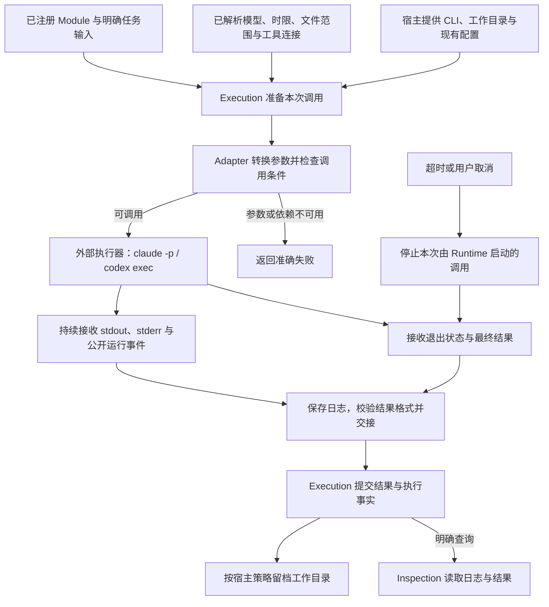

# Agent Runtime Environment, Execution Profile and Provider Adaptation

本文是 Runtime 运行环境、Execution Profile 和 Provider 适配的统一设计入口。它说明一次调用的
参数从哪里来、怎样成为 Claude、Codex 或 Antigravity 的实际配置，以及执行结果和日志怎样返回 Runtime。
实际接口、默认值、支持组合和验证结果由发布代码及其随包文档提供；设计中描述一种能力不表示所有
Adapter 都已经实现它。

Invocation 消费已解析的 Module、Execution Profile、本次输入和宿主资源，准备环境并执行一次
Provider invocation，处理基本运行信息与最终结果，并归档原始公开日志和实际资源执行记录。
Execution 拥有 Attempt 生命周期与最终提交，Registry 拥有不可变定义，宿主提供程序、认证来源和
资源，Provider 执行所配置的工具限制。详细工具日志由 Inspection 按需解析；行为评价由明确的
Evaluation 承担，不是普通模型运行的隐含步骤。

本合同同时适用于普通 Module 和 ModuleReviewer。后者只在定义端提供默认运行要求。本文不决定
业务审核结论、Workflow 路由、生产授权政策、数据库内容或软件发布，也不建立 Profile 选择服务、
第二套日志服务或底层系统调用监控。Claude、Codex 与 Antigravity 均按 §3.2 的外部 CLI 边界接入；
Antigravity 首个绑定只覆盖 `structured_output` 与 `file_review` 两种形状（§3.10）。

- Module Owner 能区分任务定义、默认运行要求、模型选择和一次任务的资源。
- Host Integrator 能知道 root 与 `.runtime` 提供什么，以及什么时候需要认证或持久存储。
- Adapter Maintainer 能沿同一条配置转换路径实现不同参数组合，并准确表达两种 CLI 的差异。
- Runtime Maintainer 能区分工具结果、Provider 终态、有效输出与业务结论，并从同一入口取回真实日志。

## 1. Primary System Flow

Claude 和 Codex 对 Runtime 都是外部执行器。Runtime 的控制边界是启动参数、输入、工作目录、
自身发起调用的时间与取消，以及接收到的日志和最终结果。CLI 内部的规划、工具调用、重试和 MCP
交互由 CLI 及相应服务负责，不进入 Runtime 的逐步调度或权限判断。

## 2. Intended Outcomes

调用者通过 Runtime 的同一公共入口运行已注册 Module，无需为 Claude、Codex 或不同 Reviewer
分别拼装启动脚本。调用者可以为一次同步运行选择时间预算，无需为每次延长运行重新定义 Reviewer。
模型选择、时间预算、工具能力和宿主资源分别说明，并在调用前成为可追溯的实际配置。
配置要反映 Provider 与宿主真实能够执行的限制；一次被正确阻止的工具操作可以由 Agent 处理，
不因这个正常拒绝就让整个 Attempt 失去输出资格。

Runtime 向调用者交付以下结果，供宿主接收业务输出并判断执行事实：

1. 固定任务要求、本次模型与时限、工具能力和实际资源在调用前被解析成准确配置；不相容组合返回明确失败，不自动扩大能力。
2. 所选 CLI 按给定任务和资源执行；Runtime 接收退出或停止事实、结构化结果、原始日志和实际配置，结果格式与业务结论分别判断。
3. 超时、取消、启动失败和输出错误保留真实状态及已有诊断；任务已明确交付的项目文件保持归属，Runtime 只维护自身工作目录的留档与清理。

## 3. Capability and Operation

| 处理对象 | 负责人 | 交接结果 |
| --- | --- | --- |
| 任务 instruction、完整输入输出 schema、语义完成条件 | Module / domain owner | 已注册定义；不携带 Provider 启动参数 |
| 通用 Module 运行要求与 Reviewer 默认环境 | Runtime 定义端 | 固定能力与 Policy 依赖；下游消费同一通用合同 |
| 本次模型、时间预算、Profile、Variant 与 Attempt | Execution，Registry 保存已确定的 release | 完整执行配置、身份与活跃预算；Invocation 执行其剩余期限，不再次选择 |
| 程序、依赖、认证来源、材料和可用存储 | 宿主与对应资源 owner | 明确安装配置及本次可用资源 |
| 配置转换、进程调用、基本运行信息与最终结果解析 | Invocation / Provider Adapter | 实际请求、最终结果、原始日志和实际资源记录 |
| 详细日志解析、请求与结果关联、完整性说明 | Inspection | 按需返回只读统一视图，不改变执行结果 |
| 所测行为是否符合明确要求 | Evaluation / 任务 owner | 消费所需日志或探针事实，给出评价结果 |
| 工具权限与资源限制的执行 | 所选 Provider、宿主或资源 Gateway | 按实际配置返回结果或拒绝；操作系统沙箱不是普通调用前置 |
| 最终提交、恢复、事实保存与读取 | Execution、Durability、Ledger、Inspection | 按原职责提交和展示结果 |

Provider Adapter 是技术绑定，不是新的 Agent 角色。Runtime core 不 import 宿主业务、Reviewer
实现或领域数据库；领域操作通过已经提供的公开资源接口执行。真实外部许可、grant 和执行 fence
仍由授权集成合同及其所属 owner 决定。

### 3.1 本次资源范围与服务端授权

Runtime 管本次运行可以使用的资源和入口，不管理 MCP 或网关背后的授权。任务 owner 与宿主明确
提供本次范围，Runtime 在 Module 固定能力内选择和绑定资源，将配置交给相应执行方，并记录实际
调用及其结果。这不是一套新的账户授权、业务审批或服务端权限策略。

| 本次范围 | Runtime 的职责 |
| --- | --- |
| 可读文件、目录 | 只向本次执行提供明确选定的材料与读取范围 |
| 可写目录 | 明确本次草稿、临时结果等可写位置；不将可读范围自动扩大为可写范围 |
| 可用 MCP | 接入宿主为本次执行明确选定、已经配置好的 MCP 连接 |
| 网关与数据库绑定 | 选择本次可以通过哪个网关访问哪个数据库的明确绑定；不改走未提供的连接或直接数据库访问 |

MCP、网关及数据库自己的鉴权、账户授权、数据库角色、表／行／列权限、凭据和授权策略，由对应
服务及其授权 owner 负责。Runtime 不查询这些后台授权细节，不复制权限表，不代替服务作第二次
许可判断，也不把检查这些内部配置作为普通 MCP 调用的前置。

Runtime 允许使用一个入口，不代表该服务一定批准请求。服务拒绝时保留其真实结果与所属 owner，
不自行扩大范围、重新申请权限或切换入口绕过拒绝。执行身份是否匹配、任务是否取消、资源绑定
是否仍有效等检查仍属于 Runtime 的执行管理；它们不产生业务访问许可。

### 3.2 外部 CLI 执行器边界

对 `claude -p` 和 `codex exec`，Invocation 只维护一份外部调用合同：把本次确定的参数、输入、工作
目录和现有连接配置交给 CLI，接收它输出的日志、公开事件、退出状态与最终结果。所用 CLI、参数和
结果格式的差异由各自 Adapter 转换，不改变这条共同边界。

启动前，Runtime 只按既定任务与本次明确选择完成输入、输出格式、模型、工作目录、材料及连接的
组装，并传入 CLI 已支持的原生工具与允许配置。运行中，它持续接收日志和公开状态，处理自己的
外层超时、取消与进程状态。结束时，它接收最终结果及文件位置，校验约定格式并保存、交接和留档。
CLI 内部的文件读写、命令与 MCP 执行、规划和重试都由 CLI 推进；Runtime 不提供第二套模型文件
服务或工具路由，也不把每条过程日志变成实时授权、重试或业务判定的触发器。

Runtime 不接管 CLI 内部如何规划或调用工具，不逐次审批、重执行或拦截其工具流程，也不为解释内部
行为重建子进程、工具或权限状态机。MCP 与网关的授权由服务自身完成。公开运行事件可被保存、显示
或在事后查询时解析，但不是 Runtime 介入内部执行的控制指令。

参数无效、程序无法启动、调用超时、用户取消、日志保存失败及最终输出格式不合要求，属于 Runtime
需要处理的外部调用问题。内部某个工具报错是否需要重试或继续，由 CLI 自己决定；Runtime 不从一条
工具错误替 CLI 改写整次结果。只有明确的新增需求，才另行讨论扩展接口，不默认建设回调桥或沙箱。

### 3.3 常用调用场景

以下场景是同一调用合同的具体用法，不是额外的执行模式、Module 类别或权限配置系统。它们共用
§3.2 的外部 CLI 边界：Runtime 准备并传递本次配置，CLI 执行，Runtime 接收日志和结果。能力在
Module 定义中明确，具体材料与连接由任务 owner／宿主提供；任务正文不能偷偷扩大配置范围。

#### 纯文本／结构化输出

调用者提供任务说明、完整内联材料和输出 schema。例如把一段材料提取成固定字段，或按明确标准
对一段内容给出结构化判断。此场景使用 `tool_free`：不开放文件、Shell、MCP、浏览器或其他任务工具，
也不需要模型可写工作区。Provider 自己的模型连接和已有登录照常使用；没有任务工具不意味着
Runtime 要启动操作系统沙箱或接管 Provider 网络。

Runtime 把准确输入交给所选 CLI，接收原始日志与最终结构化输出，校验原 schema 并记录实际状态、
用量及缺失信息。验收要证明结果来自这次调用、任务工具没有被额外开放，失败或格式错误有准确结果；
不能只把程序退出码为零当成语义完成。

#### 文件审核

调用者提供准确的文档、代码快照或其他文件，以及审核标准、只读材料位置和本次可写 scratch。
宿主根据同类审核的真实调用历史和本次需要，选择实际所需的读取、搜索、文件写入位置与检查
命令范围。材料已完整内联且不需要工具的审核，不因名为 Reviewer 就额外开放 Shell；从文件审核
时给出对应读取范围，生成脚本或中间结果确有需要时才提供 scratch 写入能力。

需要运行检查时，使用所选 CLI 能表达的命令允许规则，或本次已明确选择、具有对应约束的既有
检查工具／MCP。任务输入说明必须做什么，允许配置说明能做什么，实际结果由任务验证方判断。
不能把一次需要运行 Python／pytest 等检查解释为默认允许任意 Shell 命令，也不为此默认新建
Runtime 命令代执行、回调或逐步审批接口。

审核材料与生成内容分开：临时脚本、测试输出和报告写入明确的 scratch。CLI 的文件工具按其原生
读写配置使用目录；Runtime 保存输入完整性证据，不把这项文件工具配置宣称为所有子进程的操作系统
隔离。独立 Reviewer 使用独立会话及明确材料，避免继承作者聊天和未选定的项目指令；这个要求不
等于禁用它已明确选择的宿主登录、工具或 MCP。

输出包括约定的审核结论、问题位置与依据、实际执行的检查以及未验证项。业务 `non_pass` 或 `blocked`
可以是一次技术上正常完成的调用。验收核对材料是否按约定保持完整、结果 schema 与真实证据是否
对应；未运行的检查不能写成通过，工具报错也不能被 Runtime 擅自改写为整次业务结论。

#### 代码开发并运行命令

调用者提供开发任务、可读依赖、明确可写的 checkout／worktree 或任务副本，以及需要完成的验证。
所选 CLI 使用自己的文件编辑工具或 Shell 来阅读、修改、运行测试和整理结果。Runtime 传入程序、
模型、任务、工作目录和所需原生工具配置；CLI 内部如何分步、重试和选择命令由 CLI 决定。

工程改动是任务交付内容。调用者已有的代码目录、交付的 worktree 和修改结果不能被当作 Runtime
自有临时目录，在取消、退出或到期清理时一并删除。Runtime 只按 §3.5.6 维护自己明确拥有的工作材料
与留档；对外部可写项目仅记录准确交付位置及实际调用事实。

输出说明改了什么、改动所在位置、实际运行的测试与结果，以及未完成项；需要机器消费时使用
任务声明的 schema。验收包括真实 CLI 修改指定目标并执行所需检查、退出或停止事实及可检查日志。
不把 Shell 能用等同于它在 OS 沙箱里，也不因为没有可选沙箱就判定普通开发调用不可用。提交、
合并、发布或部署由本次任务的明确范围决定，Runtime 不因模型返回成功就自动追加这些动作。

#### 已有 MCP／网关查询数据

调用者和宿主选定本次可用的既有 MCP 连接、查询工具以及适用的网关／数据库绑定，同时明确
本地可读资料、可写工作区与输出位置。例如通过 Claude 已配置的 DYMON-MCP 取得数字，保存为
工作目录中的 JSON／CSV，再读取已有文件进行合并、整理或后续分析。这个常用场景组合 MCP 与
基础文件读写；正常配置必须让模型在指定目录中完成保存、读回和继续处理，不能只给 MCP 查询
后就认为该场景完整。调用者明确选择只查询并返回结果时，才使用这个较小配置。
Runtime 使用所选 CLI 的
现有接入参数和配置引用，不能先把连接全部清空，再以缺少 Runtime 回调通道为由拒绝普通查询。
只有 Module 声明的能力和本次选定的入口进入调用；宿主存在其他连接不代表它们自动可用。

服务负责登录、鉴权、账号权限和数据库角色／表／行／列规则。Runtime 不查询后台授权、不重做
SQL 许可判断、不复制服务登录状态，也不把连接密钥作为模型材料或普通日志。要访问哪个数据库
必须来自真实绑定；不能从 MCP 名称猜测，也不能把一句 prompt 当成已实现的数据库访问约束。
接口无法表达所需绑定时，报告这个具体配置缺口。

模型在任务内反复存取数据是本场景的必要能力，应在启动时配置原生读写工具及准确目录。Runtime／
宿主保存最终结果，不能替代这项任务内能力；只有明确选择纯结果返回时，才只使用已有输出保存接口。
保存数据
不自动等于允许任意命令，读写与额外计算命令分开说明；CLI 怎样实现文件操作按其真实接口记录，
不以某个 Provider 的内部实现推导所有任务都必须获得 Shell 或沙箱，也不另建 Runtime 文件服务。
明确交付到调用者输出目录的文件按该输出位置的约定保留，不自动纳入 Runtime 临时目录的到期删除。

CLI 负责调用查询工具、使用所配本地文件能力并整理结果；Runtime 保存它返回的日志、文件位置、
结果和可得来源引用。服务拒绝、
无数据、部分结果和整次 CLI 失败分别保留其真实含义，不自动申请权限、改走其他入口或建立中转服务。
验收通过公开调用验证选定连接确实可用、未选连接没有被额外传入、结果可解析且日志不混入连接秘密；
测试可使用短期合成数据服务，不能用参数字符串存在代替实际接入证据。数据研究的常用组合还应
验证一次真实的取数、保存、读回链路及输出文件归属；MCP-only 测试只能证明较小组合，不能代替它。

**共同结束与留档。** 四类都记录实际生效配置、接收的日志、退出／停止状态及结果。超时或取消处理
Runtime 自己启动的外层调用，已有结果与诊断按 §3.5.6 保存。只对归属明确且满足宿主保留策略的
Runtime 自有目录执行后续清理；外部项目、Provider 登录状态和服务数据不属于这个清理集合。
默认不自动启动清理日程，也不把设计中的场景说明当成当前实现已经通过验收。

### 3.4. Configuration Sources and Execution Profile

#### 3.4.1 输入与参数归属

| 参数类别 | 来源与默认规则 | 进入哪里 |
| --- | --- | --- |
| instruction、输入输出 schema、任务完成条件 | Module 的固定定义 | Prompt 和结果校验；Profile 不改写其含义 |
| execution mode、工具、输入交付、workspace、工具网络、上下文 | 通用 Module 固定能力要求；ModuleReviewer 构造时提供 Runtime 默认 | Profile 能力校验和实际资源准备 |
| max_attempts | Module 与其准确 Retry Policy | 限制已有重试调度的次数，不因值大于一自动启动重试 |
| transport、model、effort 与同步调用的 run_timeout_seconds | 按四层逐项取第一个写了值的来源：本次显式参数；该 Workflow 的参数文件；workspace 参数文件；Runtime 公开默认 | 模型选择和名义 Attempt 上限进入本次 Profile；总预算交给 Execution 的活跃运行上下文；记录每项来源及参数文件哈希 |
| root、CLI executable、认证来源、依赖、运行目录、可用 stores | 宿主安装配置；明确的本次资源参数按公共接口覆盖对应宿主项 | 宿主资源解析与实际调用记录 |
| 本次可读文件、可写目录、可用 MCP、网关／数据库绑定 | 任务 owner 与宿主明确提供的本次资源范围，须在 Module 固定能力内 | 固定实际连接与配置；不据此推导或复制服务端授权 |
| 本次任务正文、材料和已提供的逻辑请求身份 | 本次请求 | 固定输入与执行记录；任务正文不能作为配置覆盖 |

Runtime 公开参数必须说明省略值、显式空值、允许覆盖的范围和失败行为。这里不规定一个“所有字段
后写覆盖前写”的通用合并器：模型覆盖不能修改工具，材料路径不能变成授权，存储配置不能进入模型。
同一语义参数在准备阶段解析一次，后续阶段消费同一结果。

#### 3.4.2 Profile 的含义

Execution Profile 是已经解析的执行配置快照，保存模型、Adapter、工具、网络、工作区、上下文、
名义 Attempt 时间上限和输出方式。Module 运行要求回答需要什么能力；Profile 回答这一次选择了什么
执行组合；宿主资源回答这个组合使用哪些程序、文件和连接。Execution 的活跃总预算另外约束实际
剩余时间。Profile 是不可变选择，不随时间流逝反复改变 hash。

普通 Module 显式声明自己的运行要求。ModuleReviewer 继承相同构造与执行合同，只提供一套
Runtime 发布的默认环境。Portable Reviewer source 提供任务身份、归属、prompt、schema 与相关
任务文件，不声明 transport、模型或工具配置。定义导出不检查本机 CLI，也不选择本次 Profile。

新的调用准备按 §3.4.1 的四层来源取得模型选择与同步运行时间预算。root 下的 workspace 与 Workflow 执行参数文件是项目明确写下的
选择，属于合法来源；root 的其他内容、环境名称、相邻项目或历史保存的 Profile 不当作模型选择规则。
参数不能扩展 Module 固定能力。文件不可读、格式无效或参数不受支持时，在 Provider 前失败，不将
错误当成该层未写值。低层 exact-Profile 接口继续消费准确 Profile / Variant，不隐式获得高层总预算。
其新 Attempt 仍遵守 Registry 的定义版本准入；历史读取和已提交结果重放保留原内容，不补入当前默认。

执行选择与能力分别变化：更换模型或同步调用的时间预算不修改 Module；更改固定能力形成新定义。Profile 或
其他影响执行行为的配置改变，按 Registry 和 Execution 的既有版本及 Variant 规则记录，不能覆盖
旧记录或在正在运行的 Attempt 内切换。实际 CLI 安装版本和 Adapter revision 分别记录。

#### 3.4.3 同步调用时间预算与受管理子调用

`run_local_workflow_test` 的本地定义与只读 PG 定义路径，以及 `run_agent_example`，共同提供一次
同步调用的总工作时间预算。默认 1200 秒，`run_timeout_seconds` 为 1 至 86400 的整数秒；
`--run-timeout-seconds 3600` 只为本次调用选择一小时。Python 的 None 或省略 CLI 参数向较低层取值；
参数文件中的 null、布尔值、浮点数、越界值和未知键均拒绝。`runtime_execution_parameters_v1`
保留原三字段含义，`runtime_execution_parameters_v2` 在同一解析器增加运行时间字段；旧格式不接受新键。

四层解析决定请求的预算，父子约束决定实际可用预算。Execution 从同步 API 进入时读取本地 monotonic
clock，定义解析、输入检查和资源准备消耗同一预算。Provider 前检查若已过期，就停止新工作。
Provider 准备与进程调用、同一次 Runtime 调用中的图节点、实际重试和显式受管理子调用均受其剩余时间
约束；等待子调用会消耗父调用时间，重试不会重置总期限。资源准备中的不可中断 I/O 和有界清理
可能使 API 返回晚于工作期限，因此该参数不保证函数在精确秒数内返回。

Profile 的 `timeout_seconds` 保留单 Attempt 名义上限的含义。新定义经高层准备时，以解析出的总预算
填充该上限；Invocation 同时遵守 Execution 的活跃 deadline，不得通过重新启动进程、预检或向上
取整剩余秒数延长期限。工具服务自己的时限由相应服务执行。Execution 在提交前拒绝预算已耗尽后的
迟到结果；运行中不修改冻结 Profile，也不另建一套日志或超时状态机。

受管理子调用通过可信 Python 接口取得 Runtime 签发的活跃父上下文。父上下文必须属于当前进程与
准确父 Attempt；关闭、跨进程或不匹配的上下文被拒绝。子调用仍独立解析自己的配置，其实际 deadline
取本地请求期限与父 deadline 中的较早者。父只剩两分钟时，子请求一小时仍受两分钟限制；子先完成
不会终止父。并行子调用共享同一个父期限，不累加墙钟时长。父过期或取消会停止其受管理子工作并
等待必要清理，不把已放弃的子工作报告为完成。

本节的父子预算只覆盖 Runtime 显式调度的调用，不要求追踪 CLI 内部的规划、工具重试或子任务。
父上下文不来自 prompt、模型工具参数、CLI JSON 或环境变量，不是第五层配置，也不授予额外能力。
普通 Shell 中自行启动的 Runtime、远程 worker 和跨进程调用不自动获得此传递保证。跨同步 API
调用的 durable WAIT、恢复及完整 Workflow 寿命继续由原 Durability 合同决定，不默认变成二十分钟。

#### 3.4.4 独立的能力维度

工具清单、工具网络、文件可读范围、可写范围和输入交付分别表达。允许 Shell 不等于允许联网，
允许读取不等于允许写入，agent mode 不等于启用全部工具。空工具清单表示明确关闭任务工具。
Provider 用于完成结构化响应的技术输出机制与访问文件、网络的任务工具分别识别。

| 维度 | 本合同的含义 |
| --- | --- |
| tool_free | 完整输入内联；不向模型开放文件、Shell、搜索、应用、额外网络或可写工作区 |
| agent | 在明确的工具与资源范围内自主执行；工具集合可以为空 |
| workspace none | 不提供模型可写任务目录；Provider 自身必要运行缓存另行隔离 |
| 私有草稿 | 只写本次允许的草稿与临时结果；材料和依赖保持只读 |
| 显式项目工作区 | 读取或修改本次明确提供的项目范围；不由宿主 root 隐含授予 |
| provider_managed | 普通 agent 与标准 Reviewer 的默认：沿用所选 Provider／宿主的网络配置，Runtime 不另加网络限制，也不宣称无限访问或操作系统隔离 |
| network denied | 明确选择时，工具不能使用额外网络；Provider 自身完成模型调用的连接另行配置。工具为空不需要额外启动操作系统沙箱 |
| gateway_only | 明确选择时，网络操作仅经指定受控接口；原生 Shell 不因此拥有通用网络 |
| direct_sandboxed | 明确选择时，按目标及协议范围配置工具网络；所选实现须能表达这些限制 |

这些是可组合的语义维度，不是要求 Adapter 只实现几个固定套餐。具体类型、枚举和值域由代码
合同定义。组合不受支持时指出不能表达的要求，保留其余合法组合；不自动开放权限、换模型或换 Provider。
普通 agent 的基础文件读写应通过 CLI 原生能力提供，并在配置中记录实际目录与工具；不能以
宿主能保存结果代替模型能在任务中读写。明确的 `tool_free` 不开放这些任务工具。
普通 native-tool 调用不因存在 Shell 被强制归入 `denied` 或 `direct_sandboxed`。新默认只用于新构造的
定义；已冻结定义、已发请求和历史记录按原值解释，不能把原有 `denied` 静默改名为 `provider_managed`。

#### 3.4.5 Published presets and per-call selection

`module_requirements_preset(preset_id, *, mcp_connections=(), max_attempts=1)` 返回
`ModuleExecutionRequirements`。调用者把它传入 `Module(..., execution_requirements=...)`，再导出并注册
Module/Workflow。这个入口只构造固定要求，不执行模型，也不选择模型。改变要求须注册新版本。
以下为 `0.2.0.dev14` 的实际构造值；`0.2.0.dev12` 随包样例的精确验证范围见第 6.1 节。

| Preset | Mode / workspace | Task tools | Tool network | Suitable result and required call resources |
| --- | --- | --- | --- | --- |
| `structured_output` | `tool_free` / `none` | `()` | `denied` | 完整内联输入按 schema 返回结果；不提供材料文件、项目目录或任务工具 |
| `file_review` | `agent` / `own_draft_read_write` | `edit, read, search, shell` | `provider_managed` | 读取明确材料，在本次 scratch 写审核文件并读回；调用方用 `material_root` 和 `material_files` 选定文件，所需只读依赖用 `read_only_dependencies` 声明 |
| `code_change` | `agent` / `explicit_project_read_write` | `edit, read, search, shell` | `provider_managed` | 修改调用者提供的 `project_directory` 并运行验证；模型交回 schema 输出，项目修改留在该目录 |
| `mcp_data` | `agent` / `explicit_project_read_write` | `edit, read, shell, mcp__<name>`，每个声明连接一项 | `provider_managed` | 通过声明的 MCP 取数，在 `project_directory` 保存、读回和处理；构造时必须有非空 `mcp_connections=(name, ...)`，root 配置提供同名连接 |

四项共同采用 `semantic_input_delivery_mode="inline"`、`context_isolation="workflow_execution_isolated"` 和
`output_constraint_mode="native_structured_output"`；`max_attempts` 默认 1，可显式设为 1 至 100 的整数。
`file_review` 的材料文件经宿主准备，内联输入包含材料定位及任务要求，二者含义不同。
`ModuleReviewer` 自身的默认 `max_attempts` 是 3；它与 `file_review` preset 不能按名字视为同一配置。
已注册的 Reviewer 可能仍保存旧的 `network_policy="denied"`。实际调用必须读取该定义，不把新默认
应用到已有版本。普通 Module 没有隐含工具，使用 preset 本身也不产生数据库权限或凭据。

`mcp_connections` 只适用于 `mcp_data`，其他 preset 带连接名称会被拒绝；名称缺失、重复或格式无效也
被拒绝。MCP 的实际入口在 `root/.runtime/config.json` 的 `mcp_servers.<transport>.<name>`，包含
`config` 和按名字声明的 `environment_keys`；当前 Test Run API 不接受直接的 `mcp_servers` 参数。
认证由既有服务处理。Codex 的文件操作经原生 shell 完成；Claude 的 Bash 命令范围沿只读命令及
本次 `command_permits`，因此声明 shell 不替代调用方需要提供的命令选择。

执行参数入口是 `run_local_workflow_test`，CLI 对应 `agent-runtime-test-run`。本次选择
`transport_kind/model_id/reasoning_profile/run_timeout_seconds`，CLI 分别使用
`--transport/--model/--effort/--run-timeout-seconds`。省略值按第 3.4.1 节四层来源解析。
`root` 定位定义和宿主配置；`project_directory` 是具体任务项目；两者可以不同。解析后的
Execution Profile 保存选择结果；它与 preset、下述 Codex 选项及应用自身的连接配置各司其职，
不另建一份人工 Profile Registry。

#### 3.4.6 Codex configured and host selection

`codex_execution_mode` 是每次调用的 Codex 执行选项，CLI 为 `--codex-execution-mode`。
`configured` 是省略时的默认，保留现有 Adapter 生成的 CLI 配置：有文件工具时按本次目录与网络
要求生成 permission profile；没有相应 profile 时采用原 `-s read-only` 路径。已有调用不会因新增
`host` 选项而自动改变。

`host` 显式选择本人宿主权限。当前 Runtime 接受的准确组合是 `codex_cli`、`agent`、
`explicit_project_read_write`、`provider_managed`，工具恰为 `read/search/edit/shell`。
它使用给定 `project_directory`，传入 `-s danger-full-access` 与 `allow_login_shell=false`。
这个目录是任务工作范围，执行沿宿主权限，目录本身不是 OS 禁写边界。

`host` 当前拒绝 material package、额外只读依赖、`resources.commands` 声明命令扩展及 MCP；调用方
可显式用 `read_only_dependencies=()` 清除宿主默认依赖。参数未知或为 null 时拒绝；不相容能力组合
返回 `ADAPTER_CAPABILITY_UNSUPPORTED`，不启动一个更宽的替代调用。这些是 Runtime 当前接口的
支持范围，不能解释为 Codex 产品无法执行这些任务。`mcp_data` 仍由原 configured 路径提供；
需要项目上下文与 MCP 的 host 调用使用 §3.4.7 的原生项目执行。

#### 3.4.7 Native project execution

`native_project` 是每次调用的显式选择（CLI `--native-project`），让一次独立的 `claude -p` 或 `codex exec`
在调用者提供的项目目录中按 CLI 原生规则加载项目指令和 Skills。Runtime 仍组装输入、输出 schema、模型、
时限与选定连接，接收日志与最终结果并校验、记录和交接。省略时为 false，现有 configured 与 Codex host
调用的参数与记录完全不变；执行参数文件与 Module 定义不选择它。每次调用不保存、不续接会话，跨次调用
不共享对话记忆。

它只接受既有 `code_change` 与 `mcp_data` 形状：`agent`、inline 输入、`explicit_project_read_write`、
`provider_managed`，工具含 read、edit、shell（search 可选），另可有声明的 `mcp__<name>` 连接，不含 callback。
Claude 使用 `claude_cli`；Codex 另须显式 `codex_execution_mode="host"`。必须提供 `project_directory`；
材料包、`resources.commands`、额外只读依赖、`command_permits` 与 callback factory 都被拒绝。其他组合与
Antigravity 在启动 Provider 前返回 `ADAPTER_CAPABILITY_UNSUPPORTED`，不降级为其他模式，也不换 Provider。

| 项目 | Claude | Codex |
| --- | --- | --- |
| 项目上下文 | 不加 `--safe-mode` 与 `--disable-slash-commands`；CLAUDE.md 层级与用户、项目 Skills 按 Claude 原生规则发现，经 `Skill` 工具使用 | 不再关闭项目文档与 Skills（不传 `project_doc_max_bytes=0`、`skills.include_instructions=false`、`features.skip_host_skill_discovery=true`）；AGENTS.md 与 `.agents/skills` 按 Codex 文档发现 |
| 本次仍关闭 | 自动记忆（`autoMemoryEnabled=false`）与 hooks（`disableAllHooks=true`）；托管策略照常生效。Runtime 不另行控制 plugins，实际加载的 plugins 以 init 事件为准 | agents、Web 搜索与既有关闭的 features（memories、hooks、plugins 等）保持关闭 |
| 工具与许可 | 映射工具加 `Skill`；shell 同时请求 `Bash` 与 `PowerShell`（Claude 只在提供该工具的宿主上给出）；声明 MCP 时加 `ListMcpResourcesTool`、`ReadMcpResourceTool`、`ToolSearch`。`dontAsk` 下允许这些工具、`Edit(./**)` 与每个 `mcp__<name>`；用户、项目与托管的 deny／ask 规则照常优先 | 宿主权限：`-s danger-full-access`、`approval_policy="never"`、非登录 shell；execpolicy 照常生效 |
| MCP | 只有私有 `mcp.json` 中声明的连接，`--strict-mcp-config` | 渲染声明连接，并逐次关闭宿主配置中未声明的已启用服务器 |
| Python | Runtime Python 照旧位于 PATH 首位；项目自己的解释器由项目指令或 Skill 写明，经 Shell 调用 | 同左 |

两种 CLI 都不使用 bypassPermissions、跳过权限或关闭托管保护。Shell 以本人宿主权限运行，项目目录是任务
范围而非操作系统边界。凭据留在 CLI 原生机制中：根配置的连接名与 URL 与原生连接一致时，CLI 自己找到
已有登录；Runtime 不读取、复制或改写认证文件与全局设置。Runtime 不安装 Python 包、不改全局环境，
也不替换自己的解释器。

记录：trace 与 `effective_configuration` 写入 `native_project: true`、`context_enabled`（本次不再关闭的
原生上下文发现，是配置意图而非观察）、`context_suppressed`、实际工具与允许规则、`command_scope=host`、
`filesystem_scope=task_directed`；MCP 仍以名称与配置哈希记录，不复制 URL 或命令。实际发现与使用以原始
日志为准：Claude 的 init 事件列出工具、Skills、plugins 与连接状态，两种 CLI 的工具、命令与 MCP 事件由
Inspection 返回。Shell 发起的 HTTP 请求是命令，不记为 MCP 调用。

**Adapter revision。** 这个选择不新增 Adapter revision：Claude 仍为 `claude_cli_adapter@v4`，Codex workspace
仍为 `codex_cli_agent_workspace_executor@v5`，Profile／Variant 准备不变。每个既有请求（Profile 加既有的本次
资源与选择）的转换逐字节不变；新的转换路径只能经新增且被记录的本次选择到达，与 §3.4.6 的
`codex_execution_mode` 相同，记录中的绑定、`native_project` 与 `runtime_version` 共同说明实际执行了哪条转换。
改变某个既有请求的转换仍须更新 Adapter revision 及对应绑定（§3.11.3）。

### 3.5. Host Environment and Preparation

#### 3.5.1 root 与 .runtime

宿主 root 是 Runtime 配置与本地注册内容的定位入口。基于 root 的公开操作先复用轻量 setup：
`.runtime` 不存在时创建，存在时读取和使用其中的 Runtime 内容；随包操作 Skill 通过同一 setup
接入宿主发现位置。已准备环境只做必要本地检查，不额外运行模型、扫描整个项目或连接生产数据库。
CLI 帮助和纯定义构造不初始化环境。

`.runtime` 可保存可复用的宿主参数、已注册定义，以及 workspace 与各 Workflow 的执行参数文件；执行参数文件
与已注册定义分开存放，只保存执行参数，不选择定义版本；注册新版本不改写它们。Module 与 Workflow 分开保存；单节点 Workflow
仍属于 Workflow。定义的版本存取与执行目标选择由 Registry 和 Execution 各自的公共合同处理，
不在环境准备或 Adapter 中另定规则。Invocation 消费 Execution 已经按本次用途选定的准确目标；
Profile 准备和实际调用固定同一结果，不重新从 root、latest 或其他指针选择版本。

宿主配置保存程序、依赖、运行资源和可用存储的定位信息；凭据通过对应可信接口或明确的私有位置
提供。Provider 认证只交给 Provider 的认证机制，PG 凭据只交给对应存储接口。秘密不进入 Profile
正文、prompt、argv 或共享日志。root 不自动授权建库、迁移 schema、保存执行数据或读取项目全集。
程序位置与所选 MCP 连接可由随包 setup 命令写入宿主配置（规则见 Design 05 §7）；它只改动所选字段，
不导入无法以环境变量名引用凭据的连接设置。

§3.4.3 决定本能力的预算含义；其他配置文件名、键、schema / table、默认目录与 CLI 选项由公开代码
和帮助导出。本文不创造
一个新的环境配置服务，也不要求为目录、临时文件和凭据建立跨资源的通用管理框架。

#### 3.5.2 实际资源与上下文来源

调用准备区分宿主配置目录、Provider 私有状态、本次模型可见材料、可写工作区和日志目的地。
它们的用途不能混用。Runtime 不将 Provider 登录材料、私有记录或其他任务资料作为本次模型输入
交付；实际工具访问范围由已选 Provider、宿主和网关按配置执行。只读材料的全文可能被模型读取，
准入时按此处理。
任务结束后哪些目录保留、哪些运行资源立即释放，以及何时允许删除，统一按 §3.5.6 的生命周期处理。

项目指令、Skills、Plugins、hooks、MCP、环境变量和历史会话都可能改变模型行为。准备时明确本次
是否加载以及允许的来源，Adapter 使用 Provider 实际支持的开关和隔离方式实现。默认独立审核
不加载 ambient 项目和个人上下文；明确要求项目工作的普通 Agent 可以读取已授权项目入口和 Skills。
关闭自动发现不等于禁止读取已明确交付的 Skill 文件。

任务上下文选择与 CLI 自身运行配置分开处理。不能为了隔离未选定的项目指令，顺带关闭本次所需
的原生文件工具、已有登录／连接或已选择的原生许可规则。Adapter 只转换真实需要的参数；不因旧
实现曾经设置过某个开关，就把它继续当作所有调用的要求。

MCP 接入按其真实来源选择路径，不能把所有工具调用都当作 Runtime 自有工具回调。

| 本次使用的能力 | 接入方式与通道要求 |
| --- | --- |
| 纯文本输入输出 | 不要求本地工具通道 |
| Provider 自带的读取、搜索或 Shell | 使用 Provider 已有工具及宿主配置，不因使用这些工具就新增 Runtime 回调通道 |
| 已配置的外部 MCP／网关 | 使用宿主明确选定的现有连接，由服务自身执行授权；不要求再经 Runtime 自建 MCP 或中转服务 |
| 需要 CLI 之外的新回调或代执行能力 | 属于额外需求，须另行明确范围；不是正常启动 CLI、接收日志和结果的前置 |

例如，宿主明确选择 Claude 已有的 DYMON-MCP 连接时，Invocation 使用 Provider 的接入能力传递或
选择这项配置，记录可取得的工具调用结果，不检查 DYMON-MCP 内部账号或数据库授权。配置存在
不等于当前 Adapter 已实现该接入；若准确绑定无法表达或使用，报告这一接入缺口，不用自建权限层
替代它，也不把额外桥接建设扩大成所有 Runtime 任务的前置。

所选网关／数据库范围使用宿主提供的明确资源绑定，由相应接口执行。Runtime 不从 MCP 名称或
后台授权内容猜测数据库范围；连接不能承载要求的明确范围时，报告配置或适配缺口，不宣称范围已
被限制。连接配置和凭据仍走既有可信接口，不进入模型正文或共享日志。

#### 3.5.3 调用准备与相容性检查

每次调用只核对本次所需的程序、参数、输入与配置是否可用。已知不支持的参数组合在调用前说明；
CLI 返回的认证、额度或连接错误保留其真实原因，不由 Runtime 搜索其他账户、查询后台权限或自行
修改宿主配置。

Adapter 开发或升级时验证参数转换、日志接收与结果解析是否符合 CLI 的公开接口。普通调用不重复
运行模型 smoke、权限探针、全仓扫描或底层安全检查，也不为使用已有 MCP 先建设额外服务。

#### 3.5.4 配置执行与日志观测的边界

Runtime 把本次明确的文件读写范围、工具与连接选择转换为所选 CLI 的现有参数或配置。实际限制由
Provider、宿主及资源服务执行；Runtime 不另写权限判定器，不查询 MCP 的内部授权，也不通过监听
运行日志逐次决定工具是否获准执行。

文件工具的目录范围通过 CLI 原生接口配置。允许 Shell、Python 或脚本，不使这些目录配置自动成为
所有子程序的操作系统边界；Runtime 不为补足这种额外保证扫描凭据目录或建设沙箱。实际工具许可
与资源访问由已选执行器、宿主和服务处理。只有本次明确声明操作系统隔离、断网等额外要求时，
才检查已有接口能否表达该要求；不支持时报告具体缺口。普通调用不强制这些条件，也不修改宿主的
安全设置、关闭已有保护或把权限模式改成绕过审批。

日志中的工具错误、拒绝和重试作为原始执行信息保存。Runtime 不从错误文字推测隐藏权限，不扫描
CLI 的私有状态来补齐内部过程，也不把每个内部工具事件当作自己的执行检查点。

#### 3.5.5 Provider 登录与私有配置

Claude、Codex 和 Antigravity 使用宿主已配置的登录方式与私有配置。Runtime 通过正常的 CLI 接口使用它们，不
解析、刷新或重新管理认证内容，不建立一套按调用复制、比较、回写登录文件的策略。登录不可用时，
返回实际 CLI 错误并交给宿主处理。Provider 登录以及 MCP 的登录、同意与工具审批由人在原生 CLI 和
服务中完成。setup 只运行非交互的版本与登录状态查询，以及所选连接的配置查询，并报告缺口；它不启动登录，
也不代替用户批准。Antigravity 没有公开的登录状态命令：setup 只运行 `agy --version`，不读取认证文件，
也不把模型列表当作登录证据，登录状态报告为 `not_verified`，由首个真实调用确认。

凭据不进入任务正文、命令参数或共享日志，也不作为普通工作文件留档。Runtime 只释放自己创建的
临时资源，不删除或重写宿主与 Provider 已有的登录状态。不同平台的登录实现属于 Provider／宿主，
不在本合同定义 Windows 认证副本与 POSIX 引用两套机制。

#### 3.5.6 任务停止、工作目录留档与到期清理

停止执行、保留检查材料和删除过期目录是三个不同动作。普通任务结束后，默认保留本次可供检查的
工作目录与执行证据，再按宿主明确配置的保留策略清理；不把“进程已停止”理解为“立即删除全部文件”。
明确使用一次性资源的测试，继续按测试宿主已声明的导出、保留和清理策略处理。

这里的任务沿用既有 Workflow Execution / Module Run，工作目录按 Attempt 隔离，不新增任务身份或
另一套任务 Registry。宿主提供受控根目录，Invocation 核对归属并准备本次资源。每次重试有自己的
Attempt 工作区；新任务不能默认打开旧任务的目录，已封存目录也不作为新执行的可写工作区。

| 目录用途 | 执行期间的访问 | 结束后的处理 |
| --- | --- | --- |
| 已交付材料，包括既有 `materials/source` | Runtime 准备，模型按本次授权只读 | 按保留策略留存，供还原本次输入 |
| 本次私有草稿 `scratch` | Profile 允许时，模型可读写；也是本次主工作目录 | 停止后保留工作结果，不再由模型写入 |
| 原始日志、结果与执行事实快照 | Runtime 写入，检查者按既有权限读取；不是模型工作目录 | 保存完整性与准确执行引用，供后续检查 |
| Provider 登录材料与私有连接配置 | 由 Provider／宿主管理，不作为任务材料提供 | 不复制进普通留档，不由任务目录清理删除 |

该表定义用途，不强制新的物理目录名或统一存储布局。保留整个草稿目录不会把其中每个文件都变成
正式输出或业务 Artifact；只有原合同声明、校验和提交的输出才取得相应身份。留档位置也不得混作
持久 Registry、Ledger 或业务数据的存储位置。

**停止调用。** 超时、取消或宿主要求终止时，Invocation 停止本次由 Runtime 发起的 CLI 调用，使用
宿主原生进程控制并记录可观察的退出或停止结果。不能按程序名杀掉其他任务的进程。Runtime 不
追踪或重建 CLI 内部的进程树，也不宣称已核验每个内部进程；CLI 内部的收尾由 CLI 自身负责。
Runtime 的取消结果、所启动进程的退出情况和日志是否接收完整分别记录，未确认的事实保持未知。

**保存与封存。** 已确认停止后，Invocation 完成有界日志收尾并交接已取得的结果；Execution 按原
合同记录终态，宿主保存本次工作材料和所需证据，最后使留档目录退出可写执行用途。成功、失败、
超时和取消都要保留已有诊断，缺失或截断明确标记。执行成功与留档成功分别报告：保存失败不改写
已发生的执行事实，也不能报告已经留档。停止无法确认时保留原受保护现场，报告未确认的范围与
恢复位置；不得将它封存为可自动删除的普通历史目录。

任务留档不包含登录材料或未声明的 Provider 会话目录。原始日志仍按 §3.11 的私有内容与脱敏规则
处理；留档不扩大读取权限，也不要求 Runtime 检查、迁移或备份 Provider 的内部状态。

**到期清理。** 宿主资源策略决定留档位置、保留时长、清理周期及明确的保留例外，并遵守适用的
[Data Governance](the_data_governance.md) 约束。未配置保留时长或周期时，不自动删除。保留时长以
宿主确认封存完成为起点，使用符合 [Timestamp Semantic Contract](the_timestamp_semantic.md) 的
UTC 时间事实与可比较时钟；不用进程内 monotonic 值、目录名或文件 mtime 推断到期。时间或状态
证据不足时先保留并报告，不能猜测已经满足删除条件。

定期触发由宿主既有调度设施承担；Invocation 提供核对与清理 Runtime 自有目录的公开资源维护操作，
由宿主传入既有执行事实和保留策略，不反向读取 Ledger 的私有结构，也不再启动一套独立
调度服务。清理前同时确认：目录属于本次留档集合、执行已经结束且进程停止已确认、留档保存完整、
没有活跃租约或写入、没有要求继续保留的例外或恢复引用、保留期已到。这里的保存完整指已取得且
按策略必需保留的材料已保存、已知缺口已说明，不将原始日志本身无截断作为所有任务的删除前提。
任何条件不确定都跳过并说明原因。删除仅
作用于核验归属的目录，不跟随替换路径或重解析点，不追删被移走的任意目录，不删除注册定义、权威
执行记录、独立输出存储或业务数据。清理结果分别列明实际删除、保留和失败；错误不会触发更大范围
的补偿删除。

**中央留档与本次清理。** 普通 Test Run 仍是测试证据。宿主可在运行结束后显式调用 `agent-runtime-archive`
（`save_test_run_archive`、`read_test_run_archive`、`cleanup_test_run_archive`），把本次记录和本次 Attempt
文件夹中的普通文件，写入 root 配置 `run_archive` 指定的中央 Runtime 留档 schema（默认 `runtime_archive`，
只插入的 `run_archive` 与 `archive_content` 两张表；schema 由数据库 owner 用 `run_archive_ddl` 建立，保存时不建表）。
这一层是 Runtime 运行记录，不是 Workflow Ledger，也不是 Agent 使用的业务 schema：项目目录、业务库与产出只作为
记录中已有的引用，不复制，不清理。保存在一个事务中提交，再用新连接读回清单与全部内容，按路径集合、大小与 SHA-256
核对；写入或读回失败报告为留档失败，现场与运行自身的结果保持不变。保存时观察的 Python、操作系统与已安装 Runtime
版本标为 `archive_host`，不当作原运行环境；原运行事实取自记录本身。清理时再次从数据库读回核对，确认现场文件仍与
留档索引一致，链接、reparse point 或特殊文件使该 Attempt 视为未完整留档而保留；之后只把清单列出的 Attempt 交给
上述维护操作，`archive_complete` 只来自这次读回，`retention_hold` 由调用方给出，`retention_seconds=0` 表示封存后
不再额外等待，`None` 仍表示不自动删除。留档行本批不设到期或删除。

**事后检查。** 检查者可按权限查看保留的材料、草稿、日志与结果快照；权威执行状态和详细日志投影
仍由 [Inspection](agent_runtime_06_standalone_package_and_lifecycle_contract.md#7-execution-inspection)
按既有记录提供。目录存在不证明任务成功，文件内容也不能补造缺失的 Ledger 事实。已按策略删除的
材料明确报告不可用；留档本身不承诺继续执行或恢复一个 Workflow。

### 3.6. Request, Input and Context

#### 3.6.1 公共请求

Adapter 的公共 execute 接口消费已经准备好的请求与 request-bound host，返回 AgentExecutionResult。
请求使用既有 Execution 身份、准确 Module / Profile / Adapter、完整输入与 Prompt Envelope、输出
schema、本次资源，以及所需的执行边界信息。具体签名与字段由公开类型和 docstring 定义。
不向调用者另开放一条原始 CLI flags 或 settings 的任意透传入口。

Execution 在调用前产生真实 Attempt-start 记录；临时自测也使用同一执行身份和日志合同。外部
受保护操作按授权集成合同携带真实决定；普通自测使用明确测试资源，不伪造生产批准、grant 或
allow-all 服务。Provider 登录、宿主调用资格和业务资源授权分别处理。

#### 3.6.2 输入交付和输出约束

Runtime 固定完整任务输入和实际发送的 Prompt 内容，Adapter 不在记录后私自追加任务语义。
冻结的 Prompt Envelope 原样发送。CLI Adapter 可在其前加入一段由代码按本次 Attempt 实际准备结果生成的位置说明（工作目录、可写目录、材料与只读依赖目录、Runtime Python），不含任务语义、凭据或私有控制文件。Envelope 的 ref／hash 只标识冻结 Envelope，不代表整个 CLI 输入；每个 Attempt 记录实际发送的完整文本，供 Inspection 读取。
模型可见任务材料与 Runtime 控制信息分开。允许模型探索一个目录，不等于已经把该目录全文作为
冻结输入交付；实际读取内容按 Provider 可取得的事件记录。

inline、Gateway、attachment、hybrid 和显式 workspace 按实际资源与任务完整性要求选择。
必须完整交付的内容不静默截断、摘要或替换为模型自行挑选的片段；分页 Gateway 还须按所属合同
核对完整分页覆盖。Provider context limit 无法满足任务时，返回输入不足或预算问题，由任务 owner
决定分块或其他方案；Adapter 不设计业务工作流。

原生结构化输出由 Adapter 转换 schema，返回后仍验证 Module 的完整 canonical schema。
prompt_only_json 和 native_structured_output 显式选择，不因其中一种不可用自动切换。
生产用途保留 native_structured_output 默认；prompt_only_json 作为明确选择的 Evaluation Variant
使用，不自动推广为生产配置。原生输出与 prompt 中的重复 schema 约束须按公开编译规则处理。
Provider 特有的 schema 转换不产生新的业务 Module，转换行为随 Adapter 版本记录。

#### 3.6.3 Context 与重复执行

stateless、create、resume 和 reconstruct 使用既有 Context 合同。新请求不从 CLI 的“最近会话”
或宿主历史自动续接。Native resume 需要同一任务与执行配置的兼容依据；跨模型、Provider 或隔离
范围的继续工作，从允许的输入、已解析输出和连续性材料重建，不复制不透明会话目录。

已提交请求的重放读取原日志与结果，不再选择模型或启动 Provider。模型或输入改变按既有规则
形成新的执行身份。无持久存储的自测可以返回完整内存记录，但不承诺进程退出后的恢复。
工具内部重试、Runtime 新 Attempt 和同一请求的结果重放分别记录。

### 3.7. Tools, Domain Operations and Provider Bindings

#### 3.7.1 原生工具与普通 Module

read、search、shell 是逻辑能力，Adapter 将它们映射为所选 Provider 实际提供的工具。
不同 Provider 不必暴露相同工具名称，也不能只因名称相似就宣称能力等价。Shell 中的常用读取、
差异和测试命令复用 Shell，不逐条建立 Runtime 工具；子进程仍受已经配置的资源边界约束。

标准 Reviewer 的运行环境支持读取、搜索和所需检查，提供只读审核材料及必要的本次可写区域，
上下文独立；网络沿用所选 Provider／宿主配置（`provider_managed`）。本次具体启用的工具与
命令允许范围按 §3.7.2 确定，不把原生 Shell 能力当作对所有命令的默认允许。
这些默认值不要求操作系统沙箱或统一断网。普通 Module 也可以明确使用这些能力和自己的非审核
输出 schema；显式更严格的定义保留其要求，不能借默认值变化静默放宽。
审核所需命令与业务完成条件由任务输入和验证方说明。Runtime 传递这些要求并返回实际日志与结果，
不为普通 Reviewer 默认增加一个命令代执行入口，也不把命令是否完成变成自己的内部工具调度。

#### 3.7.2 必做命令、限制命令与领域许可

必做命令属于任务完成要求，真实结果交给所属 validator 判断。本次允许使用的工具、命令与目录
是另一份配置，使用 CLI 原生许可或已选工具已有的约束执行；Runtime 不从观察到的日志逐次决定
当前工具能否运行。以 commit 为审核对象时，仍提供准确冻结文件树、只读源文件、必要依赖与
临时测试目录，并核对被审源内容一致。材料被实际修改与修改尝试被拒绝分别处理。

**从真实用量形成后续配置。** 为同类审核准备默认配置时，任务 owner／宿主先通过 Inspection 或
已有调用记录查看实际工具请求、命令及其结果，区分成功、失败、拒绝、超时和不可观察部分；声明过
的命令不等于执行过，宿主保存日志也不等于模型调用了 Write。再与本次审核对象、必需检查、目录
和依赖比对，只配置本次需要的允许范围。

例如，历史审核只用了指定 Python 的 pytest 检查，就以该检查类型、准确候选与测试集合、cwd、
依赖及 scratch 作为本次配置依据；不能据此批准任意 Python 代码、其他目录或全量 Shell。若历史
采用的是已选 MCP 的预声明检查工具，也不能把它写成已验证了原生 Bash；可以复用该已有入口，
或明确选择并验证 CLI 能提供的等价约束，不默认新增一个中转服务。

历史是配置依据，不是下一次的授权凭证，也不是穷尽未来需要的清单。当前任务新增的必要操作应在
调用前按已有授权补入明确配置；缺少实际允许或接口不能表达时，报告对应缺口，不在运行中自动
扩大到不受限工具。这里只要求基于证据维护既有调用配置，不新增权限学习服务、策略注册表或
每次调用前的额外 Agent。实际生效的工具／命令范围和读取／写入目录随本次配置记录。

操作允许规则与 OS 文件／网络隔离分别验证；命令被允许不宣称其所有子程序已受到系统隔离。

真实领域或 Gateway operation 保留原 Module 声明、请求身份和外部权限。受控资源在必要许可
成立前不进入 callable。拒绝保留原 owner 与原因，按所属 Workflow 合同成为工具结果或执行失败；
它本身不使所有 Runtime Attempt 自动失效。执行授权被撤销、fence 关闭或调用身份错误仍会阻止
对应执行继续。原生工具 trace 不伪装成逐次授权 receipt。

这些交接按 [External Authority Integration](agent_runtime_09_authorization_integration_contract.md)
消费所属服务提供的决定、引用和失效事实，不接管其权限策略。仅通过 Provider 使用已有 MCP 时，
Runtime 按实际工具事件记录结果，不为每个 MCP 另建授权审核或合成并不存在的 grant。

#### 3.7.3 其他接口与 Provider Skill

需要 SDK／API 或其他执行接口时，使用其明确的适配合同；不要求普通 CLI 调用模拟 SDK 的内部
callback 或 hook。新增回调能力属于独立需求，不能因 Runtime 管理执行就默认引入。

明确选择的 Provider Skill 内容按其公开接口提供，不改变 Skill 的任务含义，也不因此扩展工具、
文件或网关范围。缺少必要的接入能力时报告具体缺口，不自动切换另一种 transport。

### 3.8. Claude CLI Adaptation

ClaudeAdapter 将已经解析的模型、effort、输入、工作目录、输出方式和已选工具／MCP 配置转换为
`claude -p` 的参数。准确 flags、settings 格式和支持版本由 Adapter 代码与公开 CLI 文档维护，不
按 Reviewer 名称选择另一套启动器，也不暗中扩大宿主提供的范围。

启动后，Claude 自己负责内部规划、工具执行、MCP 交互和内部重试。Runtime 接收 stdout、stderr、
公开运行事件、退出状态和最终 result，按本次输出 schema 做格式校验，并把日志和结果交还既有
Execution 流程。工具错误可以出现在一个最终成功的调用中，Runtime 不据此自行宣布调用失败。

需要实时查看时，转发 CLI 已提供的日志或进度，不补造隐藏状态，不要求逐次工具配对作为运行前置。
认证、额度、CLI 失败及输出格式错误分别报告；具体启动语法参见
[Claude CLI reference](https://code.claude.com/docs/en/cli-usage) 与
[settings](https://code.claude.com/docs/en/configuration)。

### 3.9. Codex CLI Adaptation

CodexAdapter 按同一外部调用合同组合 `codex exec`：传入明确模型、推理配置、输入、工作目录、
现有工具／MCP 选择和输出方式，接收日志、公开事件、退出状态与最终结果。它与 Claude 的差异是
参数及结果格式，Runtime 不因此增加内部工具调度、权限复判、专用回调桥或沙箱管理职责。

Codex 内部怎样使用 Shell、搜索、MCP 或进行重试，由 Codex 自己负责。Runtime 保存它实际返回的
信息；最终输出仍按 Module 的 canonical schema 检查。工具错误、调用终态和业务结论分别处理，
不从 Provider 私有状态补造未返回的事实。

Reviewer 也使用这条普通调用路径：按其已经确定的要求配置材料、可写目录和工具连接即可，不为
Reviewer 默认附加 Runtime 代执行命令服务。若当前 Adapter 不支持某项明确参数或连接，准确报告
该适配缺口，而不是要求所有任务先建设新的基础设施。具体语法参见
[Codex exec](https://learn.chatgpt.com/docs/developer-commands#codex-exec) 与
[Configuration Reference](https://learn.chatgpt.com/docs/config-file/config-reference)。

### 3.10. Antigravity CLI Adaptation (first binding)

`antigravity_cli_adapter@v1`（transport `antigravity_cli`，provider `google`）按同一外部调用合同启动
原生 `agy`。首个绑定只接受两种已发布要求的准确形状：`structured_output`（`tool_free`、`inline`、
workspace `none`、无任务工具、network `denied`）与 `file_review`（`agent`、`inline`、
`own_draft_read_write`、恰为 `read/search/edit/shell`、`provider_managed`），两者都要求
`native_structured_output` 以及显式模型与 effort。其他组合，包括显式项目／`code_change`、MCP／
`mcp_data`、回调、`resources.commands`、prompt-only JSON 和 Gateway 输入，在 Profile 准备阶段返回
`ADAPTER_CAPABILITY_UNSUPPORTED`，不建 Attempt 目录、不启动进程，也不改写 Module 要求去迁就。

每次调用由代码生成三份实际文件并记录其路径：`<cwd>/.agents/agents/agent-runtime-task.md` 自定义
主 agent（`structured_output` 只列 `finish`，即 CLI 交回 schema 结果的机制而非任务工具；
`file_review` 列 `view_file`、`write_to_file`、`replace_file_content`、`run_command`、`command_status`
与 `finish`，搜索经原生 Shell，不依赖 `grep_search`）；只作用于本次会话、从不写入全局设置的
`--settings` 文件；以及原样的 canonical 输出 schema 文件（`--json-schema`）。argv 与通过的原生
探测一致：`--input-format stream-json --output-format stream-json --json-schema FILE --agent NAME
--model M --effort E --settings FILE --disable-slash-commands`，不带 `-p`、续接会话、沙箱或跳过权限
的参数；时限由 Runtime 现有 deadline 与进程停止负责，不承诺停止整棵进程树。stdin 是一条
stream-json user 事件，随后关闭；其 content 为冻结 envelope（`file_review` 前置既有的 Invocation
Locations 段）。trace 分别保存 `actual_prompt` 与准确的 `stdin_jsonl`。

`structured_output` 的会话设置拒绝全部文件、命令、MCP 与 URL 操作。`file_review` 以 Attempt
`work/scratch` 为 cwd 并接受其中的编辑，允许读取 scratch、只读 materials 与所选依赖，拒绝写入
materials 和 agent 目录；命令只按宿主本次 `command_permits` 渲染为 `command(<permit>)` 允许规则，
无许可即无命令允许规则。已实测的规则体是 `regex:` 加完整命令的 Python `re.escape`
（`antigravity_command_permit`）；含空格、非 ASCII 字符与括号的解释器路径按此写法已实测运行。许可须非空、
单行、不含 NUL。纯前缀写法未经实测，不作声明，匹配语义由 agy 自己决定。该函数只转义给定字符串，不解析
`python` 别名、不规范化路径或引号、不合并命令；调用方用同一命令字符串写任务输入并生成许可，要求每条命令单独调用。
headless 模式下无法获批的工具请求被 agy 软拒绝并在 stderr 说明，调用可继续并以 0 退出；
Runtime 保留该工具步骤与 stderr，不把拒绝本身判为调用失败，也不把被拒工具记为成功。结果因此没有
`structured_output` 且 `result.denied_actions` 非空时，失败类别与代码不变（`schema`、
`antigravity_cli_structured_output_missing`），信息先列出这些原生拒绝与失败的工具步骤，trace 另存
`native_denied_actions`；不解析 stderr，不拆分或重放被拒命令。

结果接受条件：退出码 0、恰有一个 `init` 与一个 `result` 事件、`result.status` 为 `SUCCESS`、
`init.agent` 是生成的 agent、`init.model` 等于所请求模型，且 `result.structured_output` 是通过
canonical schema 的对象；不从回复文本或代码块解析结果。非 `SUCCESS` 状态按实际值写入失败信息。
用量只取 `result.usage`：`output_tokens` 原样记录（其中已含 `thinking_tokens`，不再相加）；agy 的
`input_tokens` 是否包含 `cache_read_tokens` 尚未确立，因此含缓存的输入总量、缓存读取、缓存创建与
普通输入保持未知，原始用量行保留在 trace。

Inspection 按 `step_index` 配对工具步骤；只给出摘要的读取（`N lines, M bytes`）与不含内容的写入
是明确的内容限制，不据最终回答补造。`finish` 与 `init.tools`（通用工具目录，不代表所选 agent
的工具集）不计为任务工具。登录留在原生 CLI：Runtime 不读取认证文件，setup 只运行 `agy --version`
并把登录报告为 `not_verified`，由首个真实调用确认。具体语法参见
[Antigravity CLI headless](https://antigravity.google/docs/cli/headless/) 与
[reference](https://antigravity.google/docs/cli/reference/)。

### 3.11. Output and Execution Records

#### 3.11.1 四种结果分别判断

| 结果层次 | Runtime 保存和判断什么 |
| --- | --- |
| 单次工具调用 | 运行时保存原始记录；Inspection 按需解释，Evaluation 按明确要求判断；失败后可在同一 invocation 内继续 |
| Provider invocation | 实际程序、配置、进程及 Provider 终态；退出 0 不代替其他检查 |
| Runtime Attempt | 合法返回、原 schema 与必要的结构性完成检查、执行身份和结果提交条件 |
| 业务任务 | Module / Workflow owner 定义的结论；有效 non_pass 或 blocked 不等于技术故障 |

Adapter 返回 infrastructure result，不自行批准业务结果、选择 Workflow edge 或选择 A/B winner。
输出只有经 Execution 的校验与提交后才成为 Runtime 结果；多 Variant 的 Evaluation、Selection
和 Resolution 保持原职责。文件修改、Provider 成功与产物被业务接受不互相替代。

#### 3.11.2 原始日志与按需检查

Invocation 首先保留实际收到的 stdout、stderr 与公开 Provider 事件，并关联本次执行身份。日志中
出现的工具请求、拒绝、错误及内部重试作为 Provider 返回的信息保存，不驱动 Runtime 的逐步干预。
保存运行日志与解析最终结果，不以完成所有内部工具配对或权限解释为前提。

只有调用者明确请求详细检查时，Inspection 才从已有公开日志生成视图。缺失事件、未知格式与解析
不完整如实说明，不扫描 Provider 私有目录补齐，也不反向修改原来的执行结果。历史 `tool_log` 按
[Inspection §3.6](agent_runtime_06_standalone_package_and_lifecycle_contract.md#7-execution-inspection)
保留原解释，不新增并行日志存储。

未知的内部退出码、权限原因、时间和工具结果保持未知。用量按 Provider 口径归一：input_tokens
包含缓存输入总量，cache_read_tokens 和 cache_creation_tokens 是可空子集，不再次累加。Provider
单独报告的普通（非缓存）输入记为 ordinary_input_tokens；未报告时保持未知，不由总量减缓存推算。
执行记录、汇总与检查视图分别给出输入总量、普通输入、缓存读取和缓存创建，输出用量单列。未提供
的用量保持未知，不填零或估算。日志接收中断、截断或保存失败明确记录，不能把缺口写成完整日志。

超时、取消和输出解析失败也保存已经取得的日志。受保护内容仅供有相应读取资格的调用者使用；
共享展示按既有规则脱敏，原文和脱敏展示分别说明。保存失败按存储接口返回，不冒充已经留档。

#### 3.11.3 存储、恢复与版本

有明确授权的持久存储时，由 Ledger 和对应内容存储保存记录；没有持久存储时，自测可返回内存
结果和日志。注册定义持久化与执行日志持久化是两件事。显式要求持久化而保存失败时报告该失败，
不把内存结果称为已经保存。PG schema 与 table 由存储实现定义，Invocation 不维护另一套数据库。

§3.5.6 的本地工作目录留档不要求先部署 PG，也不自动成为持久 Ledger。宿主可以保留本次日志、结果
和既有执行记录或 Inspection 导出的准确快照供检查；快照仍绑定原记录，不能从草稿或目录结构反推
新的终态。留档成功、权威记录保存成功和跨进程恢复能力分别判断。

实际 Provider、模型、CLI 版本、Adapter revision、执行配置和输入随调用记录。同步结果在原记录中
保留请求预算、受父级约束后的实际预算、观测耗时、限制来自本次调用还是父级，以及适用的准确父
Attempt 身份；每项配置来源继续使用 execution_parameter_sources。时长使用有限非负 JSON 秒数，
保留小数且不人为向上取整；实际执法只使用活跃时钟，不重新消费显示值。monotonic instant 不持久化，
旧记录缺少这些观测时不补造。兼容的 CLI 安装
升级供后续调用使用，不改写旧 Profile 或旧日志。参数转换行为改变时更新 Adapter 版本及对应
绑定；运行中的 Attempt 不自动切换。只保留会话文件或模型摘要不能替代已提交执行记录的重放。

## 4. Public Interface and Effects

以下接口沿用当前职责名称。准确 Python 签名、字段、默认值和返回类型由公开代码与 docstring
定义并自动导出，Design 不维护另一套可执行接口定义。

§3.5.6 增加的留档资源维护操作由 Invocation 承担，独立于只读 Inspection。输入是宿主明确提供的
受控留档范围、对应的既有执行事实与保留策略，以及本次是查询候选还是执行清理的意图；输出逐项
给出可清理、继续保留、实际删除或失败的结果及原因。只有明确的清理请求才产生删除效果，且仍须
满足全部归属、停止、保留和时间条件。它不执行 Provider、不控制调度周期、不修改权威终态；实际
CLI 名称、字段和错误码由相应代码接口导出。

| 接口 | 输入和输出 | 可观察影响与失败 |
| --- | --- | --- |
| resolve_execution_adapter | 已解析的准确 Profile / Adapter 和所需能力，返回适用实现 | 不调用模型；缺绑定或能力时返回具体缺口 |
| probe_execution_adapter | 已选 Adapter 和宿主依赖，返回检查结果 | 只执行明确的依赖检查；模型 smoke 单独授权 |
| prepare_registered_invocation_context | 固定定义、输入、Profile、Attempt 与本次资源，返回准备结果 | 加载和验证本次内容；不另选模型或历史 Profile |
| execute_agent_attempt | 同一准备结果及 request-bound host，返回 AgentExecutionResult | 启动所选 Provider，保留输出、用量、工具与失败 |
| read_authorized_input / authorize_operation | 准确输入 handle 或操作请求，返回允许内容或真实许可结果 | 拒绝未获准操作；保留原 owner；不自动推导整次失败 |
| stage_output_bytes | 声明的输出及 bytes，返回暂存引用 | 不提交权威结果；存储失败保留所属错误 |
| normalize_provider_result | Provider 实际结果和 canonical schema，返回规范化输出或失败 | 不形成业务判断，不补造缺失事实 |
| prepare_provider_skill_package | 准确 Skill 内容与显式 packaging 选择，返回 Provider 输入 | 确定性转换；缺支持时明确拒绝 |

宿主入口与 Skill 只消费这些 Runtime 能力，不另维护模型启动器或日志解析器。操作手册引用自动
导出的 CLI / API 文档；Runtime CLI 与 Portable CLI 保留各自用途。代码库的
`docs/agent_runtime_reviewer_api.md` 提供公开 API，`docs/agent_runtime_claude_native_tools.md`
说明原生工具入口；这两个现有名称不限制通用 Module 的适用范围。它们与本文件分开随软件交付，
不复制进独立 Design bundle；生成内容必须和代码一致。

## 5. Completion, Failure, and Recovery

### 5.1 正常拒绝与执行失败

| 观察到的情况 | 本次处理 |
| --- | --- |
| 工具报错、路径无权访问、网络被拒绝或 Provider 正常拒绝一次操作 | 保存真实工具结果；Agent 可在相同边界内继续；不自动使 Attempt failed |
| 调用前无法表达所需工具或隔离，或必要资源缺失 | 不启动 Provider，返回能力或环境错误 |
| 同步预算在 Attempt 创建前已经耗尽 | 返回 TimeoutError，说明工作期限已过，不编造执行身份或成功结果 |
| 已启动的工作耗尽本地或父级预算 | 以既有 timeout 原因停止新工作，取消受管理子调用并清理；保留各 Attempt 已取得的输出和原始失败 |
| CLI / Provider 整体失败、超时、取消或无合法最终输出 | 返回对应 failed / cancelled 结果，保留已有日志与用量 |
| 宿主或资源接口报告本次绑定失效，或本次明确要求的输入／输出校验失败 | 按所属接口拒绝接受输出并保存实际失败，不从工具日志另行推断 |
| 外部授权失效、fence 关闭或资源 owner 要求终止 | 按原授权合同停止或隔离结果，保留真正的失败 owner |
| 输出通过技术校验，但业务结论是 non_pass / blocked | 保留有效业务结果，不用技术重试追求通过 |

因此，“拒绝一次工具”与“Runtime 无法继续接受本次结果”没有自动等价关系。明确的
permission_denied 事件在普通运行中归档；Provider 宣布整个 invocation 失败时才按其整体终态处理。
Runtime 不新增工具行为巡检或全量 OS 拒绝检测承诺，不把 Bash 错误作为安全违规。

### 5.2 错误含义与后续动作

| 既有错误族 / 错误码 | 含义 | 调用者动作 |
| --- | --- | --- |
| ADAPTER_BINDING_UNAVAILABLE | 程序、Adapter 或必要依赖不可用 | 修复明确依赖，不自动替换 Provider |
| ADAPTER_CAPABILITY_UNSUPPORTED | 所选实现不能表达请求的能力或 schema | 调整被授权的执行选择，或交给 Adapter owner 实现 |
| ADAPTER_REQUEST_INVALID / input_too_large | 输入、绑定或预算无法形成合法请求 | 修正准确输入或由任务 owner 决定交付方案；不静默裁剪 |
| ADAPTER_POLICY_VIOLATION | 所选资源接口报告边界失败，或本次明确要求的输入完整性检查失败 | 拒收本次输出并保留事实；不根据工具日志推导，正常工具拒绝不归入此整次失败 |
| ADAPTER_OUTPUT_INVALID | 最终输出无法解析或不满足原 schema / 必要结构性完成条件 | 保存失败及 Provider 用量，交由既有 repair policy 决定后续 |
| ADAPTER_CONFORMANCE_FAILED | Adapter 违反调用、结果或必要记录合同 | 返回实现 owner；不把故障包装为业务结论 |
| authentication、quota、rate_limit、transport、provider、timeout、cancelled | Provider 或进程的实际失败类别 | 保留实际作用范围及可得重试依据，不从包装异常猜测 |

操作级拒绝可继续使用该资源接口已有错误码，其作用范围仍是当前操作。外层 execute 只有在
整次执行条件失效时才形成 terminal failed result。未知原因保持 unknown；调用前的配置错误、
运行中工具错误、Ledger 保存失败与外部授权结果不混为一种错误。

### 5.3 Retry 与最终提交

Adapter 管理一次 Provider invocation，不暗中重新启动完整 Module。CLI 内部的工具调整和重试
保留在同一 Attempt；Execution 按既有 Retry Policy 决定是否增加新的 Attempt，次数包括首次。
新 Attempt 保持原配置和任务，使用独立工作资源；同一同步调用内的实际重试继续消耗原预算。
更换模型、输入、权限或延长已开始运行的总期限，均不能作为重试的隐式动作。新的明确调用可另选预算。

Execution 在最终提交时验证身份、必要输出条件及适用 fence。已提交结果通过原记录重放；
进程崩溃后尚未确认的效果不假定为未发生。Durability 与 Ledger 保留既有恢复职责，Invocation
不另建请求回执、全局恢复服务或并行日志。

本次由 Runtime 启动的 CLI 退出或停止结果明确后，Adapter 使用已取得的日志、结果和失败完成交接；
停止未确认时按失败路径报告并保留现场，不冒充清理完成。释放运行资源与保留工作目录分别按 §3.5.6
处理，不能用一次无差别目录删除代替二者。运行中的正常取消仍由进程控制处理；保存诊断期间不进行
取消查询或重复分类循环。归档中保留已发生的错误，不能为了覆盖极晚到达的信号反复改写同一结果
或增加诊断身份机制。

## 6. Dependencies and Verification

本合同消费 Runtime T1 的执行职责、Registry 的准确定义、适用的外部决定和 Ledger 的记录接口。
验证对象是 Runtime 与外部执行器之间的调用合同，不是重新验证 Claude、Codex 或 MCP 内部的
实现与授权系统。已有发布、兼容和记录含义不因本次适配而改写。

1. 验证参数来源、模型与时限、输入、工作目录、文件范围、MCP 和网关／数据库绑定被正确转换与
   传入；不额外增加工具、权限或未提供的连接，也不读取服务后台授权来重新作决定。
2. 通过公开入口启动选定 CLI，正确接收 stdout、stderr、公开事件、退出状态和最终输出；普通 Module
   与 Reviewer 共用同一路径。需要真实 Provider 验证时明确标记实际调用与覆盖，不把替身当真实运行。
3. 验证 Runtime 自己发起的调用在超时、取消和启动失败时返回准确结果，保留已接收日志；只承诺本次
   可观察的进程控制事实，不以检查 CLI 内部的每个进程或工具为完成条件。
4. 验证最终输出格式、日志缺口、保存失败以及服务拒绝被准确报告。内部一次工具失败不自动变成
   整次失败；业务通过与否仍由任务 owner 判断。
5. 验证工作目录留档与到期清理，只作用于本次归属明确且符合策略的目录；停止或保存结果不明时
   保留并说明。Provider 登录状态和权威记录不混入普通目录删除。
6. 相同已提交请求的重放不重新启动 CLI；Runtime 显式发起的重试和子调用遵守既有身份与预算规则，
   不把 CLI 内部重试当作新的 Runtime Attempt。
7. 纯文本、Provider 原生工具和已有外部 MCP 不依赖 Runtime 自有回调桥；已知不支持的参数或连接
   报告具体缺口，不自动启动额外基础设施或切换到更宽的执行范围。
8. 验证普通 agent／Reviewer 的默认构造、Profile 校验、资源准入及两个 CLI Adapter 对
   `provider_managed` 一致，不因 Shell 或可选沙箱缺失拒绝普通调用；明确选择的严格配置则保持原义。
   文件工具的范围验证与操作系统隔离验证分开，不用一项结果证明另一项。

设计审查、Adapter 实现验证和生产采用分别判断。本文没有要求 Runtime 建设第二套权限层、内部
工具监督器或平台沙箱；后续工程只能围绕明确需要的外部调用能力与真实接口缺口展开。

### 6.1 Verified preset scope

四个预设在 Windows 上的有限真实验收证据收在仓库附件
`docs/proposals/profile_configuration_20261118/evidence_readback.json`：它逐条回读随包样例保存的
`record.json`、`check.json` 与已注册定义，给出 Runtime 版本、所选 Provider、模型与 effort、准确 hash、
逐项检查和原始文件定位，并保留早先未通过的记录。它是验收附件，不参与配置解析。可重复的检查入口是随包
`agent_runtime.testing.conformance_pattern_examples` 样例及源码 checkout 中
`tests/test_agent_runtime_pattern_examples.py` 的显式真实运行用例。

证据只覆盖记录中的版本、Provider、模型与 effort、预设形状和合成样例，不能据此推定其他模型、effort、
版本或组合已测；后续版本按源码核对构造值不等于全矩阵重跑。早先失败与之后的成功样例各有独立定义与记录，
不能互相覆盖，也不能把某次接口失败泛化为整个平台不可用。Antigravity（§3.10）与 `native_project`
（§3.4.7）不在该附件内，由各自版本的发布验收单独记录；原生 `agy` 探测只是接口证据，不等于 Adapter 验收。
普通 native shell 与 Runtime `resources.commands` 扩展应分别判断；后者的 macOS 限制不代表 Windows 的原生
命令执行不可用。

这些合成样例验证 Runtime 与 CLI 之间的调用合同。消费项目记录其选定版本、业务配置、成功路径及正常拒绝，
业务验收由消费项目持有，不能以合成样例代替。

## 7. References

- [Runtime Domain Root](agent_runtime_00_execution_charter.md)
- [Runtime Registry](agent_runtime_01_module_contract_and_assembly.md)
- [Agent Runtime](the_agent_runtime.md)
- [External Authority Integration](agent_runtime_09_authorization_integration_contract.md)
- [Execution Inspection](agent_runtime_06_standalone_package_and_lifecycle_contract.md)
- [Durability](agent_runtime_07_temporal_durable_adapter_contract.md)
- [Agent Capability Verification](agent_runtime_11_agent_capability_verification.md)
- [Design Doc Management](the_design_doc_management.md)
- [Timestamp Semantics](the_timestamp_semantic.md)
- [Claude CLI reference](https://code.claude.com/docs/en/cli-usage)
- [Claude settings](https://code.claude.com/docs/en/configuration)
- [Codex developer commands](https://learn.chatgpt.com/docs/developer-commands#codex-exec)
- [Codex configuration](https://learn.chatgpt.com/docs/config-file/config-reference)
- [Antigravity CLI headless](https://antigravity.google/docs/cli/headless/)
- [Antigravity CLI reference](https://antigravity.google/docs/cli/reference/)
