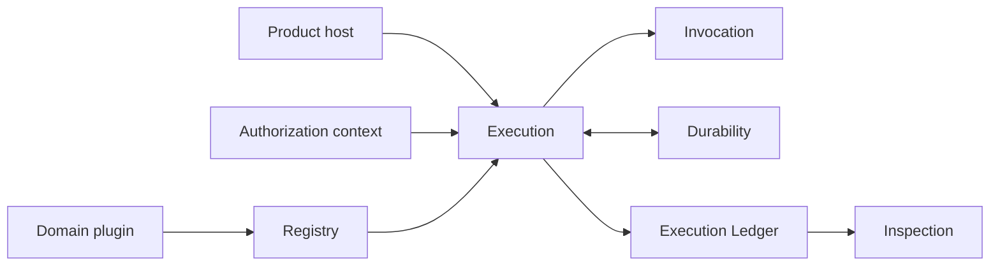
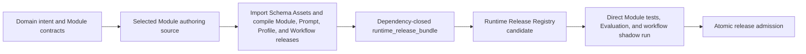
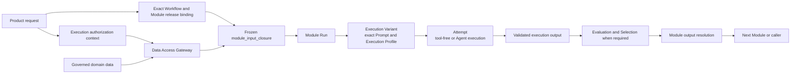
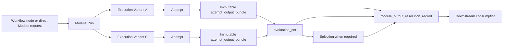
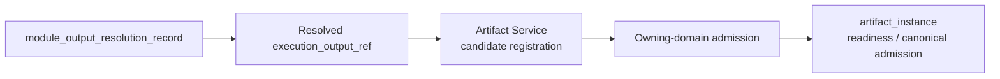
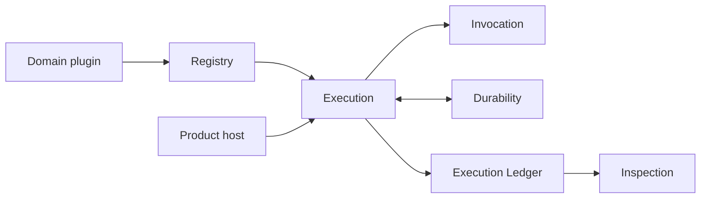

# Agent Runtime Contract

## 0. Intent Capsule

```yaml
layer: T0
t0_layer_id: the_agent_runtime
status: candidate
canonical_owner: designDoc/the_agent_runtime.md
owned_system_object: provider-neutral Agent execution
scope:
  - standalone public Runtime contracts and plugin SDK
  - Runtime admission of independently registered Module candidates
  - dependency-closed Runtime Module and Workflow Release admission
  - Workflow Execution, Module Run, Execution Variant, Attempt, Execution Output, Evaluation, Selection, and Resolution lineage
  - provider-neutral Module invocation
  - external-executor invocation and public parameter/result adaptation
  - Temporal Workflow coordination and recovery integration
  - PostgreSQL release, execution, and recorded-content persistence
  - Product Authorization and governed Data Access integration
  - task-scoped portable context
  - authorization-evidence consumption and execution-local fencing
  - task input and private-record separation, telemetry, checkpoint, recovery, evaluation, testing, and Module evolution
  - independently distributable Runtime core and extension boundary
non_goals:
  - domain roles, graph meaning, content rubrics, revision policy, or terminal business decisions
  - Principal, Entitlement, policy, delegation, or grant issuance
  - logical product action, domain workflow meaning, business lifecycle, or route selection
  - physical data placement, retention, residency, canonical domain schema, or canonical write approval
  - durable backend, provider, model, SDK, API, CLI, PostgreSQL hosting, driver, pooling, or deployment-topology selection
  - host product composition, user interface, pricing, or software-delivery status
inputs:
  - designDoc/the_charter.md
  - external:agency_platform
  - external:product_authorization
  - external:artifact_graph
  - external:data_governance
  - external:software_delivery
  - external:skill_governance
owned_specialization_contracts:
  - designDoc/agent_runtime_00_execution_charter.md
  - designDoc/agent_runtime_01_module_contract_and_assembly.md
  - designDoc/agent_runtime_03_authorized_external_event_ingress.md
  - designDoc/agent_runtime_06_standalone_package_and_lifecycle_contract.md
  - designDoc/agent_runtime_07_temporal_durable_adapter_contract.md
  - designDoc/agent_runtime_08_agent_execution_adapter_contract.md
  - designDoc/agent_runtime_09_authorization_integration_contract.md
external_authorities:
  - Agency Platform owns product topology and host execution binding.
  - Software Delivery owns mutable delivery roadmaps and release admission.
  - Each host product or domain owns canonical publication transactions.
outputs:
  - public Runtime contract and plugin seam
  - registered Schema Asset, Prompt Component, Prompt Bundle, Execution Profile, Module, and Workflow Releases
  - immutable execution, output-reference, evaluation, resolution, context, telemetry, and recovery lineage
  - provider-neutral conformance and standalone-distribution requirements
truth_surfaces:
  - logical:agent_runtime_release_registry
  - logical:agent_runtime_architecture_registry
runtime_triggers:
  - admitted Workflow Execution request
  - admitted external event or protected-operation request through a Runtime service boundary
downstream_consumers:
  - host composition roots
  - domain workflow plugins
  - provider, Temporal, and PostgreSQL implementations
  - assurance, security, and software-delivery gates
open_decisions: []
review_gate: design_doc_review, standalone import-boundary conformance, and independent engineering review
runtime_surface_ledger:
  - generated from the project-local Runtime architecture registry and Runtime Release Registry
  - never maintained manually in this portable T0 contract
verification_hooks:
  - Release Registry and generated architecture-report parity
  - single-registration-authority enforcement
  - synthetic opaque-plugin and adapter conformance
  - execution lineage, isolation, recovery, telemetry, and release compatibility tests
```

## 1. Primary System Flow

Agent Runtime is an independently distributable infrastructure product. It
registers explicit business-owned plugins, executes their admitted Workflows,
commits execution facts to its Execution Ledger, and exposes authorized
read-only projections without interpreting business meaning.

Arrows below mean logical call or committed-fact flow. Concrete technology
bindings are intentionally absent.



The Runtime core understands identities, versions, references, hashes, lifecycle states, and declared contracts. It treats domain states, roles, artifacts, evaluator meanings, and terminal outcomes as opaque values.

The owning product or domain T1 defines the logical workflow or product action.
The host Workflow Control Plane resolves its admitted execution class and
supplies an immutable `runtime_execution_binding` for Agent work. Runtime Intake
validates that binding against the exact `workflow_release` in the Runtime
Release Registry and the applicable authorization evidence supplied by the actual owner. Ordinary CLI
use does not create a requirement to inspect an MCP service's authorization
backend. Host resolution never
writes, extends, or replaces Runtime Release Registry authority.

### 1.1 Canonical registration and execution flow

Registration establishes what may execute. Execution never reconstructs that
authority from a working-tree Skill or provider session.



Execution carries the admitted releases, authorized data, provider capability,
and output lineage through distinct stages.



The Release Registry contains executable control-plane releases. Governed
content stays in its owning governed data service or Cell-local execution
store. The provider receives the semantic projection of the frozen input plus
only the capabilities admitted by the exact Execution Profile.

## 2. User Intent

Define a standalone, business-neutral infrastructure product for
registering independently owned Runtime Modules from fixed authoring sources, assembling Workflow
Graphs from those Modules, and executing, evaluating, observing, recovering,
and evolving each Module independently.

## 3. Reader Gain

A reader can separate Runtime law from domain
behavior, Skill authoring, product authorization, logical workflow ownership,
data governance, host deployment, and software delivery; identify the portable
plugin and adapter seams; and run one registered Module without relying on a
particular provider, Workflow, or durable backend.

## 4. Owned System Object

Agent Runtime owns provider-neutral execution and its Runtime release and execution objects. Business data, service permissions and external executor internals retain their own owners.




- A **Workflow Execution** pins one exact admitted `workflow_release`, its graph, execution release, authorization closure, and storage scope for its complete lifecycle.
- A **Module Run** pins one exact Runtime Module Release, execution purpose,
  optional workflow graph position, authorization scope, and immutable input
  closure. It may also be the root of an authorized standalone, Evaluation,
  test, or replay execution.
- An **Execution Variant** pins one behavior-affecting execution configuration.
  Provider, model profile, adapter revision, execution mode, input delivery
  plan, tool policy, network policy, Context policy, or output-normalization
  change creates another Variant under the same Module Run.
- An **Attempt** is one immutable invocation try under one Variant. Retry appends an Attempt and never rewrites a prior result.
- An **attempt_output_bundle** is a Runtime-owned immutable record of output
  handles, hashes, declared output types, and producing lineage. An
  **execution_output_ref** identifies one exact output in that bundle. Neither is
  an Artifact Graph `artifact_instance`; only the Artifact Service and owning
  domain can register a candidate Artifact and determine product readiness or
  canonical admission. Provider workspaces are not outputs or Artifacts.
- An **evaluation_run** judges one exact candidate through a registered evaluator. An **evaluation_set** proves required candidate-by-evaluator coverage.
- A **Selection** identifies the chosen candidate when policy requires comparison.
- A **module_output_resolution_record** is the sole Runtime authority for selecting
  which execution output may advance to a downstream Module or be
  returned to the domain plugin. It grants no Artifact Graph readiness,
  product delivery eligibility, domain acceptance, or canonical admission.

Every Module Release declares one resolution policy: direct single output,
evaluated single output, or selected output. Multiple eligible Variants require
closed evaluation coverage and immutable Selection. A raw Attempt, unresolved
execution output, score, or provider response cannot bypass Resolution.
Product-level consumption additionally requires every Artifact Graph and
domain gate declared for that use.

The product handoff is explicit and ordered:



Runtime owns only the first two identities and returns the exact resolved
`execution_output_ref` with its bundle and Resolution lineage. Artifact Service
candidate registration and owning-domain admission occur outside Runtime. An
execution output does not become an Artifact Graph object merely because it was
committed, resolved, returned, or registered as a candidate.

## 5. Authority

| Concern | Canonical owner | Runtime relationship |
| --- | --- | --- |
| Business objective, graph meaning, content quality, revision, and terminal semantics | Owning domain Intent Contract and typed graph | Consumes opaque releases and validates structural closure |
| Logical product action, behavior release, and business lifecycle | Owning product or domain T1 | Consumes one exact host-resolved Runtime binding without interpreting business meaning |
| Product or service identity, resource permissions, authorization decisions and grants | The applicable service/resource authority; [Product Authorization](the_product_authorization.md) for its own domain | Carries the references required for Runtime-initiated protected operations; does not read policy bodies or re-authorize native MCP calls |
| Runtime Module and Workflow execution, lineage, context, evaluation mechanics, recovery, and telemetry | Agent Runtime | Owns its execution lifecycle and records; does not take over an external executor's internal workflow |
| Provider, model, execution mode, selected files, writable directories, MCP connections and Gateway/database routes | Host-provided resource scope, Execution Profile and Agent Execution Adapter | Runtime fixes and translates the requested configuration; the selected Provider, host and services execute their own access controls |
| Stable Project Workflow identity plus Operation, Artifact, Design Contract, dependency, readiness, freshness, and provenance graph | [Artifact Graph](the_artifact_graph.md) and the owning domain | Runtime consumes exact registered identities and emits typed execution evidence; it does not own the project index, create an accepted `artifact_instance`, or grant product-level consumability |
| Physical placement, residency, retention, backup, export, and destruction | [Data Governance](the_data_governance.md) | Uses registered storage bindings and preserves isolation |
| Build, package, release admission, deployment, rollback, and retirement evidence | [Software Delivery](the_software_delivery.md) | Exposes versioned Runtime release units and conformance evidence |
| Product composition, deployment topology, and operator experience | [Agency Platform](the_agency_platform.md) | Is loaded and operated by the host without importing the host into core |
| Skill semantics, authoring, review identity, and lifecycle | [Skill Governance](the_skill_management.md) | Runtime receives fixed Module sources, records stable `source_skill_id` provenance, and owns executable Module admission and invocation |

Domain workflow admission, product authorization, Runtime admission, domain acceptance, and canonical mutation are separate decisions. No record from one authority substitutes for another.

### 5.1 External executor boundary

Claude CLI、Codex CLI 及同类外部执行器按公开调用接口接入。Runtime 负责确定本次参数、输入和
工作目录，启动与停止自己发起的调用，接收运行日志、退出状态和最终结果，并保存自己的执行事实。
内部规划、模型迭代、原生文件读写、命令／MCP 调用、内部重试和服务授权由执行器及服务自行处理。
Runtime 的工作分为启动前任务组装、运行中外层调用与日志接收、结束时结果交接与留档。普通 CLI 调用不另做
模型使用的文件服务、工具路由器或根据过程日志逐次审批操作的控制器。

Runtime 不建立默认的逐工具拦截、权限复判、内部子进程跟踪或平台沙箱治理。普通调用沿用所选
Provider／宿主的网络与工具许可配置，不因启用 Shell 就附加强制断网或操作系统沙箱。明确要求的
额外限制使用现有接口表达；可选沙箱不可用不等于普通 CLI 或 Shell 不可用。调用相容性检查与
外部调用生命周期管理仍属于 Runtime；它们不产生业务权限，也不把 Runtime 变成 CLI 的内部控制器。

## 6. Public Contract and Plugin Seam

### 6.1 Canonical naming

Every Runtime-owned source file uses the same three-part semantic name:

```text
module_subject_nominalized_action
```

The first term identifies the owning logical responsibility, the second
identifies the subject being acted on, and the third names the action as a
noun. Examples
include `registry_release_registration`, `execution_module_invocation`,
`ledger_record_persistence`, `invocation_prompt_assembly`,
`durability_temporal_coordination`, `registry_postgres_persistence`, and
`inspection_release_rendering`.

The name must remain understandable when copied without its directory. Bare
implementation-pattern or role names such as `service`, `manager`, `utils`,
`helpers`, `store`, `api`, `adapter`, `ports`, `release_control`, or
`persistence` are not valid Runtime filenames. A fully qualified three-part
name may contain `persistence` or `adaptation` as its action only when its
logical responsibility and subject make the behavior explicit. Logical
responsibility identifiers are governed by the architecture registry instead
of this filename guard.

Runtime-owned canonical names use `snake_case`. This includes source and schema
files, directories, variables, functions, fields, tables, columns, events,
serialized `record_type` values, and stable identifiers. A Python class may use
the `PascalCase` projection of the same three semantic terms. Opaque identifiers
owned by an external protocol remain byte-exact. Provider-required filenames
such as `SKILL.md` are protocol exceptions.

The independently published Runtime exposes stable logical responsibilities,
not source directories or currently selected technologies:

| Logical responsibility | Owns |
| --- | --- |
| Registry | Release compilation, validation, registration, activation, and exact retrieval |
| Execution | Workflow initiation and advancement, Module invocation coordination, Cell-local staging, Evaluation, output Resolution, checkpoint, and recovery |
| Invocation | Prepare an external-executor request, start and control that invocation, and collect its public logs and final result |
| Durability | Acknowledged commands, waits, retries, replay, and recovery through a replaceable durable backend |
| Ledger | Authoritative execution lineage, Attempts, usage, outcomes, and Resolution facts |
| Inspection | Authorized read models and Workflow Inspector rendering |

Authorization and governed Data Access are external authorities consumed by
Execution. Their Runtime clients carry exact execution context; they are not
alternate Runtime control planes.

Database engines, durable backends, provider SDKs and CLIs, and renderers become
implementation bindings only through the code-owned architecture registry.
Each registered binding implements exactly one logical responsibility and
cannot become a peer responsibility or record authority. The generated
architecture projection enumerates the current binding set. Physical source
directories likewise do not become logical responsibilities.

A domain plugin submits one dependency-closed `runtime_release_bundle` through a
`runtime_module_plugin`. The bundle may contain Schema Asset, Prompt
Component, Prompt Bundle, Execution Profile, Runtime Module,
Workflow, and admission
releases. Runtime
validates identity, uniqueness, exact hash closure, declared operation closure,
and release compatibility. It does not infer behavior from names, inspect
domain prose to invent a release, or maintain a parallel stable-registration
object beside the immutable releases.

Logical call and committed-fact flow is fixed. Every node below is a logical
responsibility; arrows do not mean source placement or technology binding:



Runtime imports no domain package, host catalog, product route table, or Skill
projection during production execution. The host installs compatible Runtime,
provider, durability, and domain-plugin releases explicitly. Discovery alone
grants no execution authority.

A code-owned Runtime architecture registration separately registers logical
responsibilities, physical source directories, and concrete implementation
bindings. Every shipped source file maps to exactly one logical responsibility,
one physical directory, and one canonical Design Contract. Only a concrete
technology implementation may also map to an implementation binding.
Repository CI rejects mixed axes, an unregistered or misplaced file, a missing
contract, a generic filename, a duplicate disposition, or undeclared debt.
README and stable Design Contracts explain the module law; the generated
architecture report is the exhaustive current file inventory.

### 6.2 Agentic workflow conformance invariant

Every model-backed workflow that is admitted as a managed product or
engineering workflow binds one immutable, versioned Agentic Workflow
Conformance Package. The package proves the closure of Intent, graph,
Module Releases, typed inputs and outputs, authorization, context and data
boundaries, evaluation, recovery, telemetry, tests, and release evidence. The
package is provider-neutral and domain-neutral; it does not standardize the
business graph, role semantics, rubric, or terminal meaning.

The complete package is control-plane authority. A Module Run receives only a
hash-bound task-plane projection containing the authorized materials and
operations required for that Module. A complete package is therefore not a
license to put every referenced document, prior output, or accessible Source
into every prompt. Runtime rejects both a missing required input and an
undeclared extra input.

Control-plane identity never becomes model task content merely because Runtime
needs it for admission or replay. Artifact refs, content hashes, release and
schema identities, authorization evidence, Entitlement metadata, tenancy,
Cell identity, execution IDs, and accounting fields remain in the Runtime
closure. Before invocation, code creates a declared model-input projection
containing only the semantic content and minimum semantic identifiers that can
change the Module answer. The provider workspace and prompt expose that
projection, not Runtime manifests or the private closure. Runtime joins the
model output back to the private closure and deterministically adds required
lineage after schema validation.

An execution started outside the Runtime entry and record lifecycle remains
bootstrap or advisory evidence; adding a log afterwards does not make it managed.
A CLI started by Runtime through its selected Adapter is a normal managed
invocation when the required Runtime identities and records are established.
Claude or Codex internal model/tool calls remain inside that invocation; they
do not require separate Runtime Modules, operation intents or permission reviews.
Existing release, conformance and `direct_entry_retired` rules still apply to
the actual Runtime entry, not to the CLI's private execution loop.

Agentic workflow authoring is registration-first. Before a model-backed graph
node is accepted as a workflow candidate, its owning plugin declares the exact
Module authoring source and stable source Skill ID, concrete input and output schema assets, declared
operations, Context policy, Evaluation policy, retry policy, output-resolution
policy, Prompt Bundle closure, and focused conformance fixtures needed for one
Runtime Module Release. A Workflow candidate references exact Module Release
refs and hashes; it cannot use a role name, Skill path, prompt file, model call,
or schema-ref string as a substitute for Module registration. Skill authoring
and workflow authoring fail closed when this registration closure is absent.

Repository paths are authoring-time import locators only. Registration imports
the exact schema and prompt content into the Runtime control-plane store. A
production Module Run resolves those persisted releases by ref and hash, so the
standalone Runtime distribution requires neither the originating repository
layout nor a mounted Skill directory.

### 6.3 Code-owned machine fields

Runtime identifiers, references, hashes and addresses are machine-owned fields.
Neither an Agent operating Runtime nor an Agent invoked by Runtime is responsible
for inventing, typing, assembling, recalculating in model text, or repairing them.
The owning Runtime or host/service code generates new identities, computes hashes
from the specified canonical bytes, resolves existing objects and configured
locations, and carries the resulting bindings between operations.

This includes release refs and dependency hashes; execution, Module Run, Variant,
Attempt and output identifiers; idempotency/correlation keys; and storage handles,
artifact URIs and service addresses used by the Runtime control plane. Repeating
an existing operation preserves its code-bound identity; starting a new operation
allocates the identity required by its owner. A model must not decide which case
applies by inventing a fresh key.

An Agent-facing entry accepts task intent, business content and explicit choices
among known tasks/resources. Code reads approved source/configuration and returned
records, then performs the exact technical binding. A displayed business name or
choice label is not a serialized machine identity. Business identifiers needed
to understand the task remain domain-owned data; this rule does not remove them
from semantic input or prevent a domain from naming its capabilities.

An address must resolve from the actual configured resource or a location
explicitly supplied by its owner. Code ownership does not authorize inventing a
service endpoint, selecting an unrelated store, granting access, or creating a
new service. Missing or ambiguous source/configuration is a concrete input or
integration gap; it is not a request for the Agent to guess a technical value.

Lower-level APIs may require exact ref/hash/address arguments. These are
programmatic bindings consumed from compiler, Registry, configuration or prior
operation results, not fields for an Agent to manufacture or copy by hand.
Returning an opaque handle for selection or reporting is allowed; code must
retain or resolve its exact binding rather than relying on free-form model text
to recreate it. Documentation and Skills must not turn a missing code path into
a manual fill-in exercise. An unimplemented binding is reported as such.

Model output carries the task's semantic result. Code adds Runtime identity,
hashes, locations and lineage from authoritative records after validation; a
model-authored value cannot become authoritative merely because it matches the
expected string format. Existing immutable records and their identity/hash
schemes remain unchanged by this division of responsibility.

## 7. Adapter Neutrality and Context Portability

Runtime defines replaceable service-provider interfaces for durable execution,
Agent execution, authorization integration, and host composition. Runtime
selects PostgreSQL as the production system of record for its own releases,
execution lineage, and recorded execution content. PostgreSQL hosting, driver,
pooling, and deployment topology remain replaceable implementation choices;
the persistence semantics and canonical schema do not. No implementation may
choose a domain edge, reinterpret a domain verdict, mutate domain state
directly, or redefine Runtime identity.

An immutable `prompt_component_release` is the Runtime-owned storage
unit for formatted static content that may enter a model Context. Its initial
kinds are task instruction and output constraint. It stores
the exact model-ready content, content hash, producing Formatter version, and
source-release refs and hashes. An ordered `prompt_bundle_release` references
those component releases and stores the complete compiled static Context.
Component and bundle rows are canonical after admission; Markdown is a
generated inspection and recovery projection only.

Execution-selected domain context is not a Prompt Component and does not create
another Module Release. The owning domain stores and versions that semantic
asset. After routing, the authorized Runtime caller resolves its body, ref, and
hash and freezes them into the Module input closure. Runtime records that exact
input binding and the final Prompt Envelope, so every Variant under the same
Module Run receives the same domain context bytes.

An Agent Execution Adapter receives one frozen Variant-bound request and
returns a structured terminal result, immutable output reference, normalized
failure class, Context event, and usage fields available from the provider. It
loads the admitted Prompt Bundle bound by the Module Release and produces the
exact request that Runtime sends to the selected external interface. The
content-bearing input is committed in the Cell-local Prompt Envelope before
invocation and sent unchanged. For a CLI, this is the task input and configuration
provided to that CLI; it is not a claim to capture its hidden system prompts,
internal API requests or complete model context. Inspection shows the bytes
Runtime actually sent and the public information it actually received.
A durable backend persists scheduling and content-free workflow continuity. A
PostgreSQL implementation enforces the registered Runtime schema and isolation
binding. Provider and durability implementations produce the same public
lineage regardless of implementation.

An Adapter may use refs and hashes to resolve and verify inputs, but it must not
stage a control-plane manifest in the model-readable workspace or render those
fields into the provider prompt. Model-visible filenames, instructions, input
bodies, and output-shape rendering are part of the auditable task-plane
projection.

本次资源范围由任务 owner 与宿主明确提供：可读文件、可写目录、可用 MCP，以及通过哪个网关访问
哪个数据库。Runtime 固定并传递这些选择，检查公开接口是否能够承载该配置；实际访问控制和服务端
授权由所选 Provider、宿主、MCP、网关及数据库负责。Runtime 不建立另一套权限策略、查询 MCP
内部授权，或为普通外部工具调用默认建设回调桥和沙箱。

`tool_free` 与 `agent` 表达是否向执行器提供任务工具及工作资源。输入可以按明确要求内联、通过已有
网关读取或作为选定文件提供；需要准确多文件输入时，可使用任务方提供的冻结只读文件树。Runtime
记录所提供的输入和引用，不把宿主整个工作区默认交给模型，也不把一句 prompt 当成实际参数配置。

普通 agent 调用的网络配置为 `provider_managed`：Runtime 不附加额外工具网络限制，沿用明确选择的
Provider／宿主配置。这不表示绕过其权限、允许所有网络，也不宣称操作系统隔离。明确声明的
`denied`、`gateway_only` 和 `direct_sandboxed` 保留各自含义；无法表达该具体要求时报告缺口，
不得把它改写成已兑现，也不得由此拒绝没有该要求的普通调用。

文件工具的可读写范围与任意 Shell／脚本的操作系统可达范围分别说明。Runtime 固定本次交付的
材料与配置，不据工具允许清单承诺所有子程序都无法访问其他路径。CLI、宿主和服务执行自己的
控制；这些配置不授权 Runtime 扫描凭据位置、接管内部授权或建设新的隔离基础设施。

任务 owner 与宿主提供准确输入或明确的资源绑定。Runtime 固定自己交付的 `module_input_closure`
与 `input_delivery_plan`，不丢弃或偷偷改写已要求完整交付的材料。任务需要运行中读取时，执行器
通过已选网关／MCP 使用对应服务的访问接口；Runtime 不预先遍历其后台数据或授权来构造另一套
许可。领域数据的数据库和权限归领域及数据服务，Runtime 不替它们选择数据库引擎或接管 SQL。

Claude Agent SDK, Claude Skill, Codex CLI, and future model or host adapters
are Runtime extensions. Runtime owns their descriptors, release admission,
version compatibility, external-call conformance, public result and usage
normalization, and Runtime execution lineage. Internal authorization and tool
execution remain with the selected executor and services. The owning domain supplies opaque
task semantics and an admitted Skill or prompt release; it does not own or
silently construct the provider adapter. Skill Governance owns the Skill
artifact itself, not its executable provider integration.

Every invocation initiated by Runtime passes through its selected Adapter and
creates the applicable Module Run, Variant, Attempt, output, usage and terminal
records. This requirement does not create a new Runtime Attempt for each hidden
model call or native tool operation inside a CLI. An invocation initiated outside
Runtime cannot later become conformant through a handwritten log.

Context is task-scoped, Module-Run-scoped, Variant-scoped, and
data-scope-scoped. Native continuation is an optimization permitted only while
the complete compatibility tuple remains unchanged. That tuple includes
Workflow and Module releases, Prompt Bundle, provider-facing
profile, adapter revision, Context type, resume and read-isolation policies,
execution mode, tool policy, network policy, input-package and Prompt Envelope
hashes, authorization closure, and contract versions.

An incompatible or cross-provider Variant reconstructs context from authorized
immutable input refs, the resolved prior `execution_output_ref`, continuity
state, and a typed task or revision packet. When an input is an Artifact Graph
object, its exact admitted `artifact_instance` ref and authorization evidence
are pinned. Opaque conversation/task state is not copied across incompatible Variants,
executions, tenants, Cells, providers, or authorization closures. Existing
Provider login and MCP connection configuration remain host resources; they
are not task context that Runtime must copy or recreate for every invocation.

### 7.1 Task-specific semantic context assembly

Static Prompt Components define reusable Module instructions and output
constraints. Execution-specific domain knowledge is a separate, schema-bound
Module input. It is not copied into a global Prompt Component merely because a
model needs it for one task.

The host integration may resolve task context through a generic selector:

```yaml
category: expertise
content_key: optical_interconnect
release_id: optical_interconnect.v3
```

`category`, `content_key`, and `release_id` are opaque domain identifiers. The
generic interface assigns no parent-child meaning to categories: `expertise`
and `lens`, for example, may occupy peer keys in one task schema. A different
workflow may declare entirely different keys through its own registered Schema
Asset without changing Runtime core.

An authorized domain resolver reads each exact immutable content release from
its owning data service. The resulting `task_prompt_context_resolution` contains:

- a task-schema ref and hash;
- the schema-shaped semantic `content_tree`;
- private selector, release, ordinal, and content-hash bindings; and
- a hash of the complete frozen resolution.

Runtime carries this resolution inside the immutable Module input closure and
validates it against the registered task-context Schema Asset. The model-visible
projection contains only `content_tree`; selector provenance, release refs,
hashes, authorization evidence, tenant data, and storage identity stay in the
private execution closure. Runtime does not expose its storage credentials or
an ambient Skill/repository checkout as model task content. An exact frozen
tree may be exposed only through a separately declared `managed_read_only_tree`
execution input and matching Execution Profile. Changing selected content
creates a new input closure and Module Run; changing Module instruction or
schema creates a new Module Release.

## 8. Authorization and Data Isolation

MCP、网关、数据库及相应授权服务负责各自的身份与允许／拒绝决定；Product Authorization 保留
其所属领域的权限职责，不被假定为所有外部 MCP 的统一授权后台。Runtime 对自己明确发起且要求
外部授权的操作，消费相应 owner 提供的 context、decision 或 grant 引用，不读取权限表、解释
Entitlement、签发 grant 或扩大范围。普通 CLI 调用不因此新增生产授权客户端或后台授权巡检。

An in-flight execution cannot gain access from a later Entitlement expansion. Loss, expiry, revocation, or invalidation of required authority fences new work, closes or quarantines affected provider state and uncommitted outputs, preserves committed lineage, and requires a newly authorized Workflow Execution for any continued or broader scope. Exact ordering and record shapes belong to the authorization integration specialization.

当 Runtime 自己通过已声明接口发起受保护操作时，按外部 owner 的合同携带所需决定或 grant 引用，
记录该操作的 intent 与返回事实。它不决定这些权限，也不把业务质量判断当成资源访问许可。

Claude、Codex 等外部执行器内部通过其已有 MCP／网关进行的操作，由相应服务完成鉴权与授权。
Runtime 接收其公开日志和结果，不拦截每次内部调用、不逐项建立自己的 intent，也不查询后台权限
来重判允许或拒绝。只有 Runtime 明确承担的资源操作才进入自身的操作交接合同，不能把这套流程
无条件扩展到执行器内部的全部活动。

Data isolation follows these invariants:

- every execution and context is pinned to one tenant and execution data scope;
- content-bearing inputs, outputs, credentials, and authorization-filtered results remain in their governed stores;
- durable histories and shared telemetry carry only permitted identities, references, hashes, timings, usage, and bounded classifications;
- adapters receive the explicitly selected inputs and existing connection references; Runtime storage credentials and service-private authorization material are not exposed as model task content;
- Runtime does not move, retain, export, or destroy managed data outside registered Data Governance bindings.

## 9. Telemetry, Checkpoint, and Recovery

Runtime code generates execution records. Agents never author their own execution, search, authorization, token, cost, or billing logs.

Telemetry binds each event to its valid execution scope and records trace
identity, Module and release identity, input and output refs and hashes,
provider and adapter metadata, public tool/search events when returned, latency, terminal
classification, and input, output, cache-read, and cache-creation tokens when
exposed. Missing trustworthy usage or cost remains `unknown`; it is never
estimated into authoritative billing data. Shared observability excludes
customer content and secrets. Public CLI logs are observations, not permission
receipts or a complete account of private executor activity; missing internal
information is not reconstructed and is not a prerequisite for accepting a
valid final result.

Checkpoint and recovery preserve committed work and prevent duplicate work:

1. Begin an immutable Attempt and bind required authority before a protected invocation.
2. Finalize the Attempt, `attempt_output_bundle`, calls, usage, and invocation result atomically or leave a recoverable incomplete claim.
3. Complete required Evaluation and Resolution before committing the Module outcome.
4. Commit a checkpoint before acknowledging workflow advancement to the durable backend.
5. Replay an acknowledged identity by returning committed records, not by repeating a provider call or protected effect.

A crash before invocation commitment may create a new Attempt under retry
policy. A crash after invocation commitment reconstructs from committed
records. A crash after Module outcome commitment returns the existing outcome.
Recovery remains pinned to the original graph, Module, Prompt, profile, and
execution releases; it never adopts a latest version silently.

## 10. Evaluation, Testing, and Module Evolution

Domain owners define evaluation meaning, rubrics, veto rules, and required
evaluator sets. Runtime owns evaluator isolation, execution lineage,
scheduling, coverage closure, comparison, Selection, and mechanical Resolution
enforcement. A model-backed evaluator is an ordinary admitted Runtime Module
with its own Module Run, Variant, Attempt, attempt_output_bundle, authorization,
usage, and Context lineage.

Runtime must support independent tests and evaluations at Module scope:

- external-call parameter, input, log and final-output contract tests;
- graph closure, loop, wait, and terminal simulation using opaque domain values;
- provider, durable, persistence, authorization, and host adapter conformance;
- context compatibility and cross-provider reconstruction;
- tenant, data-scope, and authorization-isolation negatives;
- retry, crash-window, replay, cancellation, and stale-output recovery;
- telemetry completeness and content-leak detection;
- inspection of the actual input Runtime sends, proving it does not add
  undeclared private control-plane fields; this is not inspection of the
  Provider's hidden prompts or internal requests;
- evaluation coverage, veto, Selection, and Resolution enforcement;
- Module compatibility, canary, rollback, and pinned-execution recovery;
- import-boundary tests proving that Runtime core has no domain or host dependency.

Every executable Module and adapter has an immutable release. A
behavior-changing update creates a new release and a new Variant, Module Run,
or Workflow Execution at the correct scope, computes affected release bindings,
runs impacted tests and evaluations, and follows Software Delivery admission.
In-flight executions remain pinned, drain under policy, or restart as newly
authorized executions. Runtime never patches an admitted release in place.

## 11. Standalone Distribution

The Runtime is publishable independently of any host application or domain
plugin. Its public distribution contains the product README, a generated and
hash-bound bundle of Runtime-owned Design Contracts, core contracts, Release
Registry and Execution modules, provider and Temporal integration definitions,
PostgreSQL migrations, conformance fixtures, and the live read-only Workflow
Inspector. Provider implementations and domain plugins may ship as separately
versioned extension distributions.

Standalone conformance requires:

- a clean installation with no host or domain dependency;
- public API compatibility and deterministic Release Registry validation;
- explicit extension loading by the host;
- synthetic opaque-plugin execution and failure tests;
- no built-in business role, graph, rubric, artifact meaning, or provider choice;
- every shipped source file mapped by the Runtime architecture registration to
  one logical responsibility and one canonical Design Contract;
- packaged Design Contract hashes equal the canonical Runtime-owned contract
  sources; and
- the Workflow Inspector lists and renders authorized formal PostgreSQL records
  without a provider credential or mutation endpoint.

The host may select and pin compatible provider, durability, and PostgreSQL
client implementations. PostgreSQL remains the production Runtime record
authority; client-library and deployment selection are release configuration,
not a competing storage contract.

## 12. As-Built Truth

Human Design Docs own purpose, boundaries, and invariants. Code-owned schemas
and validators plus the persisted Runtime Release Registry are the sole authority for
whichever Module, Prompt, Workflow, execution-release, adapter,
and admission facts are currently implemented. Runtime inspection is their
deterministic human-readable projection.

This document does not list the current host composition, installed plugins,
selected providers, selected durable backend, commands, implementation
maturity, or delivery status. Those facts belong to code-owned registries,
generated architecture reports, deployment composition, and Software Delivery
records. A manually edited inventory cannot override them.

Each product-local Runtime implementation publishes its own generated
architecture and release inspection from its code-owned registries. This T0
contract defines portable law; it does not supply or override local
implementation facts.

## 13. System-wide Invariants

An implementation is non-conformant when any of these signals is present:

- Runtime core imports a domain or host package.
- A shared Runtime type embeds a business role, content rubric, or domain edge.
- A discovered plugin, Skill projection, product workflow row, or provider session is treated as execution authority.
- A Runtime-initiated invocation lacks its required execution lineage, logs or final-result record; native CLI tool events are associated with that invocation, not assigned fabricated Runtime authorization records.
- A behavior-affecting configuration change mutates an existing Variant.
- Provider-native context is the only continuity source or crosses an isolation boundary.
- A raw Attempt, unresolved execution output, evaluation result, or losing Variant advances to another Runtime Module without Resolution.
- A `module_output_resolution_record` is presented as Artifact readiness, product delivery eligibility, domain acceptance, or canonical admission.
- An Agent writes or repairs its own audit log.
- An Agent is required to hand-author, reconstruct or repair Runtime identifiers, hashes, addresses or lineage, or model text is treated as their authoritative source instead of code-owned bindings (§6.3).
- Durable history or shared telemetry contains protected content or secrets.
- Recovery repeats a committed invocation or protected side effect.
- An in-flight execution silently adopts a new graph, Module, Prompt, adapter, data scope, or authorization closure.
- Runtime interprets Entitlements, issues authorization, approves domain content, or writes another domain's canonical state.
- A second workflow, Module, or active-release registration authority exists
  beside `runtime_release_registry`.

## 14. Peer Boundaries

This T0 document owns portable invariants. The public Runtime bundle contains
only Agent Runtime specializations. Adjacent products publish their own
contracts through their own release units.

| Contract | Owner | Responsibility |
| --- | --- | --- |
| [agent_runtime_00](agent_runtime_00_execution_charter.md) | Agent Runtime | Workflow and Module execution lifecycle, Context, telemetry, recovery, Evaluation, testing, and Module evolution |
| [agent_runtime_01](agent_runtime_01_module_contract_and_assembly.md) | Agent Runtime | Module registration sources, Module and Workflow Releases, Prompt releases, graph assembly, execution records, and generated architecture reports |
| [agent_runtime_03](agent_runtime_03_authorized_external_event_ingress.md) | Agent Runtime | Authorized external-event ingress and acknowledged application |
| `publication transaction specialization` | Owning product or domain | Protected canonical publication and idempotent recovery outside Runtime |
| [agent_runtime_06](agent_runtime_06_standalone_package_and_lifecycle_contract.md) | Agent Runtime | Standalone package boundary and append-only execution lifecycle |
| [agent_runtime_07](agent_runtime_07_temporal_durable_adapter_contract.md) | Agent Runtime | One concrete durable-backend adapter specialization and its conformance |
| [agent_runtime_08](agent_runtime_08_agent_execution_adapter_contract.md) | Agent Runtime | Provider-neutral Agent Execution and provider-facing Skill Adapter protocols and adapter admission |
| [agent_runtime_09](agent_runtime_09_authorization_integration_contract.md) | Agent Runtime | Execution authorization context integration, protected-operation handoff, fencing, and invalidation |

Agency Platform owns deployment topology and host execution binding. Software
Delivery owns delivery sequencing and mutable engineering status. Neither
contract family ships inside the Runtime Design Contract bundle.

No specialization may widen Runtime core into domain semantics, product policy, data authority, or host composition.

## 15. References

- [Enterprise Constitution](the_charter.md)
- [Agency Platform Boundary Contract](the_agency_platform.md)
- [Product Authorization and Entitlement Governance](the_product_authorization.md)
- [Data Governance, Residency, and Records Management](the_data_governance.md)
- [Software Delivery and Change Governance](the_software_delivery.md)
- [Skill Governance](the_skill_management.md)
- [Contract Audit](the_contract_audit.md)
