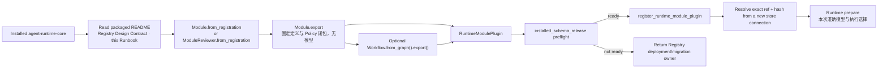

# Agent Runtime Registration Runbook

本 Runbook 面向把已批准 Module 或 Workflow 接入 Agent Runtime 的宿主开发者。它随
`agent-runtime-core` 分发，说明如何使用当前 package 的 public API 完成 source loading、release
compilation、定义保存和准确回读。注册后的执行选择由 Runtime 单独准备。

Runtime Design Contract 定义稳定语义，public Python API 定义当前可执行接口。本 Runbook 不创造新的
release 类型、权限规则或持久化协议；当文字与 public API 不一致时，停止 registration 并报告 package
drift。

接口定义见从源码自动生成的 [Reviewer API reference](agent_runtime_reviewer_api.md)。
先读其中的 Module 和 ModuleReviewer 类说明，确定固定定义、独立执行参数和存储归属；再按本 Runbook
完成一次注册。注册只保存固定定义；每次审核独立选择模型，提交本次输入与执行 key。
当前单节点执行入口的参数、授权依赖、重放限制和失败处理也在该接口参考中。
测试用途不要求复制 Reviewer。Module 内容不变时切换模型只形成新的执行选择；相容性由 Runtime 根据通用运行要求、实际 Adapter 和本次资源判断，source 不再声明 transport。

<a id="code-owned-machine-fields"></a>

## 机器字段的来源与交接

identifier、release ref、hash、内部地址、执行 key 与 lineage 由 Runtime 或其所属宿主／服务的代码负责。
操作 Agent 选择任务/source/已配置资源并提供业务内容，不手填或猜测这些机器字段。下文 API 所需的
exact ID/ref/hash 应从已批准 source、配置或前一步返回对象读取，并由调用代码直接传递；报告中可以展示
返回值，后续绑定不依赖模型从报告中重写这些值。

文中的示例名称和路径表达输入位置，不是让 Agent 自行发明身份或连接。已有 source 的业务命名与版本由
owner 决定，代码读取并校验；材料 hash 由代码读取实际文件计算；保存位置和运行引用消费真实返回记录。
来源缺失、选择有歧义或同 ref 内容冲突时报告具体缺件，不让 Agent 编一个值、改版本或手写 `.runtime`
记录使操作通过。

普通路径按下面的顺序把机器字段从一步交给下一步，操作者只给出选择：

1. **注册。** `register-reviewer --source DIR` 或 `register-module --source DIR --preset P` 读取所选 source
   文件夹（或其 `module_registration.json`）声明的 Skill 与 Module 身份，编译、注册并准确回读；`--version`
   是 owner 批准的版本。`--selection-out FILE` 写出定义选择文件，stdout 的 `selection` 是同一内容。
   已编译 bundle 用 `register --bundle`，发布包标签可省略（由代码从 bundle 唯一的 Workflow 或 Module 读取）。
2. **选择已有定义。** 不重新注册时，`agent-runtime-registry select --workflow ID --version V
   [--release-store NAME] --selection-out FILE` 从 root 或已配置的 PG store 读取该准确版本。准备输入需要所选
   定义的 schema 时，`agent-runtime-registry load --root R --selection FILE` 返回该 Workflow、其 Module 以及
   `input_schema`、`output_schema`。
3. **运行。** `agent-runtime-test-run --selection FILE` 每次重新读取所选 ref/hash；之后在同一 root 注册的
   新版本不会替换它。材料用 `--material-root DIR` 加 `--material FILE`（或明确的 `--all-materials`），
   relative_path、sha256 与执行位由代码按实际 bytes 计算，原有捕获检查继续拒绝之后的变化。
   `--record-out FILE` 把返回记录存为新文件。
4. **查看结果。** `agent-runtime-inspect --test-run-record FILE --view summary` 读取该记录；`output`、`log`、
   `files` 视图分别给出输出、执行日志与 Attempt 文件。查看不注册、不重跑、不连 PG。

Python 中直接传递返回对象：`register_module`／`register_reviewer` 的结果交给 `selection_from_registration`，
再把 selection 交给 `run_local_workflow_test(selection=...)`；`prepare_material_files` 的结果作为
`material_files`；返回记录交给 `inspect_test_run_record`。低层 exact 参数（`--workflow`、`--version`、
`--workflow-ref`、`--workflow-sha256`、手写 `material_files`）保留给已持有这些代码值的程序。
设计依据是同版本包内的 `agent_runtime/design_contract/the_agent_runtime.md` §6.3 和
`agent_runtime/design_contract/agent_runtime_00_execution_charter.md` §5.3；用下方
`importlib.resources.files("agent_runtime")` 定位当前安装包中的合同，不从另一份 checkout 猜路径。

<a id="local-runtime-setup"></a>

## 使用工具前的轻量 setup

安装当前 Runtime 包后，直接使用下面的现有注册、查询或 evaluation 命令，并提供明确 root。
这些入口在参数解析成功后共用 [setup_runtime](agent_runtime_reviewer_api.md#setup_runtime)：
首次准备 `.runtime` 和三个随包操作 Skill（`agent-runtime-registration`、`agent-runtime-test-run`、
`agent-runtime-usage`），放入宿主的 `.agents/skills` 与 `.claude/skills`；较早版本准备过的 root 在下次 setup
时补上新增的 Skill。已就绪时只做固定少量本地检查，不重复写文件，无需另执行 Skill 安装命令。

setup 不扫描项目或注册历史，不安装软件、连接 PG 或登录 Provider。它只维护自身的 setup 元数据
和可识别的操作 Skill，保留 Module、Workflow 定义和其他用户内容。同名本地修改或非法元数据会
返回具体冲突，后续操作不会开始；I/O 失败后可用同包继续完成准备。精确效果与失败见上述自动接口说明。
程序化宿主可在已有初始化中调用 `from agent_runtime import setup_runtime`；普通 import、CLI help
和参数用法错误不会创建环境。无 root 的快照检查不猜测当前目录为 Runtime 环境。

CLI 查询仍只读注册定义，但首次调用可能补齐环境；普通 evaluation 的 `persistence=not_requested`
指本次执行事实不写持久存储，与环境 setup 文件的必要写入分开。

<a id="project-setup"></a>

### 准备项目：agent-runtime-setup

新项目或需要补齐 CLI／MCP 配置时，运行一条命令（参数表见
[Setup CLI](agent_runtime_reviewer_api.md#setup-cli)）：

```powershell
agent-runtime-setup --root "C:\work\my_project" --provider both
agent-runtime-setup --root "C:\work\my_project" --provider codex --mcp my_data
agent-runtime-setup --root "C:\work\my_project" --provider both --mcp my_data --mcp-config "C:\work\host\.runtime\config.json"
agent-runtime-setup --root "C:\work\my_project" --provider antigravity
```

`both` 只表示 Claude 与 Codex。Antigravity（`agy`，首个绑定只运行 `structured_output` 与 `file_review`）用
`--provider antigravity` 单独准备，可加 `--antigravity-path EXE`；它不接受 `--mcp`。

它依次做以下几件事，可重复运行；已就绪时不写任何文件：

1. 调用上面的 `setup_runtime` 安装三份 Skill（本地修改的同名 Skill 仍按原规则报告冲突并停止）。
2. 为每个所选 CLI 选定原生程序：`--claude-path`／`--codex-path` 优先；其次是 `provider_cli_paths` 已有值，
   无法启动时保留原值并列入 `missing`，不静默替换；再次是 PATH 上的原生 `claude.exe`／`codex.exe`；最后只在 PATH 中 npm 启动器
   （`claude.cmd`、`codex.cmd`）旁的安装包固定位置查找，例如
   `node_modules\@anthropic-ai\claude-code\bin\claude.exe`。Antigravity 在 PATH 之后只查其安装器的固定位置
   `%LOCALAPPDATA%\agy\bin\agy.exe`（已启动的进程可能仍持有安装前的 PATH）。不扫描磁盘，也不安装软件。程序先用
   `--version` 确认能启动，再写入配置。
3. 运行 CLI 自己的登录状态查询（Claude `auth status --json`，只保留是否登录与登录方式；Codex `login status`，只看退出码）。
   这些查询都很短，也不会启动登录。agy 没有公开的登录状态命令：setup 不读取认证文件，也不把 `agy models` 当作登录证据，
   报告 `login: not_verified`，不列入 `missing`；`next_steps` 提醒本人按需在原生 CLI 登录，并给出一次真实样例调用来确认。
4. 只处理 `--mcp` 选中的连接；未选中的项目连接与 CLI 中的其他服务器既不读取也不改动。来源规则：
   - 给了 `--mcp-config FILE` 时只用这个文件。它可以是已有 Runtime 配置，此时复制其中的
     `mcp_servers.<transport>.<name>`，保留原有的工具范围、`default_tools_approval_mode` 与 `environment_keys`。
     它也可以是 Claude 的 `mcpServers` 文件，此时只用于 `claude_cli`。文件中没有所选名称时报告缺项，不改用其他来源。
   - 未给文件时，Codex 读取 `codex mcp get <name> --json`。项目中已有同名连接时，刷新连接地址，保留项目已选的
     `enabled`、`enabled_tools`、`disabled_tools` 与 `default_tools_approval_mode`。Claude 没有可读的 JSON 列表，已有项目连接
     保持不变；没有时报告需要 `--mcp-config`。
   - 凭据只能以环境变量名引用：Claude 的 `env`／`headers` 值须为 `${VAR}` 形式，Codex 用 `env_vars`、`bearer_token_env_var`、
     `env_http_headers`。字面值 `env`／`http_headers`、headers helper、`oauth` 或未知字段等无法这样表达的设置会使该连接被
     拒绝（`refused`），原有项目连接保留不变。报告只写字段名，不写值。处理方式是由连接 owner 提供这样表达的 Runtime 配置
     （经 `--mcp-config`），或把原生连接改为环境变量引用；操作 Agent 不手抄地址或凭据。
5. 只改写 `.runtime/config.json` 中的 `provider_cli_paths` 和所选 `mcp_servers` 条目，其余字段（包括相对路径）原样保留。

stdout 是一份 JSON 报告，各字段含义如下：

- `providers`：每个 CLI 的 `program`、`source`、`started`、`version` 与 `login`。
- `mcp_servers`：每个所选连接的 `action`，取值为 `imported`、`unchanged`、`kept`、`refused` 或 `missing`。Codex 连接另有
  `approval`；连接被关闭时还有 `disabled`。
- `missing`：需要人或 owner 处理的缺项。
- `next_steps`：下一步命令。
- `changed_paths`：本次实际写入的文件。setup 中途失败时，它仍列出已经写入的文件，不回滚。

退出码 `0` 表示没有缺项；`1` 表示有缺项或 setup 失败；`2` 表示参数错误。

**准备不等于验证。** 找到程序、显示已登录或写入连接，都不证明模型调用或 MCP 取数可用。分工如下：

- **人：** 在原生 CLI 中完成 Provider 登录（`claude auth login`、`codex login`），以及 MCP 的登录、同意或授权
  （`claude mcp login <name>`、`codex mcp login <name>`）。setup 不启动这些操作。
- **Codex 工具审批：** 仍需本地确认的工具是否设 `default_tools_approval_mode: "approve"`，由 owner 决定。可以写在 Codex
  原生配置或项目连接中（见[无人值守调用 MCP 工具](agent_runtime_claude_native_tools.md#codex-mcp-unattended-tools)）。
  setup 从不添加这一项；项目连接未设置时只作提示，不算缺项。
- **Agent：** 在人完成上述步骤后，运行报告中的样例命令做一次真实调用（`structured_output`，Codex 另给模型与 effort）。
  然后用 `agent-runtime-test-run` 运行项目自己的任务；声明 MCP 连接的任务才是取数是否可用的验证。

<a id="new-reviewer"></a>

## 0. 注册新的 Reviewer 并在宿主测试 / Register a new reviewer and test it

本节是日常操作入口。你无需读取 Runtime 生产源码或测试 fixture；先按当前任务选择：

| 当前已有的东西 | 下一步 |
| --- | --- |
| 只有“我需要一个新的 Reviewer”的想法 | 由该审核对象的负责人完成 Reviewer 定义与审核；注册工具不会替你编写职责、prompt 或 schema |
| Skill 中的一项工作要交给 Runtime 独立执行，尚无 `prompt.md` | source owner 按[从 Skill 提取一项独立任务的执行 prompt](#skill-task-base)写出 source，再注册 |
| 已批准的准确 Reviewer source，尚未注册 | [通过本地 CLI 注册并回读](#prepare-reviewer) |
| 已有当前 Runtime 可执行的准确 Module release，想运行一份新材料 | 直接进入[首次或再次测试](#test-reviewer)，不重新编译或注册 |
| 想在测试运行期间看到 Claude 进程与当前步骤 | 调用时开启[运行中状态](#watch-claude-run) |
| 已升级 Runtime，旧 Reviewer 定义需要采用新编码 | [升级已有 Reviewer](#upgrade-existing-reviewer)，完成一次新版本注册与验证 |
| 已有 execution ID，想看结果或排错 | 进入[查询](#inspect-reviewer)，不再次调用模型 |
| 普通（非 Reviewer）任务，要选择文件、命令或 MCP 运行要求 | 使用[四种常用模式的预设](#usage-presets)，再按下文注册与测试 |

参数含义以 [ModuleReviewer](agent_runtime_reviewer_api.md#modulereviewer) 及其公开方法说明为准。
下列示例只组合现有 public API，不创建新的 wrapper、数据库结构或测试 Reviewer。

<a id="prepare-reviewer"></a>

### 0.1 通过 CLI 注册固定定义

已有完整且已审的 Reviewer source 时，优先使用正式 CLI，选择 source 文件夹即可：

```sh
agent-runtime-registry register-reviewer --help
agent-runtime-registry register-reviewer --root /path/to/host \
  --source /path/to/source/.claude/skills/reviewed-skill/runtime_modules/reviewed_reviewer \
  --version v1 --selection-out /path/to/reviewed_reviewer.selection.json
```

`--source` 指向 source owner 交付的 Module 文件夹或其中的 `module_registration.json`；Skill 与 Module 身份由
命令从该声明读取并核对文件夹位置，不需要另外输入。版本是 owner 批准的定义版本。`--selection-out` 写出
定义选择文件（已存在的文件不会被覆盖），交给下方 Test Run 的 `--selection`。已在程序里持有准确身份的调用者
仍可用低层的 `--source-root`、`--skill-id`、`--module-id`（source-root 省略时使用 root）。
普通（非 Reviewer）Module 用同样的方式注册，并给出 owner 选定的运行要求预设：

```sh
agent-runtime-registry register-module --root /path/to/host \
  --source /path/to/source/.claude/skills/my-skill/runtime_modules/my_task \
  --preset code_change --version v1 --selection-out /path/to/my_task.selection.json
```

`mcp_data` 预设用可重复的 `--mcp-connection NAME` 声明宿主连接。同版本重复注册核对 source 与运行要求；
内容或要求变化时需要新版本。
单节点 Workflow 默认与 Module 同名、同版本，通过 `--kind module` 和 `--kind workflow` 区分。
需要其他图名称时，在注册命令中传入 `--workflow-id explicit_name`；显式组装的图保留自己的名称。
这项共同能力由 [Module.to_workflow](agent_runtime_reviewer_api.md#moduleto_workflow) 提供，
Reviewer 通过继承使用。方法消费准确 export，不重新读取 source 或解析默认值。
命令直接读取 source，自动解析 Runtime 默认、编译固定单节点 Workflow 并保存、回读；不需要
先手写 Policy、Profile 或 bundle。软件安装使用宿主明确的标准安装命令，与注册分开。
该命令的前置 setup 只准备本地 Runtime 环境；不会安装依赖、登录 Provider、创建 PG schema 或调用模型。

新注册使用 runtime_module_registration_v4 的八个任务字段：source 身份、owner 路径和输入输出 schema 引用及路径。prompt 仍来自同一 source 目录。Policy、模型、transport 和工具参数由 Runtime 的定义或执行责任提供，调用者无需写入 source。
v2/v3 可按既有合同读取历史内容；当前高层 authoring 不把这些旧技术字段静默忽略，新的 source 必须由负责人明确迁到 v4。
注册无需 CLI 或登录。重复同版本核对原任务内容并返回原定义及依赖，不重新应用当前 Reviewer 预设；真实 source 变化仍需新版本。同版本 Module 已保存而 Workflow 保存失败时，重试原请求复用 Module 并补齐图，再准确回读。
register-reviewer 不接受 --model-id 或 --reasoning-profile，误传退出 2；Python 注册 API 已移除这两个参数和 release_registry，误传由签名在操作 IO 前返回 TypeError。模型参数交给下方执行准备接口。
切换模型后的新调用使用新执行身份；历史执行按原 execution ID 查询 Ledger，不读取当前默认来重跑。

stdout 包含真实注册 records、保存路径和 readback=verified。失败返回非零退出码，stderr 返回
error_type、原生 error_code（若存在）和 detail；保留错误，不随机换版本或换模型继续。

**客户端兼容与升级顺序。** 新 Module 记录包含参与 hash 的 execution_requirements；执行选择还可能包含 model_defaults_version。不认识这些字段的旧 Runtime 会因 hash 不匹配而拒绝读取。
PostgreSQL 的 load_release_registry 会解码整个 catalog，所以即使调用者仍选旧 Module、
未切换 active pointer，共享 catalog 中的一条新记录也可能使旧客户端无法加载。
本地 register 同样需要恢复已有 catalog；单个旧版本文件可读，不证明整个混合目录可读。
向共享 store 注册前，先升级所有受影响读取者并核对实际构建身份；相同 dev 版本字符串不足以判断。
可以在独立测试目标验证兼容，不自动更改生产连接或迁移 schema。
旧记录内容保持不变。新记录写入后，恢复可用性应恢复支持新格式的客户端；仅降级软件并保留
混合 catalog 不能恢复读取，也不应通过删改历史记录或增加 DDL 绕过内容校验。

本地保存、版本加载和 CLI 验证：

宿主已有注册调用可传入 `root`：

```python
registration = register_runtime_module_plugin(store, plugin, root=project_root)
```

注册成功后，Module 保存到 `.runtime/module/<module_id>/<version>.json`，Workflow 保存到
`.runtime/workflow/<workflow_id>/<version>.json`。单节点 Workflow 同样在 workflow 中。
保存内容包含该对象的固定依赖，旧 Workflow 不会因其他 Module 文件更新而被重新拼装。

也可直接从已编译的完整 bundle JSON 通过安装的 CLI 注册、加载：

```sh
agent-runtime-registry register --root /path/to/host --bundle bundle.json --selection-out bundle.selection.json
agent-runtime-registry load --root /path/to/host --kind workflow --id review_workflow --version v1
```

发布包标签（`--plugin-id`、`--plugin-version`）只被校验、不被保存；省略时由代码从 bundle 唯一的 Workflow
（没有 Workflow 时为唯一的 Module）读取，bundle 含多个对象时须由发布负责人给出。bundle 恰有一个单节点
Workflow 时输出 `selection`；有多个 Workflow 时输出说明原因，此时用 `select` 明确选择其中一个。
CLI register 使用既有内存 Registry 校验并保存结果，不自行连接 PG；宿主要同时登记 PG 时使用上面的
既有 store 调用。未指定版本时选最近成功保存的新定义版本；重复保存不改变顺序，不使用文件 mtime。
这里没有 active/latest 指针文件或激活步骤。PG 既有入口不因此改义。

直接加载用 `load_runtime_registration(root, "workflow", workflow_id, version)`；新的单节点 Reviewer
执行从 `prepare_local_workflow_module` 取得固定定义与本次模型配置，见下方首次测试说明。
宿主继续提供原有实时授权、Adapter 和 Ledger 端口。旧 `run_local_workflow_module` 保留执行
已保存明确绑定的兼容行为，不用于新的 definition-only 注册流程。多节点图继续使用既有图执行入口。

这些接口的实际参数、返回和错误见[源码生成的 API 手册](agent_runtime_reviewer_api.md#load_runtime_registration)。
正常 Reviewer source 注册使用上面的 CLI。下方 Python 示例演示把相同固定定义注册到已经授权的 PG store，仍无需手工组装 Policy 或 Profile。

先使用当前宿主选定的 Python 确认安装来源，并打开同一安装包里的说明：

```python
from importlib.metadata import version
from importlib.resources import files
import agent_runtime

print(version("agent-runtime-core"))
print(agent_runtime.__file__)
print(files("agent_runtime").joinpath("README.md"))
print(files("agent_runtime").joinpath("docs/agent_runtime_registration_runbook.md"))
```

保存准确安装来源；相同版本字符串不证明相同源码。缺失文档或安装与目标版本不一致时，先由
Runtime 安装维护者处理。PostgreSQL 操作需要安装包的 `postgres` 可选依赖；连接由宿主注入。

以下是示例所需的输入来源表，不是新的配置文件格式。负责人明确 source 与资源选择，调用代码读取
这些来源并形成准确变量值，不能让操作 Agent 手填或采用 fixture 中的 ID、hash、数据库或授权替身。
表中的名称是后续 Python 示例使用的变量。

| 输入 | 提供方与内容 |
| --- | --- |
| `project_root`、`skill_id`、`module_id`、`module_version` | Source owner 提供准确、已审的 Skill/Module source 与批准版本；根目录为 Path，两个 ID 对应真实注册文件 |
| `database_url`、`registry_schema` | 宿主提供本次获准使用的 Registry 连接与 schema；凭据不写入任务材料、日志或本手册 |
| `plugin_id`、`plugin_version` | 发布负责人确定发布包命名与版本，调用代码从该发布配置读取；与 Reviewer 的 Module 版本分开，不由操作 Agent 临时编造 |
| 需要外部授权的宿主执行入口 | 宿主提供实际授权/存储资源；Runtime prepare 返回准确 Workflow、Variant 和 Profile，宿主不另选一份模型配置 |
| 本次审核输入、输出 validator | Source owner 按该 Reviewer 的真实输入 schema 提供；输出由该对象的 schema 与语义 validator 判断 |

source 注册与执行准备分开验证。注册完成后使用 Runtime prepare 核对该 Module 的通用要求及所选 Adapter；具体资源在执行前校验。每次新审核提交新材料和新执行 key，保持未改变的定义。注册时不要求提前提供模型、CLI 或生产授权。

<a id="register-reviewer"></a>

### 0.2 将固定定义注册到已授权 PG

本段会写入明确提供的 Registry，仅在本次注册已授权且上表输入齐备后执行。它注册 Module 及其
固定依赖，不生成 Workflow，不设置 active pointer，也不调用模型。具体接口见
[加载 Reviewer source](agent_runtime_reviewer_api.md#load_reviewer_registration)、
[export](agent_runtime_reviewer_api.md#modulereviewerexport) 和
[origin_bundle](agent_runtime_reviewer_api.md#moduleexportorigin_bundle)。

<!-- example:register-reviewer:start -->
```python
from agent_runtime import (
    ModuleReviewer, RuntimeModulePlugin, load_reviewer_registration,
    register_runtime_module_plugin,
)
from agent_runtime.registry import PostgresRuntimeReleaseStore

store = PostgresRuntimeReleaseStore.from_dsn(database_url, schema=registry_schema)
if store.installed_schema_release().state != "ready":
    raise RuntimeError("Registry schema is not ready; return to the schema owner")
source = load_reviewer_registration(
    project_root, skill_id=skill_id, module_id=module_id,
)
reviewer = ModuleReviewer(source)
exported = reviewer.export(module_version=module_version)
plugin = RuntimeModulePlugin(
    plugin_id=plugin_id, plugin_version=plugin_version,
    release_bundle=exported.origin_bundle,
)
registration = register_runtime_module_plugin(store, plugin)
registration.validate()
module_ref = exported.module_release.release_ref
module_hash = exported.module_release.release_sha256

# Fresh persistent read: do not use the in-memory export as readback evidence.
reopened = PostgresRuntimeReleaseStore.from_dsn(database_url, schema=registry_schema)
resolved = reopened.load_release_registry().get_module(module_ref, module_hash)
if resolved != exported.module_release:
    raise RuntimeError("Registered Module readback differs from the compiled release")
print({"module_release_ref": module_ref, "module_release_sha256": module_hash})
```
<!-- example:register-reviewer:end -->

由调用代码保存这组返回的 ref/hash，以及本次 Runtime 安装来源、目标 Registry 和 source 审核依据；
后续调用读取这些记录，不经模型文本重新抄写。相同 bundle
重复提交使用原生幂等注册；同一 ref 的内容冲突应返回发布负责人，不覆盖已有记录或临时改个版本绕过。
数据库结构未就绪时停止，本段不会自动建表或迁移。

`origin_bundle` 不含 Profile 和 Variant。此底层示例只注册 Module；需要当前本地 Test Run 入口时，以 Module.to_workflow(exported).export() 的 origin_bundle 注册真实 Workflow，或直接使用 0.1 的 register-reviewer CLI 一次完成。
[Workflow 组装](#5-可选-workflow-assembly)仍允许明确命名和多节点图。注册依赖闭合不等于执行资源已准备；普通自测和外部授权执行按下一节分别进入。

<a id="test-reviewer"></a>

### 0.3 首次测试与再次调用 / Test a reviewer

普通自测可以直接使用安装包中的正式命令，不需要 PG 或生产授权。用注册时写出的选择文件运行：

```sh
agent-runtime-test-run --root /path/to/host --selection /path/to/reviewed_reviewer.selection.json \
  --input /path/to/prepared_input.json --transport claude_cli --record-out /path/to/record.json
agent-runtime-inspect --test-run-record /path/to/record.json --view output
```

输入由该 Reviewer 所属工具按注册 schema 准备；需要查看所选定义的 schema 时，用
`agent-runtime-registry load --root /path/to/host --selection /path/to/reviewed_reviewer.selection.json`，
结果中的 `input_schema` 与 `output_schema` 属于选择文件所指的准确版本。root 只定位已保存定义，不向模型开放整个项目。
`--selection` 执行的正是注册回读的那个定义：每次运行重新读取选择文件中的准确 ref/hash，同一 root 之后注册的
更高版本不会替换它；结果的 `definition_selection` 写明所用选择，`executed_matches_selection` 由代码比较执行身份
得出，不需要人工核对四个 ref/hash。选择文件属于创建它的 root，在另一个 root 上使用会被拒绝。
不重新注册而要运行已有版本时，先用 `agent-runtime-registry select --root /path/to/host --workflow ID --version V
--selection-out FILE` 写出选择文件。低层 `--workflow`（可加 `--version`、`--expected-module-id`）仍可用；省略
`--version` 使用最近注册的新定义。--transport/--model/--effort/--run-timeout-seconds 是本次选择；省略的项依次取
`root/.runtime/execution_parameters/workflows/<workflow_id>.json`、
`root/.runtime/execution_parameters/workspace.json`，最后是 Runtime 默认。v1 参数文件保留原三个模型字段；v2 另接受整数 run_timeout_seconds，
不选择定义版本；也不读取旧文件保存的模型绑定。结果的 `execution_parameter_sources` 写明每项的
来源层与文件哈希。支持范围和参数来自
[Test Run CLI](agent_runtime_reviewer_api.md#test-run-cli) 与
[run_local_workflow_test](agent_runtime_reviewer_api.md#run_local_workflow_test)。

参数文件存在但无效（含其他键、null、布尔、小数或越界值）时准备失败，不跳到下一层；某层写的模型或 effort
与最终 transport 不符时被拒绝，Claude 模型不会发给 Codex。例如让 workspace 的每次 Test Run 使用 Codex（v1），
或同时选择模型、effort 与一小时时限（v2）：

```json
{"schema_version": "runtime_execution_parameters_v1", "transport_kind": "codex_cli", "model_id": "gpt-6-astra", "reasoning_profile": "xhigh"}
```

```json
{"schema_version": "runtime_execution_parameters_v2", "model_id": "claude-opus-5-5", "reasoning_profile": "xhigh", "run_timeout_seconds": 3600}
```

运行时间默认1200秒，单次增加 `--run-timeout-seconds 3600` 可选择一小时，不写回参数文件。
同一同步调用的准备、受管理同进程子调用及实际重试共享期限，子请求不能延长父剩余时间；清理
可能在工作期限之后完成。结果的 execution_budget 记录请求、有效预算与观测耗时。

已有 Module 仍保存固定 timeout 的旧编码时，先按[升级已有 Reviewer](#upgrade-existing-reviewer)
完成一次定义采用；之后回到本节运行新材料。

命令用临时资源执行已有单节点 Workflow，stdout 返回结果及内存执行事实，标注
persistence=not_requested；不会写 PG、注册定义或持久请求回执。CLI 前置 setup 可能补齐环境文件。
测试资源退出时清理，不能用本次
execution ID 查询持久历史，也不提供跨进程重放。`--record-out FILE` 把同一 JSON（或没有返回记录时的
错误文档）存为新文件；该文件已存在或所在文件夹不存在时，命令在 setup 和模型调用前以用法错误退出。
保存的记录是测试证据，不是持久 Runtime Ledger，用 `agent-runtime-inspect --test-run-record` 读取。

定义保存在 PG 时，宿主先在 `root/.runtime/config.json` 中按名称配置该 store（只写 DSN 所在的环境变量名和
schema，DSN 不写进配置）：

```json
{"release_stores": {"team_releases": {"database_url_env": "RUNTIME_RELEASE_DATABASE_URL", "schema": "agent_runtime"}}}
```

然后选择准确版本并运行；选择文件只记录 store 名称，每次运行按当前配置打开该 store 并读取准确 ref/hash：

```sh
agent-runtime-registry select --root /path/to/host --workflow example_reviewer --version v1 \
  --release-store team_releases --selection-out /path/to/pg.selection.json
agent-runtime-test-run --root /path/to/host --selection /path/to/pg.selection.json \
  --input /path/to/prepared_input.json
```

未配置的名称或缺少的环境变量直接报告，不猜默认 store。已在程序里持有准确 ref/hash 的调用者仍可用低层参数，
root 仍用于 setup、资源配置和参数文件：

```sh
agent-runtime-test-run --root /path/to/host --workflow-ref runtime-workflow:example_reviewer@v1 \
  --workflow-sha256 EXACT_SHA256 --release-database-url-env RUNTIME_RELEASE_DATABASE_URL \
  --release-schema agent_runtime --input /path/to/prepared_input.json
```

DSN 只从所给环境变量读取，不进入输入、结果或 Provider 环境。缺失、hash 不符或非单节点定义直接
拒绝，不回退到 root 下的同名定义；本次 Profile/Variant 只在内存中准备，不向 PG 写任何内容。
已完成并通过注册输出 schema 的执行退出 0（包括有效 non_pass），技术失败退出 1，
用法错误退出 2，中断退出 130。所属语义 validator 仍由宿主调用，不能将 schema 通过当作审核通过。

普通Module与Reviewer也可以通过同一命令选择Codex：

```sh
agent-runtime-test-run --root /path/to/workspace --workflow summarize_note \
  --input /path/to/input.json --transport codex_cli --model YOUR_CODEX_MODEL --effort high \
  --cli-path /path/to/codex
```

Codex要求显式模型与effort。tool_free Module使用codex_cli_agent_executor@v5；agent Module（工具含shell
并有私有草稿或显式project_directory，或只声明MCP连接而shell关闭；network denied或provider_managed；inline）
使用codex_cli_agent_workspace_executor@v5，可写范围见
[Codex workspace 执行](agent_runtime_claude_native_tools.md#4-codex-workspace-执行reviewer-默认环境)。
只有read、search或edit而无shell的组合在准备时报告不支持；要求工具的Module不会被自动降为无工具。省略的transport依次取参数文件与原Claude默认；模型名不决定transport。
Windows上`--cli-path`须指向原生codex.exe（npm安装的`codex.cmd`启动器不被启动）。
命令沿用宿主自身的Codex登录：CODEX_HOME原样传递（未设置时CLI使用其默认位置），Runtime不读取认证文件、
不发起登录，也不选择其他账号；宿主的config.toml与execpolicy规则正常加载。项目文档、Skills、agents、
Web搜索与plugins等功能按次关闭；宿主配置中的MCP服务器只有被Module声明的才保持启用，其余按次关闭
（见上链接）。实际启动受本次活资源约束，凭据内容不进入模型材料。

新的Codex配置使用codex_cli_agent_executor@v5与workspace v5。旧Profile和已保存结果保持原样；相同准确
请求的committed结果可在没有旧Adapter时重放。再次执行需通过prepare或现有compiler创建当前
Profile/Variant，不能把旧记录静默改成新绑定。Module/Workflow定义不因新执行配置而修改。

普通工程材料通过同一命令选择，hash 由代码计算：

```sh
agent-runtime-test-run --root /path/to/workspace --selection /path/to/task.selection.json \
  --input /path/to/task.json --material-root "/path/to/task materials" \
  --material "notes/review notes.md" --material data.csv
```

`--material` 可重复，路径相对 `--material-root`（或位于其中的绝对路径）；要交出整个文件夹时明确写
`--all-materials`，文件夹中有链接或 reparse point 时拒绝而不是跳过。代码用
[prepare_material_files](agent_runtime_reviewer_api.md#prepare_material_files) 读取实际 bytes 得到相对路径、
sha256 与执行位（Windows 没有执行位，记为 false），再交给原有的捕获检查；准备之后文件变化或缺失时运行被拒绝，
hash 不会被刷新。需要先冻结清单、稍后再运行时，用 `write_local_resources` 写出资源文件并以 `--resources` 使用。
资源 JSON 提供明确的材料根、带 hash/执行位的文件清单、只读依赖及按 ID 选择的命令；准确字段、
相对路径规则与错误见 [run_local_workflow_test](agent_runtime_reviewer_api.md#run_local_workflow_test)
和同版本 `--help`。不把整个宿主 root 隐含交给模型。
材料复制保持相对目录结构，实际完整 prompt 在保存 envelope 前形成。

冻结材料与只读依赖在所有宿主使用 Claude v4 或 Codex workspace v5；commands 仅在 macOS 可用。
Reviewer 作为任务角色在 Windows 上照常注册和运行；只有调用方明确提供非空 commands 并要求其记录型执行证据时，
才受这一 macOS 限制，Windows 上在调用前报告不支持，不能靠删除 commands 或所需证据绕过。明确 commands 或任务 callback 时需安装当前包的
`cli_tools` 可选依赖；没有这两类工具时不加载它。Runtime 的本地 MCP 命令工具取得真实进程退出码与原始输出，普通
原生工具仍按各自许可使用，未被限制成该命令清单。是否已完成全部必做命令由任务 owner 校验。

编辑调用者已有项目时，Module 记录 `explicit_project_read_write`，每次调用以 `--project-directory DIR`
（Python `project_directory`）提供一个已存在、与 Attempt 文件夹根不重叠的绝对目录；Runtime 不删除、封存或清理它。
Claude 的 Shell 命令只按宿主给出的 `--command-permit RULE`（可重复，Python `command_permits`）预批准，
例如 `--command-permit "python -m pytest:*"`；未给许可时 Runtime 不添加 Bash 允许规则。Codex 不支持逐次许可。
统一日志按真实返回 ID 关联父进程和 CLI 观察；没有配对证据就明确不完整，不能凭命令名猜测。

<a id="antigravity-command-permits"></a>

Antigravity（`file_review`）的命令同样只按 `--command-permit` 允许：每条许可是 agy 规则体，渲染为本次会话设置中的
`command(<permit>)`。已实测写法由 `antigravity_command_permit(command)` 生成，即 `regex:` 加完整命令字符串的
Python `re.escape`；含空格、非 ASCII 字符与括号的解释器路径按此写法已实测运行。许可须非空、单行、不含 NUL。
该函数只转义给定的字符串：不把 `python` 解析为某个解释器，不规范化路径分隔符或引号，也不合并分别许可的命令。
调用方在代码里用所选 Runtime Python 把每条命令只构造一次，把这同一字符串原样写进任务输入，并由同一值生成许可；
任务写明每条命令单独一次工具调用，不改路径或引号、不用 `;` 串联：

```python
from agent_runtime.invocation.invocation_antigravity_cli_execution import antigravity_command_permit

# runtime_python 例如 Path("D:/Program Files (x86)/Agent Runtime/env/Scripts/python.exe")
python_literal = runtime_python.as_posix().replace("'", "''")            # PowerShell 单引号字面量
task_commands = [f"& '{python_literal}' 'build.py'"]                     # 原样写进任务输入
permits = [antigravity_command_permit(item) for item in task_commands]  # 同一值生成 --command-permit
```

模型改写的字符串（例如把 `python` 换成绝对路径的 `python.exe`，或把两条命令用 `;` 连接）不是许可所依据的字符串，
实际运行中曾被 agy 拒绝。拒绝后若结果没有 `structured_output`，失败仍是 `antigravity_cli_structured_output_missing`，
信息先列出 agy 的 `denied_actions` 与失败的工具步骤；Runtime 不拆分、不重放被拒命令，也不放宽许可。

自定义 callback 使用 Python 的 `tool_session_factory`，由可信宿主提供函数定义与实际会话；
多节点入口使用 `tool_session_factory_for_node`。它们不是 `--resources` 字段，也不是普通 CLI
可从 JSON 导入的函数或服务。非原生工具名须匹配 Module/Profile 声明，工具 schema 由 factory 定义并固定；
准确参数见上方执行 API 及 [LocalWorkflowModuleBridge](agent_runtime_reviewer_api.md#localworkflowmodulebridge)。
随包 `--example` 使用自己的固定 callback，不授予生产领域 Gateway 访问权；callback 需要 Unix-domain socket，
只在 macOS/Linux（需要 `cli_tools`）上运行，Windows 在打开会话前报告不支持。四种常用模式的随包样例不依赖 callback，
在所有宿主上运行，见 README 的“可运行样例”。

宿主可在可选 `.runtime/config.json` 中提供程序路径（`provider_cli_paths`）、只读依赖默认
（`read_only_dependencies`）、Attempt 文件夹根（`attempt_workspace_root`，默认 `root/.runtime/attempt_workspaces`）
和可选 MCP 连接（`mcp_servers`，按 `claude_cli` / `codex_cli` 分组，每项为 `{"config": {...}, "environment_keys": [...]}`），
[load_runtime_config](agent_runtime_reviewer_api.md#load_runtime_config) 给出完整格式。Module 只获得它以
`mcp__<name>` 声明的连接；Codex 连接只接受以环境变量名引用的凭据字段。
显式 CLI 路径覆盖对应默认；依赖 None 使用默认，显式空列表清空。无工具调用不暴露未使用的依赖。
这个文件不保存模型、Profile、任务材料或 PG 权限，也不自动创建或连接数据库。
每个 Attempt 文件夹在该根下保留，含 `archive/execution_record.json`；运行结束且进程停止已确认时封存。
宿主按自己的保留策略用 `maintain_attempt_workspaces` 查询或清理已封存且到期的文件夹。

需要外部授权和持久记录时，使用已有宿主项目文档的“Reviewer 测试/运行”入口。宿主提供授权和存储，
使用 Runtime 的执行准备接口解析本次固定定义与独立模型选择，不复制 Reviewer 默认工具参数：

```python
from agent_runtime import prepare_local_workflow_module

prepared, selection = prepare_local_workflow_module(
    project_root, workflow_id, version=None,
    # 可省略模型参数；省略时使用 Runtime 模型默认，不读取旧文件的模型选择。
    model_id=requested_model, reasoning_profile=requested_effort,
    release_store=execution_release_store,
)
```

prepared.release 是已经解析的准确 Workflow；prepared.registry 包含其固定依赖及本次 Profile；
selection 是本次准确 Variant。宿主从这些结果取得 Profile 并注入既有 Adapter、授权和 Ledger，
直接交给下方执行内核，不重新读取 root 或重新选择最新版本、模型。
release_store 是宿主明确的现有 Registry，要求已建好 schema；准备函数自动保存本次完整闭包并回读，
不会重注册 source 或写 .runtime。省略该参数只形成内存结果，不能声称完整配置已持久保存。
支持范围、默认模型和原错误合同由 [prepare_local_workflow_module](agent_runtime_reviewer_api.md#prepare_local_workflow_module)
的 docstring 自动导出；不支持的 transport 明确拒绝，不按模型名字猜 provider 或自动回落。
旧文件附带的模型配置保持可回读，但不会成为这个新入口的默认。

外部授权持久执行的公共入口是
[run_registered_workflow_module](agent_runtime_reviewer_api.md#run_registered_workflow_module)，
它支持已注册的单节点 Workflow evaluation，并保留明确的宿主授权接口要求；不能从这个函数存在
推断任意宿主、任意工具或 Claude/Codex 配置已接通。已有接口参考列出了完整参数及失败限制。

**要求持久执行却找不到实际授权/存储接入时，交给宿主集成维护者。** 不把该缺口转成普通自测的
前置条件。Runtime 开发者的 live pytest sample 验证其声明的 fixture 与能力；它不能
代替你的新 Reviewer 配置，也不能为了测试而悄悄创建另一个 Module release。

下表仅用于已明确选择外部授权持久执行的调用：

| 时点 | 操作者要核对的事实 |
| --- | --- |
| 调用前 | 当前输入符合该 Reviewer 的 schema；实际固定 Module/Profile/Workflow 与批准值一致；入口支持操作声明；使用明确的新执行 key |
| 调用后 | 保存返回的 execution ID、真实执行状态、Attempt、Module/Profile 身份和用量；调用异常时保留原始错误及已取得的执行 ID |
| 输出判断 | 按该 Reviewer 的输出 schema 和语义 validator 判断，区分“执行完成”与文稿 verdict；合法 non_pass 可以表示被审材料需要修改 |
| 持久性 | 使用下一节的新查询连接读取同一 execution ID；即时内存结果不能代替 PG 回读 |

再次审查新材料时保持同一固定 Module/Workflow，独立准备本次模型，提交新的输入与 key；
无需重新读取 authoring source 或重新注册定义。明确更换模型使用新 key；
相同 key 用于同一准确执行重放，不能换材料、模型或配置。已有 started 记录但没有 committed 结果时，使用
Runtime 原恢复入口；不要换 key 重复不明效果。是否激活或正式部署另行决定。

<a id="watch-claude-run"></a>

#### 查看 Claude 运行中状态 / Watch a running Claude review

审核运行时间较长时，可以让 Runtime 在 Claude CLI 进程运行期间交付易失的安全摘要，用来区分进程
是否仍在运行、已收到多少输出、当前走到哪一步。摘要只供即时显示，不是执行记录。

| 入口 | 如何开启 |
| --- | --- |
| Python 调用 [run_local_workflow_test](agent_runtime_reviewer_api.md#run_local_workflow_test) | 传 `progress_observer=callback`，见下方示例 |
| 自行构造 [ClaudeAdapter](agent_runtime_reviewer_api.md#claudeadapter) 的宿主 | 构造时传同一个 `progress_observer` |
| 通用 `agent-runtime-test-run` CLI | 没有观察开关；需要时改用上面的 Python 入口 |
| Portable 正式 `engineering_review.py` | 自动在 stderr 逐行输出顶层键为 `runtime_process_progress` 的 JSON；其参数和保存结果以 Portable 文档为准 |

只有解析后的 transport（本次调用、Workflow 参数文件、workspace 参数文件，最后 Runtime 默认）是
`claude_cli` 时才回调；其他 transport 接受该参数但从不回调，执行不变。

下例的前提是 root 下已有按 0.1 注册的单节点 Workflow。`host_root`、`workflow_id`、`input_path`
由调用者给出，输入文件由该 Reviewer 所属工具按注册 schema 准备。示例用 `transport_kind="claude_cli"`
只选择 transport，模型和 effort 仍按上文的参数来源层取值。若参数文件中的模型或 effort 写在解析为 Codex
的层，调用会在 setup 前以 transport 混用的 `ValueError` 拒绝；此时在调用中同时给出 Claude 的 `model_id`
与 `reasoning_profile`。

<!-- example:watch-claude-run:start -->
```python
import json
import os
from pathlib import Path

from agent_runtime import run_local_workflow_test


def show_progress(snapshot):
    # Called on a Runtime thread: write one safe line to stderr and return promptly.
    event = snapshot.current_cli_event
    current = None if event is None else (event.phase, event.tool_category, event.command_id)
    line = (f"claude pid={snapshot.process_id} running={snapshot.process_running} "
            f"elapsed={snapshot.elapsed_seconds:.0f}s stdout={snapshot.stdout_byte_count}B "
            f"stderr={snapshot.stderr_byte_count}B trigger={snapshot.update_trigger} "
            f"event={current} dropped={snapshot.updates_dropped}\n")
    os.write(2, line.encode("utf-8"))


result = run_local_workflow_test(
    Path(host_root), workflow_id,
    input_payload=json.loads(Path(input_path).read_text(encoding="utf-8")),
    transport_kind="claude_cli",  # Selects the transport only; model and effort keep their layers.
    progress_observer=show_progress,
)
# The full result holds the in-memory trace and private raw streams; show status only.
print({"status": result["status"], "failure_class": result["failure_class"]})
```
<!-- example:watch-claude-run:end -->

每个 snapshot 只有下列字段，不含思考、正文、工具参数、工具输出或逐次历史：

| 字段 | 含义 |
| --- | --- |
| `update_trigger` | `process_started`、`event_received`、`heartbeat`、`process_finished`；事件摘要因内部故障停止时为 `observation_stopped`，进程事实继续交付 |
| `process_id`、`process_running` | 当前 CLI 进程的 PID 与是否仍在运行；重试启动新进程，从 `process_started` 重新开始 |
| `elapsed_seconds` | 该进程启动后的耗时 |
| `stdout_byte_count`、`stderr_byte_count` | 已采集的输出字节数 |
| `current_cli_event` | 最近一个已识别事件，或 None。`phase` 为 `init_observed`、`model_activity_observed`、`tool_requested`、`tool_result_observed`、`final_result_observed`、`declared_command_started`、`declared_command_finished`；`tool_category` 是安全类别或 None，无法关联到请求的返回为 `unknown`；`command_id` 仅在 Runtime 绑定了本次已声明命令时给出 |
| `updates_dropped` | 自上次交付以来因观察者过慢而丢弃的 snapshot 数 |

读数时注意：

- 10 秒内没有新事件时发 `heartbeat`，重复上一个事件摘要。静默期的 heartbeat、不变或为 0 的字节数
  都不是“模型没有进展”的证据。
- 未交付的 snapshot 最多缓存 16 个，超出时丢弃最旧的，下一次交付用 `updates_dropped` 报告数量。
- callback 在 Runtime 线程上按顺序调用，应快速返回，不在其中等待外部服务。callback 抛出的异常不会
  传给调用者，之后也不再回调；执行、期限、清理和返回结果都不受影响。运行返回时不等待尚未交付的摘要。
- `progress_observer` 不可调用时在 setup 前抛出 `TypeError`；其他错误、`status` 与返回值语义和不观察时相同，
  `status=completed` 也不等于审核通过，见 [run_local_workflow_test](agent_runtime_reviewer_api.md#run_local_workflow_test)。
- Runtime 不保存这些摘要，但这不表示返回结果里没有过程信息。通用 Test Run 的完整返回值（及其 CLI
  stdout）包含内存 `execution_trace`、带原始流的 `execution_log` 和 `provider_trace`，可能含私有材料，
  不要整体打印或写入共享日志；Portable 正式入口保存的是它自己的精简审核结果。需要详细工具日志时按
  [0.4](#inspect-reviewer) 读取。

<a id="inspect-reviewer"></a>

### 0.4 查询执行结果与失败 / Inspect a review

普通 Test Run 的结果用保存的记录文件查看，不需要抄写 execution ID、content ref 或 Attempt 路径：

```sh
agent-runtime-inspect --test-run-record /path/to/record.json --view summary
agent-runtime-inspect --test-run-record /path/to/record.json --view output
agent-runtime-inspect --test-run-record /path/to/record.json --view log
agent-runtime-inspect --test-run-record /path/to/record.json --view files
```

结果给出 `outcome`（`completed`、`failed`、`cancelled`，或没有返回记录时的 `no_record` 与原错误）、执行身份、
所用 selection、各 Attempt 文件夹及其留档是否仍在磁盘上；`output` 加输出与 failure_detail，`log` 加
执行日志，`files` 列出 Attempt 文件夹内的文件。本地记录的 `durable_history` 为 `not_available`：它是测试
证据，不能用于持久恢复。记录缺失或不是可读 JSON 时退出 1。Python 用 `inspect_test_run_record`。

持久执行（宿主经 `run_registered_workflow_module` 写入 PG Ledger）返回的 `ModuleRunResult` 可直接交给
`PostgresWorkflowInspectionRepository(query).read_module_run_result(result)`，读取已提交的 trace、执行日志与输出；
该存储没有这次执行时报告 FileNotFoundError，不重跑。直接使用更低层的查询 API 时，`execution_id` 来自刚才的真实返回；
`database_url` 与 `execution_schema` 来自该次执行使用的 Ledger 配置。连接和查询权限由宿主提供。
这里的 schema 是 Execution Ledger，不是上段的 Registry schema。

<!-- example:inspect-reviewer:start -->
```python
from agent_runtime.ledger import PostgresRuntimeExecutionQueryStore

query = PostgresRuntimeExecutionQueryStore.from_dsn(
    database_url, schema=execution_schema,
)
trace = query.load_trace(execution_id)
if not trace.records:
    raise RuntimeError("No committed records; verify the execution ID and Ledger binding")
metadata = query.list_content_metadata(execution_id)
print({"execution_id": execution_id, "record_count": len(trace.records),
       "content_metadata": [dict(item) for item in metadata]})
```
<!-- example:inspect-reviewer:end -->

这一步只读取已提交事实，不重跑模型。按 trace 中的 Attempt 状态、failure 和输出引用检查结果。
需要正文时，用实际记录的 `content_ref` 调用 `query.load_content(execution_id, content_ref)`；返回
None 表示该引用没有可读内容，不能当成成功空输出。输出、prompt、诊断可能包含私有材料，只向
获授权读者展示，不把凭据或原文发到共享日志。

完整工具日志由 Runtime 提供。普通 `agent-runtime-test-run` 返回的 `execution_log` 包含全部 Attempt，
每项带实际工具请求、结果、原始事件位置和完整性信息；`provider_log.raw_streams` 保存原始 stdout/stderr
的 base64 字节。它在临时资源清理前生成，调用者可保存完整 stdout JSON；无需 PG 或新的日志命令。
`complete=false` 和 `issues` 表示日志存在缺口，不能将部分记录或空列表当成已确认没有工具调用。
日志完整不等于执行成功。每个 Attempt 的 `failure_detail` 返回最终失败或取消原因；
`claude_cli_cleanup_failed` 表示临时资源清理失败，`claude_cli_interrupted` 表示取消且禁止重试。
进程收尾时取消，先前超时或输出上限保留在 `provider_log.prior_stop_reason`；
失败已交到 Adapter 后才取消，原失败保留在 `provider_log.adapter_failure`，不被取消状态覆盖。

持久执行使用同一个日志读取实现，凭据仍由已有查询配置提供：

```python
from agent_runtime.inspection import PostgresWorkflowInspectionRepository

repository = PostgresWorkflowInspectionRepository(query)
log = repository.read_execution_log(execution_id, include_private_content=True)
```

省略 `include_private_content` 时只返回元数据，不读取正文。内存调用者可用
[read_execution_log](agent_runtime_reviewer_api.md#read_execution_log) 读取真实 `ModuleRunRecord` 及其 Attempts；
该接口与持久查询共用同一实现。权限、缺失内容和 hash 不符保留原错误，不扫描目录寻找替代日志。
历史 trace 未记录新日志格式时明确不完整，不补造数据。Provider 原生调用与 Gateway 授权操作分开展示。

普通运行只处理基本 metadata 与最终 result，归档原始流和 Runtime 实际资源记录，不配对或评价
工具日志。`read_execution_log(..., include_private_content=True)` 才按需生成详细工具视图；
默认 False 不读私有正文。旧 trace 已保存的 `tool_log` 保留原解释，新 trace 从原文派生，不回写
历史。日志缺口只影响视图完整性，不改变 Attempt 状态或重试。Test Run CLI 在临时资源
清理前调用同一读取接口，返回各次 Attempt 的完整已采集原文与详细视图，再由任务 owner 判断。

工具拒绝与整次执行失败分别记录。Claude 实时拒绝、工具结果与最终拒绝摘要可关联同一准确
tool_use_id；缺少或冲突的身份保持不完整。Codex 日志保留实际命令、聚合输出、可得退出码和
Provider 终态；命令失败不自动使整个 turn 失败。文件变更事件只报告路径与变更种类，搜索事件
只报告公开 query/action 时，缺少的 patch 或搜索结果在 issues 中明确说明，不补造正文。
这些数据从同一个 Runtime 日志接口读取；退出码 0、日志完整和业务审核通过分别判断。

新调用与显式历史绑定使用当前安装软件的修复实现，Runtime descriptor 和执行结果记录实际
package version。Adapter revision 表示参数转换与能力合同；本次结果判定修正未改变这些参数。
旧 Profile、Variant、已提交结果和已保存日志保持原样，不用新 parser 覆盖历史记录。

当前新的执行准备使用 ClaudeAdapter 的 claude_cli_adapter@v3，已注册 Module/Workflow 不因此改变。
旧 claude_cli_adapter@v1/v2 和 claude_cli_native_tools_executor@v2 记录仍可读，committed 请求可重放；
新包不再启动旧绑定。当前调用者先迁移到公共准备接口，再采用新包；旧 Profile/Variant 不被改写。
准确接口与迁移说明见 [Claude Adapter](agent_runtime_reviewer_api.md#claudeadapter)。
独立 CLI 审核的助引日志可由 Runtime 的 [parse_cli_log](agent_runtime_reviewer_api.md#parse_cli_log) 解释，
其来源仍是独立 CLI，不因此成为 managed Runtime execution。业务接受规则由 Portable validator 判断。

本轮注册、模型执行、输出校验、持久回读要分别有证据。注册成功不等于实际测试成功；测试环境缺件
也不等于 Reviewer 对文稿给出 blocked。具体失败保留原生错误和所属负责人：源或 schema 问题找
source owner，Profile/Adapter/入口不相容找宿主集成维护者，Registry/Ledger 不可用找存储维护者。

<a id="archive-test-run"></a>

### 0.4.1 运行留档与本次清理 / Archive a run and clean its own scene

普通 Test Run 结束后，宿主可以显式把本次记录和本次 Attempt 文件夹存进中央 Runtime 留档库，从数据库读回核对，再只删除
本次的 Attempt 现场。这是运行记录层：不写 Workflow Ledger，不把 Test Run 变成生产历史；项目目录、业务库和产出只是
记录中已有的引用，不复制、不清理。默认 Test Run 不变。

**一次性准备。** 数据库 owner 用自己的管理连接执行 `run_archive_ddl` 返回的语句（只建 `runtime_archive` schema 与
`run_archive`、`archive_content` 两张表，普通应用角色只获 SELECT 与 INSERT）：

```python
from agent_runtime import run_archive_ddl

for statement in run_archive_ddl("runtime_archive", grant_role="comms_app"):
    print(statement + ";")
```

宿主 root 的 `.runtime/config.json` 加一项 `run_archive`（与 `release_stores` 分开；只写凭据名，不写密码）：

```json
{"run_archive": {"host": "localhost", "port": 5432, "database": "the_workspace", "user": "comms_app",
                 "schema": "runtime_archive", "password_credential": "project001.postgresql.comms_app"}}
```

每次新连接时，代码运行 `%LOCALAPPDATA%\the_workspace\credentials\app\venv\Scripts\wscred.exe get <password_credential>`，
在内存中取得密码并只交给数据库连接；密码不进命令参数、环境变量、配置、记录、收据或输出。凭据客户端失败时只报告
它的错误码（例如 `LOGIN_REQUIRED`），本次留档失败、现场保留。保留失败收据；`write_failed` 在恢复连接或登录后重新
执行 `save` 时使用新的 `--receipt-out`。`readback_failed` 可先对原收据执行 `read`，重新核对成功后再执行 `cleanup`。

**日常命令。** 使用安装了 `agent-runtime-core[postgres]` 的 Python 环境中的命令；`--record` 是 `--record-out`
写出的完整 Test Run 记录文件。标识、hash 与收据都由代码生成，后续命令只读取收据文件：

```powershell
agent-runtime-test-run --root C:\rt\demo --selection C:\rt\demo\my_task.selection.json `
  --input C:\rt\demo\input.json --record-out C:\rt\demo\run_001.record.json
agent-runtime-archive save --root C:\rt\demo --record C:\rt\demo\run_001.record.json `
  --receipt-out C:\rt\demo\run_001.archive.json
agent-runtime-archive read --root C:\rt\demo --receipt C:\rt\demo\run_001.archive.json --view output
agent-runtime-archive cleanup --root C:\rt\demo --receipt C:\rt\demo\run_001.archive.json
agent-runtime-archive read --root C:\rt\demo --receipt C:\rt\demo\run_001.archive.json --view log `
  --extract-to C:\rt\demo\run_001_restored
```

- `save` 保存记录文件和本次每个 Attempt 文件夹中的普通文件（保留相对结构与字节）。Runtime 的 marker 与 seal 是控制
  元数据，不存；租约在旁边的租约目录，不读。链接、reparse point 与特殊文件不跟随，记为 `unarchived_entries`，该 Attempt
  的 `scene` 为 `incomplete`。一次事务提交后用新连接读回，按路径集合、大小与 SHA-256 核对。收据的 `run_status` 是运行
  自身结果，`archive_status` 是 `verified`、`write_failed` 或 `readback_failed`；失败运行也能 `verified` 留档，但仍是失败
  运行。退出码 0 只表示已核对留档。加 `--cleanup` 时，核对成功后接着执行下面的清理。
- 清单的 `run` 来自记录本身（状态、失败码、定义身份、模型、effort、记录中的 Runtime 版本）；`archive_host` 是保存时
  在本机观察到的 Python、操作系统与已安装 Runtime 版本，不代表原运行环境。不读取环境变量全集、登录文件或 MCP 服务端授权。
- `read` 每次从数据库重新读回并核对；`--view summary|output|log` 按 `inspect_test_run_record` 展示存档记录，
  `archive.files` 是文件索引，`--extract-to` 把全部存档文件还原到新文件夹（`record/` 与 `attempts/<attempt_id>/`）。
- `cleanup` 不信收据里的状态，重新读回并核对；只处理存档清单列出的 Attempt，路径固定为
  `<attempt_workspace_root>/<attempt_id>`。现场与留档索引不一致（例如留档后新增文件）、现场不完整、与记录的项目目录
  重叠时保留并说明原因；其余交给 `maintain_attempt_workspaces`（`retention_seconds=0`），它照常要求执行结束、进程停止已确认、
  已封存、无活跃租约，`--hold` 给出 `retention_hold`。`--query` 只报告 `cleanable`。全部 `deleted`（或已 `absent`）时退出 0，
  否则退出 1 并列出 `retained_reasons`。记录文件、项目目录、业务数据与留档行都不删除；本批没有留档到期清除。

<a id="archive-test-run-example"></a>

**可运行样例。** 用随包 `native_project` 样例跑一次新的 Claude 任务，再保存、读回、只清理本次 Attempt，并在清理后
读回还原。运行前需要：

- 一个选定的 Python 环境，已安装 `agent-runtime-core[postgres,cli_tools]`：`[postgres]` 用于留档连接，`[cli_tools]`
  用于样例的本地 MCP fixture。样例运行、项目脚本与留档都使用这个解释器。
- 一个已配置的 donor root，其 `.runtime\config.json` 已有 `provider_cli_paths.claude_cli`（`agent-runtime-setup` 写入）
  与 `run_archive`。样例只读取它。
- 数据库 owner 已按上文建好留档 schema 并授权该应用角色；本机已安装 `wscred.exe` 并已登录，能取得 `password_credential`。
- 原生 Claude CLI 已登录；Claude 的 Bash 需要 Git for Windows。

```powershell
$Python = "C:\work\runtime-env\Scripts\python.exe"   # 上述 Python 环境
$DonorRoot = "C:\work\my_project"                    # 已配置 claude_cli 与 run_archive 的 root
$ExampleRoot = "$HOME\rt-archive-example"            # 短英文路径；每次运行新建子文件夹
$Model = "claude-opus-5-5"
$Effort = "xhigh"
@'
import json, sys
from pathlib import Path
from agent_runtime import (cleanup_test_run_archive, load_runtime_config, read_test_run_archive,
                           save_test_run_archive)
from agent_runtime.testing.conformance_pattern_examples import run_pattern_example

donor, example_root, model, effort = Path(sys.argv[1]), Path(sys.argv[2]), sys.argv[3], sys.argv[4]
donor_config = load_runtime_config(donor)
archive_binding = donor_config["run_archive"]
if archive_binding is None:
    sys.exit(f"{donor} has no run_archive in .runtime/config.json")
cli_path = donor_config["provider_cli_paths"]["claude_cli"]


def show(step, value):
    print(f"== {step}\n" + json.dumps(value, ensure_ascii=False, indent=2, default=str), flush=True)


# 1. A new native_project Test Run; record.json is its complete record.
result = run_pattern_example(example_root, "native_project", "claude_cli", cli_path=cli_path,
                             model_id=model, reasoning_profile=effort)
run, record = Path(result["run_directory"]), Path(result["record"])
show("run", {key: result[key] for key in ("run_directory", "status", "passed", "record")})
if not result["passed"]:
    sys.exit("example checks failed; nothing archived or cleaned (see check.json)")

# 2. Add only the donor's run_archive to the generated host config.
host = run / "host"
config_path = host / ".runtime" / "config.json"
config = json.loads(config_path.read_text(encoding="utf-8"))
config["run_archive"] = archive_binding
config_path.write_text(json.dumps(config, indent=2) + "\n", encoding="utf-8")

# 3. Save, verified on a new connection, then read back.
receipt_path = run / "archive_receipt.json"
receipt = save_test_run_archive(host, record, receipt_out=receipt_path)
show("save", receipt)
if receipt["archive_status"] != "verified":
    sys.exit("archive not verified; the Attempt folder is kept")
reading = read_test_run_archive(host, receipt_path, view="output")
show("read", {"verified": reading["verified"], "run_status": reading["run_status"],
              "output": reading["record_inspection"].get("output")})

# 4. Query, then remove only this run's own Attempt folders.
for query in (True, False):
    cleanup = cleanup_test_run_archive(host, receipt_path, query=query)
    show("cleanup query" if query else "cleanup", cleanup["attempts"])
    if not cleanup["complete"]:
        sys.exit("cleanup not complete; see retained_reasons")

# 5. After deletion: read again, restore, and compare with what stays on disk.
restored = run / "restored"
reading = read_test_run_archive(host, receipt_path, view="log", extract_to=restored)
facts = {
    "attempt_folders_removed": not any(Path(row["workspace_path"]).exists() for row in cleanup["attempts"]),
    "record_bytes_restored": (restored / "record" / "execution_record.json").read_bytes() == record.read_bytes(),
    "attempts_restored": all((restored / "attempts" / attempt).is_dir() for attempt in receipt["attempt_ids"]),
    "project_kept": (run / "project" / "reports" / "stock_report.md").is_file(),
}
show("after cleanup", {**facts, "restored_to": reading["extracted_to"]})
if not all(facts.values()):
    sys.exit("restored files differ from the run")
'@ | & $Python - $DonorRoot $ExampleRoot $Model $Effort
if ($LASTEXITCODE -ne 0) { throw "archive example stopped at the step printed above (exit $LASTEXITCODE)" }
```

脚本逐步打印结果，任一步失败即停止，不会继续清理；在中央保存之前停止时，本地的 `record.json` 与 Attempt 文件夹
（含 `archive\execution_record.json`）照常保留。留档的是完整 `record.json`（不是 `check.json` 或查看摘要）；完成后本次
Attempt 文件夹已删除，`restored\record\execution_record.json` 与 `record.json` 字节相同，`restored\attempts\<attempt_id>\`
是还原的 Attempt 文件。原生项目的业务产出（本例 `project\reports`、`project\data`）在 Attempt 之外，不进入留档也不被清理。
模型任务使用随包的本地 MCP fixture，不是业务 MCP；留档步骤连接 donor 配置的 Runtime 留档数据库。同样的保存、读回与
清理适用于任何普通 Test Run：用该次运行的 root 和 `--record-out` 文件替换第 1 步。

Python 宿主用同名 API：
`save_test_run_archive(root, record, receipt_out=...)`、`read_test_run_archive(root, receipt, view=..., extract_to=...)`、
`cleanup_test_run_archive(root, receipt, query=..., retention_hold=...)`；隔离测试库可传
`store=PostgresTestRunArchiveStore.from_dsn(dsn, schema=...)`。

<a id="upgrade-existing-reviewer"></a>

### 0.5 升级已有 Reviewer / Upgrade an existing reviewer

本节面向已经有 Reviewer、现在需要升级 Runtime 的宿主维护者。完成后，指定 root 能用当前安装包
执行从已审 source 登记的新定义，并能在每次调用时选择运行时限。操作方法由本 Runbook 维护；
宿主文档和操作 Skill 引用此入口。

安装包与采用定义是两件事。普通 setup 只更新 Runtime 自身的环境文件和操作 Skill，保留既有
Module/Workflow。旧定义若仍把 timeout 固定在执行要求中，新执行会要求
`module_execution_requirements_v2`；从同一已审 source 重新注册一个新定义版本即可采用当前编码。
已经符合当前要求的定义直接复用；一次包升级并不必然要求全部 Reviewer 重新注册。

当前 ModuleReviewer 预设为工具 `edit, read, search, shell`、私有草稿与 network `provider_managed`。
已注册的 Reviewer 保留其记录的工具与 `denied`：没有 `edit` 时不获得写文件工具；在没有 Claude sandbox 的
宿主上（例如 Windows），记录 `denied` 且含 Shell 的 Reviewer 会得到 Claude 自身的 sandbox 拒绝。需要新预设时，
由其负责人从同一已审 source 重新注册一个新定义版本；Runtime 不改写已保存的记录。

这里有三个不同的版本：安装包版本标识软件构建；`module_execution_requirements_v2` 是 Runtime
生成的定义内部编码；CLI 的 `--version` 是采用方为 Module/Workflow 选定的定义版本名。后者不要求
字面上叫 `v2`。注册 source 自身仍遵循当前 `runtime_module_registration_v4` 协议，操作者不通过
改旧 JSON 的版本字符串完成升级。

**准备本次操作。** 使用宿主已经选定的 Python 环境，确保 `python`、`agent-runtime-registry` 和
`agent-runtime-test-run` 都来自该环境。取得已批准的 Runtime 安装包、目标 root、同一份已审
Reviewer source、准确的 Skill/Module ID、一个获准且未使用的新定义版本名，以及符合其输入 schema
的测试材料和已授权模型环境。source 若仍是旧协议，交 source owner 先完成迁移。下面所有路径和 ID
均替换为这些实际值；示例采用与 Module 同名的单节点 Workflow。

**安装已批准的软件包。** 例如已取得 wheel 时：

```sh
python -m pip install --upgrade /absolute/path/to/agent_runtime_core-0.2.0.dev22-py3-none-any.whl
python -c 'import agent_runtime; from importlib.metadata import version; print(version("agent-runtime-core")); print(agent_runtime.__file__)'
agent-runtime-registry register-reviewer --help
agent-runtime-test-run --help
```

wheel 文件名中的版本换为本次批准的构建；使用既有固定 tag/commit 安装方式的宿主继续该方式。
核对实际导入位置、版本和 CLI 能力，不能仅凭版本字符串相同认定安装相同。共享 catalog 的读取者
先按[客户端兼容与升级顺序](#prepare-reviewer)统一到可读该编码的版本，再写新定义。

**登记新定义并准确回读。** 以下公共 CLI 路径写入指定 root 的本地 `.runtime`：

```sh
review_root="/absolute/path/to/consumer"
review_source="/absolute/path/to/approved-source/.claude/skills/approved-skill/runtime_modules/approved_reviewer"
review_version="runtime_budget_adoption"
review_input="/absolute/path/to/prepared_input.json"

agent-runtime-registry register-reviewer --root "$review_root" --source "$review_source" \
  --version "$review_version" --selection-out "$review_root/$review_version.selection.json"
```

`review_source` 是已审 Reviewer 的 Module 文件夹（`.claude/skills/<skill>/runtime_modules/<module>`）。
注册结果应为 `readback=verified`，输出的 `selection` 与写出的选择文件是本次回读的准确 Workflow 与 Module。Runtime 在编译时产生新编码。重复旧定义版本会回读旧内容，不会应用新默认；
若新 ref 已存在且内容冲突，回到发布负责人核对版本与 source，不覆盖旧记录或临时换名绕过冲突。
已有显式 Workflow 名称或图装配要求的宿主继续使用其批准的图，并回读它实际引用的新 Module。

**用准确版本验证运行。** 在已授权的模型/CLI 环境中，通过同一入口运行准备好的材料：

```sh
agent-runtime-test-run --root "$review_root" --selection "$review_root/$review_version.selection.json" \
  --input "$review_input" --run-timeout-seconds 3600 --record-out "$review_root/$review_version.record.json"
```

transport、model、effort 继续按四层参数取值，必要时在本次命令明确提供；注册本身不选择模型。
检查运行记录的 `definition_selection.executed_matches_selection` 为 true，实际 Runtime 版本正确，
执行达到 `completed`，且 `execution_budget.requested_timeout_seconds` 为 3600、对应来源为 `call`。
随后由该 Reviewer 的所属 validator 核验结果与输入绑定。材料的 `passed`、`non_pass` 或 `blocked`
是内容结论，不替代执行事实。缺少 CLI/登录、执行失败或校验失败时，保留原始结果，报告尚未验证的
环节及实际错误，不把注册成功当作运行成功。

**恢复日常使用。** 宿主若显式固定版本或 ref/hash，采用本次回读的准确 Workflow；使用本地最新定义
选择时，由 Runtime 的注册顺序解析，不写另一份 active 指针。此后修改一次时限直接传
`--run-timeout-seconds`，长期默认值使用现有参数文件，不再为 1200、3600 等时长重复注册。
旧定义、旧 ref/hash 和历史结果保持原样。

定义来源若是 PostgreSQL，上述本地注册不会改变 PG，也不会让固定旧 PG ref 的调用自动切换。
由该 Registry 的发布负责人通过[已授权 PG 注册](#register-reviewer)及既有 Workflow 发布入口登记
新定义，回读新的准确 ref/hash；调用者随后按[PG Test Run](#test-reviewer)验证这组引用。本地 CLI
验证成功不能代替 PG 定义采用，升级软件也不授予生产数据库写入权限。

## 1. 开始前确认

调用方必须已经拥有：

- 已批准的 Module 或 Workflow meaning；
- 精确的 Skill、Module registration、prompt、input/output schemas 和 owner contract；
- 普通 Module 的明确通用运行要求，或 ModuleReviewer 的固定默认环境；
- 新导出自动得到的 Policy 依赖，无需调用者另传；
- 明确提供的 Runtime Release Store；
- 只有使用 PostgreSQL store 时才需要宿主明确提供 DSN 和 schema name；本地文件注册无需 PG。

Registration 不负责创作这些输入，也不解析 credential。它不会调用 provider、执行 Reviewer、设置产品
权限或写入业务数据库。

## 2. Registration Flow



## 3. 读取随包文档与 public API

从当前 Python environment 解析真实安装来源：

```python
from importlib.metadata import version
from importlib.resources import files
import agent_runtime

runtime_version = version("agent-runtime-core")
runtime_origin = agent_runtime.__file__
runtime_readme = files("agent_runtime").joinpath("README.md")
registration_runbook = files("agent_runtime.docs").joinpath(
    "agent_runtime_registration_runbook.md"
)
registry_design = files("agent_runtime.design_contract").joinpath(
    "agent_runtime_01_module_contract_and_assembly.md"
)
```

Registration 只使用公开导出：

```python
from agent_runtime import (
    Module,
    ModuleReviewer,
    load_reviewer_registration,
    ReleaseSubjectKind,
    RuntimeModulePlugin,
    RuntimeReleaseBundle,
    Workflow,
    register_runtime_module_plugin,
)
from agent_runtime.registry import PostgresRuntimeReleaseStore
```

缺少所需 public symbol、随包文档或安装来源时停止。不要导入 private module、已删除 symbol 或宿主保存的
compatibility facade。

Editable install 需要额外记录 source root、exact commit 和 Runtime package source 的工作树状态。相同
package version 不足以证明相同 code identity。

## 4. 加载并编译 Module

Reviewer source 使用专用格式入口，构造和 export 由继承的 Module 实现：

```python
source = load_reviewer_registration(project_root, skill_id=skill_id, module_id=module_id)
reviewer = ModuleReviewer(source)
exported = reviewer.export(module_version=module_version)
```

普通 Agent 直接使用 Module.from_registration(..., execution_requirements=requirements)，可接受自己的非审核 schema；无需创建一个 Reviewer 或新 subclass。固定环境类型可以继承 Module。常用任务的 requirements 用下面的预设取得。当前 loader 只读取调用方明确提供的 project root 下的固定
authoring closure：

```text
.claude/skills/<skill_id>/runtime_modules/<module_id>/
├── module_registration.json
├── prompt.md
└── schemas/
    ├── input.schema.json
    └── output.schema.json
```

调用 export 只提供 module_version；Runtime 从固定要求派生 Policy，返回的 ModuleExport 只包含定义与依赖，不包含 Profile、Variant 或执行 blocker。source 目录绝对路径不进入 release identity，也不参与执行时的定义回读。

Module release 与 Execution Profile 分开。Profile 或 provider 变化通过新的 Profile 与 Variant Policy
release 表达，不要求重写未变化的 Module。

<a id="usage-presets"></a>

### 4.1 四种常用模式的预设 / Requirement presets

普通 Module 没有默认工具。四种常用模式的固定要求由
[module_requirements_preset](agent_runtime_reviewer_api.md#module_requirements_preset) 给出，作为
`execution_requirements` 明确传入；preset ID 与模式同名：

| preset | 固定要求 | 每次调用另需 |
| --- | --- | --- |
| `structured_output` | `tool_free`、workspace `none`、无工具、network `denied` | `--input` |
| `file_review` | `agent`、`edit, read, search, shell`、`own_draft_read_write`、`provider_managed`（与 ModuleReviewer 能力相同） | `--resources` |
| `code_change` | `agent`、`edit, read, search, shell`、`explicit_project_read_write`、`provider_managed` | `--project-directory`；Claude `--command-permit` |
| `mcp_data` | `agent`、`edit, read, shell` 与 `mcp__<name>`、`explicit_project_read_write`、`provider_managed` | `root/.runtime/config.json` 的 `mcp_servers`；`--project-directory` |

```python
from agent_runtime import Module, module_requirements_preset

module = Module.from_registration(project_root, skill_id=skill_id, module_id=module_id,
                                  execution_requirements=module_requirements_preset("code_change"))
exported = module.export(module_version=module_version)
workflow = Module.to_workflow(exported).export()
```

预设默认 `max_attempts=1`，可传入其他合法值；`ModuleReviewer` 仍使用其固定预设（3 次）。预设只在注册时取值：
已保存的定义保持其保存的工具与网络要求，不按版本标签或之后的预设重新推断。transport、模型、effort 与时限
仍由每次调用或执行参数文件决定。完整的选择方法与随包样例见随包 Skill `agent-runtime-usage`；
样例中的 `build_pattern_workflow` 是同一组合的可读实例。

需要在调用者项目里按项目指令和项目 Skills 执行时，照样用 `code_change` 或 `mcp_data` 注册；原生项目模式是
每次调用的 `--native-project`（Codex 另加 `--codex-execution-mode host`），不写入定义，也不需要新的 preset。
见 [原生项目执行](agent_runtime_claude_native_tools.md#6-native-project-execution)。

<a id="skill-task-base"></a>

### 4.2 从 Skill 提取一项独立任务的执行 prompt / Build one task's execution prompt from a Skill

本节写给 source owner 与 Skill 作者：Skill 中的一项工作需要交给 Runtime 独立执行时，怎样写出上面
source 目录里的 `prompt.md`。注册只读取、校验并冻结 owner 交付的内容，不编写任务含义，也不批准领域
任务；写好后仍按 §0.1 注册、用 Test Run 验证，不另设注册路径。

1. **先确定一个角色和一项稳定任务。** 说明执行 Agent 是谁、处理什么对象、交付什么。一份
   `prompt.md` 只承接这一项任务。它要保留这项任务的：
   - 目的，实质结果与质量要求；
   - 各项输入的用途；
   - 边界；
   - 会改变结果的判断与方法；
   - 输出要求、完成条件和缺件处理。
2. **使用固定的五章结构：** `1. Task Summary`、`2. Intended Outcomes`、`3. Boundaries`、
   `4. Inputs and Completion`（`4.1 Inputs`、`4.2 Output`、`4.3 Completion Contract`）、`5. Method`。
   - 这是一份完整的执行 prompt，不是供发现的 Skill，也不是一张删减规则清单。
   - 结果确定性指交付内容中可核对的验收证据，不要求措辞、条数或固定 SOP 一致。
   - Method 写会改变结果的判断，其余选择留给执行 Agent。
3. **调用方的工作留在 prompt 之外。** 以下事情属于调用方或宿主 harness：选择并组装资源，选择
   运行配置（预设、模型、时限），发起调用，绑定机器身份，处理和保存结果。
   - 不把 Skill 的发现信息、调用方操作说明、Authoring Rules、审核或发布流程放进 prompt。
   - 执行角色实际需要的工具用法与操作边界要保留，例如“只修改 edit_file”“把结果写入工作目录中的
     指定文件”。不是机械删除所有操作类句子。
4. **prompt、声明输入与输出约定合起来完整说明执行。** 执行 Agent 不能靠未声明的原始 `SKILL.md`
   或历史聊天补齐指令。Output schema 只给出结构；语义质量与完成条件仍写在 Intended Outcomes 和
   Completion Contract 中。
5. **稳定指令、选定框架与本次材料分开。**
   - `prompt.md` 是稳定的任务指令。
   - 选定的专业框架提供知识，本次 Source 与必要的事实元数据是内容证据。两者都作为声明输入或
     材料资源交付。
   - 选哪个框架、哪份来源由业务 harness 决定；Runtime 不替业务选择。
6. **每项要求走到一个去处。** 用一张简表逐项核对原 Skill 的要求，既不丢失含义或完成条件，也不
   把同一段定义复制到多处。同一要求在结果、方法和验收中承担不同作用时可以分别出现。这张表是作者的
   检查记录，不是新的追踪 schema。

   | 去处 | 放什么 |
   | --- | --- |
   | `prompt.md` | 角色任务、实质结果与质量、边界、关键判断方法、输出含义、完成与缺件处理 |
   | 调用方／harness | 资源选择与组装、运行配置、调用、机器身份、结果处理与保存 |
   | 声明输入或材料资源 | 本次 Source 与事实元数据、选定的专业框架 |
   | Output schema | 字段、类型与必填结构 |
7. **位置由 Runtime 代码交付。** agent 调用时，Runtime 在冻结 prompt 前加一段
   `## Runtime Invocation Locations`，给出本次实际的工作、可写、材料与依赖目录和 Runtime Python
   （见 [ClaudeAdapter 与 Claude CLI 执行](agent_runtime_claude_native_tools.md)）。
   - `prompt.md` 用相对布局或“本次提供的目录”指代它们，不写本机路径。
   - 这段位置说明不是把 harness 的操作手册或选择逻辑复制进 prompt 的理由。

**示例（通用、非业务）。** 设想一份“整理来源笔记”的 Skill。它既说明何时使用、调用方怎样挑选来源与
分析框架、怎样调用和保存，也说明笔记应满足的要求。逐项分去处如下：

| 原 Skill 中的内容 | 去处 |
| --- | --- |
| frontmatter `description`、何时使用本 Skill | 留在 Skill，不进 prompt |
| “从资料库挑一份来源，按领域选框架，调用 Runtime，保存结果” | 调用方／harness |
| “每条笔记脱离原文也能读懂；保留来源的数字、限定、日期与观点归属；正负面信息按同一相关性标准取舍；不加入处理者立场” | `prompt.md`：Intended Outcomes 与 Method |
| “相关内容按完整事项归组，不按段落、图表或单个指标拆散” | `prompt.md`：Method |
| “来源不完整或图片无法读取时，说明未读部分，不补写” | `prompt.md`：Output、Completion Contract 与 Method；Output schema 的 `status` 与 `unread_parts` |
| 领域分析框架正文 | 声明输入：选定的框架，由 harness 选择 |
| 来源全文、日期、出处定位 | 声明输入：本次 Source 与事实元数据 |
| “返回 status、entries 与 unread_parts” | Output schema 给出结构；各字段的含义、各状态的条件与验收仍写在 prompt |
| Authoring Rules、审核流程 | 留在 Skill 与审核方法，不进 prompt |

由此得到的完整 `prompt.md`：

```markdown
## 1. Task Summary
把本次提供的一份来源整理为忠于来源、可独立阅读的笔记条目，供阅读、检索和后续研究使用，
并如实说明来源中哪些部分没有读到。

## 2. Intended Outcomes
1. 每条笔记围绕一个完整事项，脱离原文也能读懂：说明对象、发生了什么或谁持什么观点，保留来源中的
   数字、单位、限定词（如“约”“预计”“不超过”）、日期或期间，以及观点归属（谁说的、谁估计的）。
2. 与本次用途相关的事项都有条目。正面与负面信息按同一相关性标准取舍，不加入处理者自己的立场，
   也不把来源的观点改写成事实。
3. 读者能看出覆盖范围：无法读取、明显截断或只给出链接的部分逐项列出，不被补写或略去不提。

## 3. Boundaries
- 只处理本次 source。不添加来源之外的事实、因果、结论或建议，不判断来源陈述是否属实。
- frameworks 只用于判断相关性和关注点，本身不是内容证据；框架中出现而来源没有的内容不写入笔记。
- 不为满足条目数量拆分或合并事项；内容少的来源可以只有少量条目。
- 不改变输出字段的含义，不在输出中写入本次运行配置、文件位置或处理过程说明。

## 4. Inputs and Completion
### 4.1 Inputs
- source.text：本次来源全文（可能包含表格文字与图片链接）。
- source.metadata：标题、发布者、日期等事实元数据；缺少某项时，笔记中不推测该项。
- frameworks：本次选定的领域框架，说明什么内容与本次用途相关、应关注哪些方面。

### 4.2 Output
按 output schema 返回一个 JSON 对象：
- status：complete、partial 或 no_usable_source，条件见 4.3。
- entries：笔记条目。每条的 text 是独立可读的笔记；source_locators 列出该笔记依据的全部来源
  位置（章节、段落或表格标识，可以多处）。
- unread_parts：没有读到的部分。每项的 source_locator 指出位置，reason 说明原因
  （例如“只有图片链接”“正文在此处截断”“表格文字缺失”）。没有时为空数组。

### 4.3 Completion Contract
- complete：已读完整份 source，unread_parts 为空，每个相关事项都有条目。
- partial：source 有无法读取或截断的部分。可读部分中的相关事项都有条目，未读部分逐项列在
  unread_parts 中；未读部分的内容不写进任何条目。
- no_usable_source：source 为空或全部无法读取。entries 为空，unread_parts 说明原因。
- 每条笔记的数字、限定、日期与归属都能在其 source_locators 指向的位置找到。符合 output schema
  只证明结构正确，不能代替以上条件。

## 5. Method
1. **先读懂整份来源。** 通读 source.text，弄清它讨论哪些对象与问题、作者是谁、观点由谁提出。
   遇到只有链接的图片、缺失的表格或明显截断的正文，立即记入 unread_parts，之后不再猜测其内容。
2. **确定事项边界。** 讨论同一对象同一问题的内容合为一个事项，包括不相邻的段落和对应的表格。
   来源对同一事项先后给出不同数字或修正判断时，在同一条笔记中写明先后关系，不拆成互相矛盾的两条。
   多个对象被并列比较时，保留比较关系和各自的归属。
3. **判断相关性。** 逐个事项对照 frameworks：与框架所述用途和关注点有关的事项写成条目，无关的不写。
   正面与负面信息使用同一标准，不因立场不同而取舍不同。框架未覆盖、但来源明确作为重点的事项，
   按与用途的直接关系判断，不能确定时保留。
4. **忠实改写。** 可以翻译、调整语序、合并不相邻段落，把代词换成所指对象，使条目独立可读。
   不新增事实、因果或结论；来源的推测保持推测语气，引用的观点保持其归属。
5. **处理元数据缺口。** source.metadata 缺少日期或发布者时，条目中不补写；来源正文给出期间的，
   以正文为准，并在条目中写明是哪个期间。
6. **完成前回读。** 逐条核对数字、单位、限定、日期与归属能在 source_locators 指向的位置找到；
   再检查可读部分的每个相关事项都有条目、未读部分都在 unread_parts 中，最后按 4.3 确定 status。
```

对应的 `schemas/output.schema.json`，表达上面三种状态：

```json
{
  "type": "object",
  "additionalProperties": false,
  "required": ["status", "entries", "unread_parts"],
  "properties": {
    "status": {"type": "string", "enum": ["complete", "partial", "no_usable_source"]},
    "entries": {
      "type": "array",
      "items": {
        "type": "object",
        "additionalProperties": false,
        "required": ["text", "source_locators"],
        "properties": {
          "text": {"type": "string", "minLength": 1},
          "source_locators": {"type": "array", "minItems": 1, "items": {"type": "string", "minLength": 1}}
        }
      }
    },
    "unread_parts": {
      "type": "array",
      "items": {
        "type": "object",
        "additionalProperties": false,
        "required": ["source_locator", "reason"],
        "properties": {
          "source_locator": {"type": "string", "minLength": 1},
          "reason": {"type": "string", "minLength": 1}
        }
      }
    }
  }
}
```

输入 schema 相应声明 `source`（含 `text` 与 `metadata`）和 `frameworks`；由哪个领域框架、哪份来源
组成本次输入，仍由 harness 决定。

最后换一份同类来源，对照这份 prompt 走读一遍。确认方法仍然适用、不依赖原 `SKILL.md` 或聊天后，按
§0.1 用合适的预设注册为普通 Module（这个只返回结构化结果的例子是 `structured_output`），再用 Test Run
验证真实输出。

## 5. 可选 Workflow assembly

Workflow graph 只引用 exact Module refs/hashes：

```python
workflow = Workflow.from_graph(
    workflow_candidate,
    module_exports=module_exports,
).export()
```

`module_exports` 必须与 graph 中的 Module closure 完全相等。缺少、额外或 hash 不一致都会在 Registry
mutation 前失败。

## 6. 形成 RuntimeModulePlugin

使用 ModuleExport.origin_bundle 或 WorkflowExport.origin_bundle 取得固定定义闭包，直接作为 release_bundle 注册。执行准备另生成本次 Profile 和 Variant。既有低层 bundle API 仍可接收显式准确执行选择，但它们不是 source 注册的默认输入。
同一 ref 只能对应同一内容；不得手工改变 compiler 返回的 Prompt、Schema、Policy、Module 或 Workflow
records。

```python
plugin = RuntimeModulePlugin(
    plugin_id=plugin_id,
    plugin_version=plugin_version,
    release_bundle=release_bundle,
)
plugin.validate()
```

RuntimeReleaseRegistry 提供内存校验；root 文件保存及新进程 load 形成本地持久注册证据。使用 PG 时，只有目标 PostgresRuntimeReleaseStore 写入及新连接准确回读才能证明 PG 注册完成。两种证据分别报告。

## 7. PostgreSQL schema preflight

调用方提供 DSN；Runtime 不读取 Infisical、环境文件或其他 credential source：

```python
store = PostgresRuntimeReleaseStore.from_dsn(
    database_url,
    schema=runtime_schema,
)
installation = store.installed_schema_release()
```

只有 `installation.state == "ready"`，且 schema release 与 structure hash 均受当前 Runtime 支持时，才进入
registration。`unknown`、`installing`、结构漂移或不受支持时停止；保留实际安装状态与 Runtime 返回的
异常信息，交给 schema 安装或迁移负责人。

首次安装干净 schema 是独立管理员操作：

```python
store.create_schema(installed_at_utc=installed_at_utc)
```

已有 schema 的升级使用已审核的 `RegistrySchemaMigrationPlan`，再调用 `migrate_schema(...)` 或
`resume_schema_migration(...)`。Registration 不能把 schema installation 或 migration 当成 fallback；未经
明确 DDL 授权时只返回 Registry deployment/migration owner。

<a id="8-registerresolve-与-active-pointer"></a>

## 8. 注册、准确回读与已有 PG pointer

Persistent registration 只调用 public sink：

```python
result = register_runtime_module_plugin(store, plugin)
```

Registration 事务性写入整个 dependency-closed bundle。任一 dependency、schema 或 ref/hash conflict
失败时不产生部分结果。相同 exact bundle replay 返回等价 registration result；相同 ref 对应不同内容时
永久冲突。

注册后，使用同一 PostgreSQL schema 的新 store connection 按 exact ref/hash 解析 Module 或 Workflow，
并与 export 比较。Production resolution 不再读取 authoring source。

本地 .runtime 和新的 CLI 没有 active 操作，未指定版本就是最近成功注册的新版本。下面仅说明原 PG 公共接口中仍存在、需独立授权的 pointer 操作；它不参与本地最新版本选择：

```python
pointer = store.set_active_release(
    ReleaseSubjectKind.MODULE,
    module_id,
    module_release_ref,
    module_release_sha256,
)
```

清除 pointer 必须携带 expected current ref/hash。Registration 不自动 activation；pointer 变化也不修改
任何 immutable release。

## 9. 完成检查

一次注册按实际使用的 store 验证：

1. package version、import origin、随包文档与所需 public API 均可解析；
2. Module source closure 完整，owner、prompt 和 schemas 均绑定 exact content；
3. 固定 Module/Workflow、Prompt、Schema 和 Policy 的准确依赖闭合，新增定义不带模型；
4. 使用 PG 时 schema preflight 为 ready，本地文件注册无需这个前置；
5. registration、identical replay 和 conflicting-ref refusal 均符合原生结果；
6. PG 新连接或本地新进程能够准确回读已注册 release；
7. active pointer 只有在单独请求后才改变；
8. registration 后删除或改变 authoring source 不会改变已注册 release；
9. generated inspection 与持久 store 的 exact records 一致；
10. 没有 provider invocation、业务数据库写入或 Runtime core 对宿主包的 import。

只报告实际运行过的验证。纯内存是 conformance_only，本地文件回读是本地持久注册，PG 新连接回读是 PG 持久注册；一种证据不替代另一种。
