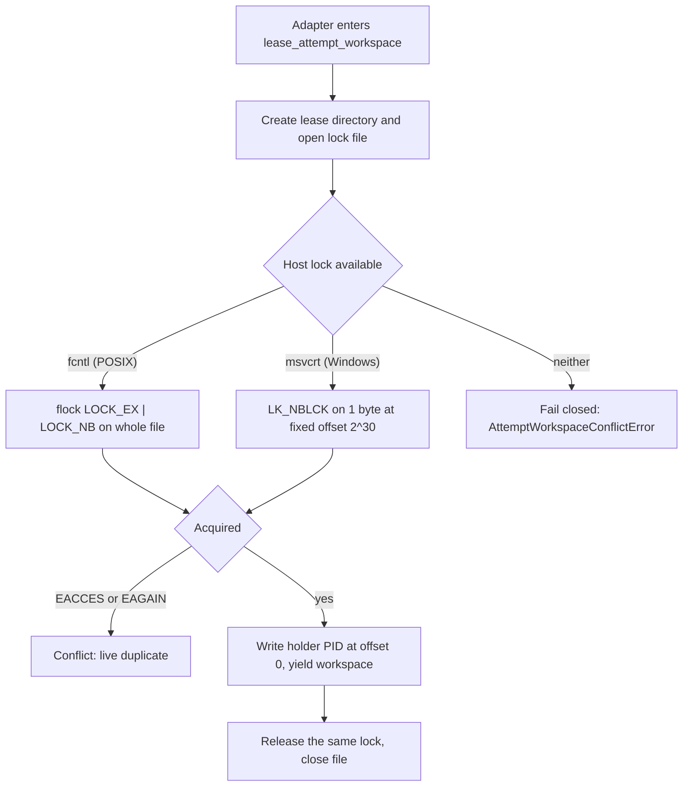

# Windows Attempt workspace lease

## 1. Outcome, authority and delivery boundary

On a Windows host, a Runtime Provider invocation can acquire, hold and release the Attempt workspace lease with the same guarantees it has on POSIX: a live duplicate dispatch is refused, including a second open of the same lease file in the same process, and the lease is released by the operating system when the holding process exits or crashes. A host without any supported OS lock still fails closed.

Authority: on 2026-11-05 the Runtime owner (Bokan) asked for "this part", the Attempt workspace lease, to get a Windows implementation, then a review and a push. The Runtime Designs (00 through 11, the_agent_runtime.md) do not state which operating systems the Runtime supports. The POSIX-only rule exists only as a code comment in `invocation_workspace_preparation.py`. This plan therefore relies on the owner's explicit decision and changes no Design meaning: the lease contract (exclusive, crash-released, outside the provider-writable directory) stays the same; only the host mechanism is added.

Baseline source: `main` at 2f39158a. Timestamp Semantics and Identifier and Reference Semantics do not apply: no time-bearing field, identifier, reference, version or hash changes.

Scope of this batch: the lease mechanism in one module and its tests. Excluded and recorded as follow-ups, because each is a separate Windows gap with its own design choice:

- Codex private state links `auth.json` with `Path.symlink_to` (`invocation_codex_environment.py`); unprivileged Windows refuses this with WinError 1314.
- `codex_auth_directories` resolves the credential source through `readlink`.
- Local command execution sandboxing uses macOS `sandbox-exec` (`invocation_local_command_execution.py`), and local resource preparation is gated to Darwin.
- The Claude adapter creates its temporary directory under `/tmp` (`invocation_claude_cli_execution.py`, `TemporaryDirectory(dir="/tmp")`), and local command execution also uses `/tmp`; both assume a POSIX path layout.

This batch does not claim that a Codex or Claude review completes on Windows. It removes the first refusal on that path.

## 2. Current behavior and the concrete defect

`lease_attempt_workspace(workspace)` is the single lease implementation. Both Provider adapters call it around Provider entry: `invocation_claude_cli_execution.py` (line 542) and `invocation_codex_module_invocation.py` (line 850). It creates `<parent>/.agent_runtime_attempt_leases/<workspace>.lock`, takes `fcntl.flock(LOCK_EX | LOCK_NB)`, maps `EACCES` or `EAGAIN` to `AttemptWorkspaceConflictError("... leased by a live duplicate invocation")`, writes the holder PID, and unlocks on exit.

On Windows `import fcntl` fails, `_fcntl` is `None`, and every lease raises `AttemptWorkspaceConflictError("Attempt workspace leasing requires a POSIX host (fcntl) ...")`. The adapters classify this as `dependency_unavailable` with `retry_denied`, so every Provider attempt fails before Provider entry. A real Codex review of a Design doc on 2026-11-05 failed this way. On `main`, 5 of 10 tests in `tests/test_agent_runtime_attempt_workspace.py` fail on Windows for this reason.

## 3. Target flow

## 4. Implementation

All changes are in `src/agent_runtime/invocation/invocation_workspace_preparation.py`. The public function, its signature, error class and messages for conflicts stay unchanged. No new module, wrapper or adapter.

1. **Backend selection at import.** Keep `import fcntl`. Only when it is unavailable, try `import msvcrt`. Exactly one of `_fcntl` and `_msvcrt` is set on POSIX and on Windows; both are `None` elsewhere.
2. **Two private helpers, `_acquire_lease_lock(handle)` and `_release_lease_lock(handle)`.** POSIX keeps the existing `flock` calls. On Windows, `msvcrt.locking` acts at the current file position, and writing the PID moves that position. Each helper therefore seeks the file descriptor to `_WINDOWS_LEASE_LOCK_OFFSET = 1 << 30` with `os.lseek` immediately before its call: `msvcrt.locking(fd, LK_NBLCK, 1)` to acquire, `msvcrt.locking(fd, LK_UNLCK, 1)` to release. An `OSError` from `os.lseek` during acquisition goes through the same mapping as a locking error.
3. **Why a byte at a fixed far offset.** Windows locks are mandatory byte-range locks. Locking byte 0 would block other handles from reading the PID record that the lease writes at offset 0. Locking one byte far past any PID record keeps the record readable, does not extend the file, and gives every process the same region to contend on.
4. **Fail closed when neither lock exists.** The existing guard changes from `_fcntl is None` to `_fcntl is None and _msvcrt is None`. The message names both supported hosts and still contains "POSIX".
5. **Error mapping is unchanged.** `msvcrt.locking` with `LK_NBLCK` raises `OSError` with `errno.EACCES` on contention, which the existing `EACCES or EAGAIN` branch already maps to the live-duplicate conflict. Other `OSError`s keep mapping to "lease cannot be acquired".

Guarantees on Windows and their basis:

| Guarantee | Basis |
| --- | --- |
| Exclusive across processes | `LockFileEx` byte-range locks conflict across handles. |
| Same-process duplicate is fenced | A second `open()` creates a second handle; byte-range locks conflict per handle, so the existing same-process test applies unchanged. |
| Released on crash | Windows releases a terminated process's file locks, but asynchronously: for a short time after the process has exited, the lock can still be held. POSIX releases at exit. Consequence for callers: on Windows, a retry immediately after a crashed holder can be refused as a live duplicate for that short time. This batch does not change retry handling; the difference is reported to the Runtime owner. |
| PID record readable | Lock region is outside the record. |

## 5. Dependencies, compatibility and failure

No new dependency: `msvcrt` is in the Windows standard library. POSIX behavior and code paths are byte-for-byte equivalent in effect: the same `flock` calls run in the same order. Lease files already on disk are compatible; the file format (PID text) does not change. Nothing is persisted beyond the existing lock file, and no record, schema or Registry changes.

Failure effects: if acquisition fails, nothing has been written to the workspace and the adapter reports the existing `dependency_unavailable`, `retry_denied` failure before Provider entry, as today. If release raises during `finally`, the file handle is still closed in the outer `finally`, and Windows drops the lock when the handle closes or the process exits.

## 6. Tests and verification

Changes in `tests/test_agent_runtime_attempt_workspace.py`. New and modified tests carry `@pytest.mark.deterministic`: they use real OS locks and subprocesses but no Provider, Runtime execution or database.

| Test | Change | What it catches |
| --- | --- | --- |
| `test_same_process_duplicate_dispatch_is_fenced_for_full_lease_scope` | unchanged, now runs on Windows | Lock not exclusive per handle, or not released after the scope. |
| `test_workspace_lock_is_outside_provider_writable_directory` | unchanged | Lock file placed inside the workspace. |
| `test_workspace_lock_is_released_when_holder_process_crashes` | modified: the external holder uses `msvcrt` at the shared offset on Windows, `fcntl` elsewhere; after the holder is killed and has exited, recovery is retried every 50 ms for at most 10 seconds, and the test still fails if the lock is never released; marker added | Different processes contending on different regions; lock never released after the holder is killed. |
| `test_held_lease_records_holder_pid_readable_by_other_handles` | new | Windows lock covering the PID record; PID not written. |
| `test_workspace_module_imports_without_os_lock_but_leasing_fails_closed` | renamed and modified: hides both `fcntl` and `msvcrt`, only from the lease module, so the standard library still imports | Lease admitted without any OS lock. |

Commands, run on Windows with the repository's virtual environment, and reported separately:

1. `python -m pytest tests/test_agent_runtime_attempt_workspace.py -q`: all lease tests pass except the two `test_provider_adapters_hold_lease...` cases, which go through the Codex adapter and are expected to keep failing on Windows at the excluded auth symlink (WinError 1314). That failure must be the symlink, not the lease.
2. Full suite `python -m pytest -q` on `main` and on the candidate on the same Windows host; compare the failed-test sets. Acceptance: no test that passes on `main` fails on the candidate. Pre-existing Windows failures are reported as a baseline, not fixed here.
3. POSIX regression: this host has no POSIX environment and the repository has no CI. The POSIX branch keeps the existing calls. Running the full suite on a POSIX host is a gate the Runtime owner holds before merging to `main`; it is not part of this batch's acceptance. Reported as not verified on POSIX.
4. Real path check: install the candidate into a new, disposable virtual environment (not the host's working Runtime install), register the bundled Reviewers into a disposable host root, and run one Reviewer through the Codex transport. Expected result: the attempt fails at the `provider_environment` stage with WinError 1314 (the excluded auth symlink), not at the lease. This is evidence for this batch, not a claim that reviews complete on Windows.

## 7. Implementation order and delivery

1. Implement on branch `feat/windows-attempt-workspace-lease` from `main` 2f39158a.
2. Run checks 1 and 2, then commit the code, tests and this plan as one commit with a single parent.
3. Independent implementation review of the exact commit.
4. Push the branch to `origin`. Merging to `main` and releasing a package are separate decisions for the Runtime owner.

## 8. Review binding

Independent plan review is required before implementation. The registered `engineering_change_reviewer` executes through Agent Runtime, which refuses to run on this Windows host because of the defect this plan fixes. As a temporary substitute chosen by the Runtime owner, reviews run through `claude -p --model opus` with the same reviewer prompt, schemas and checklist. They are recorded as substitute reviews, not as Runtime `engineering_change_reviewer` verdicts.

Review history, kept in this folder:

- R1: the first candidate was reviewed by an independent agent session; verdict passed with five notes (`CODE_DESIGN_REVIEW_R1.md`).
- R2: the same candidate was reviewed through `claude -p`; verdict blocked, because the reviewer had no shell to bind the plan hash and the `main` baseline. It also raised one fix: the crash-release guarantee did not state the bounded recovery retry (`CODE_DESIGN_REVIEW_R2.md`).
- This revision answers R2. It states the bounded retry, the explicit seek before release, the `/tmp` follow-up, the POSIX owner gate and the real-path environment.

An implementation draft exists in the working tree but has not been committed. The bounded retry in the crash test was added to that draft after a full Windows suite run showed the asynchronous release. It was not covered by an accepted plan at the time. This revision brings it into the plan, and the draft is adopted only after this candidate passes review.
