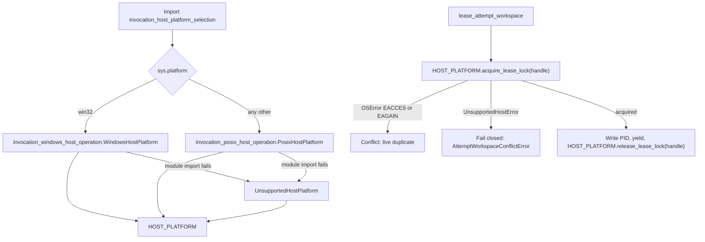

# Batch 1: host platform interface and Attempt workspace lease

## 1. Outcome, authority and delivery boundary

The Attempt workspace lease obtains its operating-system lock through a host platform interface. A POSIX implementation and a Windows implementation each live in their own module, and one selection point chooses between them once at import. `lease_attempt_workspace` contains no platform branch. Lease behavior on both hosts stays exactly as delivered in commit 8704f37: exclusive per handle and across processes, released by the operating system when the holder exits (asynchronously on Windows), lock file outside the provider-writable directory, fail closed when no supported lock exists.

Authority: on 2026-11-05 the Runtime owner chose this structure, one interface with a separate Windows implementation instead of branches inside shared functions, and asked that the already pushed lease change be restructured the same way. The program record is `README.md` in this folder. This batch changes code organization only; it changes no Design meaning and no public behavior.

Baseline: branch `feat/windows-attempt-workspace-lease` at 8704f37, whose parent is `main` 2f39158. The new commit is added on top of 8704f37; pushed history is not rewritten. Timestamp Semantics and Identifier and Reference Semantics do not apply.

In scope: the interface and selection module, the two implementation modules, the lease function, architecture source registration, tests. Out of scope: batches 2 to 5 in `README.md`. The interface contains only what this batch uses; later batches add their own members with their own plans.

## 2. Current behavior and the concrete defect

In 8704f37, `invocation_workspace_preparation.py` imports `fcntl`, falls back to `msvcrt`, and both private helpers `_acquire_lease_lock` and `_release_lease_lock` branch on which module loaded. The fail-closed guard in `lease_attempt_workspace` also branches on both. Platform knowledge is mixed into the lease module, and each later Windows difference would add more branches to more shared functions. The owner rejected that pattern.

## 3. Target flow

## 4. Implementation

New modules in `src/agent_runtime/invocation/`, named by the repository's `<responsibility>_<subject>_<action>.py` rule:

1. **`invocation_host_platform_selection.py`.** Defines:
   - `HostPlatform`, a `typing.Protocol` with `acquire_lease_lock(handle)` and `release_lease_lock(handle)`. `handle` is the open lease file object.
   - `UnsupportedHostError(RuntimeError)`.
   - `UnsupportedHostPlatform`, whose methods raise `UnsupportedHostError("Attempt workspace leasing requires a POSIX host (fcntl) or a Windows host (msvcrt); duplicate-dispatch fencing is unsupported on this platform")`.
   - `select_host_platform(platform: str) -> HostPlatform`: maps `"win32"` to the Windows module and every other value to the POSIX module, imports that module with `importlib`, and returns `UnsupportedHostPlatform()` if the import raises `ImportError`.
   - `HOST_PLATFORM = select_host_platform(sys.platform)`.
2. **`invocation_posix_host_operation.py`.** Imports `fcntl` at module top. `PosixHostPlatform.acquire_lease_lock` calls `fcntl.flock(fd, LOCK_EX | LOCK_NB)`; `release_lease_lock` calls `fcntl.flock(fd, LOCK_UN)`. These are the calls `main` makes today.
3. **`invocation_windows_host_operation.py`.** Imports `msvcrt` at module top. Public constant `WINDOWS_LEASE_LOCK_OFFSET = 1 << 30`. Both methods `os.lseek` to that offset immediately before `msvcrt.locking` with `LK_NBLCK` or `LK_UNLCK` on one byte. The reasoning comments from 8704f37 (far offset keeps the PID record readable; asynchronous release after process exit) move here.

Import direction: the two host operation modules import only the standard library. They do not import the selection module or any other Runtime module. `HostPlatform` is a structural `Protocol`, so the implementations need no import of it, and the dynamic import in selection cannot hide a cycle.

Changes to `invocation_workspace_preparation.py`: remove the `fcntl` and `msvcrt` imports, both private helpers and the module-level guard. `lease_attempt_workspace` calls `HOST_PLATFORM.acquire_lease_lock(handle)` inside the existing `try`; it adds `except UnsupportedHostError as exc: raise AttemptWorkspaceConflictError(str(exc)) from exc` before the existing `OSError` mapping, and calls `HOST_PLATFORM.release_lease_lock(handle)` in the existing `finally`. The public docstring states that release on Windows can be delayed after the holder exits.

Observable differences from 8704f37, and why they are acceptable: on an unsupported host the empty lock file is now opened before the refusal; the lease directory was already created before the refusal in 8704f37 and on `main`, and nothing is written into the provider workspace. The refusal message text is unchanged.

Architecture registration: add three `_source("invocation", ...)` entries to `RUNTIME_SOURCE_FILE_REGISTRATIONS` in `registry_architecture_registration.py`, owner `designDoc/agent_runtime_08_agent_execution_adapter_contract.md`: (`host_platform`, `selection`), (`posix_host`, `operation`), (`windows_host`, `operation`). They are not implementation bindings: the required implementation technology set (`claude_cli`, `codex_cli`, `html`, `http`, `postgresql`, `temporal`) is unchanged, so no Design change is needed.

## 5. Dependencies, compatibility and failure

No new dependency. Public API, error class, conflict messages and lease file format are unchanged. Every caller of `lease_attempt_workspace` (Claude adapter, Codex adapter, native structured output tests) keeps its import. Only test code imported the private `_WINDOWS_LEASE_LOCK_OFFSET`; it moves to the public constant in the Windows module.

Failure handling is the same as 8704f37: `OSError` with `EACCES` or `EAGAIN` maps to the live-duplicate conflict, any other `OSError` to "cannot be acquired", and the unsupported host to the fail-closed refusal. Selection never raises at import; an unavailable implementation turns into a refusal at first lease.

## 6. Tests and verification

All new and modified tests carry `@pytest.mark.deterministic`: they use real OS locks, imports and subprocesses, but no Provider, Runtime execution or database.

| Test | Change | What it catches |
| --- | --- | --- |
| `tests/test_agent_runtime_host_platform.py::test_selection_maps_windows_and_other_hosts` | new | `"win32"` not mapped to the Windows module, or another platform not mapped to the POSIX module. The test replaces the import function used by selection with a recorder and asserts the module name selection asks for, so both mappings are checked on any host. The returned type cannot show this, because the other host's module fails to import here. |
| `...::test_selection_returns_unsupported_platform_when_module_import_fails` | new | An unavailable implementation module raising at import, or being returned anyway, instead of `UnsupportedHostPlatform`. |
| `...::test_unsupported_platform_refuses_both_operations` | new | Unsupported host silently acquiring or releasing. |
| `...::test_current_host_selects_its_native_implementation` | new | This host selecting the wrong implementation (`WindowsHostPlatform` on `win32`, `PosixHostPlatform` elsewhere). |
| `...::test_lease_module_contains_no_platform_dispatch` | new | Reintroduced platform knowledge in the lease module: the module source must not reference `sys.platform`, `os.name`, `fcntl` or `msvcrt`. |
| `test_workspace_lock_is_released_when_holder_process_crashes` | modified: imports `WINDOWS_LEASE_LOCK_OFFSET` from the Windows module inside the Windows branch | Holder and lease contending on different regions. |
| `test_workspace_module_imports_without_os_lock_but_leasing_fails_closed` | modified: hides `fcntl` and `msvcrt` from the two host operation modules instead of from the lease module | Lease admitted on a host with no supported lock. |
| Other lease tests | unchanged | Same guarantees as 8704f37. |

Commands on Windows, reported separately:

1. `python -m pytest tests/test_agent_runtime_attempt_workspace.py tests/test_agent_runtime_host_platform.py tests/test_runtime_architecture_validation.py tests/test_agent_runtime_naming_contract.py -q`. Expected: all pass except the two Codex adapter lease cases, which still stop at the batch 3 credential symlink (stage `provider_environment`, WinError 1314).
2. Full suite, compared by failed test identity, not by counts. Each run uses `python -m pytest -q -p no:cacheprovider -rfE`; its failed set is the sorted node IDs from the `FAILED` and `ERROR` summary lines.
   - `main` baseline: `baselines/windows_main_2f39158_failed.txt` in this folder, 520 node IDs from a full run of a clean `main` 2f39158 worktree on this Windows host on 2026-11-05 (520 failed, 1350 passed, 92 skipped, no errors). It is committed with this batch.
   - 8704f37 baseline: re-run in a clean 8704f37 worktree on the same host, in parallel with the candidate run, and committed as `baselines/windows_8704f37_failed.txt`.
   - Acceptance: every node ID in the candidate's failed set is also in both baseline failed sets. The tests added by this batch do not exist in either baseline and must pass. Counts are reported for information only.
3. POSIX is not run on this host and the repository has no CI. A POSIX full-suite run remains the owner's gate before merging to `main`.
4. Real-path check before the implementation review: install the candidate into a disposable virtual environment and a disposable governed host under a short path, register `design_contract_reviewer`, and run one review through the Codex transport. Expected: failure at `provider_environment` with WinError 1314, as with 8704f37. The evidence goes to the implementation review.

## 7. Implementation order and delivery

1. On `feat/windows-attempt-workspace-lease`, add the three modules, change the lease module, register the sources, update and add tests.
2. Run checks 1 and 2, then commit code, tests, `README.md`, this plan, its review records and both baseline files as one commit whose single parent is 8704f37.
3. Run check 4, then the independent implementation review of the exact commit.
4. Push the branch. Merge to `main` and release stay with the Runtime owner.

## 8. Review binding

Plan and implementation reviews run through `claude -p --model opus` with the `engineering_change_reviewer` prompt, schemas and checklist, as recorded in `README.md`. They are substitute reviews, not Runtime `engineering_change_reviewer` verdicts.

Review history: R1 returned non_pass with one fix, F1: acceptance (a) was stated per test but verified by counts (`CODE_DESIGN_BATCH1_REVIEW_R1.md`). This revision compares failed test identities against committed baselines, and also takes up R1's two notes: the selection test asserts the requested module name, and the implementation modules do not import the selection module.
