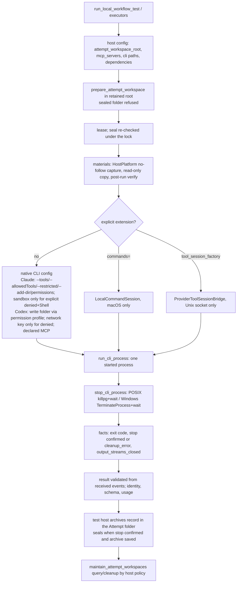

# External CLI boundary: Code Design (R6, for plan re-review)

R6 is R5 (which passed independent plan review) plus the delta in §4.12, which is required by the adopted reviewer-usage Design amendment. All other R5 sections stand unless §4.12 names them.

## 0. Identity and authority

| Item | Value |
| --- | --- |
| Scope | Owner-confirmed outer CLI boundary and compatibility boundary, the accepted native-default scope, and the corrections from independent plan review R1 (findings F1–F3 against R4) |
| Author | Orca worker, Claude Opus 5.5, effort xhigh |
| Base | `feat/windows-attempt-workspace-lease` at 5490f597af9b5e493f687625184235280441900b; the candidate commit will have this as its only parent |
| Design binding | Adopted canonical `designDoc/` (all reviews passed; bundle 9868b72f…):<br>• T0 `the_agent_runtime.md` 5fecfcfc5892…<br>• T1 `agent_runtime_00_execution_charter.md` 15e2481aaef3…<br>• `agent_runtime_01_module_contract_and_assembly.md` 311722ee42fd…<br>• `agent_runtime_08_agent_execution_adapter_contract.md` d772bb801fbb…<br>• `agent_runtime_09_authorization_integration_contract.md` 314127cd373a… (unchanged)<br>• `agent_runtime_11_agent_capability_verification.md` b75530cbb9ff…<br>The usage patterns are T1 §5.2 and 08 §4.3. The defaults are 08 §5.4, §6.4 and §8.1, and 01 §6.3.<br>**R6 binding** (bundle a29bf9d7…), superseding the matching rows above:<br>• T1 00 079f59922d48…<br>• 01 9d12589fafbd…<br>• 08 3660ef3614de…<br>• 11 4717a119019b…<br>T0 5fecfcfc… and 09 314127cd… are unchanged. The current sections are 08 §4.3 (file review, MCP data with local I/O) and §8.2 (history-informed permits).<br>**Final binding: adopted outer-CLI consolidation** (canonical equals packaged; bundle c2caaf64b234…):<br>• T0 `the_agent_runtime.md` b96d7f531884…<br>• T1 `agent_runtime_00_execution_charter.md` d31ff055f328…<br>• `agent_runtime_01_module_contract_and_assembly.md` e498dfa5aaf5…<br>• `agent_runtime_08_agent_execution_adapter_contract.md` d88eb86f7c20…<br>• `agent_runtime_11_agent_capability_verification.md` 15db911d22e3…<br>• `agent_runtime_09_authorization_integration_contract.md` 314127cd373a… (unchanged)<br>These supersede every earlier Design hash in this row. They cover the three-phase outer contract, base native file I/O with explicit directories for every agent call, and context selection kept separate from native permission configuration |
| Time semantics | The host's Timestamp Semantics contract (RFC 3339 UTC instants), for the instants in §4.8 |
| Host facts | A forced Claude sandbox refuses to start on this Windows host.<br>Ordinary Claude Bash works under native permissions without a sandbox.<br>Inventory of past reviews: they used `--tools ""` plus only the fixed-command MCP tool, and no native file or Shell calls.<br>A Codex file I/O probe was bounded to the app-bundled `codex-cli 0.166.0-alpha.5.1` with Runtime's injected flags. It says nothing about npm `codex-cli 0.166.0` or normal host-configured invocation |

Files carried over from the paused Windows process-tree work:

- `invocation_process_execution.py`: revised as §4.1 describes, keeping `CliProcessCreationEvidence` and `cli_process_stop_confirmed`.
- `invocation_codex_module_invocation.py`: revised as §4.2–4.7 describe.
- `invocation_host_platform_selection.py`: revised as §4.1 and §4.4 describe.
- `invocation_windows_process_operation.py`: deleted.

## 1. Goal

A host uses `claude -p` and `codex exec` normally through Runtime, on Windows and on POSIX.

**What the call uses**

- **Login and configuration:** the host's existing ones.
- **Tools:** Read, Search, Edit, Shell and declared MCP connections, controlled by each CLI's native permission and configuration settings.
- **Networking:** provider-managed for ordinary agent and Reviewer calls.
- **Folders:** chosen material folders, plus a writable folder that is either the private scratch or the caller's own project directory. File scope reaches the CLI's native file-tool settings.
- **Usage patterns:** the four patterns of 08 §4.3 (text/structured output, file review, coding with commands, existing MCP/gateway data) all work through this one contract (§4.10).

**What Runtime keeps**

- input integrity;
- separation of its own directories;
- output, schema and model-identity checks;
- budgets;
- stop facts;
- retention and bounded cleanup.

**What Runtime does not do**

- Promise OS confinement of every Shell or Python program.
- Promise global unreachability of private state.
- Force a sandbox.
- Copy login state.
- Supervise CLI-internal processes.
- Probe backend authorization.

**Saved requirements and explicit extensions**

- Saved explicit requirements keep their exact meaning: `denied`, `gateway_only`, `direct_sandboxed`. Where a CLI cannot honour one, the CLI's own refusal is reported. It is never relabelled or weakened.
- The explicit `commands=` and `tool_session_factory` extensions remain for their real callers. Ordinary calls do not inherit them.

Attempt folders follow 08 §6.6 on the public path (`run_local_workflow_test` / `agent-runtime-test-run`):

- retained by default;
- archived;
- sealed only when the stop is confirmed;
- later cleaned by an explicit maintenance call under host policy. This works for material-bearing Attempts too.

## 2. Flowmap



## 3. Current code against the target

| Area | Current code (5490f59) | Target |
| --- | --- | --- |
| Network | `NETWORK_POLICIES = {denied, gateway_only, direct_sandboxed}`; native tools require `denied` (`registry_release_definition.py:858-866`); Reviewer defaults, admissions and adapters require `denied` | New value `provider_managed`, the default for new agent and Reviewer requirements. `denied` and the others keep their exact meaning when saved or chosen |
| Claude sandbox | Always emitted, with `failIfUnavailable` (`invocation_claude_cli_execution.py:615-630`) | Emitted only for an explicit `denied` with Shell (network allowlist empty plus draft write scope), and for explicit extensions as today |
| File scope | Sandbox read allowlist, credential scans, denied roots | Claude: `--restricted`, `--add-dir`, `settings.permissions`. Codex: permission profile writable main folder over `:read-only`. Runtime checks only its own directories |
| Codex login | Private `CODEX_HOME`, copy or symlink, `auth_file`, file store | Host environment; `CODEX_HOME` passed through when set |
| Process | Windows Job module; POSIX psutil descendants; observe/release | Started process only; host-native stop; bounded wait |
| Materials | macOS-only, with POSIX fd primitives inline | All hosts, through HostPlatform material operations; `commands` stay macOS-only |
| MCP | Empty strict set | `tool_policy` `mcp__<name>` admits host-configured connections. Raw config never enters logs or model input |
| Output completeness | Claude hardcodes complete; Codex fails on incomplete capture | `output_streams_closed` (EOF only) is recorded; a valid result with incomplete raw capture is accepted and the gap recorded |
| Unconfirmed stop | Temp dirs disposed | Retained, with the location reported |
| Public Attempt folders | `TemporaryDirectory` deleted on return | Retained root, archive, seal, maintenance API; read-only material copies cleanable |
| Windows launchers | `.cmd`/`.bat`/`.ps1` refused, described as security; default lookup `shutil.which` picks `claude.cmd` | Same refusal, now explained as argument fidelity. Default lookup searches PATH for the native `<name>.exe` (§4.1); otherwise the host names the program |
| Revisions | Claude v3, Codex tool-free v4, workspace v3 | Claude v4, Codex tool-free v5, workspace v4 (08 §11.3); old records stay readable and replayable without execution |

## 4. Changes by file

### 4.1 Process control and program handling

`invocation_host_platform_selection.py`:

- `HostPlatform` loses:
  - `mount_codex_credential`
  - `remove_codex_state`
  - `observe_cli_process`
  - `release_cli_process`
  - `protected_read_roots`
  - `credential_locations`
- It gains the §4.4 material operations and `resolve_cli_program(name, environment)` (see below).
- `remove_private_directory(..., *, clear_read_only=False)` is described in §4.8.
- `UnsupportedHostPlatform` mirrors these changes.
- Docstrings:
  - `create_cli_process` starts the single Runtime-invoked process; an `OSError` means none exists.
  - `stop_cli_process` stops that process with host-native control and confirms its exit within a bound, or raises. It never enumerates CLI-internal processes.

`invocation_posix_host_operation.py`:

- Delete `_remember_descendants` and the psutil import.
- `_stop_process_group` keeps `killpg` (with the Darwin EPERM retry), then `wait(timeout=3)`, or raises `RuntimeError`.

`invocation_windows_host_operation.py`:

- `create_cli_process` is `subprocess.Popen(argv, executable=native_program(...), cwd, env=dict(environment), stdin/stdout/stderr=PIPE, creationflags=CREATE_NEW_PROCESS_GROUP | CREATE_NO_WINDOW)`.
- `stop_cli_process`: `kill()` while running, then `wait(timeout=3)`, else `RuntimeError`.
- `native_program` and its helpers move here unchanged.
- Launchers (`.cmd`, `.bat`, `.ps1`) are still not started.
  - **Reason:** this is correct program and argument handling, not a security policy. A launcher hands its arguments to `cmd.exe` or PowerShell, which re-parse them, and Runtime's argv carries JSON, paths and quotes that must arrive byte-exact.
  - **Error message:** it says this and suggests naming the native program in `provider_cli_paths` or `cli_path` (for example the `claude.exe` the npm shim starts).
  - **POSIX:** unchanged. The kernel executes a script with its shebang interpreter and passes argv through unchanged, so POSIX has no such restriction.
- `testing/conformance_local_test_run.py:332-338` default CLI lookup: today's `shutil.which(program)` returns `claude.cmd` on this host. It changes to `HOST_PLATFORM.resolve_cli_program(program, environment)`:
  - POSIX: `shutil.which`.
  - Windows: `native_program` over PATH (`claude.exe`).
- No launcher contents are parsed.

`invocation_process_execution.py`:

- Drop the observe loop and release.
- `cleanup_error` now means only that the stop of the started process was not confirmed.
- A worker still blocked after `join(timeout=1)` sets `CompletedProcess.output_streams_closed=False`. `True` means only EOF on both pipes. Output-limit, read, observer and stream failures keep their `CliProcessError` stop reasons.
- `_stop_unstarted` is reduced to stop plus pipe close.

Deletions:

- `invocation_windows_process_operation.py`.
- In `registry_architecture_registration.py`, the `windows_process` `_source` (line 679).

`pyproject.toml`: `psutil` moves to the `test` extra.

### 4.2 Host login (Codex)

- `invocation_codex_module_invocation.py`:
  - `_ENVIRONMENT_KEYS` moves here, with `CODEX_HOME` added. `conformance_local_test_run.py:64` imports it.
  - The environment is `HOST_PLATFORM.provider_environment(os.environ, _ENVIRONMENT_KEYS)`, plus the §4.6 MCP keys.
  - Delete `tracked_launch_guard`, every `process_stop_confirmed`, and the `provider_state_isolated` and `isolation_gaps` trace keys.
  - Both executors lose `auth_file`.
  - `_command` drops `cli_auth_credentials_store="file"`.
- Delete `invocation_codex_environment.py` and `invocation_windows_credential_preparation.py`.
- In the registry, delete the line-301 binding path, the `codex/environment` `_source` (lines 648–652) and the `windows_credential` `_source` (line 677).

### 4.3 Network policy and native permission configuration

Contracts and admission (exact meanings preserved):

- `contracts/registry_release_definition.py`:
  - `NETWORK_POLICIES` gains `provider_managed`: Runtime imposes no extra egress guarantee, and the CLI, host and services govern networking. This is not a permission bypass.
  - The native-tools rule (lines 858–866) admits agent + inline with `denied` or `provider_managed`.
  - Tool-free stays `denied` with no tools (line 826).
  - `ReviewerDefaults` (lines 1137–1155) is not changed. It is the legacy decoder for saved Reviewer defaults, and historical shapes already exist (v1, v2 with `denied`, and custom versions; see `tests/test_agent_runtime_registry_module_policy_closure.py:251-252` and `:306`). Every saved shape keeps decoding exactly, and no version is reused to mean `provider_managed`. No current consumer needs more.
- `registry/registry_module_authoring.py:463`: `ModuleReviewer._default_execution_requirements`, the current constructor of new Reviewer defaults (a `ModuleExecutionRequirements`), uses `provider_managed`. Already-registered Reviewers keep their saved `denied` until their owner re-registers through the existing upgrade procedure.
- These sites accept `provider_managed` beside `denied`. Each check keeps `denied` where it is the saved value, and `gateway_only` and `direct_sandboxed` stay unchanged:
  - `execution_self_test_binding.py:55`
  - `execution_module_invocation.py:2222` (`_assert_admitted_test_evaluation_profile`)
  - `testing/execution_module_evaluation.py:124`
  - `invocation_local_resource_preparation.py:157`
  - Claude `_execution_expectation` (lines 202 and 212, which record the actual value) and the descriptor at line 332 (`("denied", "provider_managed")`)
  - Codex workspace expectation (lines 204 and 211) and its descriptor through `invocation_result_assembly.py:90` (a tuple of policies)
- Codex tool-free v5 stays `denied`.

Claude (`_execute`):

- **Native controls on every call:**
  - `--tools` and `--allowedTools` from `tool_policy`;
  - `--restricted` (file tools confined to cwd plus `--add-dir`; code-running tools only if named);
  - `--add-dir` for materials and dependencies;
  - `settings.permissions` (`additionalDirectories`, `blockReadsOutsideWorkingDirectories`);
  - `--permission-mode auto`.
- **`settings.sandbox`:**
  - Emitted only when `network_policy == "denied"` and `shell` is in `tool_policy`, the explicit requirement. It contains `enabled`, `failIfUnavailable`, `allowUnsandboxedCommands: false`, `network` (empty allowlist, `strictAllowlist`), and for a draft `filesystem.allowWrite = [cwd, crt- temp]`.
  - Removed: the POSIX read allowlist, `denyRead "/"`, and the extra `denyWrite` entries.
  - `provider_managed` and `denied` without Shell emit no sandbox.
  - A call with `local_commands` or `provider_tools` (an explicit extension) keeps today's complete settings block unchanged (lines 615–633). That code moves into the extension branch, so ordinary calls never build it.
- **Dependency overlap check (lines 594–598):** reduced to Runtime's own `(crt- temp, workspace_root)`.
- **Environment:**
  - `_ENVIRONMENT_KEYS` gains `PATH`, the proxy variables (as Codex has) and `CLAUDE_CODE_GIT_BASH_PATH`. Secret-bearing variables stay excluded by the allowlist.
  - PATH is the Runtime Python bin and dependency bins, then the host PATH, replacing the fixed `/usr/bin:/bin:…`.
  - `GIT_CONFIG_GLOBAL` becomes `os.devnull`.
  - The other ambient-context variables are unchanged.
- **Preflight** `--version`/`--help` stays (08 §6.3).

Codex workspace:

- `codex_permission_profile` becomes `{"extends": ":read-only", "filesystem": {main_folder: "write"}}`, plus `network.enabled=false` only when `denied`. `provider_managed` leaves Codex's default.
- Deleted: `_DENIED_ROOTS`, `codex_program_files`, `ISOLATION_GAPS`, `_credential_locations`, `codex_auth_directories`, and the read grants that only reopened denied roots.
- `check_codex_external_grants` is reduced to its separation rule (a dependency may not be a filesystem root or overlap `workspace_root`). Its callers are the executor dependency validation (line 704) and the profile builder.
- `codex_home_locations` exists only for the commands branch (§4.7).
- PATH is the Runtime Python bin, dependency bins and (on macOS) the Xcode bin, then the host PATH. `GIT_CONFIG_GLOBAL` becomes `os.devnull`.

Ambient context: the existing suppression stays the default for ordinary and Reviewer calls:

- Claude: `--safe-mode`, `--setting-sources ""`, `--strict-mcp-config`.
- Codex: `--ignore-user-config`, `--ignore-rules`, `--ephemeral` and the features off.

Explicitly selected host resources (§4.6 MCP) are added on top. This is not a universal ban.

### 4.4 Materials and dependencies on every host

- `_profile_resources`: the general gate drops `sys.platform != "darwin"` and admits `denied` or `provider_managed`. A new rule refuses `commands` unless darwin, with `ADAPTER_CAPABILITY_UNSUPPORTED` ("declared local commands require macOS sandbox-exec").
- `_RESOURCE_BINDINGS` becomes `{claude v4, codex workspace v4}`.
- The POSIX fd code moves unchanged into `PosixHostPlatform`:
  - `read_material_file(root, parts) -> (bytes, executable: bool | None)`
  - `write_material_tree(source, files)`
  - `material_tree_state(source) -> ({relative: (sha256, executable | None)}, directories)`
- The Windows implementations:
  - check with `lstat`, refusing any reparse point or non-regular entry;
  - read in binary mode, comparing `fstat` before and after;
  - set the read-only attribute on copied files;
  - report `executable` as `None`.
  A path race can only cause a read, which the hash check refuses.
- Integrity stays: copies are read-only, and after the run the tree, hashes and read-only state are verified, giving `ADAPTER_POLICY_VIOLATION` on drift.
- `describe_local_resources` keeps the v2/v3 texts for replay. The new revisions say "Other locations follow the CLI's own permissions", replacing "read-only or inaccessible".

### 4.5 Results with incomplete raw capture

- Claude line 675 and Codex `_default_invoke` set `process_output_complete=process.output_streams_closed`.
- Codex line 1052, the unconditional failure, is deleted. The parsed events decide:
  - missing or invalid events give `codex_cli_result_missing_or_invalid`;
  - nonzero exit, failed turn, usage and schema checks stay as they are.
- Capture failures keep their codes.
- Inspection already reports `process_output_complete=False` as a log gap.

### 4.6 Explicitly selected existing MCP connections

**Admission by fixed capability**

- A Module declares each connection in its `tool_policy` as `mcp__<name>`. This is valid under the existing `ID_PATTERN`, so no schema change is needed.
- Shared helpers `declared_mcp_connections` and `callback_tool_names` in `invocation_tool_definition.py` replace the inline derivations. Callers:
  - `execution_local_invocation.py:343`;
  - Claude lines 389 and 438;
  - the self-test callback check (around `execution_self_test_binding.py:182`);
  - the Codex workspace subset check (line 206).
- Effect: `mcp__*` names are never treated as callbacks.
- Undeclared host connections are never passed, so a read/search Module gains no tools.
- A declared but unconfigured connection fails before launch with `dependency_unavailable` / `ADAPTER_BINDING_UNAVAILABLE`.
- Tool-free Profiles cannot declare tools.

**Host configuration** (validated by `load_runtime_config`):

```json
{"mcp_servers": {
  "claude_cli": {"<name>": {"config": {...Claude mcpServers entry...}, "environment_keys": ["VAR"]}},
  "codex_cli":  {"<name>": {"config": {...Codex mcp_servers table...},  "environment_keys": ["VAR"]}}}}
```

- Names match `[a-z0-9_-]{1,64}` and are not `runtime_commands` or `runtime_tools`.
- `environment_keys` are environment-variable names whose values stay in the host environment.
- No authorization is inspected, and Runtime adds no general secret scanner. The credential rule is enforced only through which config fields are accepted:
  - **Claude `config`:** a JSON object that is never placed on a command line (see Adapters). Its secrets should use Claude's `${VAR}` expansion with `VAR` listed in `environment_keys`.
  - **Codex `config`** (F1): the only CLI channel is `-c` argv, so this is a closed set of fields.
    - **Non-credential fields:** `command`, `args`, `cwd`, `url`, `startup_timeout_sec`, `tool_timeout_sec`, `enabled`, `enabled_tools`, `disabled_tools`, `default_tools_approval_mode`.
    - **Credential fields, by environment reference only:** `env_vars` (names forwarded to a stdio server), `bearer_token_env_var`, and `env_http_headers` (header name to variable name).
    - **Refused:** the literal-value fields `env`, `http_headers` and `bearer_token`, and any key outside the set. `load_runtime_config` refuses them with `ValueError` naming the field, before any execution.
    - **Variable coverage:** every variable referenced through `env_vars`, `bearer_token_env_var` or `env_http_headers` must appear in `environment_keys`, or the config is refused.
    - **Command arguments and URLs:** the host contract states that `args` and `url` are not credential channels and are passed as given. Runtime does not scan them.
    - **Field names:** they are Codex's documented `mcp_servers` keys. Codex itself runs with `--strict-config`, so any field it does not recognise fails at startup.
- **Rejected alternative:** Codex `-p <profile>` layering `$CODEX_HOME/<name>.config.toml` would keep a host-owned profile out of argv. It is not used, because its merge order with `--ignore-user-config` and with Runtime's `-c` overrides is unverified, and adopting it would mean managing files in the host `CODEX_HOME`.

**Adapters** (`ClaudeAdapter` and both Codex executors take `mcp_servers={}`):

- **Claude:**
  - Declared entries are written to `crt-/mcp.json` in the call's private directory and passed as a second `--mcp-config` value (a file path) after the unchanged inline value. `--strict-mcp-config` stays.
  - `mcp__<name>` is added to `--allowedTools`.
  - With any MCP server present, `--safe-mode` is omitted and the existing ambient-context settings are applied.
- **Codex:** `-c mcp_servers.<name>=<toml(config)>` for each declared entry, rendered only from the validated closed field set. The argv therefore holds only non-credential fields and variable names.
- **Both:** the declared `environment_keys` are copied from the host environment into the child environment, and only there.

**Logs and model input**

- The trace records `mcp_connections=[{name, config_sha256, environment_keys}]`.
- The recorded argv still replaces each Codex MCP value with `<host MCP config sha256:…>`. This keeps host connection details out of shared logs, though the values are already credential-free. The Claude argv holds only the file path.
- Claude's trace `environment` (line 654) shows forwarded MCP keys as `<redacted>`; Codex records key names only.
- Nothing enters the prompt or the resource description.

**Plumbing:** `run_local_workflow_test` passes `config["mcp_servers"].get(transport, {})`.

### 4.7 Explicit extensions (kept)

- `LocalCommandSession`, `invocation_local_command_mcp.py`, `ProviderToolSessionBridge`, `invocation_tool_transport.py`, `command_sandbox_conflicts` and `_SYSTEM_READ_ROOTS` stay, with unchanged evidence.
- Their own checks stay only in their branches:
  - the Claude extension branch keeps its provider-private list as `provider_private_locations()` in `invocation_local_command_execution.py`;
  - the Codex commands branch computes `protected = (host temp, codex_home_locations())`.
- `unix_socket_transport_available()` is checked before `ProviderToolSessionBridge` opens a session. Claude line 757 classifies `NotImplementedError` from `provider_tool_preparation` as `ADAPTER_CAPABILITY_UNSUPPORTED`.
- `conformance_agent_examples.py:69` keeps its explicit `denied` (Design 11 examples).

### 4.8 Retention, seal, maintenance, public path

**Stop-unconfirmed retention**

- `private_temporary_directory(..., retain=None)`: if `retain()` is true at exit, nothing is disposed and it raises `OSError("Runtime private directory retained at <path>: the CLI process started by Runtime was not confirmed stopped")`.
- The Claude `crt-` and Codex schema directories pass `retain=lambda: stop_unconfirmed`. The flag is set when `cli_process_stop_confirmed(exc) is False`.
- This surfaces as `claude_cli_cleanup_failed` / `codex_cli_cleanup_failed` (Codex lines 744–751).

**Lease and seal** (`invocation_workspace_preparation.py`)

- `_hold_lease(path)` does not resolve the final component.
- `lease_attempt_workspace` re-checks the seal under the lock. `prepare_attempt_workspace` refuses a sealed folder.
- `seal_attempt_workspace(*, workspace_root, attempt_id, effective_at_utc)`:
  - validates the id, then holds the lease;
  - requires an ordinary directory whose marker names the id;
  - exclusively writes `.agent_runtime_attempt_seal.json` = `{attempt_id, effective_at_utc}`;
  - returns on an identical repeat; a conflicting seal raises.

**`maintain_attempt_workspaces(*, workspace_root, facts, retention_seconds, observed_at_utc, intent)`**

- Validates every input and id before touching any path.
- For each listed id:
  1. Non-blocking lease; contention gives `lease_active`.
  2. Under the lease, `lstat` must show an ordinary non-reparse directory. Take `identity`.
  3. Read the marker and seal.
  4. Evaluate the facts, the policy and the time.
  5. With intent `cleanup` and no reasons, call `remove_private_directory(dir, identity, clear_read_only=True)`. The identity is re-verified at disposal, so a replacement is never deleted.
- With `clear_read_only=True`:
  - **Windows:** each child is opened handle-relative without following reparse points and passes `verify_entry` (files single-link). `FILE_ATTRIBUTE_READONLY` is cleared through that same handle (`SetFileInformationByHandle`, `FileBasicInfo`) before deletion. Multiply-linked files and reparse points are still refused.
  - **POSIX:** each directory is opened with `O_DIRECTORY | O_NOFOLLOW` relative to its parent fd and given owner rwx with `fchmod`, then `rmtree` runs.
  - Source material roots and dependencies are never inside an Attempt folder, so they are never traversed.
  - The default `False` keeps the existing contract for Runtime private temp dirs.
- Results: `cleanable`, `retained` with reasons, `deleted`, or `deletion_failed` with the location. Unlisted folders and lease files are untouched.

**Public path** (`run_local_workflow_test`)

- `load_runtime_config` gains `attempt_workspace_root`, defaulting to `<root>/.runtime/attempt_workspaces`. It replaces the `TemporaryDirectory`.
- Per Attempt, the test host:
  1. Writes the record to `<attempt>/archive/execution_record.json` with exclusive create.
  2. Seals with the current UTC time when the record status is terminal, the stop is confirmed and the archive was saved.
  3. Adds `record["attempt_workspaces"]`.
- Attempt ids derive from the per-run idempotency key, so runs sharing the root do not collide.
- Same-identity reuse before the seal, and replay, are unchanged.

### 4.9 Adapter revisions

| Binding | Old | New |
| --- | --- | --- |
| Claude `_CURRENT_BINDING` (default Profiles via `execution_local_invocation._execution_profile_for_requirements`) | v3 | v4 |
| `CodexCliModuleExecutor` and `_execution_expectation` (lines 180, 188, 1115) | v4 | v5 |
| `CodexCliAgentWorkspaceModuleExecutor` and `_workspace_execution_expectation` (lines 201, 210, 1132) | v3 | v4 |

- Profiles are derived per call.
- Committed old records stay readable, and replay starts no Provider.
- Old-revision Profiles are refused for new execution with the existing binding error.

### 4.10 The four usage patterns (08 §4.3) mapped to code

| Pattern | Module capability | Caller/host supplies | Code path in this plan | Gap closed here |
| --- | --- | --- | --- | --- |
| Text or structured output | `tool_free`, empty `tool_policy` | Inline input, output schema | No sandbox block on any tool-free call (§4.3); native or prompt-only schema | Today's forced sandbox may refuse tool-free Claude on this host |
| File review | `agent`, `read`/`search` (+`shell` only if the method needs commands), private draft | Exact materials, read-only sources, scratch | Materials on every host (§4.4); `search` maps to Claude `Grep` and `Glob`; commands are native Shell, never the extension unless `commands=` is passed | macOS-only materials; Glob unmapped |
| Coding with commands | `agent`, `read`/`search`/`shell`/`edit`, `attempt_workspace_policy` `explicit_project_read_write` | `project_directory`: the caller's existing checkout, worktree or task copy | cwd is `project_directory`; Claude `--tools` includes `Edit`,`Write`; the Codex profile marks it `write` | No writable external target today; scratch inside the Attempt folder would be deleted by maintenance |
| Existing MCP or gateway data | `agent` + only `mcp__<name>` (no Shell needed); workspace `none` or private draft | Host connection entry (§4.6); the gateway/database binding is that connection | §4.6; MCP-only Codex path below | MCP pinned empty today; Codex requires Shell for every agent Profile |

**Explicit project workspace (coding).**

- `contracts/registry_release_definition.py` attempt-workspace values (line 779) gain `explicit_project_read_write`, which requires `agent` (the line 872 rule is extended). It is a Module fixed capability; `ReviewerDefaults` is unchanged.
- The per-call `project_directory: Path` is new on `run_local_workflow_test` and the `agent-runtime-test-run --project-directory` option, and is an adapter constructor parameter for the Claude and Codex workspace executors.
- Before launch:
  - It must be an existing absolute directory, not a filesystem root, and must not overlap `workspace_root`, the Attempt folder or Runtime temp.
  - It is required exactly when the Profile selects this policy, and refused otherwise.
- **Claude:** cwd is `project_directory`, and `--add-dir` covers the materials and dependencies.
- **Codex:** `main_folder` (write) is `project_directory`; TMPDIR is `<attempt>/work/tmp`, also `write`.
- The Attempt folder still holds the materials and the archive.
- Runtime never deletes, seals or cleans `project_directory`. Maintenance (§4.8) only touches Attempt folders, and the record gives `project_directory` in `attempt_workspaces[]` and the trace.
- Interruption and stop rules are unchanged: changes already made remain where they are.

**Logical `edit` tool.**

- `NATIVE_TOOLS` gains `edit → Edit, Write` for Claude. `search` becomes `Grep, Glob`.
- For Codex, `edit` is served by its shell/apply_patch tooling and requires `shell`, the same constraint as read/search today (lines 206–209).
- The shared `callback_tool_names` (§4.6) treats `edit` as native.
- `ReviewerDefaults` stays read/search/shell. "Allowed to read" never implies "allowed to write" (08 §5.4).

**MCP-only Codex path (F2).** An agent Module whose `tool_policy` holds only `mcp__<name>` entries reaches Codex through the public path with Shell disabled.

- **Routing:** `_execution_profile_for_requirements` (`execution_local_invocation.py:91-93`) already routes every agent to `CodexCliAgentWorkspaceModuleExecutor`.
- **`_workspace_execution_expectation`** (lines 192–211; today it requires an own draft at 204 and Shell at 208–209) becomes:
  - `tool_policy` must be non-empty, and every item must be `read`, `search`, `shell`, `edit` or `mcp__*`.
  - If `read`, `search` or `edit` is present, `shell` is required. The existing exact `CodexCapabilityUnsupportedError` text is kept: Codex serves them only through its shell tool.
  - An MCP-only `tool_policy` needs no `shell`.
  - `attempt_workspace_policy` may be `own_draft_read_write` or `explicit_project_read_write`. It may be `none` only when `shell` is absent, because Shell keeps requiring a writable folder as today.
  - `network_policy` may be `denied` or `provider_managed`.
  - The returned `InvocationExecutionExpectation` carries the actual workspace, network and tools.
- **Fixed Shell attribute** (line 731): the check `self.shell_tool_enabled != ("shell" in tool_policy)` and the fixed `shell_tool_enabled = True` (line 1135) are removed for the workspace executor. `build_workspace_command(shell_tool="shell" in profile.tool_policy)` takes the flag from the Profile. The tool-free executor keeps `shell_tool_enabled = False` and its check.
- **Without Shell:**
  - `features.shell_tool=false`, and the `functions` namespace is excluded (the existing `_command` branch at 354/359).
  - With workspace `none`: no permission profile, `-s read-only` (as the tool-free command uses), and cwd is the Attempt `work` folder.
  - With a draft: the write-folder profile of §4.3.
  - The Runtime Python roots and PATH additions are skipped.
- **Descriptor:** `invocation_result_assembly.py:57-90` takes `network_policies: tuple[str, ...]`, replacing the single `network_policy`. The workspace descriptor lists `("denied", "provider_managed")`; the tool-free one lists `("denied",)`. `execution_module_invocation.py:1978` already checks `in`.
- **Prompt text:** `describe_local_resources` for workspace v4 with `none` says "No model-writable task workspace is authorized", as the Claude text does.
- Genuinely unsupported Codex combinations keep their exact errors: read/search/edit without Shell, Shell with workspace `none`, `gateway_only`, `direct_sandboxed`.

**Declared Runtime operations (F3, withdrawn).** `_assert_admitted_test_evaluation_profile` (`execution_module_invocation.py:2202-2240`) and `ModuleSelfTestResources.__init__` (`execution_self_test_binding.py:44-47`) keep their operation rules exactly.

- **Only change:** the inline branch's `network_policy == "denied"` becomes membership in `{"denied", "provider_managed"}`. The four-pattern outcome needs this, and nothing else in the operation rules.
- **Why the expansion is unnecessary:**
  - None of the four patterns declares non-model operations.
  - The current portable engineering reviewer source (v4) declares none.
  - The Design 11 examples declare only `model_execute` (`conformance_agent_examples.py:115`).
  - The existing `commands=` / `tool_session_factory` call shapes therefore pass today's admission unchanged.
- **Pre-existing and not fixed here:** a Module declaring non-model (Gateway) operations with an inline Profile, or one with `tool_policy` beyond its declared operations on the gateway_read path, is still refused as today. This is reported, not claimed fixed.
- **Kept intact:** the 01 §6.3 sentence is satisfied in that the explicit extensions' normal paths are not excluded. They never depended on non-model operation declarations.

**Admission and expectation sites for the new values.** These all accept `explicit_project_read_write` beside `own_draft_read_write`, `edit` beside `read`/`search`/`shell`, and `provider_managed` beside `denied`:

- the Claude expectation (line 204);
- the Codex workspace expectation (above);
- `execution_self_test_binding.py:55`;
- `_profile_resources` (the tool-intersection check). Local materials still require a native tool, so a materials-free MCP-only Module never reaches it.

**Resource description.** `describe_local_resources` for the new revisions gains one line for that policy: "Your working directory is the project directory provided for this task; your changes there are the delivery."

### 4.12 R6 delta: native flags, basic file I/O, history-informed permits

**a. Inherited flags.** Independent-review context and native permission configuration are separate concerns. Context suppression stays. Nothing that drops the user's or host's native permission configuration is kept merely to suppress context.

| CLI flag (today) | Concern | R6 |
| --- | --- | --- |
| Claude `--setting-sources ""` | Drops user, project and local settings, including their `permissions` allow/deny rules and default mode | **Removed.** Native settings load normally. Runtime's `--settings` adds only the declared scope |
| Claude `--restricted` | Confines file tools to cwd + `--add-dir` (scope, kept as a need) but also ignores user, project and local settings | **Removed.** File scope comes from `--add-dir` and `settings.permissions` (`additionalDirectories`, `blockReadsOutsideWorkingDirectories`); `--tools` already limits built-in tools |
| Claude `--safe-mode` / the existing settings `claudeMdExcludes`, `autoMemoryEnabled:false`, `disableAllHooks`, `enabledPlugins:{}` | Context: CLAUDE.md, skills, plugins, memory, hooks. The CLI help says permissions "work normally" under safe mode | **Kept** for context isolation. Hooks are disabled with the rest of the customizations and recorded as such in the trace (`context_suppressed`) |
| Claude `--strict-mcp-config` | Only declared MCP connections reach the call (08 §4.3) | **Kept** |
| Claude `--permission-mode auto` | Classifier auto-approval would ignore a narrowed allow list | **Changed** to `--permission-mode dontAsk`: only `--allowedTools` entries and the user's own allow rules run; deny rules still win. This is not a bypass mode |
| Claude `--disable-slash-commands`, `--no-chrome`, `--no-session-persistence` | Context and session hygiene | **Kept** |
| Codex `--ignore-rules` | Drops the user's execpolicy rules, a native permission control | **Removed** |
| Codex `--ignore-user-config` | Drops `CODEX_HOME/config.toml` with its native permission, approval and sandbox configuration, besides context | **Removed.** Context is suppressed by the existing explicit `-c` overrides (`project_doc_max_bytes=0`, skills off, features off, `mcp_servers={}` then the declared servers), and model and effort by `-m`/`-c` |
| Codex `-c approval_policy="never"` | Non-interactive: an unapproved action is refused, never auto-approved | **Kept** |
| Codex permission profile / `-s read-only` | The declared write directory (or none) | **Kept**: the task's explicit directory scope |
| Codex `--strict-config`, `--ephemeral`, `--skip-git-repo-check`, `--json` | Config validation, session hygiene, output format | **Kept** |

No `--dangerously-*`, `bypassPermissions`, `danger-full-access` or global setting change is introduced.

**b. Basic native file I/O and explicit directories.** These hold for ordinary agent and data tasks; `tool_free` remains the intentional exception.

**Where the baseline comes from.** Adapters inject no tools. Every call maps exactly the `tool_policy` recorded in its Module requirements, and a Profile copies it. The baseline therefore comes only from recorded requirements:

- **`ModuleReviewer._default_execution_requirements`** (`registry_module_authoring.py:458-465`), the only Runtime-recorded preset, becomes `tool_policy=("edit", "read", "search", "shell")` for newly constructed Reviewers. That covers material reads plus the "必要 scratch" writes. Already-registered Reviewer requirements, saved Profiles and committed records keep their recorded `tool_policy`, and its meaning is unchanged:
  - without `edit` there is no Write or Edit tool;
  - the `ReviewerDefaults` legacy decoder is untouched.
- **Ordinary agent Modules:** generic `Module` already requires explicit `ModuleExecutionRequirements` (lines 184-185). Their baseline is what the author records, normally `read` and `edit` for agent and data Modules.
  - The runbook and README agent/data examples show `("edit", "read", "search")`, plus `shell` or `mcp__<name>` as needed.
  - Explicit smaller choices stay exactly as recorded: `tool_free`, query-only (`mcp__<name>` without `edit`) and workspace `none`.
  - Nothing is widened at run time.
- **Mapping for every revision:** `read` maps to `Read`; `search` to `Grep` and `Glob`, both read-only search tools (the R5 mapping); `edit` to `Edit` and `Write`; `shell` to `Bash`. The mapping depends only on the recorded names, so a legacy snapshot gains no write or command capability.

**Claude.** The base rendering follows the form verified on native `claude.exe` 2.1.316:

- **Tools:** `--tools` lists exactly the mapped tools.
- **Read rules:** `--allowedTools` lists `Read`, `Grep` and `Glob` when they are present.
- **`edit` with a writable directory:**
  - Private draft: cwd is the Attempt's `work` folder, holding `./materials` and `./scratch`. Allow rule `Edit(./scratch/**)`; settings `permissions.deny: ["Edit(./materials/**)"]`.
  - `project_directory`: cwd is the project directory, with allow rule `Edit(./**)`. Materials and dependencies are `--add-dir`, protected by their OS read-only copy and the §4.4 integrity check.
  - Workspace `none`: no write directory exists, so the Module cannot record `edit`; that combination is refused at expectation.
- **Settings:** `permissions.blockReadsOutsideWorkingDirectories` and `blockWritesOutsideWorkingDirectories` are true whenever any file tool is present; `additionalDirectories` holds the read directories.
- **Rule form:** `Edit(path)` also governs `Write` (Primary's finding), so no `Write(path)` rule is rendered.
- **No Shell is needed for file I/O.**
- **Argv differences from Primary's probe:**
  - `--restricted` and `--setting-sources ""` are omitted (§4.12a). The `blockReads`/`blockWrites` settings provide the working-directory confinement.
  - `--safe-mode` and the empty MCP set apply only when no MCP connection is declared.
  - R8 and R9 verify this argv on the same binary.

**Codex.**

- On the probed app alpha binary, file I/O exists only through the shell tool (bounded probe). This is re-verified on the host-named binary (§8).
- Codex `read`/`search`/`edit` require `shell` where the selected binary has no other file tool. This is a recorded fact about that binary, not the old blanket check, and it is relaxed for a binary shown to have native file tools without Shell.
- A Codex Module recorded without `shell` (for example MCP-only, R5 F2) runs as that smaller configuration, with `effective_configuration.file_io` set to `unavailable_without_shell`. Runtime never adds Shell.

**Shared rules.**

- **Host output persistence:** the §4.8 archive is not a substitute when the task asks the model to read or write files in-task.
- **Delivered files:** files written to a caller-owned `project_directory` or output directory follow that location's retention, never Runtime's Attempt cleanup.

**c. Commands: native allow-rule semantics and history-informed permits** (08 §8.2). Permits are prepared by the owner or host before the call, never learned from the run's logs.

- **New per-call host input:** `command_permits: tuple[str, ...]` (Claude Bash rule bodies, for example `"C:/…/python.exe -m pytest:*"`).
  - Supplied on `run_local_workflow_test(command_permits=...)`, `agent-runtime-test-run --command-permit` (repeatable) and the `ClaudeAdapter` constructor.
  - Each value is validated as a non-empty single-line string without `)`.
  - Permits require a recorded `shell`; otherwise they are refused as `ADAPTER_REQUEST_INVALID`.
- **Claude default:** the Bash tool is present when `shell` is recorded, but Runtime never adds a blanket `Bash` allow rule. Under `--permission-mode dontAsk`, a Bash command runs only if:
  - it matches a `Bash(<permit>)` rule Runtime passes, or one of the user's own allow rules (now loaded, §4.12a); or
  - it is one of Claude's built-in read-only commands, which the official docs (code.claude.com/docs/en/permissions#read-only-commands) say run without a prompt in every mode, including read-only `git` forms. That set is not configurable except through explicit ask or deny rules.

  Every other command is denied and reported in the result's `permission_denials`, which the trace keeps.
- **The guarantee is not a closed whitelist:** the CLI allows `command_permits` plus its native read-only set, minus any deny rules. A Reviewer therefore never gets full Shell by default, but `command_permits` is not a closed command whitelist either.
- **A truly closed command set** uses an already selected bounded-check tool. The recorded history shows exactly this: the explicit `commands=` extension's MCP entry. Its platform limits still apply (macOS sandbox-exec), and elsewhere it is reported as the exact gap. Runtime adds no hook, interceptor, broker or sandbox to manufacture a whitelist.
- **Broad command execution** happens only when the host explicitly passes a broad permit (for example `"*"`), which is then recorded. It is never a default.
- **Codex:** there is no per-call command allow-rule flag. Non-empty `command_permits` is refused before launch as `ADAPTER_CAPABILITY_UNSUPPORTED`.
  - With `shell` recorded, Codex commands run under Codex's own policy: approval `never`, its sandbox and permission profile, and the user's execpolicy rules (no longer ignored). Runtime cannot narrow this per call.
  - `effective_configuration.command_scope` records `provider_policy`, so it is not described as a narrowed permit. A Codex Reviewer that needs a narrowed set uses the explicit `commands=` extension where supported, or reports the gap.
- **Runtime boundary:** Runtime never edits Profiles, permits or definitions from history, and has no permission learner, router or broker.

**d. Recording what was in effect** (08 §8.2, last paragraph).

- The trace gains `effective_configuration`:
  - `tools` (CLI-native names);
  - `allowed_rules`;
  - `permission_mode`;
  - `read_directories`;
  - `write_directories`;
  - `mcp_connections` (names and hashes);
  - `context_suppressed` (list);
  - `cli_program` (absolute path);
  - `cli_version` (preflight output);
  - `command_scope`: `none` (no Shell), `native_read_only_plus_permits` (Claude, the recorded permits listed), or `provider_policy` (Codex Shell under its own policy);
  - `file_io`: `native_tools`, `via_shell` or `unavailable_without_shell`.
- Nothing in it carries credential values.

**f. Exact native configuration per pattern.** Every Claude call has these common parts:

- `-p`, `--model`, `--effort`, `--output-format stream-json --verbose`;
- `--permission-mode dontAsk`, `--strict-mcp-config`, `--disable-slash-commands`, `--no-chrome`, `--no-session-persistence`;
- `--mcp-config` (inline: the empty set or the explicit extension's server), plus the private `mcp.json` path when connections are declared;
- context isolation: `--safe-mode` without declared MCP, or the existing settings equivalent with MCP;
- `--json-schema` for native output.

Every Codex call has these common parts:

- `exec -m <model>`, `-c model_reasoning_effort=…`;
- `-c approval_policy="never"`, the context `-c` overrides (`project_doc_max_bytes=0`, skills and features off), `-c mcp_servers={}` followed by the declared `-c mcp_servers.<name>=…`;
- `--skip-git-repo-check --strict-config --ephemeral --json`, and `--output-schema` when used.

| Pattern | Claude tools / rules / settings | Codex |
| --- | --- | --- |
| Text/structured (`tool_free`) | `--tools ""`, `--allowedTools ""`; no settings `permissions`/`sandbox`; cwd is the Attempt `work` folder | v5: `-s read-only`, `features.shell_tool=false`, the `functions` namespace excluded |
| File review (new Reviewer default: edit, read, search, shell; draft) | `--tools Read,Write,Edit,Glob,Grep,Bash`.<br>`--allowedTools Read Glob Grep Edit(./scratch/**)`, plus `Bash(<permit>)` for each host `command_permits`. No blanket `Bash`: without permits only Claude's native read-only commands run.<br>Settings `permissions`: `blockReadsOutsideWorkingDirectories`, `blockWritesOutsideWorkingDirectories`, `deny:["Edit(./materials/**)"]`, `additionalDirectories:[dependencies]`.<br>cwd `work`.<br>A saved Reviewer without `edit` gets no Write/Edit | Workspace v4: `features.shell_tool=true`; permission profile with `work/scratch` write and `network.enabled=false` only for `denied`.<br>Permits refused; `command_scope=provider_policy` (§4.12c).<br>cwd `scratch` |
| Coding (`explicit_project_read_write`, recorded edit/read/search/shell) | `--tools Read,Write,Edit,Glob,Grep,Bash`.<br>`--allowedTools Read Glob Grep Edit(./**)`, plus `Bash(<permit>)` for the host's test or build permits.<br>Settings: `blockReads`/`blockWrites`, `additionalDirectories:[materials, dependencies]`.<br>cwd is `project_directory` | Permission profile with `project_directory` write and `<attempt>/work/tmp` write; `command_scope=provider_policy`.<br>cwd is `project_directory` |
| MCP data (recorded `mcp__<name>` + edit/read [+search]; draft or `project_directory`) | `--tools Read,Write,Edit,Glob,Grep` (no Bash unless `shell` is recorded).<br>`--allowedTools Read Glob Grep Edit(<write dir rule>) mcp__<name>`.<br>Settings as for review or coding by workspace; no `--safe-mode`, using its settings equivalent.<br>The query-only smaller choice (`mcp__<name>` alone) gets no file tools | With `shell` recorded: the Shell profile plus `-c mcp_servers.<name>` (closed fields), `file_io=via_shell`.<br>Without `shell`: `shell_tool=false`, `-s read-only` for `none`, `file_io=unavailable_without_shell` |

**e. Exact executable identity.**

- Selection order is unchanged: explicit `cli_path`, then `provider_cli_paths`, then `CODEX_CLI_BIN` (Codex), then native PATH lookup.
- Acceptance names the binary explicitly and records its absolute path, `--version` and sha256 in the handoff record. No result is carried across binaries: the app alpha probe, the npm 0.166.0 build and any other build are each separate.
- Only documented flags are used, and no helper binaries are executed.

### 4.11 Public interfaces, docs and generators

**Public interface changes**

- **Constructor parameters:**
  - Codex executors lose `auth_file` and gain `mcp_servers`;
  - `ClaudeAdapter` gains `mcp_servers`;
  - `ClaudeAdapter` and the Codex workspace executor gain `project_directory`.
- **Test run:** `run_local_workflow_test(project_directory=)` and `agent-runtime-test-run --project-directory`.
- **Profile values:** `attempt_workspace_policy` gains `explicit_project_read_write`; logical tool `edit`.
- **New API** in `invocation_workspace_preparation.__all__`:
  - `seal_attempt_workspace`, `maintain_attempt_workspaces`;
  - `AttemptWorkspaceRetentionFacts`, `AttemptWorkspaceMaintenanceResult`.
- **Contracts and config:**
  - `load_runtime_config` keys `attempt_workspace_root` and `mcp_servers`;
  - `network_policy` value `provider_managed`;
  - the `ModuleReviewer` default requirements (`ReviewerDefaults` is unchanged).
- **Records:** `record.attempt_workspaces`.

**Generators**

- `tools/build_agent_runtime_api_reference.py`;
- `tools/build_agent_runtime_design_contract_bundle.py`, run after Primary's corrected Design.

**Docs** (each pair edited identically)

- `README.md` and `src/agent_runtime/README.md`:
  - psutil (around line 709);
  - Codex login and isolation (around line 740);
  - materials row (line 624);
  - the Reviewer environment wording ("denied tool network" becomes provider-managed).
- Both `agent_runtime_claude_native_tools.md` copies: process cleanup (line 126) and the host matrix (materials, Shell, MCP, launchers).
- Both `agent_runtime_registration_runbook.md` copies: login (line 265), config keys, and the Reviewer re-registration note for `provider_managed`.
- The `ModuleReviewer` docstring (`registry_module_authoring.py`).

## 5. Fields and parameters

The instants are RFC 3339 UTC with the `Z` suffix, supplied by the host from one UTC clock. Runtime never uses the monotonic clock, names or mtimes for them.

| Field | Question it answers | Values | Producer | Consumer branch | Verification |
| --- | --- | --- | --- | --- | --- |
| `network_policy` value `provider_managed` | Does Runtime impose a network restriction on this agent call? | `provider_managed`: no Runtime egress guarantee; CLI, host and services govern it. `denied`, `gateway_only`, `direct_sandboxed`: unchanged exact meanings | Module requirements (the `ModuleReviewer._default_execution_requirements` default) | Claude: sandbox only for `denied`+Shell. Codex: `network.enabled=false` only for `denied`. Admission sites in §4.3 | Deterministic per value and site; real Claude Shell run with `provider_managed` |
| `attempt_workspace_policy` value `explicit_project_read_write` | Does this Module write a caller-provided project rather than private scratch? | `none`; `own_draft_read_write` (scratch in the Attempt folder, retained and cleanable); `explicit_project_read_write` (the caller's `project_directory`, never cleaned by Runtime) | Module fixed capability | Adapter cwd and write target; `project_directory` required or refused; maintenance never touches it | Deterministic for each value; real coding runs |
| `project_directory` | Which existing caller directory is this call's writable project? | Absolute existing directory, not a root, no overlap with Runtime folders | Caller or host per call | Adapter cwd and write grant; recorded in the trace and `attempt_workspaces[]` | Deterministic validation; real coding runs |
| `tool_policy` item `edit` | May the CLI use its native file-edit tools? | Present or absent | Module fixed capability | Claude adds `Edit`, `Write` to `--tools`/`--allowedTools`; Codex requires `shell` (edits through shell/apply_patch) | Deterministic argv; real coding runs |
| `CompletedProcess.output_streams_closed` | Did both pipes reach EOF before handoff? | True: EOF only, not completeness. False: a pipe was still open after the bounded join | `_run_cli_process` | `process_output_complete`, then Inspection's log gap | Windows real run |
| `config.attempt_workspace_root` | Where are this root's Attempt folders retained? | Absolute locator; default `<root>/.runtime/attempt_workspaces` | Host | `run_local_workflow_test` | Deterministic plus real acceptance |
| `command_permits` (per call) | Which Shell commands may this call run unattended? | Claude Bash rule bodies, for example `python -m pytest:*`. Empty means no Runtime Bash allow: only Claude's native read-only commands and the user's own allow rules can run. These are pre-approvals, not a closed whitelist | Owner or host, before the call, from history and current need (08 §8.2) | Claude `--allowedTools Bash(<p>)` under `dontAsk`; refused without `shell`; Codex refused (`ADAPTER_CAPABILITY_UNSUPPORTED`) | Deterministic rendering and refusals; real R9 |
| trace `effective_configuration` | What tool, command and directory scope was actually in effect? | `tools`, `allowed_rules`, `permission_mode`, `read_directories`, `write_directories`, `mcp_connections`, `context_suppressed`, `cli_program`, `cli_version` | Adapters | Inspection, record, host history (read later by the owner, never by Runtime) | Deterministic content and no-secret check; real runs |
| `config.mcp_servers[transport][name].config` | Which existing connection, in CLI-native form? | Claude: a JSON object written only to the private `mcp.json`. Codex: the closed field set, with credentials only by environment reference; literal credential fields and unknown keys are refused | Host | Claude `mcp.json`; Codex `-c` | Deterministic refusals and sentinel tests; real MCP-only fixture runs |
| `….environment_keys` | Which host variables carry that connection's secrets? | Variable names | Host | Child environment; trace shows names only | Deterministic |
| `tool_policy` item `mcp__<name>` | May this Module use host connection `<name>`? | Declared or absent | Module (fixed capability) | Selects connections; never a callback | Deterministic; real fixture runs |
| trace `mcp_connections[]` | Which connections did this call use? | `{name, config_sha256, environment_keys}` | Adapters | Inspection and record | Deterministic: no raw config or values in the trace |
| `private_temporary_directory(retain=)` | Keep this directory because the stop was unconfirmed? | True retains and raises the location; False or None disposes | Adapters | Context exit | Deterministic plus real injected stop failure |
| `remove_private_directory(clear_read_only=)` | May disposal lift read-only state inside the owned tree? | True (maintenance only); False (default, existing contract) | `maintain_attempt_workspaces` | Windows attribute clear via held handle; POSIX `fchmod` of directories | Deterministic on the current host |
| Seal `attempt_id` / `effective_at_utc` | Which Attempt is sealed, and since when (archive confirmed)? | Validated id; UTC instant | `seal_attempt_workspace` (test host clock) | Retention start; prepare/lease refusal | Deterministic |
| `AttemptWorkspaceRetentionFacts.execution_ended` | Is the execution terminal? | bool | Host | False gives `execution_not_ended` | Deterministic |
| `.process_stop_confirmed` | Did Runtime confirm its process exited (no `cleanup_error`, no `*_cleanup_failed`)? | bool | Host | False gives `process_stop_unconfirmed` | Deterministic |
| `.archive_complete` | Are the required logs and results saved, with gaps stated? | bool | Host | False gives `archive_incomplete` | Deterministic |
| `.retention_hold` | Does an exception or recovery reference keep it? | bool | Host | True gives `retention_hold` | Deterministic |
| `retention_seconds` | How long after the seal may it be deleted? | Positive int, or None (never automatically) | Host policy | None gives `retention_policy_absent` | Deterministic |
| `observed_at_utc` | The host's current UTC instant | UTC instant | Host clock | Earlier than the seal gives `time_evidence_inconsistent`; earlier than seal plus retention gives `retention_not_expired` | Deterministic |
| `intent` | Query or cleanup? | `query`, `cleanup` | Host | `cleanable` versus a deletion attempt | Deterministic |
| `AttemptWorkspaceMaintenanceResult.outcome` | What happened to this folder? | `cleanable`, `retained`, `deleted`, `deletion_failed` | Maintenance | Host report | Deterministic, every value |
| `.retained_reasons` | Which conditions kept it? | `ownership_unconfirmed`, `seal_unconfirmed`, `execution_not_ended`, `process_stop_unconfirmed`, `archive_incomplete`, `retention_hold`, `retention_policy_absent`, `time_evidence_inconsistent`, `retention_not_expired`, `lease_active` | Maintenance | The host acts on each reason | Deterministic, every value |
| `.failure_message` | Why did deletion fail, and where? | Disposal error text with the location | Maintenance | Operator | Deterministic, injected |
| `record.attempt_workspaces[]` | Where is each Attempt kept, and is it archived and sealed? | `{attempt_id, workspace_path, archive_path or None, sealed, seal_skipped_reason: archive_not_saved, process_stop_unconfirmed, execution_not_ended or None}` | `run_local_workflow_test` | Host archive and maintenance input | Deterministic plus real acceptance |

## 6. Errors and results

| Situation | Result |
| --- | --- |
| Stop unconfirmed | Existing code with `cleanup_error`; temp dirs retained; `*_cleanup_failed` names the location; not sealed |
| Pipe held open after exit | `process_output_complete=False`; the result is still validated |
| Login missing or expired | The CLI's own error is kept. Runtime neither reads nor repairs login state |
| Saved `denied` + Claude Shell where Claude's sandbox is unavailable | Claude's own startup refusal; `claude_cli_process_failed` with stderr; never relabelled to `provider_managed` |
| Declared MCP connection not configured | `dependency_unavailable` / `ADAPTER_BINDING_UNAVAILABLE`, before launch |
| MCP server failure or refusal | Recorded as the CLI's tool events. Runtime runs no authorization check |
| Launcher named on Windows | `CliProcessStartupError` stating that argv fidelity requires the native program, and how to configure it |
| `commands=` off macOS / callbacks without Unix sockets | `ADAPTER_CAPABILITY_UNSUPPORTED`, before any session |
| Material drift | `ADAPTER_POLICY_VIOLATION`, as today |
| `project_directory` missing for `explicit_project_read_write`, given for another policy, nonexistent, a root, or overlapping Runtime folders | `schema` / `ADAPTER_REQUEST_INVALID`, before any process |
| A Module declaring non-model operations with an inline Profile | Refused at admission, unchanged from today: `NotImplementedError` from `_assert_admitted_test_evaluation_profile` (pre-existing, not addressed) |
| Codex MCP config with a literal credential field (`env`, `http_headers`, `bearer_token`), an unknown field, or a referenced variable missing from `environment_keys` | `ValueError` from `load_runtime_config` naming the field, before any execution |
| Codex `read`/`search`/`edit` without `shell`, or Shell with workspace `none` | `CodexCapabilityUnsupportedError` (`ADAPTER_CAPABILITY_UNSUPPORTED`) with the existing exact text |
| Sealed folder reused | `AttemptWorkspaceConflictError` |
| Maintenance invalid input | `ValueError`, no effect |
| Archive write fails | The record is returned with `seal_skipped_reason: archive_not_saved`; the folder stays |

## 7. Removed guarantees and required behavior

**Removed:**

- The mandatory network denial for native tools, and the forced Claude sandbox.
- OS read confinement and global private-state unreachability:
  - credential and denied-root scans;
  - the POSIX read allowlist;
  - program-file grants.
- Job/descendant containment.
- Per-call Codex login handling, `auth_file`, and the forced file store.
- The "pipe open after stop" cleanup failure.
- Codex's failure on incomplete raw capture.
- The macOS-only gate for materials.
- Deletion of the test workspace on return.

**Still required:**

- Saved `denied`/`gateway_only`/`direct_sandboxed` meanings.
- Native CLI tool, permission and file-scope controls.
- Ambient-context suppression by default.
- Filtered child environment.
- Material integrity (read-only copies plus post-run verification).
- Own-directory separation: dependencies outside Runtime folders; one folder per Attempt; lease.
- Stop of the started process with explicit facts.
- Output, schema, model-identity and usage checks.
- Budgets, idempotent replay, retention and bounded cleanup.
- Explicit extensions with their evidence.
- Preflight compatibility.

## 8. Tests

**Markers.** New or behavior-modified tests use exactly one of `deterministic` or `real_run`. Untouched `fake_run` tests keep their marker. Dropping an assertion of a deleted guarantee does not change what a test verifies.

**Delete**

- `test_agent_runtime_windows_credentials.py`.
- In `test_agent_runtime_codex_environment.py`, the 14 private-state tests:
  - `test_private_state_has_only_credential_reference…`
  - `test_standard_home_and_explicit_source…`
  - `test_unsupported_credential…`
  - `test_state_inside_workspace…`
  - `test_removed_state…`
  - `test_identity_failure…`
  - `test_replaced_auth…`
  - `test_normal_reference_cleanup…`
  - `test_reference_cleanup_oserror…`
  - `test_refresh_cleanup…`
  - `test_runtime_does_not_open_credential_contents`
  - `test_each_call_gets_fresh_state…`
  - `test_auth_removed_by_cli…`
  - `test_preserved_refresh…`
- In `test_agent_runtime_windows_process_tree.py`:
  - `test_owned_job_stops_every_descendant…`
  - `test_descendants_of_an_exited_root…`
  - `test_owner_death_closes_its_job…`
  - `test_only_the_standard_pipes_are_inherited_and_job_limits…`
  - `test_native_stop_uncertainty_retains_codex_private_state`
- In `test_agent_runtime_host_directories.py`:
  - `test_posix_state_disposal…`
  - `test_codex_state_parent_junction…`
  - `test_windows_native_protected_locations_and_temp_root`
- `test_agent_runtime_run_budget.py::test_real_process_is_reaped_when_ownership_discovery_is_denied`.
- `test_agent_runtime_budget_invocation.py::test_exited_parent_group_is_cleaned_before_descendant_observation`.
- Assertions on denied roots, credential locations, program-file grants or the forced Claude sandbox, wherever they appear (`test_agent_runtime_codex_workspace.py`, Claude native-tool tests).

**Rewrite**

- `git mv` the process-tree file to `test_agent_runtime_windows_cli_process.py`, with:
  - exit code after stop (`real_run`);
  - Popen failure creates no child (`real_run`);
  - stop failure gives `cleanup_error` (`deterministic`);
  - Codex version-probe failure blocks exec (`real_run`);
  - the POSIX mapping (`deterministic`);
  - launcher refusal message (`deterministic`).
- `test_unclosed_pipe…`: success with `output_streams_closed=False`.
- Unsupported-host operation list.
- Packaging dependencies: `["jsonschema>=4.23"]`.
- Codex argv expectations: no store option.
- Revision literals.
- `auth_file` and private-state references in `…codex_self_test.py`, `…codex_execution_outcomes.py` and `…registered_module_execution.py`.
- Test-run tests use an owned `attempt_workspace_root` and assert retention.
- Local-resource tests lose the macOS skip, except the command cases.
- Network-policy tests that asserted "native tools require denied" now assert that `provider_managed` and `denied` are both admitted and that the other values are unchanged.

**Kept:** script-launcher refusal, exact argv/env/stdin/bytes, exit codes, guard failure after creation, no OS dispatch in the shared runner, Claude preflight, the local-commands and provider-tools suites (macOS/Unix-gated), and the budget-lifecycle child-call tests.

**New, `deterministic`**

- Network policy and native configuration:
  - `provider_managed` admitted at each §4.3 site; tool-free still `denied`.
  - New `ModuleReviewer` requirements carry `provider_managed`.
  - Existing `ReviewerDefaults` v1, v2 (`denied`) and custom-version decoding is unchanged; the existing policy-closure tests keep passing unmodified.
  - Claude settings: no `sandbox` for `provider_managed`, nor for `denied` without Shell; with `denied`+Shell, only the network and draft-write keys; extension additions unchanged.
  - Codex profile: write folder only, plus the network key only for `denied`.
  - Dependency overlap only with Runtime folders.
  - Claude environment includes the host PATH and Git Bash variable, never DSN-like variables.
  - Ordinary calls construct no extension and import no `mcp`.
- MCP:
  - admission (`mcp__` never a callback; undeclared not passed; unconfigured refused);
  - Claude `mcp.json`, `--allowedTools`, no `--safe-mode`;
  - Codex `-c` rendering;
  - trace `mcp_connections` and redacted argv and environment (no raw config or values);
  - config validation.
- Materials:
  - commands refused off darwin; materials and dependencies accepted;
  - HostPlatform material operations on the current host: capture, copy, verify, link/reparse refusal, drift, `executable` None.
- Bridge gap before `open_session`.
- `retain` True/False.
- `clear_read_only`:
  - a read-only material tree is deleted;
  - a multiply-linked file is refused and its source is untouched;
  - a junction or symlink is refused and its target is untouched;
  - the default False keeps refusing read-only entries.
- Seal and maintenance:
  - seal: prepare/lease refusal, idempotence, conflict, refused while leased;
  - maintenance: every `outcome` and every reason; query never deletes; a replaced folder is not deleted; invalid input before any path;
  - two runs share a root without collision; archive and seal skip reasons;
  - Codex accepts a valid result with incomplete capture and still fails on missing/invalid events and capture errors (invoker seam).

- Pattern additions (§4.10):
  - `explicit_project_read_write` validation, including the `agent`-only rule;
  - `project_directory` required, refused, root, overlap and nonexistent cases;
  - cwd and write grant for Claude and Codex;
  - maintenance never touches `project_directory`;
  - `edit` gives Claude `Edit,Write`, and Codex `edit` without `shell` is refused;
  - `search` gives `Grep,Glob`;
  - Admission (F3), with the predicate otherwise unchanged:
    - `_assert_admitted_test_evaluation_profile` admits inline `provider_managed` and `denied`;
    - a Module with non-model operations is still refused (inline), and the gateway equality is unchanged;
    - the self-test host still requires exactly one model operation;
    - the Design 11 example Modules (`model_execute` only) and a governance-shaped `run_local_workflow_test(commands=..., resources_path=...)` call pass preparation unchanged.
  - MCP-only Codex on the public path (F2):
    - `_execution_profile_for_requirements` with `tool_policy=("mcp__fixture",)`, workspace `none`, `provider_managed` gives a workspace v4 Profile;
    - the expectation and descriptor pass, and `execute` reaches the invoker seam;
    - argv holds `features.shell_tool=false`, the `functions` namespace excluded, `-s read-only`, no permission profile, and `-c mcp_servers.fixture=…`;
    - the same set with a draft gives the write-folder profile;
    - `read`, `search`, `edit` without `shell`, and `shell` with `none`, keep their exact errors.
  - Codex MCP credentials (F1):
    - `load_runtime_config` refuses `env`, `http_headers`, `bearer_token`, unknown keys and unlisted referenced variables, each with the field named;
    - accepted `env_vars`, `bearer_token_env_var` and `env_http_headers` render as names only;
    - with a sentinel value in a referenced host variable, the sentinel never appears in the argv passed to the runner, the recorded argv, the trace or the recorded environment, yet is present in the child environment;
    - for Claude, the sentinel stays out of argv and trace, and `mcp.json` sits in the private `crt-` directory, disposed with it.

**New, `real_run`** (Windows): a grandchild holding stdout gives a confirmed stop and `output_streams_closed=False`; timeout and cancel stop a live root.

**R6 additions** (§4.12)

`deterministic`:

- **Claude argv:** no `--setting-sources`, no `--restricted`; `--permission-mode dontAsk`; `--safe-mode` (or its existing settings equivalent when MCP is present) and `--strict-mcp-config` are kept.
- **Codex argv:** no `--ignore-rules`, no `--ignore-user-config`; the context `-c` overrides and `approval_policy="never"` are kept.
- **Tool mapping:**
  - `read` gives `Read`, `search` gives `Grep,Glob`, and `edit` gives `Edit,Write`;
  - tools are exactly those mapped from the recorded `tool_policy`, with no injection;
  - a legacy snapshot without `edit` gets no Write or Edit;
  - with `edit`: `Edit(./scratch/**)` and the `Edit(./materials/**)` deny for a draft, `Edit(./**)` for `project_directory`; `edit` with workspace `none` is refused;
  - `blockReads`/`blockWrites` settings are present;
  - Codex without `shell` records `file_io: unavailable_without_shell`;
  - new `ModuleReviewer` requirements carry `("edit", "read", "search", "shell")`, while saved ones and `ReviewerDefaults` decode unchanged;
  - `ReviewerDefaults` decoding is unchanged.
- **Permits:**
  - `command_permits` render as `Bash(<permit>)` only; plain `Bash` is never rendered, with or without permits;
  - `command_scope` and `file_io` record the correct value for each case;
  - permits without `shell` are refused;
  - invalid permit text (empty, newline or `)`) is refused;
  - Codex with permits is refused as `ADAPTER_CAPABILITY_UNSUPPORTED`.
- **Trace:** `effective_configuration` contents, with no credential values.

`real_run` (Claude 2.1.316 native `claude.exe`, plus the Codex binary named by the host):

- **R8, MCP data chain (Claude):**
  - Setup: an `agent` Module recording `("edit", "mcp__fixture", "read")` (no Shell), with workspace `explicit_project_read_write` and a caller output directory as `project_directory`. The fixture returns two synthetic numbers.
  - The model must save them to `numbers.json`, read the file back, and write `summary.json` with their sum.
  - Assert: the fixture tool event and the Write/Read tool events are present; both files exist with the correct content in the output directory; the directory survives maintenance cleanup of the Attempt; no sentinel or config leaks.
  - The MCP-only R4 run remains the smaller case and does not replace this one.
- **R9, scoped Reviewer permit (Claude):**
  - Setup: a new `ModuleReviewer`-default Module (edit, read, search, shell; draft) with `command_permits=("<project python> -m pytest:*",)`, on a synthetic package with a passing test. The prompt also asks the model to run an unlisted, non-read-only command: `<project python> -c "print('UNLISTED_EXECUTION')"`, that is, arbitrary Python outside the permit.
  - Assert:
    - the pytest command ran (tool_use and tool_result);
    - the unlisted Python command appears in `permission_denials` and its marker is in no tool result;
    - `effective_configuration` shows `command_scope=native_read_only_plus_permits` and the permit.
  - Claude's native read-only commands (for example `git status`) are not asserted as denied, because the CLI documents that they always run.
- **R9b, no permits (Claude):** the same Reviewer without `command_permits`. The same unlisted Python command is denied (`permission_denials`): the default is not full Shell.
- **Codex, against the host-named binary** (absolute path, `--version` and sha256 recorded):
  - the data chain with `mcp__fixture`, `read`, `edit` and `shell`, under the same R6 argv;
  - the coding pattern.
  - Results are recorded as observed. A policy refusal is reported as that binary's result. No bypass or full-access mode is tried.

**Acceptance matrix by usage pattern.** "D" is a deterministic test and "R" a real CLI run on this host, through the public `run_local_workflow_test` with owned roots. "R<n>" refers to Claude run n in the list below.

| Pattern | What must be shown | Claude | Codex |
| --- | --- | --- | --- |
| Text/structured | Inline input, no task tools, no sandbox block, validated schema output, model identity, usage; tool-free retention, seal and cleanup | D: argv/settings. R1 | D: argv. R: tool-free test |
| File review | Exact materials copied read-only and verified after the run; native read/search and base scratch writes; checks only through host `command_permits` (R6), never full Shell by default; drift gives `ADAPTER_POLICY_VIOLATION`; the material Attempt cleaned by maintenance | D: materials ops, rules, permits. R2, R3, R9 (permitted pytest runs; unlisted Python denied), R9b (no permits: unlisted Python denied) | D: profile; permits refused. R: workspace v4 with materials and cleanup, on the host-named binary |
| Coding with commands | Caller `project_directory` edited by native tools, test command run, change survives Attempt cleanup | D: cwd, write, tools. R5a | D: profile. R: coding run |
| Existing MCP/gateway | **Normal data chain:** declared connection used (actual tool event and result), then the model saves the data locally, reads it back and writes a result in the declared output directory (actual Write/Read events); the directory survives Attempt cleanup. **Smaller MCP-only case:** undeclared connections not passed, unconfigured refused, credentials only by environment reference, the sentinel value never in argv, trace or environment record | D: admission, `mcp.json`, sentinel, base file rules. R8 (data chain, no Shell), R4 (MCP-only) | D: no-Shell public path, closed fields, sentinel, `file_io` record. R: data chain with `shell` declared, plus MCP-only with Shell off, on the host-named binary |
| Common end-of-run | Stop facts, `output_streams_closed`, unconfirmed stop retains `crt-`/schema dir, archive/seal skip reasons, `denied` kept exact | D: retention/seal/maintenance. R6, R7, R5 | R: injected stop failure |

**Commands**

The interpreter is the selected host Python (`<python>`), with `PYTHONPATH=<checkout>/src` for the child only.

- Focused pytest per step.
- Full `python -m pytest -q`, compared per test ID with Primary's 5490f59 baseline (394 failed / 1585 passed / 101 skipped). New failures are separated from pre-existing failures and environment artifacts.
- Both generators.

**Real CLI acceptance**

Uses owned scratch roots, tiny synthetic inputs and the host's normal login. No credential contents and no real databases are read. The MCP fixture is a temporary stdio server written by the test into its scratch directory (`mcp` 1.30 FastMCP, one tool `fixture_echo(text) -> "fixture:" + text`). It runs on the project interpreter and lives only for the test.

Claude (`AGENT_RUNTIME_REAL_RUN=1`, `AGENT_RUNTIME_CLAUDE_BIN=%APPDATA%/npm/node_modules/@anthropic-ai/claude-code/bin/claude.exe`, 2.1.316):

1. Retention of a tool-free run: the folder, archive and seal are recorded. Maintenance `query` gives `retained` (`retention_not_expired`); `cleanup` with an expired policy gives `deleted`.
2. A material-bearing read/search Module (`provider_managed`): materials verified; then maintenance `cleanup` deletes the Attempt including its read-only copies.
3. A `provider_managed` Shell Module with `command_permits=("printf:*",)` runs `printf` and the tool event is recorded.
4. MCP. A Module with exactly `tool_policy=("mcp__fixture",)` (no Shell), workspace `none` and `provider_managed`, with the fixture configured:
   - The fixture's config references a sentinel `FIXTURE_TOKEN` through `environment_keys`. The fixture echoes only whether it received the variable, never its value.
   - The run must show the actual MCP tool event, the fixture marker in the result, and a trace holding only `name`/`config_sha256`/key names.
   - The sentinel value appears in neither argv nor trace.
   - A read/search Module in the same root gets no MCP tool.
5. A saved `denied` + Shell Module: Claude's own sandbox refusal is recorded unchanged.
5a. Coding pattern. An `explicit_project_read_write` Module with read/search/shell/edit receives a `project_directory`: an owned scratch copy of a tiny synthetic package with one failing unit test. With `command_permits=("<project python> -m pytest:*",)`, Claude edits the file and runs the test. Then:
    - the change and the test result are present in `project_directory`;
    - the Attempt folder is sealed;
    - maintenance cleanup deletes the Attempt folder;
    - `project_directory` and its change remain untouched.
6. A short-deadline timeout: stop facts, temp released.
7. An injected stop failure: `claude_cli_cleanup_failed`, `crt-` retained with its location, folder unsealed.

Codex (`AGENT_RUNTIME_CODEX_BIN=…/codex.exe`, 0.166.0):

- the tool-free test;
- a workspace v4 run with materials and Shell (`provider_managed`), followed by cleanup;
- the same coding pattern against its own `project_directory` copy;
- the MCP fixture via `-c mcp_servers.fixture`, with the same MCP-only capability set (Shell off, workspace `none`) and the sentinel passed through `env_vars`, using the fixture config's own `default_tools_approval_mode`;
- the injected stop failure.

Not available on this host, reported as unverified: macOS `commands=`, Unix-socket callbacks, POSIX process and material operations.

## 9. Order

Each step is followed by its focused tests.

1. Process control and program handling (§4.1, §4.5).
2. Codex login (§4.2).
3. Network policy and native configuration (§4.3).
4. Materials (§4.4).
5. MCP (§4.6).
6. Retention and maintenance, plus the public path (§4.8).
7. Extension gaps (§4.7) and pattern additions: project workspace, `edit`/`Glob`, MCP-only Codex path, network-value admission (§4.10). Then the R6 delta: flag changes, `dontAsk`, exact recorded-tool mapping with the new `ModuleReviewer` `edit` default, `command_permits` with native allow semantics, `effective_configuration` (§4.12).
8. Revisions (§4.9).
9. Docs and generators (§4.11).
10. Full suite and real acceptance.
11. Commit: explicit file list, including the reviewed Design source and bundle files, with sole parent 5490f59.
12. Handoff record.

## 10. Excluded and known limits

- **Excluded:**
  - Windows IPC or sandbox;
  - host or global safety-setting changes;
  - a PowerShell tool mapping;
  - a per-call MCP option or Profile schema field;
  - gateway or database bindings beyond MCP;
  - schedulers;
  - governance repository edits and consumer re-registration;
  - Git history rewrite.
- **Windows stop:** it terminates only the started process. Pipes held by CLI-internal processes are reported as an incomplete log.
- **Windows material checks:** these are path-based. A race can only cause a read that the hash check then refuses. Execute bits are not represented.
- **Codex per-call command permits:** these are not expressible, so they are refused with the exact gap. The host's own Codex execpolicy rules (no longer ignored) remain in force, and Codex Shell runs under `command_scope=provider_policy`.
- **Claude `command_permits` are pre-approvals, not a closed whitelist.** Claude's built-in read-only commands (including read-only `git` forms) always run, per its documentation. A closed command set needs the explicit `commands=` extension (macOS today) or another already selected bounded-check tool. No Runtime hook or interceptor is added.
- **Recorded `tool_policy` snapshots keep their meaning.** Saved Reviewers without `edit` get no file-write tools until their owner re-registers with the new default.
- **Native settings now load:** user and project native settings (Claude) and `config.toml` (Codex) now load. A host whose own settings deny or restrict a tool sees that restriction honoured, and Runtime reports the CLI's result.
- **Codex file I/O on this host:** unproven for the selected binary until the §8 R6 runs, which are bound to its exact identity.
- **Codex MCP config contract:** Codex MCP connections accept credentials only through environment references. Hosts with a literal-credential Codex config must move the secret into an environment variable. `args` and `url` are not credential channels by contract, and are not scanned.
- **Pre-existing admission refusals:** inline Modules declaring non-model operations stay refused as today (§4.10); this plan does not fix them.
- **Already-registered Reviewers:** they keep their saved `denied` until their owner re-registers. With Claude Shell on a host without Claude's sandbox, such a Reviewer gets Claude's refusal.

## 11. Amendment A1 (post-R6): Codex host MCP selection

**Status:** bounded amendment to R6 (d5091af4…) for Astra review; it corrects one verified R6 parameter assumption and changes nothing else.

**Corrected assumption.** §4.6 rendered `-c mcp_servers={}` before the declared servers and assumed it cleared the host's servers. With host configuration loading normally (R6 removed `--ignore-user-config`), it does not: a configuration-merge probe (npm `codex-cli 0.166.0`, sha256 9d563ee4…) showed an unselected `config.toml` server still enabled after `{}` and after the selected override. Without a correction, host servers would reach tool-free v5 calls and calls declaring other or no MCP names.

**Mechanism** (`invocation_codex_module_invocation.py`):
- New helper `select_codex_mcp_servers(argv, *, cwd, environment, timeout_seconds, launch_guard=None, **cancellation) -> (argv, disabled, overlaid)`.
- **Sole caller:** `_default_invoke`, for a `codex exec` argv, right after the existing `--version` probe of the same selected binary. Injected invokers are unchanged; tests answer the listing in their fake runners.
- **Listing 1:** `<codex> <the call's -c values without Runtime's own mcp_servers.<name> entries> mcp list --json`, with the exec call's exact cwd and environment, through `run_cli_process` (owned stop, launch guard, cancellation, a 30 s bound, 1 MiB output).
- **Disable:** every server listed enabled and not declared gets `-c mcp_servers.<name>.enabled=false`, inserted before `-C`.
- **Overlay:** a declared name that is also host-configured is reported in `overlaid`, not resolved.
- **Listing 2:** runs with all values plus the disables. It must show exactly the declared set enabled. It is skipped only when nothing is declared and nothing needed disabling.
- `mcp_servers={}` is still rendered; its docstring no longer claims to clear anything.

**Data handling**
- Only `name` and `enabled` are read from the listing. The rest of the output (transport details) is discarded and is never recorded or logged.
- This also holds when a listing process itself fails (code review r1 F1). Its runner exception keeps its type, exit code, stop reason and cleanup facts. Its captured stdout and stderr and its `-c` command line are removed before the exception leaves the helper. Nothing of the listing reaches the Attempt trace or the raw logs, and nothing is parsed as provider output.
- Every failure in this step is marked `cli_probe = "codex mcp list"` in the trace, showing that `codex exec` never started.
- Host files are never read or written. No MCP server is started or queried by Runtime, and no permission or auth-status decision is made.
- `CodexCliInvocationResult` gains `host_mcp_disabled` and `host_mcp_overlaid`, both tuples of names defaulting to `()`.
- The trace's `effective_configuration` records both lists, names only. `mcp_connections[].config_sha256` covers only the config Runtime supplied; an overlaid name also carries hidden host fields, and the trace says so by listing it.

**Failure** (no silent exposure)
- **Refusals** raise `OSError` before exec:
  - a nonzero listing exit;
  - non-JSON or wrong-shaped output;
  - a name that a plain `-c` key cannot address (`[A-Za-z0-9_-]{1,128}`);
  - an enabled set that differs from the declared set.
  The executor records each as `dependency_unavailable` / `ADAPTER_BINDING_UNAVAILABLE`. (Corrected wording: the text originally said "reports that `OSError` as a process failure", which was inaccurate. Code review r1 asked for the correction, and tests now pin the classification.)
- **A failure of a listing process itself** keeps the runner's own classes:
  - a timeout gives `codex_cli_timeout`;
  - an output-limit or stream failure gives `codex_cli_process_failed`;
  - an unconfirmed stop keeps the stop uncertainty: the schema folder is retained and reported (`codex_cli_cleanup_failed`);
  - an interruption gives `codex_cli_interrupted`.
  None of these carries listing content.
- In every case `codex exec` never starts.
- Runtime never solves a collision by copying credentials or dropping host security settings.

**Evidence**
- A disable probe: `enabled=false` disables the synthetic unselected server, exit 0.
- `tests/test_agent_runtime_cli_boundary.py::test_real_codex_config_merge_keeps_only_declared_servers` (`real_run`, npm 0.166.0, synthetic `CODEX_HOME`, `mcp list` only):
  - the empty table alone leaves `unselected_fixture` enabled (the regression);
  - after selection the listing is `{selected: true, unselected: false}`, with `selected_fixture` reported as overlaid;
  - tool-free disables both.
- Deterministic tests cover the disable path, the overlay, the tool-free case, each refusal and invoker plumbing.
- `test_codex_listing_failure_keeps_its_class_and_stop_facts_but_no_listing_content` drives synthetic listing failures through the executor:
  - the failures: a subprocess timeout, a Runtime timeout, an output limit, an unconfirmed stop, non-JSON output and a would-enable mismatch;
  - each listing carries a credential-shaped sentinel;
  - the test pins each failure class and code, checks that the sentinel is absent from the trace, the diagnostic and the raw logs, and checks that exec never starts.

**Unchanged:** Claude (`--strict-mcp-config` with a private `mcp.json`), the closed Codex field set, the environment-reference credential rule, `approval_policy`, permission profiles and all other R6 sections.

## 12. Code review r1 repairs (candidate 40ce74d, NON_PASS F1–F4)

**Status:** fixes on a repair commit whose sole parent is 40ce74d. 40ce74d itself is unchanged.

- **F1, listing failure content.** See §11 Data handling and Failure.
- **F2, archive destination.**
  - The Test Run archive is written only through `write_attempt_archive` (`invocation_workspace_preparation.py`). Under the Attempt lease, the Attempt must be an ordinary directory whose marker names it, and `archive` must be an ordinary directory, never a link, junction or reparse point. The file is created exclusively, and the Attempt, folder and file are checked again afterwards.
  - On any refusal nothing is written, the row reports `archive_not_saved` with `archive_error`, and the folder is not sealed. Existing content is never replaced or removed.
  - These are path checks, like the Windows material checks.
- **F3, final handoff.**
  - `run_cli_process` calls the observer only under a delivery lock. At handoff it takes that lock, waiting at most 5 s for a call in flight, sets "handed off" and fixes the snapshot.
  - After that, a worker still blocked on a held pipe neither appends bytes nor calls the observer.
  - An observer that does not return within the bound makes the call a stream failure, not a result.
  - `output_streams_closed=False` keeps its meaning. No descendant scanning or killing is added.
- **F4, Design bundle bytes.** Five unchanged Design documents (02, 03, 05, 06, 07) were hashed from CRLF working copies, while Git stores LF.
  - Those canonical and package copies are normalized to the stored LF bytes. The manifest is regenerated, and the bundle check is run on the exact repair-commit bytes.
  - No document text changes.
- **C2/C3/C5 acceptance gaps, Codex on Windows.** Measured with the documented no-model `codex sandbox` entry (codex-cli 0.166.0, Runtime's exact permission overrides, the same `pwsh` the Codex shell uses):
  - **The sandbox identity.** The Codex sandbox runs commands under its own identity. Codex adds access entries only for write folders. Reading elsewhere relies on the access the host's own Codex setup placed on the parent tree: on this host, `CodexSandboxUsers:(RX)` inherited from the user profile.
  - **Runtime's own task folders.** Runtime created the Attempt's `work`, `materials` and `scratch` with `mkdir(mode=0o700)`. On Python 3.13 Windows that gives an owner-only list and cuts that inheritance.
    - These folders now come from `HostPlatform.create_task_directory`: normal inherited creation on Windows, 0o700 on POSIX (unchanged).
    - Private control and credential folders are unchanged. No access list is ever edited.
    - A native regression test checks it.
  - **The materials `read` entry.** The profile also declares the Attempt's materials folder, already selected and recorded in `read_directories`, as `read`. This states the intended input; it is not claimed as enforcement, because Codex adds no access entry for it. No other read grant is added: dependencies and Python roots are not declared. C3 shows the selected interpreter is reachable through the inherited host access.
  - **Fixture locations.** pytest's owner-only `tmp_path`, the protected `%TEMP%` and this session's package-redirected AppData are not reachable by that sandbox: `pwsh` starts at `C:\`, and paths are denied. Codex acceptance therefore uses ordinary host project folders next to the checkout and records their provenance. There C2, C3 (the exact selected interpreter's pytest, "1 passed") and C5 pass.
